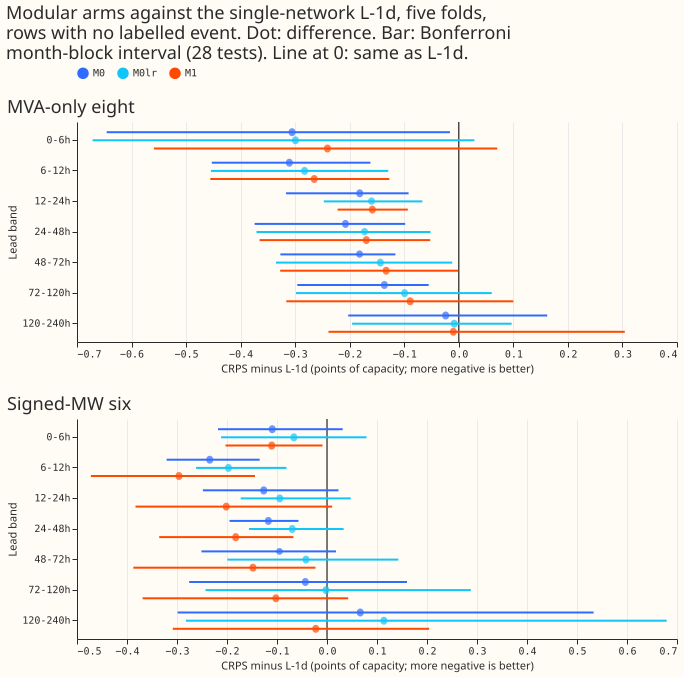
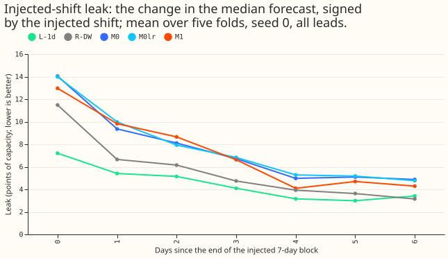

**Splitting the demand neural network into a weather encoder, a datetime encoder, and a mixer
improved the forecast one to five days ahead at the eight primary substations whose readings are in
MVA (apparent power) by 0.14 to 0.21 points of capacity (CRPS, lower is better), against the single
multilayer neural network L-1d. The network used no past power as input. Most of that gain stayed
when the new mixer learned at the same rate as L-1d. The network also has a higher point estimate
of the injected-shift leak (7.6 against 4.49 points of capacity, with overlapping fold ranges), and
more than half of the gain at the eight comes from one substation, D8.** The auxiliary heads did
not help at the eight.

We asked whether a neural network built from three parts forecasts better than L-1d, the
single-network daily-refit forecaster of [experiment
511](../00511-lagless-network-refit-cadence-half-life-and-mixed-pretraining/result.md). The weather
encoder sees only the forecast weather and the substation's embedding. The datetime encoder sees
only the calendar, the holidays, and the sun's position. A mixer joins the two. The network is
first trained on estimates of past weather (ERA5 and CAMS), with a mixer that sees nothing else.
That mixer is then discarded. A new mixer, which also sees the spread of the ECMWF ENS ensemble
weather forecast and the lead time, is trained on ENS forecasts. A second network (M1) adds a small
forecasting head after each encoder. Every arm refits daily with a recency weight that halves every
90 days, and averages 2 seeds, as L-1d does. Scores are the continuous ranked probability score
(CRPS) in points of effective capacity, on rows with no labelled event. "The eight" are the MVA-only
primary substations and "the six" are the signed-MW primary substations.

Verdict: partly supported. The modular network without auxiliary heads (M0) forecast better than
L-1d, where prediction P1 expected it within 0.05 points. M1 did not beat M0, so prediction P2
failed. The decision rule bounds the injected-shift leak at L-1d's 4.49 plus 0.5, and every modular
arm's point estimate exceeds that.

## Arms and prediction results

- **M0:** weather encoder, datetime encoder, and mixer, with no auxiliary heads.
- **M1:** M0 plus an auxiliary mixture head after each encoder, each with weight 0.25.
- **M0lr (post hoc control, added after M0 scored):** M0 with the fresh mixer's learning rate set to
  L-1d's fine-tuning rate, 2e-4, instead of 5e-4.
- **M2 (not run):** one pooled network over the Primaries and the bulk and grid supply points.
  The input matrices and cleaned-power stack hold the 16 Primaries only, and building them for the
  four supply points is a data-preparation task.

**Prediction P1 (M0 within 0.05 of L-1d at 24-120 h at the eight) failed in the better direction.**
M0 was 0.208, 0.182, and 0.137 better than L-1d.

**Prediction P2 (M1 beats L-1d by at least 0.05 in each of the three bands) failed.** M1 beat L-1d
by 0.170, 0.133, and 0.089, but its interval at 72-120 h includes zero and its leak is 7.30. The
stop rule (M0 more than 0.05 worse than L-1d) did not fire.

## Results

The table shows CRPS at the eight, the mean of 5 folds and 2 seeds. Each arm row adds, in
brackets, the contrast against L-1d (negative is better), its Bonferroni month-block interval, and
the number of folds in which the arm is worse. The bootstrap has 5 month blocks, which is near
min-to-max, and 28 tests are counted (2 counted contrasts, M0 and M1 against L-1d, times 7 lead
bands times 2 sets). The leak column is the
injected-shift leak of [experiment
511](../00511-lagless-network-refit-cadence-half-life-and-mixed-pretraining/result.md)'s stress
world (seed 0, all leads, points of capacity), whose fold ranges are 2.59 to 10.47 for L-1d, 2.44
to 17.48 for M0, 2.74 to 16.75 for M0lr, and 1.72 to 16.13 for M1. The minimum detectable effect is
0.134 at 24-48 h, 0.139 at 48-72 h, and 0.101 at 72-120 h.

| Arm | 24-48 h | 48-72 h | 72-120 h | Leak, all leads |
|---|---|---|---|---|
| L-1d | 4.485 | 4.565 | 4.738 | 4.49 |
| M0 | 4.277 (-0.208; -0.374 to -0.098; 0/5) | 4.383 (-0.182; -0.327 to -0.116; 0/5) | 4.601 (-0.137; -0.296 to -0.055; 0/5) | 7.60 |
| M0lr | 4.312 (-0.173; -0.371 to -0.052; 0/5) | 4.421 (-0.144; -0.335 to -0.012; 0/5) | 4.638 (-0.100; -0.298 to +0.060; 1/5) | 7.71 |
| M1 | 4.316 (-0.170; -0.365 to -0.053; 0/5) | 4.431 (-0.133; -0.327 to -0.001; 1/5) | 4.649 (-0.089; -0.316 to +0.100; 1/5) | 7.30 |
| R-DW (experiment 539, L-1d plus day-ago and week-ago power) | 4.266 | 4.363 | 4.572 | 5.68 |
| A-pool (experiment 425, lagged power) | 4.197 | 4.311 | 4.538 | not run |

**Most of the gain is not the learning rate.** M0lr keeps 0.173, 0.144, and 0.100 of M0's 0.208,
0.182, and 0.137, and M0 minus M0lr is -0.035, -0.038, and -0.037 (the interval excludes zero only
at 24-48 h, by 0.002). M0 reads no power, yet lands near R-DW, which reads day-ago and week-ago
power.

**The learning rate does not explain the higher leak.** M0lr leaks 7.71, almost M0's 7.60. The
leak could come from the fresh mixer or from the separate encoders, and this experiment cannot
tell which.

**At the six signed-MW Primaries, the gain is smaller and less certain.** At the six, M0 minus L-1d
is -0.117, -0.095, and -0.043 and the intervals include zero except at 24-48 h; M1 is -0.183,
-0.148, and -0.102 there.

**One Primary carries about half of the gain at the eight.** Leaving D8 out, M0's mean contrast over
24-120 h falls from -0.166 to -0.071, M0lr's from -0.129 to -0.043, and M1's from -0.121 to -0.021.
Leaving any other Primary out leaves M0 between -0.163 and -0.209. The sign holds at 7 of 8
Primaries for M0 and M0lr and at 5 of 8 for M1. D15 and D18 (report-only) show M0 scoring 9.891 over
all leads against 10.876 for L-1d.

## Checks

- **Inputs, with no power or target-time quantity.** The weather encoder reads the 7 ensemble-mean
  columns `mean_shortwave`, `mean_longwave`, `mean_temperature_2m`, `mean_dew_point_temperature_2m`,
  `mean_pressure_surface`, `mean_precipitation`, and `mean_wind_speed_10m`, plus the 8-wide
  substation embedding. The datetime encoder reads `cos_zenith`, `sin_azimuth`, `cos_azimuth`,
  `sin_hour`, `cos_hour`, `sin_hour_2`, `cos_hour_2`, `dow_1` to `dow_7`, `covid`,
  `christmas_inside`, `christmas_days`, `christmas_tent`, `bank_holiday`, `nearest_days`, and
  `nearest_inside`, plus the embedding. The fine-tuning mixer reads both encoder outputs, the
  embedding, the 7 ensemble-spread columns `std_*`, and `lead` and `lead_sqrt`. None is derived from
  power; the 9 lag columns are removed (`non_lag_layout`), and the only target-time inputs are the
  calendar and sun position of the target half-hour, which a forecast made at the origin knows.
- **Origin-time weather, asserted row by row.** For every test origin (153) the script asserts
  `nwp_init_time <= power_fcst_init_time`, `power_fcst_init_time == origin`, and that the
  weather-run summary file exists; for every training origin it asserts the file exists 9 hours
  before the origin and that the target is after the origin (check totals in `checks_M0.json`).
  Example, 2025-10 test row: target 2025-10-03 07:00 UTC, origin 2025-10-01 09:00 UTC, weather run
  2025-10-01 00:00 UTC.
- **Audit triggers** (the skill's seven conditions that call for an independent audit before
  merge). None fired: P1's contradiction was tested by M0lr and recorded; D8 shrinks the gain
  without flipping its sign; M1 does not beat M0 in the 24-120 h bands, and its gap to M0 there is
  inside the interval. No audit ran. The skill also asks for the median minus mean forecast per site
  and for the contrast on the error of the mean forecast; neither was computed, because the stored
  forecasts hold quantiles only.
- **Not done.** No forecast-example figure was drawn. The rebuilt K2-S1 (experiment 541) had no
  stored predictions when scored. The fresh mixer's initialisation is the same for every seed (seed
  12345), so seed spread excludes mixer-initialisation variance. Only one learning-rate control was
  run.

## What the next experiment should answer

Which part of the modular network makes it follow recent data harder (the fresh mixer, or encoders
that see weather and calendar apart), and does the gain at the eight hold without D8. Compute used:
about 1.2 GPU-hours in all (pretraining, fits, and stress runs of M0, M1, and
M0lr).

The code is in `ml-experiments/00545-modular-lag-free-demand-network-weather-and-datetime-encoders/`
and reuses experiments 397, 428, 448, 510, 511, and 539 (the scorer and the stress script).
