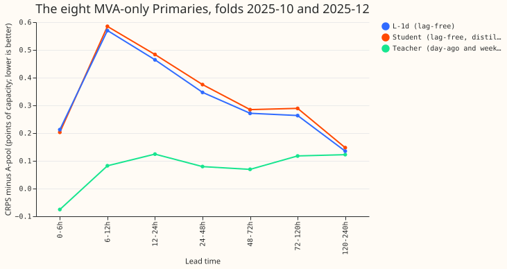

**A demand network that sees no recent power did not learn what a network with day-ago and
week-ago power knows, even when trained on that network's forecasts, so the lags must stay an input
at forecast time.** We asked whether a lag-free "student" network could be taught by a "teacher"
network that reads the power from the same half-hour a day ago and a week ago. The student was
fine-tuned on a loss that gave half its weight to the real target and half to draws from the
teacher's forecast distribution. The teacher is R-DW of experiment 539, which closed 76% to 83% of
the gap between the lag-free network L-1d and A-pool. The student follows
[experiment 511](../00511-lagless-network-refit-cadence-half-life-and-mixed-pretraining/result.md)'s
L-1d recipe, with the same rows and the same pretrained weights. The idea is knowledge distillation
([Hinton et al., 2015](https://doi.org/10.48550/arXiv.1503.02531)).

Verdict: refuted. At the eight MVA-only Primaries the student scored 0.028, 0.013, and 0.026 points
of capacity (CRPS) worse than L-1d at 24-48 h, 48-72 h, and 72-120 h, so it closed a negative share
(-8%, -5%, and -10%) of L-1d's gap to A-pool. The pre-registered stop rule (under 15% on the first
2 folds) ended the experiment after folds 2025-10 and 2025-12. The other 3 folds, the injected-shift
leak, and the rebuilt K2-S1 comparison were not run. Every number is interim and unaudited.

## Results (first 2 folds, the eight)

- Student minus L-1d: +0.028 (24-48 h), +0.013 (48-72 h), +0.026 (72-120 h), +0.012 (120-240 h).
  Intervals are month-block bootstrap with 2 blocks (the range of the 2 folds): 0.017 to 0.039,
  0.003 to 0.023, 0.011 to 0.041, and -0.001 to 0.026. Both folds are positive, except at 120-240 h
  (1 of 2). The minimum detectable effect is 0.21, 0.21, 0.15, and 0.18, so the differences are
  far below what the experiment could resolve; they show no gain, not a loss.
- Absolute CRPS at 24-48 h: student 4.552, L-1d 4.524, teacher 4.257, A-pool 4.177. At 72-120 h:
  4.753, 4.727, 4.581, 4.464.
- At the six (signed MW) the student is also 0.027 to 0.052 worse than L-1d at 24 to 240 h.
- The Bonferroni count is 28 for the counted contrasts of this scoring script. No interval here
  was widened to it, and the claim does not rest on one.

## Checks and caveats

- Weather input for every row comes from the run issued at or before the forecast origin, asserted
  row by row for 62 test origins and all training origins. Example: target 2025-10-03 07:00 UTC,
  origin 2025-10-01 09:00 UTC, weather run 2025-10-01 00:00 UTC. The teacher's lags were observed at
  or before origin minus 3.5 h, also asserted per row. The student has no lag column.
- The teacher fitted on the same rows it labels, so its forecast on them is sharper than on new
  rows. The 0.5 weight on the real target limits the effect. A student cannot beat an honest teacher
  and did not match it.
- Median-minus-mean forecast, tail scores, and the leak were not computed because the experiment
  stopped. No audit trigger was tested beyond the prediction itself: a refuted prediction has one
  untested explanation, that the lag information is not recoverable from the weather and calendar
  inputs. One seed pair, one teacher weight (0.5), and one loss form were tried.
- Cost: about 0.15 GPU-h for the 2 folds. Code review: one Sonnet review, all five findings
  triaged (four applied, one a design note).

## What the next experiment should answer

Whether a robust same-slot summary (the median of the same half-hour over the last 4 weeks) keeps
the lags' gain with a smaller injected load-shift leak than the 5.68 points of the day-ago and
week-ago lags.
