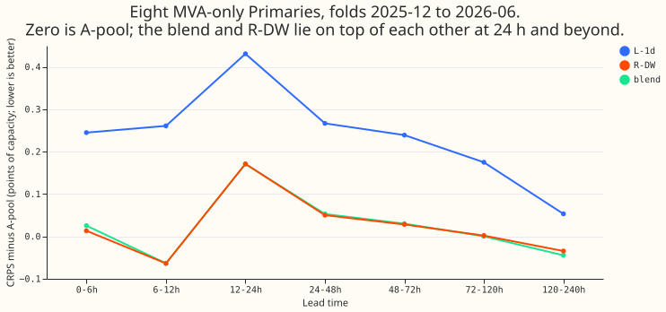
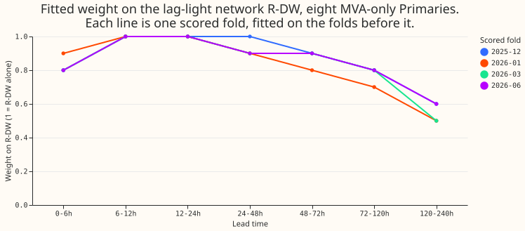
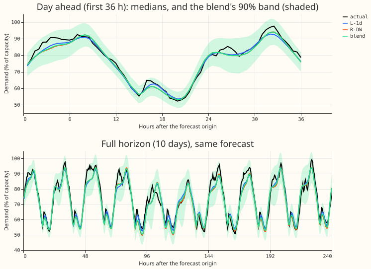

**Averaging the lag-free network L-1d with the lag-light network R-DW, with a fixed weight per lead
band, forecasts no better than R-DW alone.** We asked whether the two networks make different
enough errors that their blend beats both. The blend averages the 11 stored quantiles of each
network (mixture parameters are not stored), with the weight on R-DW fitted on the earlier folds
and applied to the next. Nothing was fitted except the weights, and no new forecasts were made.

Verdict: not supported. At the eight MVA-only Primaries and 24-120 h, the blend scored 4.404
points of capacity (CRPS) against R-DW's 4.403 and L-1d's 4.597. The pre-registered gain was at
least 0.05 below both parents in each of 24-48 h, 48-72 h, and 72-120 h, and the gain over R-DW was
+0.003, +0.002, and -0.002 in those bands. The first fold (2025-10) supplies weights only, so
everything below is the four folds 2025-12, 2026-01, 2026-03, and 2026-06. July 2026 is unused.
Every number is interim and unaudited.

## Results (four scored folds)

- **Eight, blend minus R-DW:** +0.003 (24-48 h), +0.002 (48-72 h), -0.002 (72-120 h), +0.000 (24-120
  h). The 24-120 h interval is -0.018 to +0.013 (month-block bootstrap, 4 blocks, near min-to-max),
  with 3 of 4 folds positive (the blend worse) and an MDE of 0.04. The difference is far below both
  the 0.05 goal and what the experiment could resolve.
- **Eight, blend minus L-1d:** -0.19 at 24-120 h (interval -0.28 to -0.11, 0 of 4 folds positive);
  this is R-DW's own gain over L-1d, not a gain from blending.
- **Six (signed MW, rows with no labelled event):** blend minus R-DW is -0.001 to -0.004 in each of
  the three bands (-0.002 at 24-120 h, interval -0.016 to 0.006, MDE 0.08); blend minus L-1d is
  -0.06 at 24-120 h.
- **Weights:** at the eight the fitted weight on R-DW is 1.0 at 6-24 h, 0.9 at 24-72 h, 0.7 to 0.8
  at 72-120 h, and 0.5 to 0.6 at 120-240 h (figure 2). At 120-240 h the blend is -0.010 from R-DW
  (interval -0.064 to 0.052).
- **A fixed half-half blend** is worse than R-DW at the eight (+0.041 at 24-120 h, interval 0.006
  to 0.086): equal weights move the forecast towards the worse network.
- **Versus A-pool** at the eight, 24-120 h: blend +0.021 (interval -0.027 to 0.061).
- **Cold winter nights (eight, 24-120 h, 13,092 rows):** blend 3.976, R-DW 3.945, L-1d 4.318.
  **22-31 December (fold 2025-12 only, 15,360 rows):** blend 3.987, R-DW 4.062, L-1d 3.975.
- **Tails (eight, 24-120 h, blend):** coverage at q01 0.25%, q05 1.5%, q95 96.2%, q99 99.4%, so
  the 1.15 widening leaves the bands slightly too wide.
- **D15 and D18 (report-only), 24-120 h:** blend minus R-DW +0.084 (folds -0.16, +0.14, +0.33,
  0.00); blend minus L-1d -0.92.
- Counted tests: 28 (2 contrasts x 7 bands x 2 sets). No interval above is widened to that count,
  and no claim rests on one.

## Checks and caveats

- Weather inputs: none are read here. Both networks used the weather run issued at or before the
  forecast origin, asserted row by row in experiment 539's checks. This script asserts that every
  weight was fitted on earlier folds only and prints one example row: fold 2025-12, Primary 0,
  origin index 109602, target index 109705 (lead 51.5 h), weight 0.9, L-1d median 0.786, R-DW
  median 0.791, blend median 0.790, actual 0.892 (fractions of capacity).
- The parents' CRPS recomputed from the stored quantiles matches experiment 539's stored per-row
  CRPS to under 0.01 on every row (asserted).
- The weights come from quantile averaging, a scored-fold-by-fold walk-forward on four
  non-contiguous months, so earlier folds are not always the same season. Four month blocks are
  near the min-to-max of the folds.
- The first fold is not scored. The MDE comes from the two seeds of each parent, blended with the
  same weights.
- The avoidable-curtailment cost was not computed. The related experiment 458 (a weight per lead
  band on the lag-free forecast in a lagged and lag-free mixture) also found no gain.
- Code review: one Sonnet review of the pull request, findings triaged in the pull request.
- Cost: no GPU, under 1 minute on 2 cores.

## What the next experiment should answer

Whether a blend of R-DW with a network of a different kind, such as K2-S1 rebuilt on origin-time
weather (experiment 541), has errors different enough to give the 0.05 gain.
