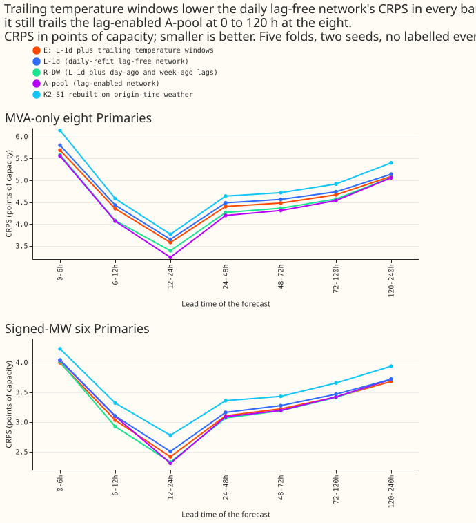
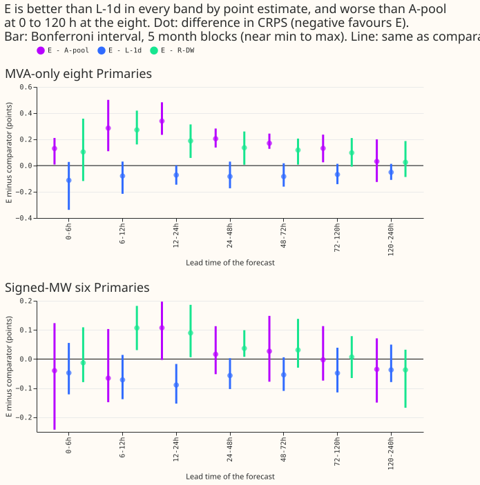
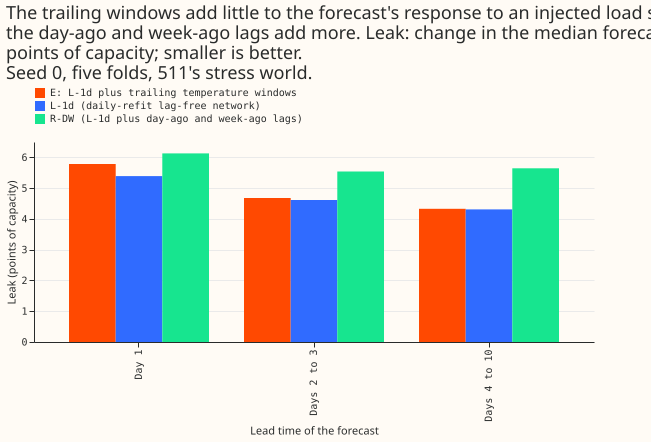

**Take-home message: adding recent temperature to the daily-refit neural network that sees no recent
power lowered its error a little in every lead band, although no interval excluded zero. At 120 to
240 hours ahead its error was inside the minimum detectable effect of the same neural network
given recent power. At 0 to 120 hours ahead, for the eight Primaries metered in MVA only, its CRPS
stayed 0.13 to 0.34 points of capacity worse.** The verdict is partly supported by the predictions
below: the pattern predicted (a gap at 24 to 48 hours, none at 120 to 240 hours) held, and the size
predicted for the temperature columns' gain narrowly missed.

We asked how good a demand forecast can be when its neural network sees no recent power (it is
"lag-free"), only weather that was known at the forecast origin. We assembled the parts that earlier
experiments had found useful: pretraining
on past weather estimates, a refit every day with a 90-day half-life, three columns holding the mean
temperature over the last 6, 24, and 72 hours ([experiment
526](../00526-lagless-demand-network-trailing-weather-window-placebo-repeat/result.md)), and bands
widened by 15% at scoring. We scored the result on the five test months of [experiment
511](../00511-lagless-network-refit-cadence-half-life-and-mixed-pretraining/result.md) against the
same neural network without the temperature columns (L-1d), the neural network that also sees recent
power (A-pool), the neural network with only the day-ago and week-ago power lags (R-DW, [experiment
539](../00540-lag-gap-what-closes-the-gap-to-lag-enabled-models/result.md)),
and the rebuilt K2-S1 (a mixture of lagged and lag-free neural networks) of [experiment
541](../00541-k2-s1-rebuilt-on-origin-time-weather/result.md).

**Terms.** E is the assembled neural network. The eight are the eight Primary substations with
MVA-only (megavolt-ampere, unsigned) telemetry, and the six are the six with signed-MW telemetry.
D15 and D18 are two further Primaries with short histories, reported separately. CRPS is the
continuous ranked probability score in points of capacity (percentage points of a substation's
capacity; smaller is better). A-pool is [experiment
425](../00425-best-mdn-architecture-assembly-with-ablations/result.md)'s arm A as scored in
experiments
533 and 537. Each row is one forecast of one Primary's power for one valid time from one forecast
origin. The scored set holds 1,142,520 rows with no labelled event, from the five test months of
experiment 511. July 2026 was not used.

**How intervals are built.** Each interval resamples whole months in five blocks, so it spans nearly
the minimum to the maximum of the folds (a fold is one test month). It is widened for 42 counted
comparisons (3 contrasts, 7 lead bands, 2 row sets), which is the Bonferroni correction. The minimum
detectable effect (MDE) is the smallest difference between two networks that the spread between the
two seeds, over the folds, could reliably resolve; a difference inside the MDE is not shown.

## Predictions (written before any score was read)

- **P1, met; the gap at 24 to 48 h was smaller than predicted.** E minus A-pool at the eight is
+0.031
  at 120 to 240 h (interval -0.125 to +0.200, MDE 0.16), inside the MDE. At 24 to 48 h it is +0.205
  (+0.138 to +0.283, MDE 0.13), above the MDE but below the predicted +0.23 to +0.27.
- **P2, narrow miss.** E minus L-1d at the eight is -0.083 and -0.084 at 24 to 48 h and 48 to 72 h,
  just outside the predicted -0.08 to 0.00; the other bands from 24 h are inside it. No interval at
  the eight excludes zero, as predicted.
- **P3, met.** E minus the rebuilt K2-S1 at 120 to 240 h at the eight is -0.310 (-0.584 to +0.058),
  not shown different from zero (1 of 5 folds positive).
- **P4, met.** The injected-shift leak of E is 4.55 points of capacity over all leads, against 4.49
  for L-1d (threshold 4.99) and 5.68 for R-DW.

## Scores

Absolute CRPS, all leads (points of capacity):

| Set | E | L-1d | R-DW | A-pool | Rebuilt K2-S1 |
|---|---|---|---|---|---|
| Eight | 4.790 | 4.855 | 4.713 | 4.682 | 5.068 |
| Eight, cold winter nights | 4.309 | 4.479 | 4.270 | 4.161 | 5.035 |
| Six | 3.446 | 3.493 | 3.449 | 3.457 | 3.698 |
| D15 and D18 (report-only) | 10.816 | 10.876 | 10.004 | 10.652 | 12.195 |

E minus comparator at the eight (difference, Bonferroni interval; folds where E is worse; MDE):

| Band | E - L-1d | E - A-pool | E - R-DW |
|---|---|---|---|
| 0-6h | -0.113 (-0.338, +0.028; 1/5; 0.27) | +0.130 (+0.008, +0.211; 4/5; 0.27) | +0.104 (-0.118, +0.358; 3/5; 0.27) |
| 6-12h | -0.079 (-0.215, +0.031; 2/5; 0.20) | +0.286 (+0.109, +0.501; 5/5; 0.20) | +0.272 (+0.161, +0.419; 5/5; 0.20) |
| 12-24h | -0.072 (-0.146, +0.001; 1/5; 0.17) | +0.340 (+0.235, +0.483; 5/5; 0.17) | +0.188 (+0.058, +0.314; 5/5; 0.17) |
| 24-48h | -0.083 (-0.173, +0.030; 1/5; 0.13) | +0.205 (+0.138, +0.283; 5/5; 0.13) | +0.136 (+0.006, +0.260; 4/5; 0.13) |
| 48-72h | -0.084 (-0.161, +0.017; 1/5; 0.14) | +0.170 (+0.128, +0.244; 5/5; 0.14) | +0.118 (+0.007, +0.206; 4/5; 0.14) |
| 72-120h | -0.068 (-0.142, +0.013; 1/5; 0.10) | +0.132 (+0.025, +0.236; 5/5; 0.10) | +0.098 (-0.008, +0.210; 4/5; 0.10) |
| 120-240h | -0.051 (-0.109, +0.013; 1/5; 0.16) | +0.031 (-0.125, +0.200; 3/5; 0.16) | +0.025 (-0.087, +0.187; 2/5; 0.16) |

**At the six, the temperature columns' gain is similar and still not resolved.** E minus L-1d is
-0.037 to -0.089 in every band, and E minus A-pool is within +/-0.11 (inside the MDE in every band
except 12 to 24 h, where +0.107 exceeds an MDE of 0.107 by 0.0005, with an interval of -0.003 to
+0.197). The only E minus L-1d interval that excludes zero is 12 to 24 h (-0.089, -0.153 to -0.017).
E minus R-DW excludes zero at 6 to 12 h, 12 to 24 h, and 24 to 48 h. The full tables are in this
experiment's private `scores/` folder.

- **Cold winter nights, the eight (report-only, no correction).** Only three test months hold cold
  winter nights (2025-12, 2026-01, and 2026-03), so each interval is the minimum to maximum of three
  folds. E minus L-1d is -0.169 over all leads (-0.221 to +0.103; 1 of 3 folds positive), which is
  about 2.6 times the -0.065 over all rows and is not shown different from zero. E minus A-pool is
  +0.148 (+0.076 to +0.207), a larger gap than over all rows.
- **Tails, the eight.** The q95 and q99 pinball loss of E minus L-1d is within 0.013 of zero in
every
  band (q99 within 0.007). The share of rows below the q95 forecast is 0.967 for E, 0.968 for L-1d,
  and 0.952 for A-pool. The widened bands of E and L-1d are therefore somewhat wide at the top.
- **Fold signs, the eight, E minus L-1d over all leads:** -0.136 (2025-10), -0.027 (2025-12),
  -0.082 (2026-01), +0.024 (2026-03), -0.109 (2026-06).

## Method

- **Arm E.** Experiment 511's L-1d (daily refit at 00:00 UTC, 90-day half-life, two seeds, five
folds)
  with three columns appended after the 37 lag-free columns: the mean ensemble temperature over the
  6,
  24, and 72 hours ending at the valid time (experiment 515's `previous`-seam tables). Code reused
  from the folders of experiments 397, 428, 510, 511, 515, 521, and 539. Weights stored under this
  experiment's private data folder.
- **Pretraining.** E starts from W-T pretrained weights: experiments 515 and 526's for 2025-12,
  2026-01, and 2026-03, and this experiment's for 2025-10 and 2026-06 (same code). L-1d starts from
  experiment 510's pretrained weights, so the E minus L-1d contrast measures the temperature
  columns and the new pretrained weights together. W-T is experiment 515's name for the three
  columns.
- **Origin-time weather, row by row.** Every training and test row's weather run was issued 9 h
  before its origin and the target follows the origin (asserted for all 24,979,347 training rows and
  1,142,520 test rows; `nwp_init_time <= power_fcst_init_time` for all rows of all 153 test
  origins).
  The window columns use only that run and earlier runs. Example (2025-12 test row): origin
  2025-12-31 09:00 UTC, target 2026-01-08 08:30 UTC, weather run 2025-12-31 00:00 UTC.
- **Dropped, with reasons.** The four-head mixture, because experiment 527 found head count does not
  explain the gap. Per-lead widening, because experiment 523 found at most 0.024 points from it. A
  two-stage ensemble calibrator, because no stored follow-up of experiment 524 supports it.
- **Not scored.** Experiment 526's ten winter folds hold no L-1d, A-pool, or R-DW scores.

## Checks

- **Median minus mean forecast, and the error of the mean forecast beside CRPS:** not computed. The
  fitted forecasts store 11 quantiles and no mean column, so audit trigger 3 of the `ml-experiment`
  skill (the quantile and mean contrasts pointing in
  different directions) cannot be assessed.
- **Triggers fired:** the miss on P2 (audit trigger 2, a result contradicting its prediction) is
  0.003 to 0.004 points. Its likely explanation is that E also starts from different pretrained
  weights than L-1d; this was not tested. No audit was run. Leave-one-fold-out checks
  were not run; the fold signs above show E minus L-1d negative in 4 of 5 folds.
- **Caveats.** Two seeds, five folds, one stress seed. The comparison with L-1d mixes the windows
  with new pretrained weights. Labelled events are incomplete: the logs of National Grid Electricity
  Distribution (NGED) may miss events, so rows
  with no labelled event may still hold one. No example-forecast figure is included because arm E
  stores forecasts without the actual power; experiments 511 and 523 show the day-ahead and
  14-day forecasts of the same network without the windows.
- **Lead range.** The forecasts cover 0 to 240 h, which spans the NGED 1 to 10 day horizon.

## Open question after this experiment

The data does not say whether a neural network with both the temperature columns and the day-ago
and week-ago power lags would close the 0 to 120 hour gap with less injected-shift leak than R-DW
has. Down-weighting lags near a flagged event is one way to test it.
