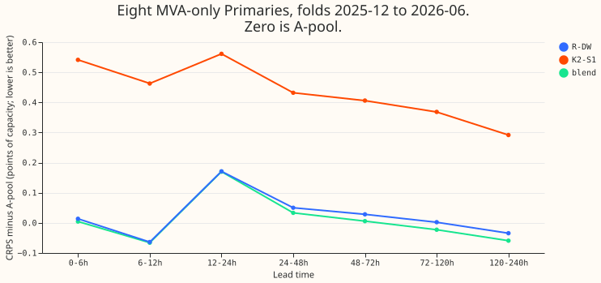

**Averaging R-DW with the retrained K2-S1 gains 0.022 points of capacity at 1 to 5 days, under the
0.05
we asked for, and no stored blend of climatology into a demand network helped at 5 to 10 days.**
Part 1 asks whether two demand networks of different kinds make errors that cancel. Part 2 asks
whether earlier experiments found that climatology helps at long lead. The result is `partly
supported` for Part 1; Part 2 stops, as pre-registered. Every number is interim and unaudited.

## Part 1: blend of R-DW and the retrained K2-S1

The blend averages the 11 stored quantiles of R-DW (experiment 539) and of each of the three cells of the retrained
K2-S1 ([experiment 541](../00541-k2-s1-rebuilt-on-origin-time-weather/result.md), heads trained on
origin-time weather), with the weight on K2-S1 fitted per group and lead band on earlier folds only.
The code is a copy of [experiment
547](../00547-lag-light-and-lag-free-blend-by-lead-band-stored-forecasts/result.md)'s
(`ml-experiments/00549-k2-s1-blend-and-climatology-stored-check/`). CRPS is in points of capacity,
on rows with no labelled event, for the four folds 2025-12, 2026-01, 2026-03, and 2026-06; the first
fold (2025-10) only supplies weights. July 2026 is unused.

- **Eight, 24-120 h:** blend 4.381, R-DW 4.403, K2-S1 4.776, A-pool 4.382. Blend minus R-DW -0.022
  (month-block interval -0.037 to -0.006, 4 blocks, near min-to-max), per-fold signs -0.035, -0.038,
  +0.003, -0.019. The cell-to-cell minimum detectable effect is 0.011. Blend minus K2-S1 is -0.395
  (-0.599 to -0.243), a difference that reflects K2-S1's own deficit, not a blending gain.
- **Pre-registered rule:** the gain must be at least 0.05 below both parents. The blend is 0.022
  below R-DW,
  so the verdict is `partly supported` (below -0.02, so not `not supported`).
- **By band at the eight, blend minus R-DW:** -0.009 (0-6 h), -0.002 (6-12 h), -0.001 (12-24 h),
  -0.017 (24-48 h), -0.023 (48-72 h), -0.025 (72-120 h), -0.025 (120-240 h; interval -0.046 to
  +0.008). The gain is largest at 2 to 10 days, and it never reaches 0.05.
- **Weights:** the fitted weight on K2-S1 is 0.0 to 0.2 at 0-24 h and 0.1 to 0.2 beyond. K2-S1 alone
  is 0.37 worse than R-DW at 24-120 h (0.21 to 0.56).
- **Six (signed MW):** blend minus R-DW -0.030 at 24-120 h (-0.082 to +0.006, MDE 0.020; folds
  -0.110, +0.016, -0.001, -0.026). Blend minus A-pool is -0.049 (-0.085 to -0.020).
- **A half-and-half blend** is worse than R-DW at the eight (+0.037, -0.008 to +0.079).
- **Tails (eight, 24-120 h, 184,393 rows):** the share of actuals below q01 is 0.24% (nominal 1%)
  and
  below q05 is 1.6% (nominal 5%); below q95 is 95.9% and below q99 is 99.4%. Only 0.24% of actuals
  fall below q01 and 1.6% below q05, so the lower quantiles sit too low and the lower tail is too
  wide.
- **D15 and D18 (report-only):** the blend is 0.42 worse than R-DW (0.015 to 0.99), on short
  history.
- **Counted tests:** 28 (2 contrasts x 7 bands x 2 sets). No interval above is widened to that
  count.
  The MDE reflects the three cells of K2-S1 only, with R-DW held at its seed average, so the minimum
  detectable effect understates the noise.

## Part 2: stored blends with climatology or a calendar-only forecast

| Experiment | What was blended | Where | Result at long lead | Weather issued at or before the forecast origin? |
|---|---|---|---|---|
| [262](../00262-wind-aifs-members-and-climatology-by-lead/result.md) | Climatology by lead day into the ECMWF wind members | 3 metered wind farms (not Primaries), days 7 and later | Helped by 0.45 without the offset table, 0.08 (-0.48 to +0.23) with it | Yes, assuming the run is available at 09:00 UTC |
| 528 (interim files only, no page) | Gate between the lag-free network and a calendar-only mixture (S2-G) | Eight and six, five folds, all seven lead bands | Worse than L-Ww at every band, +0.46 (eight) and +0.52 (six) at 120-240 h; gate collapsed to calendar-only | Yes (the L-Ww contrasts do not use K2-S1, so the K2-S1 correction does not touch them) |
| [319](../00319-primary-demand-default-1-solar-summary-and-heuristic-blend-at-7-to-10-days/result.md) and [322](../00322-primary-demand-default-2-daylight-only-heuristic-blend-and-sunshine-graft-replication/result.md) | Manual heuristic (same half-hour in earlier weeks and years), not climatology | Six Primaries on the convex GAM chain, 168-240 h | 319: all-hours blend helped by 0.145 and harmed cold winter nights by 0.076. 322: daylight-only blend helped by 0.075 with no harm on cold winter nights | Yes (origin 09:00 UTC) |

Two further pages do not blend: [experiment
329](../00329-primary-demand-default-3-member-solar-distribution-at-7-to-10-days/result.md) planned
a climatology of the solar response but did not run, because the gap it targeted was already closed,
and [experiment 317](../00317-primary-demand-default-1-at-7-to-10-days/result.md) uses climatology
only as a comparator (the research default beats it by 11% to 13% at 168-240 h).

**No stored blend of a calendar-only or climatology forecast into a demand network helped by 0.05 at
120-240 h, so Part 2 stops and the two proposed arms (an auxiliary climatology head and
weather-input
dropout) have no stored evidence.** The only blend in the table that helped by 0.05 at these leads,
the manual-heuristic blend of experiments 319 and 322, mixes in a forecast built from recent power
history, not a calendar-only table, and was scored on the GAM chain. Its all-hours form harmed cold
winter nights. The wind gain in experiment 262 (0.45, or 0.08 with an interval including zero once
the offset table was applied) is at three wind farms, not Primaries. The stored evidence covers
168-240 h (319, 322, 329, 317) and day 7 onwards (262), not 120-168 h. The blend in experiment 528
did
not carry a pre-registered comparison to climatology itself, and its numbers have no reviewed page.

## Checks and caveats

- **Weather inputs:** none are read here. Both networks used the weather run issued at or before the
  forecast origin (R-DW in experiment 539, K2-S1 in experiment 541). The script asserts that
  `target > origin` on every row and that each weight was fitted on earlier folds only. Example
  row: fold 2025-12, Primary 0, origin index 109602, target index 109705 (lead 51.5 h), weight on
  K2-S1 0.2, R-DW median 0.791, K2-S1 cell 0 median 0.813, blend median 0.795, actual 0.892
  (fractions of capacity).
- **Reproduction:** blending at weight 0 and 1 reproduces the stored R-DW and K2-S1 per-row CRPS to
  under 0.01 on every row (asserted). The scored rows are those of experiment 541 (about 227,000 per
  fold), fewer than experiment 547's, so numbers are not comparable across the two pages.
- **Review:** one Sonnet code review before the run. Accepted: print the row counts (all rows
  survive), assert non-empty training selections, and set the MDE to NaN for contrasts it does not
  cover. Rejected: writing NaN to unscored rows (the `main16` filter protects every table here).
- **Cost:** no GPU, 38 seconds on 2 cores. July 2026 unused. Labels are incomplete, so clean rows
  may
  hold unlabelled events.

## What the next experiment should answer

Nothing follows from Part 1 beyond closing the question of blending these two networks. If a gain at
120-240 h is still wanted, the open question is why the monthly lag-free heads beat the daily refit
there (the post-reset queue's items on the monthly lag-free heads).
