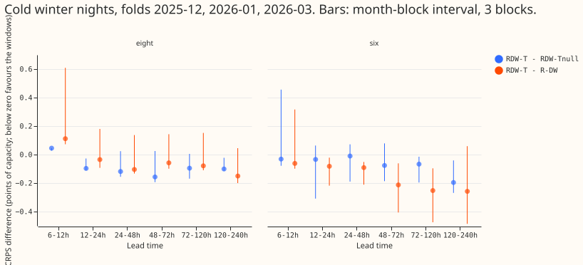
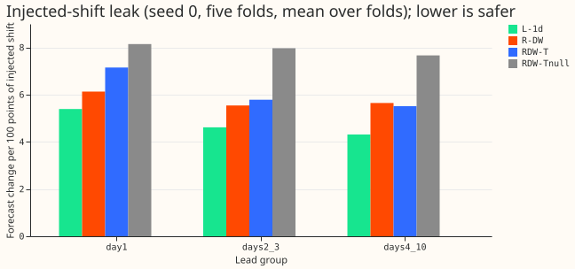

**Three average-temperature inputs still lower the forecast error on cold winter nights, by about
0.10 points of capacity, when the neural network also reads the power from one day and one week
earlier. Over all rows we cannot show any gain.** We asked whether the three trailing temperature
windows of experiment 526 (the average forecast temperature over the 6, 24, and 72 hours before each
half-hour) still lower the error of a demand neural network that already sees the substation's own
power at the same time one day and one week earlier (experiment 539's network, called R-DW, which
is not yet on this site). We trained R-DW twice: once with the real windows (R-DW + W-T) and once
with the same three inputs copied from a different, shuffled day (R-DW + W-Tnull, the placebo), so
that only the real weather information differs. Error is CRPS, the continuous ranked probability
score, in points of capacity: percentage points of each Primary substation's capacity, where lower
is better. Cold winter nights are below 5 degrees C, 18:00 to 08:00, and "the eight" are the
Primary substations that report apparent power (MVA) only. On those nights at the eight, the real
windows score 4.162 and the placebo 4.266. The verdict is `supported` by the rule written before
scoring (a difference of at most -0.05 with an interval excluding zero), with the caveats below. Every
number is interim and unaudited.

- **Pre-registered contrast** (cold nights, below 5 degrees C, 18:00 to 08:00, eight MVA-only
  Primaries, rows with no labelled event): R-DW + W-T minus R-DW + W-Tnull is **-0.104** (month-block
  interval -0.113 to -0.009, 3 blocks, one per winter fold; per-fold signs -0.112, -0.113, -0.009,
  all negative; 32,716 rows). The rule asked for at most -0.05 with an interval excluding zero, and
  both hold. Experiment 526 found -0.093 without the lags.
- **Minimum detectable effect:** 0.212, twice the effect. The interval is narrow only because it
  rests on 3 blocks. Treat the size as uncertain. The size is similar to the -0.093 that experiment
  526 found without the lags, but 526 used more winter folds, so the two are not like for like.
- **By lead band on cold nights, eight:** -0.119 (24-48 h), -0.157 (48-72 h), -0.096 (72-120 h),
  -0.101 (120-240 h; interval -0.114 to -0.023). Intervals at 24-72 h and at 72-120 h (-0.169 to +0.005) include zero; the 12-24 h band is
  -0.110 to -0.027 and the 6-12 h band is positive (+0.045, 2 blocks).
- **All rows, eight:** -0.018 (-0.054 to +0.037), per-fold signs -0.030, -0.044, -0.049, +0.088,
  -0.065. The interval includes zero.
- **Six signed-MW Primaries:** all rows +0.000 (-0.041 to +0.046); cold nights -0.124 (-0.242 to
  -0.028; MDE 0.115).
- **Absolute CRPS (points of capacity), eight, all rows / cold nights:** R-DW + W-T 4.677 / 4.162,
  R-DW + W-Tnull 4.695 / 4.266, R-DW 4.713 / 4.270, L-1d + W-T (experiment 548, arm E) 4.790 /
  4.309, A-pool 4.682 / 4.161, L-1d 4.855 / 4.479, manual_heuristic 5.616 / 6.379. Six, all rows:
  3.386, 3.385, 3.449, 3.446, 3.457, 3.493, 4.717.
- **Against R-DW:** R-DW + W-T minus R-DW is -0.037 (-0.075 to -0.002) at the eight over all rows
  and -0.108 (-0.150 to +0.097) on cold nights. R-DW + W-T minus L-1d + W-T is -0.114 at the eight
  (-0.173 to -0.063): the lags still add to the windows.
- **Seam check of experiment 526** (persistence fill before the origin, 3 winter folds): RDW-seam
  minus R-DW + W-T is +0.003 over all rows (-0.001 to +0.009) and +0.016 on cold nights (+0.003 to
  +0.034). The gain does not come from how the window is filled across the forecast origin.
- **Injected-shift leak** (a 7-day block of shifted power; change in the median forecast per 100
  points of shift, seed 0, five folds): R-DW + W-T 5.7, R-DW + W-Tnull 7.8, R-DW 5.7, L-1d 4.5,
  L-1d + W-T 4.5. The windows do not raise the leak above R-DW's, but the seed-0 ranges across folds are wide
  (about 2.4 to 13), and the placebo's 7.8 is higher by 2 points, so these figures cannot rank the arms.
- **D15 and D18 (report-only):** R-DW + W-T minus R-DW + W-Tnull is +0.061 (-0.325 to +0.428) over
  all rows and -0.016 on cold nights; short history, not scored.
- **Counted tests:** 28 (2 contrasts x 7 bands x 2 site sets, the eight and the six, all-rows slice
  only). The cold-night contrast was pre-registered and is not counted. No interval is widened to that count. Intervals are month-block
  bootstraps, near the minimum to maximum of the folds (5 blocks all rows, 3 cold nights).

## Method

Both arms are experiment 539's R-DW on experiment 511's harness (daily refit at 00:00 UTC, 90-day
weight half-life, ERA5 and CAMS pretraining, 2 seeds, five folds 2025-10, 2025-12, 2026-01, 2026-03,
and 2026-06; July 2026 unused). The window inputs are experiment 515's three W-T columns, appended
after the six lag inputs; the pretraining weights are the lag-free W-T and W-Tnull networks of
experiments 515, 526, and 548, with W-Tnull pretrained here for 2025-10 and 2026-06. The code
copies experiment 539's lag code (not on `main`) and uses the window code of experiment 548. It
lives in `ml-experiments/00550-lag-light-network-trailing-temperature-windows-with-placebo/`. The "winter
folds of 526" are the three winter folds of these five (2025-12, 2026-01, 2026-03).

- **Origin-time weather and lags**, asserted row by row: every day-ago and week-ago lag was observed
  at or before the origin minus the data delay, and the 9-hour-earlier weather-run file exists for
  all 153 test origins. Example: origin 2025-12-01 09:00 UTC, target 2025-12-01 20:00 UTC, lag
  observed 2025-11-30 20:00 UTC; weather run 2025-11-23 00:00 UTC for a training row at origin
  2025-11-23 09:00 UTC.
- **Placebo caveat:** the donor day is a different day of the same calendar month group and day type
  (experiment 515's draw) and can lie after the row's own day, so some placebo window values come
  from a run issued after the origin. The donor day is a different day, so it carries no information about the target. If a later
  donor day helped the placebo at all, the contrast would be understated, not inflated. We did not
  measure that.
- **Unlabelled events:** NGED's event labels are incomplete, so "rows with no labelled event" may
  hold unlabelled load shifts; counts are lower bounds.

## Checks

- **Median forecast minus mean forecast:** not computed; these arms store quantiles only.
- **Error of the mean or median forecast beside the quantile score:** not computed, for the same
  reason.
- **Triggers for an audit** (listed in the `ml-experiment` skill): none fired (the placebo moves the score by 0.018 at the eight,
  inside its interval half-width of about 0.04; the cold-night interval is of the same order as
  experiment 526's). Leave-one-site-out was not run. No audit was run.
- **Not done:** forecast examples, tail coverage, and the curtailment cost are not shown on this
  page.

## Lessons and what the next experiment should answer

The windows keep their cold-night gain beside the lags. The all-rows gain is not shown. The next experiment should add the other winter folds of
experiment 526 (2024-11 to 2025-03 and 2025-11, 2026-02) to the lag-light harness, to lift the
cold-night contrast above its minimum detectable effect.
