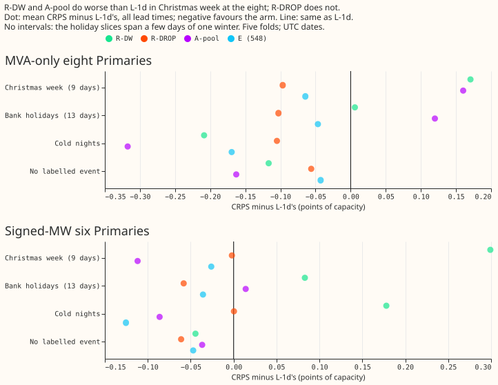
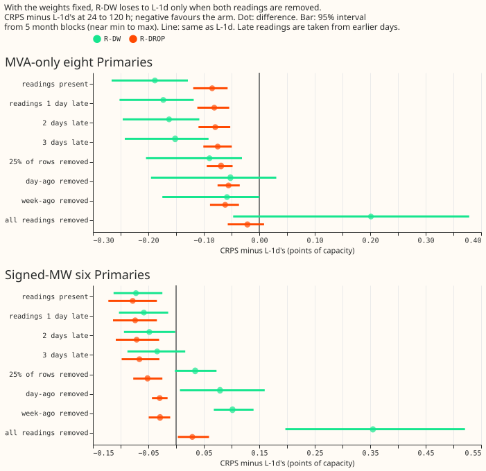

 **No lag input looks ahead of the forecast origin. R-DW fails the Christmas-week limit, and R-DROP
passes every pre-registered test but keeps less of the gain.** The question was whether the
lag-light demand networks R-DW (experiment 539) and R-DROP (experiment 544) are safe to put in a
release. All numbers are interim and unaudited, in points of capacity; lower CRPS is better. Nothing
was refitted.

Verdict: partly supported. P1 held, P2 failed, and P3 held for R-DROP and failed (in the safe
direction) for R-DW.

## Figures

## Results

- **P1, lag-timestamp audit: zero violations.** The audit recomputed each lag's source half-hour
  from its definition, for the day-ago, week-ago, and newest reading, in 34.8 million rows
  (104,481,990 lag checks): the raw summary matrices of all 16 Primaries, and each of the five
  folds' training and test tables. It found 0 sources later than the origin minus 3.5 h, 0 age
  columns that differ from the target minus the source time, 0 missing flags that disagree with the
  cleaned power, and 0 values that differ from the cleaned power (tolerance 1e-5 on raw values, 1e-4
  on standardised tables inverted with the fold's own standardiser; 981,447 rows clipped at 5
  standard deviations are skipped in the built tables and are covered by the raw pass). One row of
  every lag and lead band is printed in `audit_lag_timestamps.json`; for example, a 2026-01-01
  09:00Z origin with target 2026-01-03 05:00Z has its day-ago lag from 2026-01-01 05:00Z (origin
  minus 4.0 h) and its week-ago lag from 2025-12-27 05:00Z. The same standing weather rule holds:
  the 2026-01 test example uses weather run 2026-01-01 00:00Z for origin 2026-01-01 09:00Z, and the
  check that `nwp_init_time` is at or before the origin passed for every test origin.
- **One data-cleaning gap, not look-ahead.** The raw lag matrices still hold D15 and D18 readings
  from before 2025-03-01, which the cleaned power drops (261,287 lag checks). Those two Primaries
  are report-only, so no headline number changes.
- **P2, Christmas week: failed at the eight.** R-DW minus L-1d is +0.171 over 9 target days (24
  December 2025 to 1 January 2026; 5 of 9 days worse; +0.170 and +0.284 in the two folds that hold
  them), above the 0.10 limit and below the 0.2 stop rule. A-pool is +0.160, R-DROP -0.097, and the
  lag-free recipe of experiment 548 -0.065. At the six R-DW is +0.299. With one winter and a few
  days no interval is shown, and the minimum detectable effect (0.12) is the seed spread of all
  rows, so it understates the noise of a slice.
- **Bank holidays.** Christmas Day, Boxing Day, and New Year's Day windows (3 days each) are worse
  for R-DW by +0.36, +0.37, and +0.19 at the eight. Good Friday and Easter Monday windows reach only
  long leads (3 to 10 days), where R-DW is better (-0.37 and -0.85), so they say little about the
  short leads.
- **Cold nights and rows with no labelled event.** R-DW is better than L-1d at the eight (-0.209 and
  -0.117), and worse at the six on cold nights (+0.178). R-DROP is better or equal in both.
- **P3, lag removal (eight, 24-120 h, minimum detectable effect 0.116, Bonferroni count 28).**
  R-DROP with every reading removed minus L-1d is -0.021 (interval -0.057 to +0.009, 5 month blocks,
  near min to max; 1 of 5 folds worse), inside the 0.15 limit in every band (largest upper end
  +0.035). It reproduces experiment 544's stored R-DROP-absent forecasts exactly. R-DW with every
  reading removed is +0.201 (-0.047 to +0.379; 4 of 5 folds worse), +0.390 against its own
  readings-present forecast, so the predicted loss over 0.5 did not occur (largest band 6-12 h,
  +0.342). At the six R-DW is +0.355 and R-DROP +0.029.
- **Partial removal and late reading.** Removing only the day-ago or only the week-ago reading
  leaves R-DW at -0.052 and -0.058 against L-1d. Readings 1, 2, and 3 days late leave R-DW at
  -0.173, -0.163, and -0.152 and R-DROP at -0.081, -0.079, and -0.075, so ageing costs R-DW at most
  0.04 and R-DROP at most 0.01 against their readings-present forecasts. Removing 25% of rows at
  random leaves R-DW at -0.090 and R-DROP at -0.069.
- **Release checklist.** Passed: lag-timestamp and weather audits; removal with R-DROP within 0.15;
  late reading within 0.1. Failed: R-DW in Christmas week (0.10 limit).

## Caveats

- NGED's logs may miss load-shift events, so rows with no labelled event may hold unlabelled events
  and the slices undercount them.
- Christmas week is one winter (9 target days), so a per-year sign cannot be read. D15 and D18 are
  report-only and July 2026 is unused. The six-Primary holiday windows are signed-MW rows with no
  labelled event.
- Part 3 scores the stored networks with their readings altered at inference only. A network trained
  to expect late readings may do better.

## What the next experiment should answer

Does R-DW with the week-ago reading replaced by a holiday-aware reading, or with its readings
switched off on public holidays, remove the Christmas-week loss and keep the gain?

## Code

`ml-experiments/00551-*/`: `e00551_audit.py` (Part 1), `e00551_calendar.py` (Part 2),
`e00551_removal.py`, `e00551_rows.py`, and `e00551_score.py` (Part 3), `e00551_figures.py`. They
import the folders of experiments 087, 397, 428, 454, 470, 510, 511, 521, and 544, and read
experiments 539, 544, and 548's stored weights and scores. The Sonnet code review found no
look-ahead; its tolerance, reproduction, and gating findings were applied, and its caveats on the
Easter windows and the slice minimum detectable effect are in the text.
