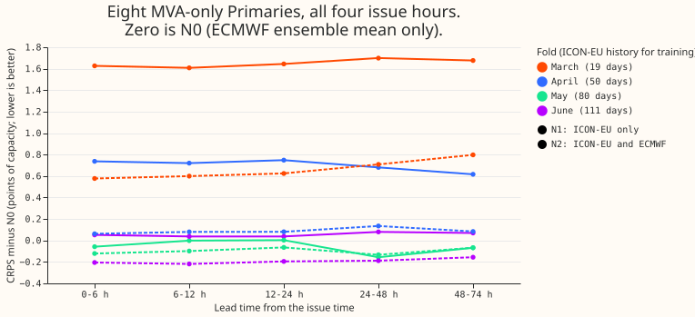
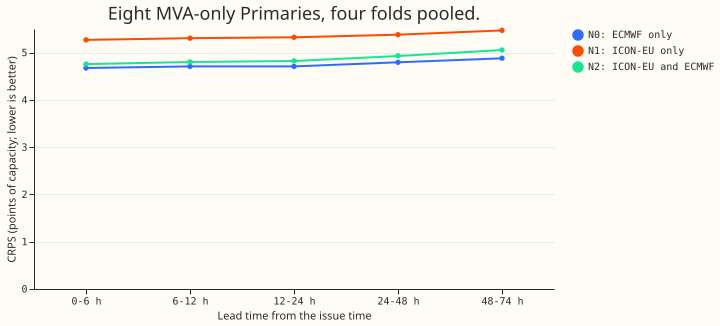

**An ICON-EU run issued four times a day did not improve the lag-free demand forecast: the adaptor
was worse than the ECMWF ensemble mean while it had under 3 months of history, and level with it
afterwards.** The verdict is `not supported`. This covers March to June 2026 only, so it says
nothing about winter. Every number is interim and unaudited.

## What was compared

- **N0:** the ECMWF ensemble mean (the latest 00 UTC run usable at the issue time) through experiment
  524's frozen stage-1 network, which takes no lead time and no spread.
- **N1:** the same network, with its seven mean-weather inputs replaced by the output of a
  2 x 32 multilayer perceptron fed the latest usable ICON-EU run (shortwave as direct plus diffuse,
  2 m temperature, dew point, surface pressure, precipitation, 10 m wind speed).
- **N2:** N1 with the ECMWF means and spreads as extra adaptor inputs.
- **Timing:** an ICON-EU run is usable 4 h after its init time (an assumption), and an ECMWF run at
  09:00 UTC on its day (the project's convention). The code asserts this row by row. One example:
  issue 2026-03-16 06:00, ICON-EU run 2026-03-16 00:00, ECMWF origin 2026-03-15 09:00, valid
  2026-03-17 15:30.
- **Fitting:** each monthly fold fits the adaptor on ICON-EU rows from 2026-02-10 to the month start
  minus 3.5 h (19, 50, 80, and 111 days). Phase A regresses the seven standardised ECMWF means;
  phase B trains through the frozen stage 1 on the power likelihood. Two seeds.
- **Not run:** N3 (a Previous Runs table back to 2024), because the run times of that table are not
  fixed. ICON-D2 has no true-run archive.
- **Data:** 564 Dynamical.org runs (CC BY 4.0) at the 16 Primary points, 12 GB, read in 85 minutes.
  The store has no longwave radiation and no 100 m wind, so the adaptor learns longwave from the
  other inputs. Reused code: experiments 87, 397, 422, 428, 448, 510, and 524.

## Results

- **P1 fails.** N1 minus N0 at 0-24 h at the eight is +0.58 (06 UTC), +0.61 (12 UTC), and +0.61 (18
  UTC), against the required -0.10. Per-fold values at 06 UTC: +1.57, +0.73, -0.03, +0.04 (March to
  June). The minimum detectable effect is 0.30 to 0.38, the month-block interval excludes zero only
  at 18 UTC and runs up to +1.4, and 4 blocks make that interval near min-to-max.
- **P2 holds:** N1 minus N0 at 00 UTC is +0.60 (folds +1.65, +0.75, -0.02, +0.03).
- **P3 holds:** N2 minus N1 at 24-74 h is -0.43 (interval -0.84 to -0.05, folds -0.93, -0.54,
  +0.01, -0.25; MDE 0.04). N2 is still no better than N0 overall: 4.93 against 4.79 at the eight.
- **N2 against N0 by fold (eight, all leads):** +0.71, +0.10, -0.10, -0.18 (March to June). Only June
  is below -0.10, and that is a single fold.
- **Six (signed MW):** pooled N0 3.24, N1 3.65, N2 3.12; N1 minus N0 by fold +1.33, +0.38, +0.02,
  -0.14.
- **D15 and D18 (report-only):** N0 16.8, N1 14.6, N2 14.3, so the adaptor helps there by 2 points in
  every fold. These two series have short history, and the adaptor trains on power, so the gain may
  come from correcting the stage-1 network's bias there and not from the ICON-EU weather.

## Caveats

- **Spring only, four folds.** The fold-to-fold spread is larger than any difference in May and
  June, so those two folds do not separate N1 from N0 in either direction.
- **The adaptor is trained through a stage-1 network that has seen the same power**, without the
  cross-fit that experiment 524 uses. This can flatter or hurt N1 and N2 against N0.
- **Early stopping is close to in-sample:** every fifth issue day is held out, but neighbouring issue
  days share valid times, and March has 19 days of history.
- **Absolute scores are not comparable with experiments 524 and 448:** the quantiles here are not
  widened about the median, and CRPS is twice the unweighted mean pinball loss over 11 levels.
- **N0 is scored only on rows where an ICON-EU run exists**, which removes the first hours of
  2026-02-10 only.
- **The minimum detectable effect** is 2.8 times the spread of two seeds, a crude estimate.
- **NGED's event logs are incomplete,** so clean rows may hold unlabelled load-shift events.

## Lessons

**The ICON-EU archive that exists is too short to answer the question.** The adaptor needs a year
or more of runs. With 111 days it only reaches the ECMWF mean. The ECMWF ensemble mean through a
network trained on estimates of past weather is a strong baseline to beat.
