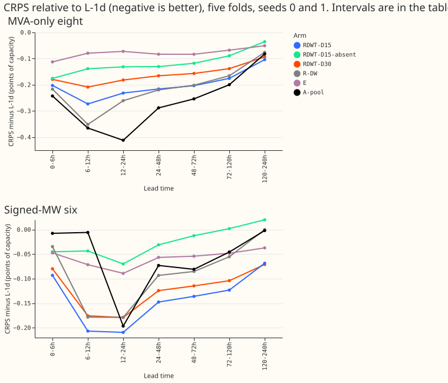
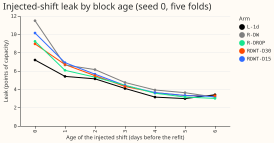
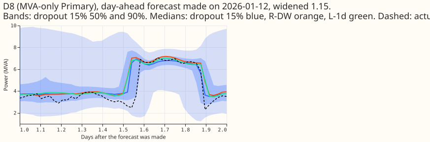
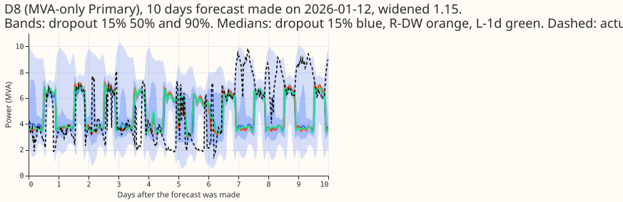

**One demand neural network can use the day-ago and week-ago power readings, the trailing
temperature windows, and lag dropout together, and 15% dropout keeps as much of the gain of the
readings as no dropout does.** We asked whether three earlier ideas combine into a network that is
accurate when yesterday's and last week's power readings are present and still works when they are
missing. The three ideas are the two readings (experiment 539's R-DW, whose page is not yet merged),
the trailing temperature windows of experiments 515 and 548, and randomly removing the readings in
training ([experiment
544](../00544-lag-light-demand-network-robust-same-slot-median-and-lag-dropout/result.md)'s R-DROP).
The network with 15% dropout scored the same as R-DW when the readings were present, and scored no
differently from the lag-free network when they were removed. The network with 15% dropout missed
one target: it closed 82% of the gap between L-1d and A-pool, against a target of 85%. Verdict:
partly supported. All numbers are CRPS in points of capacity (lower is better), over five test
months, interim and unaudited.

Terms. CRPS is the continuous ranked probability score, here as a percentage of each substation's
effective capacity. L-1d is the demand neural network without power readings (experiment 511).
R-DW adds the day-ago and week-ago readings. R-DROP is R-DW trained with the readings removed in 30%
of rows. E is the lag-free network with the trailing windows (experiment 548). A-pool is the network
that reads all recent power readings (experiment 425). The eight are the MVA-only Primary
substations, and the six are the signed-MW Primaries. Bands are lead times, such as 24-48 h. The
RDWT-D15 and RDWT-D30 arms are R-DW plus the windows, trained with 15% and 30% dropout.

## Results

- **Pre-registered predictions** (the eight MVA-only Primaries, 24-120 h, rate chosen before scoring
  as the one with more gap closed among rates with leak at most 6.0, which is 15%).
    - P1, gap closed with readings present of at least 85%: **failed**. 15% closes 82% (24-48 h 75%,
      48-72 h 80%, 72-120 h 88%); 30% closes 64%. R-DW closes 80% over the same band. The gap is
      above the 70% stop line.
    - P2, readings removed within 0.15 of the lag-free recipe (E): **held**. 15%: 4.524 against
      4.555, difference -0.031 (-0.103 to +0.031).
    - P3, Christmas week no worse than L-1d by more than 0.10: **held**. 15%: 4.164 against 4.243
      (-0.079). R-DW was 4.414 (+0.171) in the same week. It is one week of one winter, so it
      has no interval.
    - P4, injected-shift leak at most 6.0 points of capacity: **held**. 15%: 5.33 (5.89 for positive
      shifts and 4.78 for negative ones, so the positive-shift figure sits just under the limit).
      30%: 5.10. R-DW: 5.68. L-1d: 4.49. These are means over block ages 0 to 6 and both signs, and
      the range across folds is wide (about 2.6 to 10.7). At block age 0 the leak is 10.1 (15%) and
      9.0 (30%), against 11.5 for R-DW and 7.2 for L-1d.
- **Absolute CRPS at the eight, 24-120 h.** A-pool 4.395; RDWT-D15 4.438; R-DW 4.442;
  RDWT-D30 4.481; RDWT-D15 readings removed 4.524; RDWT-D30 readings removed 4.535; R-DROP 4.546;
  E (lag-free with windows) 4.555; R-DROP readings removed 4.609; L-1d 4.631; `manual_heuristic`
  5.521. At the six: RDWT-D15 3.209, RDWT-D30 3.230, R-DW 3.269, A-pool 3.280, L-1d 3.342.
- **Counted contrasts at the eight, 24-120 h** (95% month-block bootstrap, 5 blocks, near
  min-to-max; Bonferroni count 84 = 2 rates x 3 contrasts x 7 lead bands x 2 row sets; minimum
  detectable effect 0.116). RDWT-D15 minus L-1d: -0.193 (-0.285 to -0.119; 0 of 5 folds worse).
  RDWT-D15 minus R-DW: -0.004 (-0.055 to +0.046; 2 of 5 folds worse). RDWT-D15 readings removed
  minus E: -0.031 (-0.103 to +0.031; 3 of 5 folds better). The 30% arm gives -0.150, +0.038, and
  -0.020. Every lead band from 0-6 h to 120-240 h shows the same sign for the 15% arm against L-1d.
- **Dropout rates.** The 15% arm against the 30% arm: -0.043 (-0.080 to -0.020; 5 of 5 folds in
  favour of 15%). With readings removed the two rates differ by -0.011 (inside the minimum
  detectable effect).
- **At the six** the 15% arm is 0.133 better than L-1d (-0.133, interval ending at -0.053)
  and 0.071 better than A-pool; both are inside or near the minimum detectable effect of 0.155, and
  the gap ratio is not meaningful there because L-1d is just 0.061 behind A-pool.
- **Tails.** At the eight, 24-120 h, pinball loss at q95 is 0.050 better than L-1d (-0.092 to
  -0.011) and 0.042 worse than A-pool (-0.003 to +0.088); at q99, 0.020 better than L-1d and 0.019
  worse than A-pool (+0.010 to +0.025).
- **Cold winter nights, 24-120 h, eight:** RDWT-D15 3.952, RDWT-D30 3.985, L-1d 4.318, A-pool 3.790.
  A-pool is 0.16 better than the 15% arm on those nights.
  Bank-holiday windows, all leads: RDWT-D15 4.875 against L-1d 4.982.
- **Retrained K2-S1 (experiment 541).** Its per-band table is on the same rows; see
  `00541-k2-s1-rebuilt-on-origin-time-weather`. The page does not pair that table with these arms.

## Checks

- **Triggers fired:** none that need an audit. The nested-arm trigger does not fire, because the 15%
  arm is not worse than R-DW. The headline rests on pools of seeds 0 and 1; see the caveats.
- **Origin-time weather and lag timestamps**, asserted row by row for 24,979,347 training rows and
  1,142,520 test rows over 153 test origins. Example: origin 2025-10-01 09:00 UTC, target 2025-10-01
  12:30 UTC, weather run 2025-10-01 00:00 UTC, day-ago reading observed 2025-09-30 12:30 UTC (at
  least 3.5 h before the origin).
- **Median minus mean forecast per site** and the **error of the mean or median forecast** were not
  computed (these checks expose a spread that shifts the forecast); the pinball contrasts above
  agree in sign with the CRPS contrasts.
- Cost about 1.5 GPU-hours, one process under 8 GB.
- **Reviews.** One Sonnet code review before the first fit (no problems found, one unused path
  removed). Write-up review: see the pull request.

## Caveats

- **Seed 2 is not comparable.** The RDWT-D15 and RDWT-D30 arms are pools of seeds 0 and 1, and the
  `-s2` arms are single fits of seed 2. A pool of two seeds averages their quantiles, which scores
  lower CRPS than one seed, and every stored comparator is a pool of seeds 0 and 1. Seed 2 alone
  gives 4.523 (15%) and 4.570 (30%), higher than the pooled arms, and the gap closed would read 46%
  and 26%. The headline therefore rests on two seeds; a fit of seeds 0 and 1 alone is not available.
- The 85% target was set above what R-DW itself reached (80% over this band), so it was unlikely to
  hold for any dropout.
- Christmas week is one week in one winter. NGED's load-shift logs may miss events, so rows with no
  labelled event may hold unlabelled events and the leak is measured on injected shifts only.
- The lead range is 0 to 240 h, which covers the 1 to 10 day horizon NGED care about; the
  conclusion is drawn on 24-120 h.

## What to try next

- Run the final bake-off of the release plan with 5 seeds, comparing this 15% network with the
  lag-free recipe and A-pool, since the 15% network and the lag-free recipe are within the minimum
  detectable effect of each other when the readings are removed.
- Try a dropout rate between 0% and 15% only if the bake-off shows the readings-present gap matters.
