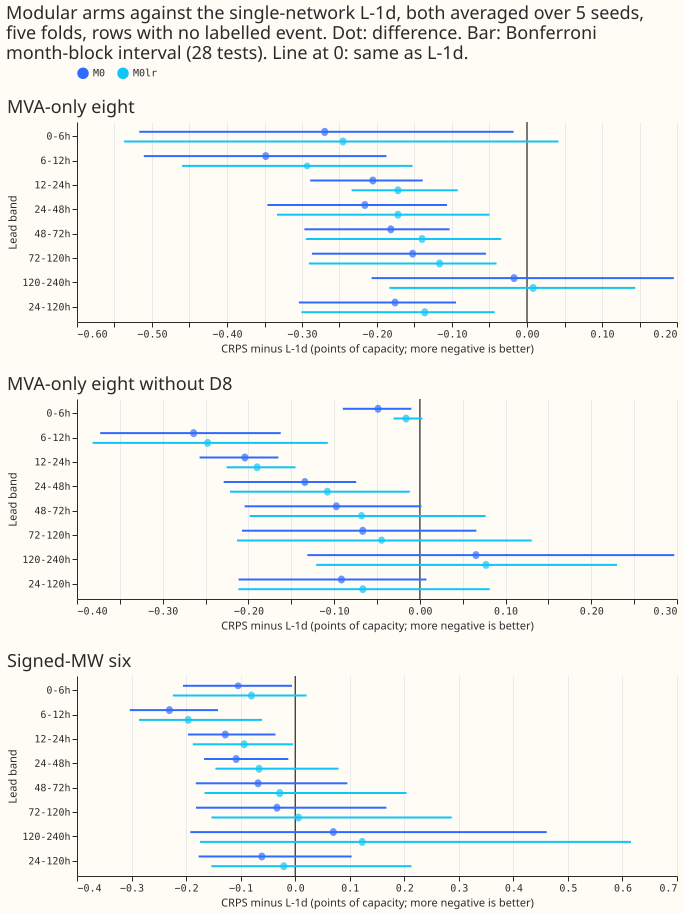
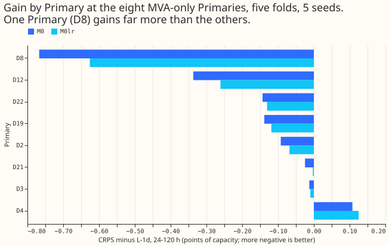

**The modular demand network M0 still beats the single network L-1d at leads of 1 to 5 days when
both are averaged over 5 seeds, by 0.176 points of capacity at the eight MVA-only Primaries (CRPS,
lower is better), and the gain mostly survives a slower learning rate. About half of it comes from
one Primary, D8: without D8 the gain is 0.091, with an interval that includes zero. The leak
mitigations and the diagnostic arms were not run, so what raises M0's injected-shift leak is still
unknown.**

We asked whether the gain of experiment 545 holds with more seeds. M0 has a weather encoder, a
datetime encoder, and a fresh mixer at fine-tuning; M0lr is the same with the mixer at L-1d's
learning rate. The control is L-1d refitted here for seeds 2 to 4, so that both sides average 5
seeds (seeds 0 and 1 are the stored fits of experiments 511 and 545). Scores are CRPS in points of
effective capacity on rows with no labelled event. "The eight" are the MVA-only Primaries and "the
six" the signed-MW Primaries. The maintainer cut stage 2 (M0-hl180, M0-c3, M0-sep, M0-mix) after
this stage scored, so prediction P2 was not tested.

Verdict: partly supported. P1 held (M0 0.176 and M0lr 0.136, both at least 0.10, with intervals
excluding zero). P3 held on its point estimate (0.091 without D8, at least 0.05) but its interval
includes zero. P2 was not tested. No failure condition fired, and the stop rule did not fire
(M0lr's gain is 0.136, above 0.03).

## Results

CRPS minus L-1d (5 seeds each), negative favours the modular arm, over leads of 24 to 120 h
pooled. Brackets give the Bonferroni month-block interval (5 blocks, near the minimum to maximum of
the five folds; 28 counted tests) and the number of folds in which the arm is worse. The minimum
detectable effect (MDE) is 0.111 at the eight, 0.088 at the eight without D8, and 0.091 at the six.

| Set | M0 | M0lr | M0 minus M0lr |
|---|---|---|---|
| Eight | -0.176 (-0.304 to -0.095; 0/5) | -0.136 (-0.301 to -0.043; 0/5) | -0.040 (-0.105 to +0.007; 2/5) |
| Eight without D8 | -0.091 (-0.211 to +0.008; 2/5) | -0.067 (-0.212 to +0.081; 1/5) | -0.025 (-0.090 to +0.026; 2/5) |
| D8 alone | -0.767 (-1.421 to +0.016; 1/5) | -0.626 (-1.248 to +0.201; 1/5) | -0.142 (-0.212 to -0.012; 1/5) |
| Six | -0.061 (-0.177 to +0.103; 1/5) | -0.021 (-0.154 to +0.213; 1/5) | -0.040 (-0.119 to -0.001; 0/5) |

**The gain is not a 2-seed accident.** In the bands the pre-registration names, M0 minus L-1d is
-0.216, -0.182, and -0.153 at 24-48 h, 48-72 h, and 72-120 h (experiment 545, 2 seeds: -0.208,
-0.182, -0.137), and no fold is worse. M0lr keeps -0.172, -0.140, and -0.116.

**One Primary carries about half of the gain.** M0 gains at 7 of the 8 Primaries (D4 is worse, by
0.108), and D8 gains 0.767 against at most 0.34 for any other of the eight. Without D8 the bands
are -0.134, -0.097, and -0.067, and only 24-48 h has an interval that excludes zero. The gain is not
carried by D8 alone, but it is not shown at the other seven.

**M0 reaches R-DW and sits close to A-pool without reading power.** At the eight over 24-120 h, M0
scores 4.433, R-DW 4.442, A-pool 4.395, the 5-seed L-1d 4.609, the 2-seed L-1d 4.631, and the manual
heuristic 5.521 (M0 minus A-pool +0.038, interval -0.101 to +0.162). At the six the gain is smaller
and its interval includes zero (M0 3.245, the 5-seed L-1d 3.306, A-pool 3.280).

**Averaging 5 seeds helps L-1d a little.** The 5-seed L-1d is 0.022 better than the 2-seed L-1d at
the eight (-0.040 to +0.001).

## Checks

- **Origin-time weather, asserted row by row.** For every one of the 153 test origins the script
  asserts `nwp_init_time <= power_fcst_init_time`, `power_fcst_init_time == origin`, and that the
  weather-run summary file exists; every training target is after its origin and its weather run
  exists 9 hours before. Example, 2025-10 test row: target 2025-10-03 07:00 UTC, origin 2025-10-01
  09:00 UTC, weather run 2025-10-01 00:00 UTC (`checks_*_s2-3-4.json`: 24,979,347 training rows and
  1,142,520 test rows per arm).
- **Inputs** are experiment 545's: no power-derived column, the 9 lag columns removed.
- **Reuse.** Seeds 0 and 1 of M0, M0lr, and L-1d are the stored fits of experiments 545 and 511
  (unchanged code); seeds 2 to 4 were fitted here, with new pretrained weights for M0 (all five
  folds) and for L-1d in fold 2025-12.
- **Not done.** Stage 2 (M0-hl180, M0-c3, M0-sep, M0-mix) and the injected-shift leak were not run,
  so P2 is untested; the leak figures of experiment 545 (L-1d 4.49, M0 7.60, M0lr 7.71, seed 0) are
  unchanged. The climatology was not scored here, and no forecast-example figure was drawn. One
  Sonnet reviewer read the code before the first fit and found no bug; the write-up was checked
  against the printed report by its author only. The 5-seed gain over 2 seeds is not paired with
  a 5-seed A-pool or R-DW, which keep their own seeds.

## What the next experiment should answer

Whether a 180-day half-life or a 3-day refit cadence brings M0's injected-shift leak under 6.0, and
which part of the network raises it. Compute used: about 3.5 GPU-hours (pretraining and 1,377
fits).

The code is in `ml-experiments/00554-m0-replication-five-seeds-leak-mitigations-and-leave-d8-out/`
and reuses experiments 397, 428, 448, 510, 511, 521, 539, and 545.
