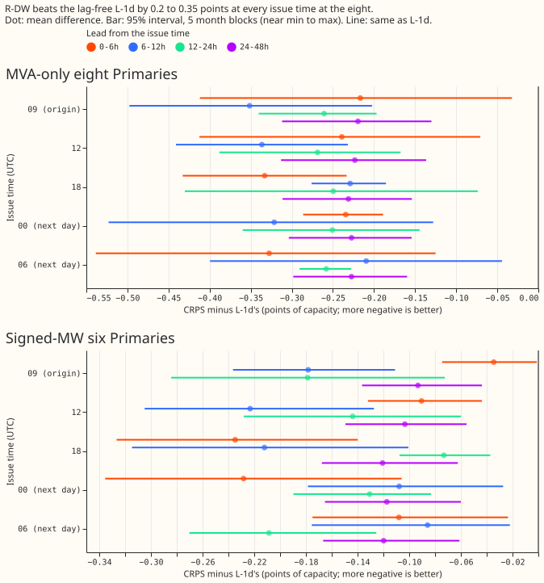
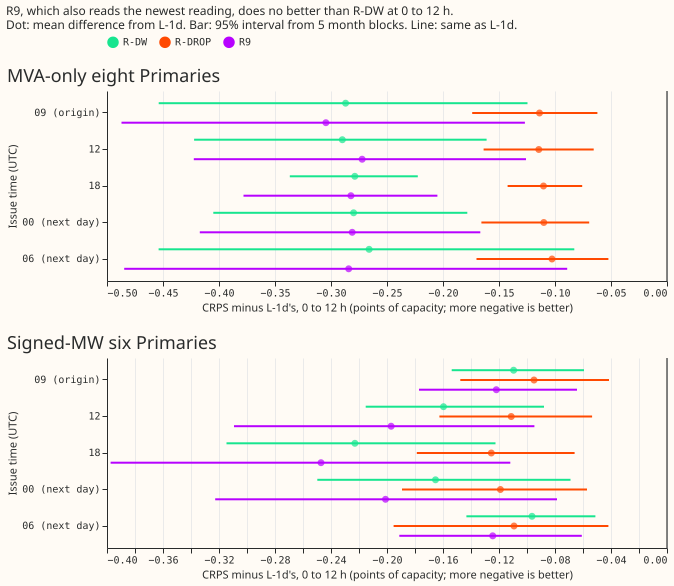
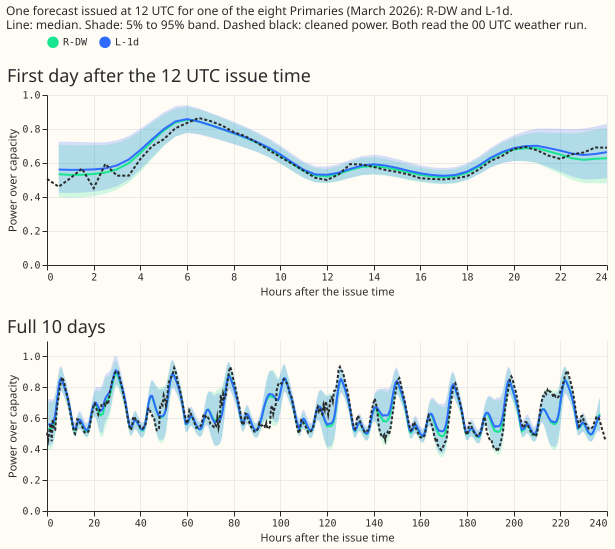

**Question and answer.** NGED wants the demand forecast updated every 6 hours, but the weather
forecast arrives once a day (the 00 UTC run, usable from 09:00 UTC). We asked whether the power
readings available at 06, 12, and 18 UTC (and at 00 UTC) make the forecast better than a forecast
that ignores power readings, when both still use the 00 UTC weather. We took neural networks already
trained for the 09:00 UTC forecast, one that reads the day-ago and week-ago power at each half-hour
(R-DW, experiment 539) and compared them with the network that reads none
(L-1d, experiment 511), re-timing the readings to each issue time. They kept their whole advantage,
about 0.28 points of capacity at 0 to 12 h at the eight Primaries that report in MVA.

Verdict: supported. P1 held (-0.290 at 12 UTC against the required -0.2). P2 held at 06 and 18 UTC.
All numbers are interim and unaudited; CRPS is in points of effective capacity and lower is better.

## What was compared

- **Arms.** L-1d, the lag-free network of experiment 511 (read from its stored forecasts, which do
  not depend on the issue time). R-DW (experiment 539) and R-DROP (experiment 544) read the day-ago
  and week-ago readings. R9 (experiment 538) also reads the newest reading. R-DROP was trained with
  30% of its rows having the readings removed. Stored daily refits and both seeds are used unchanged;
  nothing was refitted.
- **Issue times.** 12 and 18 UTC on the run's day; 00 and 06 UTC on the next day; 09:00 UTC (the
  origin the networks were trained on) is shown for reference. Rows are those with a valid time after
  the issue time, and lead bands are counted from the issue time.
- **What changes at an issue time.** The lead input, and the day-ago and week-ago readings (value,
  flag, age; for R9 the newest reading as well), are retaken from the latest same-clock half-hour at
  or before the issue time minus the 3.5 h data delay. The weather inputs are those of the 00 UTC run.
- **Checks, row by row at each issue time and fold (75 tables, 1.1 million rows kept at 12 UTC).**
  The weather run is usable at or before the issue time; each lag source is on the right clock slot,
  is the latest such slot, and is at or before the issue time minus 3.5 h; the ages equal an
  independent recomputation. The rebuild at 09:00 UTC reproduces the stored table, and the 09:00 UTC
  forecasts reproduce the stored forecasts of experiments 538, 539, and 544 to under 1e-4. One
  example: issue 2026-03-01 12:00 UTC, weather run 2026-03-01 00:00 UTC (usable 09:00), target
  2026-03-02 12:30, day-ago reading from 2026-02-28 12:30, week-ago reading from 2026-02-23 12:30.
- **Statistics.** Intervals are 95% month-block bootstraps with 5 blocks (near the minimum to
  maximum of the folds). The counted tests are R-DW minus L-1d at 4 issue times, 4 lead bands, and 2
  row sets, so the Bonferroni count is 32. The minimum detectable effect (MDE, 2.8 times the spread of
  L-1d's two seeds) is 0.12 to 0.17 at 0-12 h. Other contrasts are report-only.

## Results

- **P1 holds.** At 12 UTC, 0-12 h, at the eight, R-DW minus L-1d is -0.290 (-0.42 to -0.16; MDE
  0.14), with every fold negative: -0.330, -0.443, -0.111, -0.127, -0.449 (October to June). R-DW
  scores 4.219 and L-1d 4.509.
- **P2 holds.** At 0-12 h at the eight, the difference is -0.266 at 06 UTC (-0.45 to -0.08), -0.279
  at 18 UTC (-0.34 to -0.22), and -0.280 at 00 UTC (-0.41 to -0.18), against -0.287 at 09:00 UTC. The
  gain does not grow at later issue times.
- **Lead bands at the eight (R-DW minus L-1d).** 0-6 h: -0.239 (12 UTC), -0.333 (18), -0.234 (00),
  -0.327 (06). 6-12 h: -0.336, -0.229, -0.321, -0.210. 12-24 h and 24-48 h stay between -0.22 and
  -0.27 at every issue time. All 32 counted contrasts are negative with a 95% month-block interval that
  excludes zero: the 16 at the eight lie between -0.21 and -0.34 (all 16 also exclude zero at the
  Bonferroni level), and the 16 at the six between -0.07 and -0.23 (14 exclude zero at that level).
- **The six (signed MW), 0-12 h.** -0.160 at 12 UTC (-0.22 to -0.09), -0.223 at 18, -0.165 at 00, and
  -0.096 at 06 (-0.14 to -0.05).
- **R-DROP keeps about 40% of the gain:** -0.114 at 12 UTC at 0-12 h at the eight (-0.16 to -0.07).
- **R9 adds nothing.** R9 minus R-DW at 0-12 h at the eight is -0.001 to -0.018 at 00, 06, and 18 UTC
  and +0.018 at 12 UTC. Every interval includes zero or has an upper end under +0.001 (figure 2). A
  fresher newest reading does not help at these lead times beyond the day-ago and week-ago readings.
- **D15 and D18 (report-only).** R-DW minus L-1d at 0-12 h is -0.93 to -1.27 across issue times.
- **Tails.** At 0-12 h at the eight, the share of actuals below the q95 forecast is 0.965 to 0.972
  for R-DW and 0.976 to 0.983 for L-1d (nominal 0.95); below q05 it is 0.014 to 0.018 against 0.012
  to 0.015 (nominal 0.05). Both are too wide in the tails, and R-DW is slightly nearer to the nominal
  level. Full table: `tails_0_12h_eight.csv`.

## Checks

- **Median forecast minus mean forecast, and the error of the mean forecast beside the quantile
  score.** Not run: the networks output quantiles and nothing here re-fits them.
- **Audit triggers.** None fired: the 09:00 UTC rows reproduce experiments 539's R-DW numbers (for
  example -0.351 at 6-12 h at the eight), no control failed, and R9 (which contains R-DW's inputs)
  is not worse than R-DW. Triggers 3 and 4 were not tested (no leave-one-out run).

## Caveats

- **Weather input is old.** At 06 UTC on the next day the 00 UTC run is 30 h old, and the network
  saw only runs 9 h old in training. The lead input is counted from the issue time, so the network
  cannot see the staleness. The result holds up to that staleness anyway.
- **Absolute scores differ between issue times** because the rows differ (valid times after the
  issue) and the time of day of the target changes. L-1d's CRPS at 0-12 h is 5.38 at 06 UTC and 3.56
  at 18 UTC. Compare arms within an issue time, not across issue times.
- **Refits are those of the 09:00 UTC origin day,** up to one day older than a live service would use
  at 00 and 06 UTC on the next day.
- **No fine-tune on issue-time rows,** and one network trained on 09:00 UTC origins only. A network
  trained on issue-time rows may do better.
- **Five folds, 5 month blocks,** so the intervals are near min-to-max. Two of the 16 counted
  contrasts at the six have Bonferroni-level intervals that include zero. July 2026 is unused.
- **NGED's event logs are incomplete,** so clean rows may hold unlabelled load-shift events.

## What the next experiment should answer

Does a short fine-tune on rows with issue-time origins, or a fresher weather run (ICON-EU, which did
not help in experiment 552 with 4 months of history), improve on the lag-light network's 0.28 points?

## Code

`ml-experiments/00555-*/`: `e00555_infer.py` (inference at each issue time), `e00555_rows.py` and
`e00555_score.py` (scores), `e00555_figures.py`, and `run.sh`. They import the folders of
experiments 087, 397, 428, 454, 470, 510, 511, and 521, and read the stored weights and forecasts of
experiments 538, 539, and 544 (private data folder). The scripts of experiments 538 and 539 are not
in this repository.
