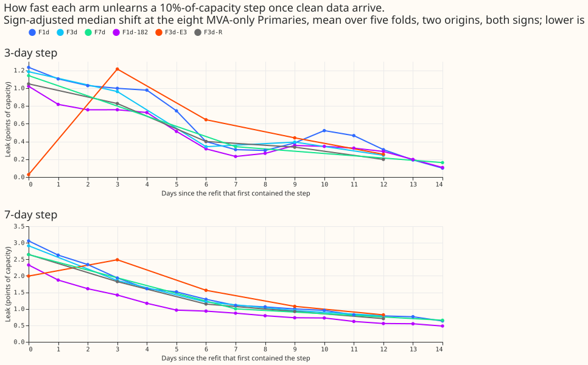
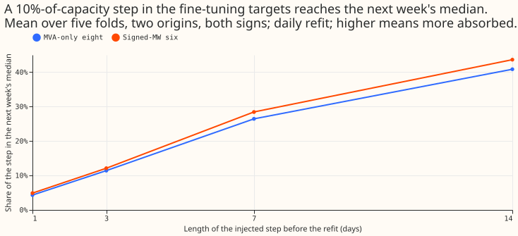
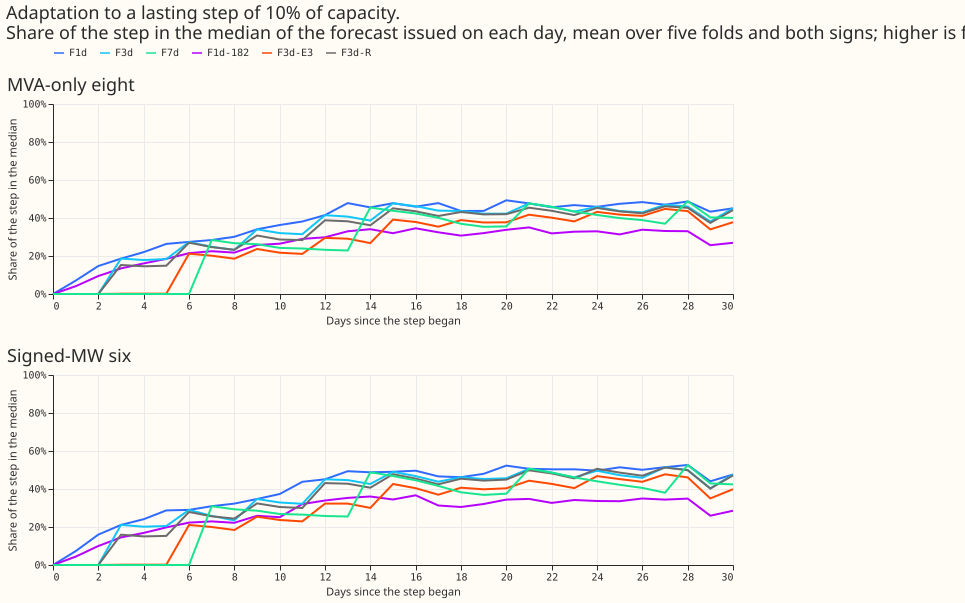
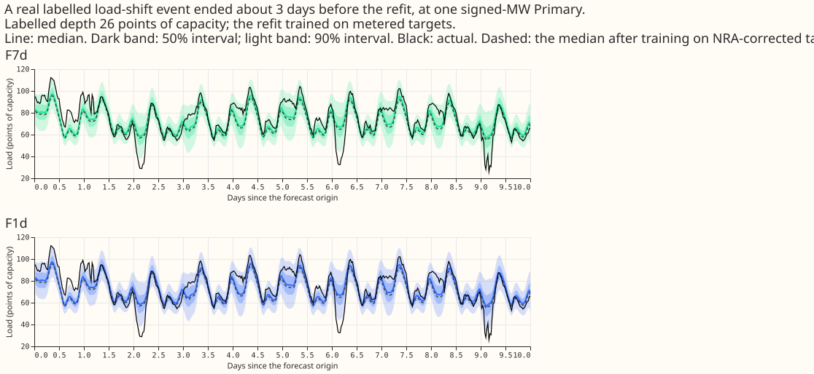
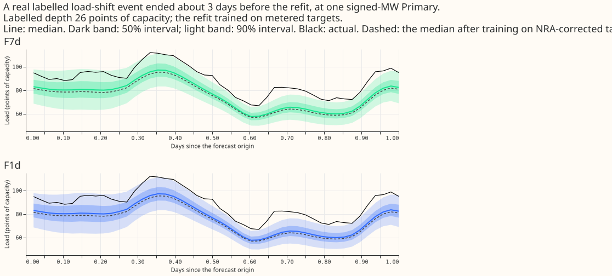
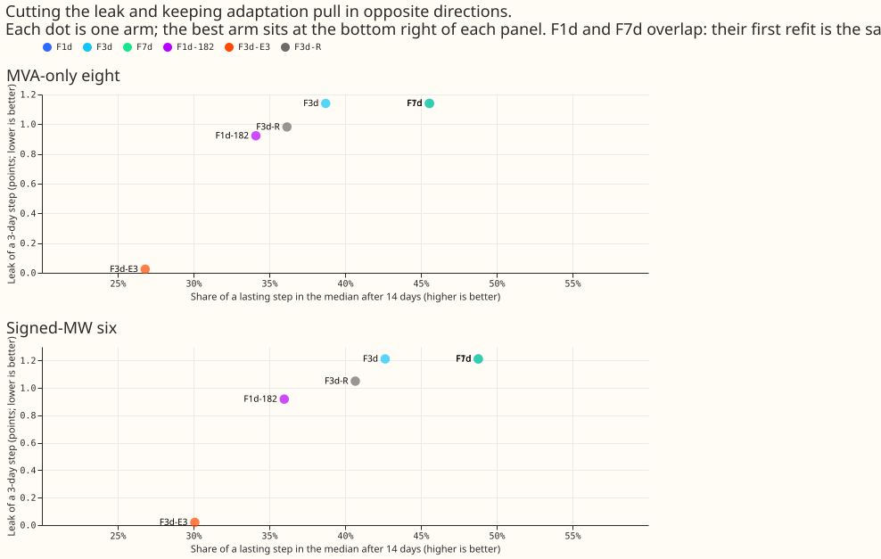
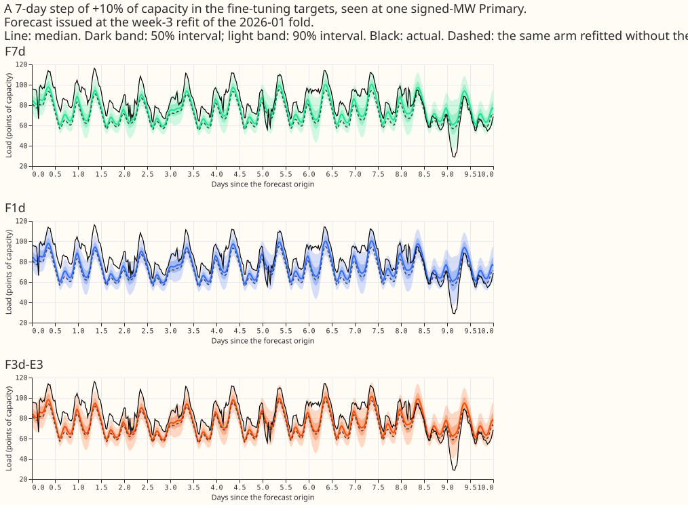
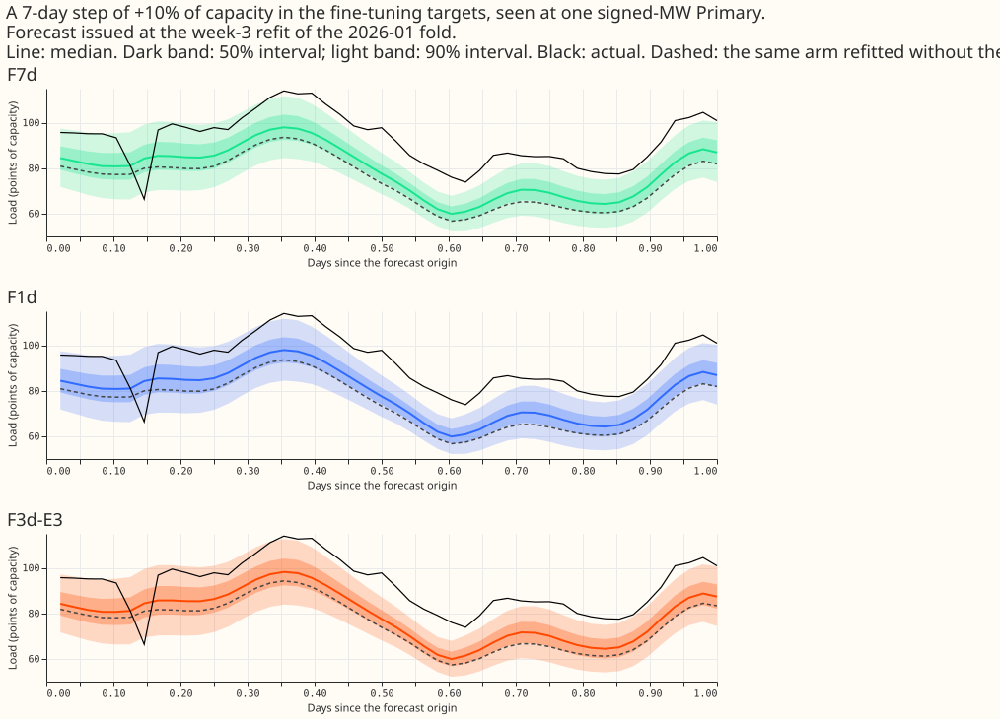

**A step added to the fine-tuning targets of the lag-free demand network reaches the next week's
median forecast by a share that grows with the step's length, about 1 in 10 for a 3-day step of 10%
of capacity, and the effect fades over about 2 weeks. A real labelled event leaks 1.5% of its
depth.** We asked how much of a load-shift event in the rows a neural network is refitted on ends up
in its next forecasts. We added a step of 10% of a Primary's capacity to the fine-tuning targets of
the 16 Primaries, for the 1, 3, 7, or 14 days before a refit, and compared the median forecast with
the matched refit without the step. We also fitted once on metered and once on corrected targets
around 74 real labelled events, injected a lasting step, and scored two rules that might cut the
leak: leaving the newest 3 days of targets out (F3d-E3), and shrinking the weight of rows far from
the previous fine-tune's median (F3d-R).

**Verdict: partly supported.** The leak is real but small at realistic lengths, F3d-E3 removes it
for short steps at a score cost just above the bar, and F3d-R does not reach the bar. "The eight" are
the MVA-only Primaries and "the six" the signed-MW Primaries. A "leak" is the sign-adjusted shift of
the median, in points of capacity (percentage of each Primary's capacity). Scores use rows with no
labelled event, two seeds, and five folds of 511 (2025-10, 2025-12, 2026-01, 2026-03, 2026-06).

## Results

**The leak grows with the step's length and does not depend on the refit cadence.** The first
refit after a step is the same fit for the daily, 3-day, and weekly arms, so the three arms share
every first-refit number below; cadence matters only for the refits that follow. One seed, mean of
five folds, two origins, and both signs.

| Step before the refit | Leak at the eight (points) | Share of the step | Leak at the six (points) | Share of the step |
|---|---|---|---|---|
| 1 day | 0.43 | 4% | 0.49 | 5% |
| 3 days | 1.14 | 11% | 1.21 | 12% |
| 7 days | 2.64 | 26% | 2.84 | 28% |
| 14 days | 4.08 | 41% | 4.36 | 44% |
| 3 days, alternating signs across Primaries | 0.62 | 6% | 0.62 | 6% |

- **Reproduction of experiment 510:** a step of 3 standard deviations of the 7-day mean over 7 days,
  at the week-3 origin and all 16 Primaries, moved L-Ww's median by 6.12 points (experiment 510:
  6.11), and by 14.5 points in the 2026-01 fold.
- **The stop rule did not fire:** F1d's leak at L = 3 days is above 1.0 point in each of the first
  four lead bands (0 to 48 h) at both groups: 1.24 to 1.54 at the eight and 1.30 to 1.63 at the six.
- **Bad data leak little:** a 24 h stuck reading leaks 0.30 (eight) and 0.18 (six) points, a 6 h
  dropout 0.07 and 0.04, and a 6 h spike of 10 residual median absolute deviations 0.26 and 0.10.
- **Noise:** the standard deviation between the two signs' leaks for one fold and origin, over the
  square root of 2, is 0.1 to 1.0 points for the arms that leak. The leak is one seed per cell, so
  no leak difference smaller than about 1 point is read as an effect.

**The leak fades over about 2 weeks, and the recency weight, not the cadence, sets how fast.** After
a 3-day step, the daily arm's leak at the eight falls from 1.23 points to 0.10 by day 14 (8%), and
the weekly arm's from 1.14 to 0.16 (14%). Figure 2 shows all six arms. The leak halves by about day
6 for every arm.

**The network adapts slowly to a genuine lasting step.** None of the six arms reached 90% of a
lasting step of 10% of capacity in 29 days, the eight stayed under 50% (F1d 49% at day 28), and at
the six F1d reached 50% on day 20, F3d on day 21, F7d on day 21, and F3d-R on day 24. F1d-182 and
F3d-E3 never reached it. Early stopping on clean held-out weeks and the 90-day recency weight may
explain the plateau; this experiment did not test either.

**Real labelled events leak 1.5% of their depth.** Over 74 events with a labelled depth, fitted
once on metered and once on corrected targets (only the measured event corrected), the F1d fits
absorbed a mean of 1.5% of the depth (median 0.3%; fold means 1.1%, 0.6%, 3.8%, 0.4%, and 1.1%;
five-block interval 0.6% to 2.6%, near the minimum to the maximum of the fold means). Without the
largest event the mean is 1.1% (interval 0.6% to 1.7%). The largest absorbed share among events of
10 points or more was 6.5% of a 26-point event of 3.7 days.

**F3d-E3 passes the leak bar and misses the score bar by a hair; F3d-R misses the leak bar.** Leak
of a 3-day step at the eight (six): F3d 1.14 (1.21), F3d-E3 0.02 (0.02), F3d-R 0.98 (1.05),
F1d-182 0.92 (0.92). F3d-E3 cuts the leak by 98% at 1 and 3 days, by 34% at 7 days (1.74 against
2.64), and by 15% at 14 days. It delays adaptation by about 3 days (share of a lasting step after 3
days 0.1% against 19%, after 14 days 27% against 39%, after 28 days 44% against 46%). F3d-R cuts the
leak of a 3-day step by 14% at the eight and 13% at the six.

| Arm | CRPS eight | CRPS six | minus L-Ww, eight (Bonferroni interval) | minus L-Ww, six | minus F3d, eight | minus F3d, six |
|---|---|---|---|---|---|---|
| L-Ww (F7d) | 4.920 | 3.555 | | | | |
| F1d | 4.855 | 3.493 | -0.065 (-0.094, -0.039) | -0.061 (-0.100, -0.029) | | |
| F3d | 4.881 | 3.520 | -0.039 (-0.062, -0.018) | -0.035 (-0.069, -0.006) | | |
| F1d-182 | 4.923 | 3.558 | +0.003 (-0.066, +0.085) | +0.004 (-0.047, +0.050) | | |
| F3d-E3 | 4.939 | 3.571 | +0.019 (-0.004, +0.042) | +0.016 (-0.008, +0.039) | +0.057 (+0.035, +0.081) | +0.051 (+0.020, +0.085) |
| F3d-R | 4.890 | 3.551 | -0.030 (-0.058, -0.004) | -0.004 (-0.036, +0.023) | +0.009 (-0.008, +0.024) | +0.031 (+0.015, +0.047) |

- **Tails:** q99 pinball loss of every arm is within +0.0024 of L-Ww (limit +0.02); coverage of the
  nominal 99% quantile is 98.5% to 99.6% for every arm at both groups.
- **Cold winter nights (eight, six):** L-Ww 4.348 and 3.494, F1d 4.224 and 3.434, F3d 4.283 and
  3.481, F1d-182 4.308 and 3.555, F3d-E3 4.349 and 3.472, F3d-R 4.306 and 3.530.
- **Lead bands:** F1d's CRPS is the lowest of the six arms in all seven lead bands at the eight and
  in six of seven at the six, where F1d-182 is lower at 0 to 6 h (4.029 against 4.041; table in the
  data folder, `crps_by_band.csv`).
- **Curtailment at the six (avoidable-curtailment cost in experiment 449's units, f = 0.9, 0.75,
  0.5):** L-Ww 0.95, 5.96, 22.26; F1d 0.73, 5.47, 21.43; F3d 0.75, 5.64, 21.77; F1d-182 0.88,
  5.60, 21.58; F3d-E3 0.96, 6.04, 22.46; F3d-R 0.96, 5.98, 22.04.
- **Minimum detectable effect:** CRPS 0.164 (eight) and 0.123 (six), carried from experiment 510's two
  seeds, not refitted. The CRPS contrasts of F3d-E3 and F3d-R against F3d are below it, so they read
  as "interval excludes zero", not as "at least this large".

## Serving complexity

Every arm serves one network per pass and no table. F1d and F3d refit daily or every 3 days (a fine-tune
of about 3 s). F3d-E3 is the F3d schedule with the newest 3 days of targets left out, which an
operator can read as "never learn from the last 3 days". F3d-R is the F3d schedule with each row's
weight multiplied by min(1, 3 / |z|), where z is the row's residual against the previous 3-day
fine-tune's median in units of the Primary's residual median absolute deviation over 90 days. The
CRPS price against L-Ww is in the table above. Comparisons with K2-S1 are not reported: K2-S1's
forecasts beyond 24 h of lead are voided (the correction at the top of experiment 511's page).

## Checks

- **Median minus mean forecast:** not computed; the arms output quantiles of one mixture and no
  mean forecast, so the check does not apply.
- **Quantile score against error of the median:** CRPS and q99 pinball loss against L-Ww point the
  same way for F3d-E3 at the eight (zero) and F3d-R at the eight (both lower), and differ in sign for
  F3d-R at the six (CRPS -0.004, q99 +0.0024), where both intervals include zero.
- **Triggers fired:** none. The reproduction of 510's 6.11 passed (6.12). A code review before the
  first run is triaged below.
- **Look-ahead:** for each arm, the rows selected at 2026-01-11 had 0 rows past the valid-time cut
  (cutoff minus 3.5 h) and 0 past the origin cut; the example row has valid time 2024-04-11 05:00,
  origin 2024-04-10 09:00, cutoff 2026-01-11. The fine-tune of F1d at 2026-01-10 reproduced the stored
  weights of experiment 511 to 8e-5 points in the median (maximum).

## Caveats

- **Deviations from the brief:** one seed for every stress cell, no stored two-seed leak interval,
  and the leak contrasts use the sign-pair noise above; F1d-182 skipped the bad-data cells and the
  1-day, 14-day, 3-standard-deviation, and alternating-sign cells, and F3d-E3 and F3d-R skipped
  the bad-data cells, to stay within the compute cap; the unmirrored injection hits all 16
  Primaries together (the brief's "donor and recipient" wording was implemented as all Primaries,
  and the mirrored sensitivity as alternating signs).
- **Not computed:** curtailment differences against L-Ww, F1d, and BG2 with block intervals (only the
  absolute costs above and the script's differences against K2-S1 and the manual heuristic); the
  "harm rows" of the brief; the fold-by-fold signs of the CRPS contrasts beyond what the stored
  table holds.
- **The unlearn time of F3d-E3 is not comparable:** its first refit contains no leak by
  construction at L of 3 days or less, so "days to 10% of the first value" has no meaning for it.
- **F3d-R's reference** is the plain F3d fit 3 days earlier under the same injection, with the
  residual median absolute deviation computed in-sample, which makes the clipping stricter than an
  out-of-sample rule would.
- **A "1-day" step covers 20.5 h** because the newest training targets are 3.5 h old at the refit.
- **The lasting step's first refit contains no injected row,** so day 0 reads zero by construction.
- **The labels are incomplete:** unlogged load-shift events may sit in the fine-tuning windows, so
  every leak here is a lower bound for the real leak and the real-event counts are lower bounds.
- **Horizon:** the scores cover leads of 0 to 240 h; the leak is reported by the seven lead bands in
  the data folder (`leak_by_band.csv`).

## Triage of the code review

A fresh Sonnet agent reviewed `e00556_fit.py` before the first run. Accepted: the stuck-reading
sign (the leak is read along each Primary's realised injection direction), the stuck-reading
start index and its silent-zero case (now the last finite reading, with an assertion), the wrong
return annotation, float64 sums, and runtime assertions for the look-ahead cut and for injected rows
being non-empty. Rejected: stricter gating of the run on the reproduction check (the check passed
and is in "Checks"); the in-sample residual deviation of F3d-R, kept and caveated; the 20.5 h step
and the zero day-0 adaptation, kept and caveated.

## What to try next

An experiment that explains the plateau of adaptation, by fine-tuning without early stopping on the
clean held-out weeks and with a shorter recency half-life, is the next test; the shorter half-life
was already shown in experiment 511 to raise the leak, so the pair of results would fix the trade-off.
