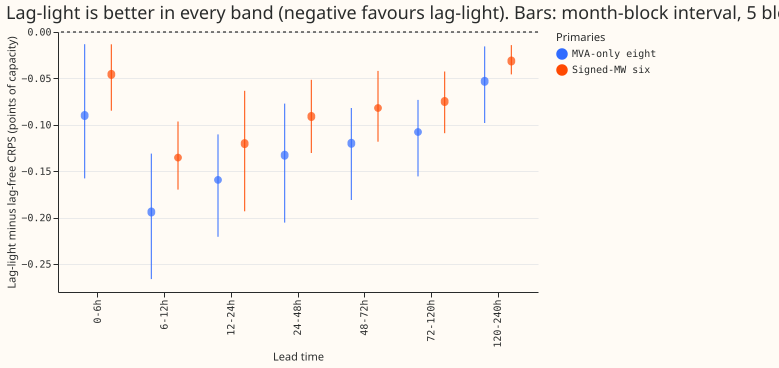
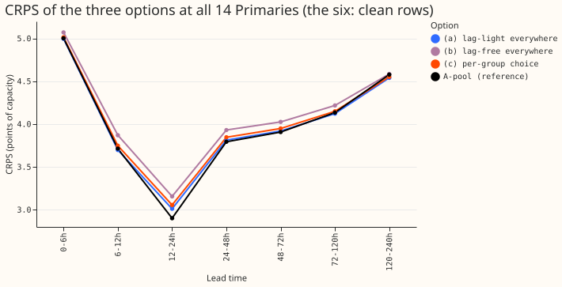

**One lag-light network for all 14 Primaries beats the per-group choice, because the lag-free
recipe is 0.081 points of CRPS worse than the lag-light network at the six.** We asked whether the
lag-free recipe is good enough at the six signed-MW Primaries to use there, with the lag-light
network (which reads yesterday's and last week's power) only at the eight MVA-only Primaries. We
re-scored the stored forecasts of two earlier experiments and ran no fit. The pre-registered test
failed at the six: the two networks differ by more than 0.03 in every lead band. Nothing is
adopted. Verdict: not supported. All numbers are CRPS in points of capacity (lower is better), over
five test months, interim and unaudited.

Terms. Lag-light is arm RDWT-D15 of [experiment
553](../00553-lag-light-release-candidate-lag-dropout-with-trailing-temperature-windows/result.md):
day-ago and week-ago power readings, trailing temperature windows, and 15% lag dropout, with the
readings present. Lag-free is arm E of [experiment
548](../00548-lag-free-release-candidate-assembly-with-trailing-temperature-windows/result.md).
A-pool is the network that reads all recent power (experiment 425). The three options are (a)
lag-light at all 14, (b) lag-free at all 14, and (c) lag-light at the eight and lag-free at the six.
Option (c) is a row selection of the two stored arms, so it equals (a) at the eight and (b) at the
six.

## Results

- **Pre-registered test.** (a) within 0.03 of (c) at the six: **failed**. The difference is -0.081
  over 24-120 h and -0.059 over all leads, and larger than 0.03 in every band (smallest -0.031 at
  120-240 h). At the eight the test holds by construction, since (a) and (c) are the same
  network. The failure has the opposite sign to the one the brief worried about: (a) is better than (c), so the per-group
  choice gives up accuracy, and one network for all 14 does not.
- **Predictions.** P1 (six, 24-120 h, lag-light minus lag-free between -0.10 and 0.00): **held**,
  -0.081. P2 (lag-free at the eight trails by 0.10 to 0.14): **held**, 0.117. P3 (Christmas week at
  the eight, lag-light no worse than lag-free by more than 0.10): **held**, -0.064 (3.902 against 3.965
  over 24-120 h; one week, no interval). P4 (leak above lag-free, under 6.0): **held** as stored,
  5.33 against 4.55.

**Table 1. Counted contrasts, lag-light minus lag-free, 24-120 h** (95% month-block bootstrap,
5 blocks, near min-to-max; Bonferroni count 14; MDE = minimum detectable effect, from the two
seeds of L-1d).

| Primaries | CRPS lag-light | CRPS lag-free | Difference | Interval | MDE | Folds worse |
|---|---|---|---|---|---|---|
| Eight | 4.437 | 4.554 | -0.117 | -0.174 to -0.078 | 0.116 | 0 of 5 |
| Six | 3.209 | 3.290 | -0.081 | -0.119 to -0.044 | 0.155 | 0 of 5 |
| All 14 (a) against (c) | 3.993 | 4.022 | -0.029 | -0.043 to -0.017 | n/a | 0 of 5 |

Both counted intervals exclude zero after the Bonferroni widening (upper ends -0.065 and -0.032). The
difference at the six is under its MDE, so a single seed pair cannot confirm it alone, but the sign
agrees in all five folds.

- **Per band.** Lag-light minus lag-free at the eight, from 0-6 h to 120-240 h: -0.090, -0.194,
  -0.159, -0.133, -0.120, -0.108, -0.053. At the six: -0.046, -0.135, -0.120, -0.091, -0.082, -0.075,
  -0.031. The gain is largest at 6-24 h and shrinks with lead time.
- **Against A-pool, 24-120 h.** At the eight, lag-light is +0.043 (0.011 to 0.082) and lag-free is
  +0.160 (0.100 to 0.223). At the six, lag-light is -0.071 (-0.109 to -0.015) and lag-free is
  +0.010 (-0.046 to +0.079). The lag-free recipe matches A-pool at the six; the lag-light network is
  better than A-pool there.

**Table 2. Absolute CRPS, 24-120 h.**

| Set | (a) lag-light | (b) lag-free | (c) per group | A-pool | L-1d | `manual_heuristic` |
|---|---|---|---|---|---|---|
| Eight | 4.437 | 4.554 | 4.437 | 4.395 | 4.630 | 5.521 |
| Six | 3.209 | 3.290 | 3.290 | 3.280 | 3.341 | 4.685 |
| All 14 | 3.993 | 4.097 | 4.022 | 3.991 | 4.164 | 5.218 |
| D15 and D18 (report only) | 9.923 | 10.36 | n/a | 10.21 | 10.50 | 13.58 |

**Table 3. Slices, lag-light minus lag-free** (24-120 h unless noted; "all leads" in brackets).

| Slice | Eight | Six |
|---|---|---|
| Cold winter nights | -0.162 (-0.092) | -0.049 (+0.050; interval -0.003 to +0.090) |
| Rows with no labelled event | -0.105 (-0.076) | -0.081 (-0.059) |
| Christmas week | -0.064 (-0.015) | -0.018 (-0.014) |
| Bank-holiday windows | -0.100 (-0.060) | -0.141 (-0.084) |

The six has no rows outside the clean class, so its "no labelled event" row equals its all-rows
row. Intervals for the one-week and bank-holiday slices rest on 1 to 5 blocks and are not
reliable. The cold-night slice at the six over all leads is the one place where lag-free scores
better (2 of 5 folds), and its interval includes zero.

- **D15 and D18 (report only).** Lag-light is 0.441 better over 24-120 h (interval -0.702 to
  -0.128)
  but 0.604 worse in Christmas week; the minimum detectable effect at these two series is 1.4, so
  neither figure is resolved.
- **Tails, 24-120 h.** Pinball loss at q95: -0.051 (-0.071 to -0.032) at the eight and -0.022
  (-0.034 to -0.007) at the six, in favour of lag-light. At q99: -0.017 and -0.003.
- **Injected-shift leak** (stored, experiment 553, all 14 Primaries pooled): lag-light 5.33 points of
  capacity, lag-free 4.55, L-1d 4.49. The leak is not split by group, so it does not separate the
  eight from the six.
- **Operational cost of each option.** (a) One recipe to maintain, and the day-ago and week-ago power
  readings are required at all 14 Primaries (with 15% dropout, the network still runs when they are
  absent, at the lag-free score). (b) One recipe, no readings required, 0.104 CRPS worse over
  24-120 h at the 14. (c) Two recipes to maintain, readings required only at the eight, 0.029 CRPS worse
  than (a) over 24-120 h at the 14.

## Checks

- **Origin-time weather** is the standing rule; this experiment reads only stored per-row scores of
  experiments 548 and 553, which assert it row by row (experiment 553: 1,142,520 test rows over
  153 test origins, for example origin 2025-10-01 09:00 UTC, weather run 2025-10-01 00:00 UTC). No
  forecast is made here, so there is no new row to assert.
- **Rows.** 1,145,256 stored rows; 1,142,520 have a finite CRPS for every arm used and form the row
  sets (the same count as experiment 553). July 2026 is not scored.
- **Counted contrasts:** 14, matching the Bonferroni count.
- **Reviews.** One Sonnet code review before scoring. It found that the first draft omitted
  experiment 553's finiteness mask, which would have let the absolute means of different arms
  average over different rows. That mask is now applied. It also found that the first assertions
  were tautological; they are now null checks on the per-group column. Its other findings are
  recorded below in the caveats. Write-up review: see the pull request.
- Cost: CPU only, 2 cores, a few minutes. No GPU.

## Caveats

- **Seeds.** Both arms are pools of seeds 0 and 1, as every stored comparator is. The difference
  at the six (0.081) is under its MDE (0.155), so it needs the multi-seed bake-off to confirm.
- **The six is the clean class.** The six's row set is rows with no labelled event, as in experiments
  521 and 553, so the 14 here are the eight plus the clean rows of the six. NGED's load-shift logs
  may miss events, so these rows may hold unlabelled events.
- **No forecast plots.** The experiment makes no new forecast, so it has no day-ahead or 10-day
  example of its own. The forecasts of arm RDWT-D15 are plotted in experiment 553; the stored
  predictions of arm E are not drawn here.
- **Lead range.** The lead range is 0 to 240 h, which covers the 1 to 10 day horizon NGED care about.
- **Bootstrap draws** differ in order from experiment 553's, so intervals for the same contrast may
  differ from experiment 553's in the third decimal place.

## What to try next

- Take the lag-light network forward as the single candidate for all 14 Primaries in the planned
  multi-seed bake-off, and keep the lag-free recipe as the fallback for missing readings.
- Look at the six on cold winter nights, the only slice where lag-free was ahead, in that bake-off.
