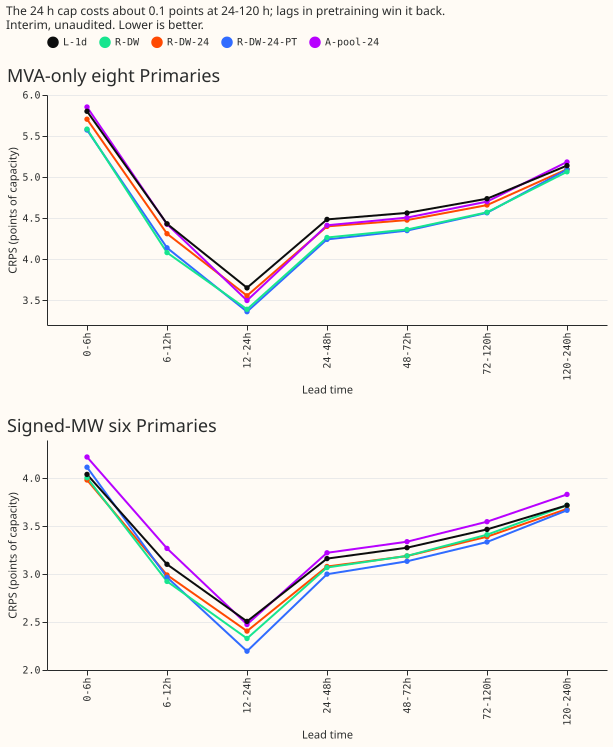
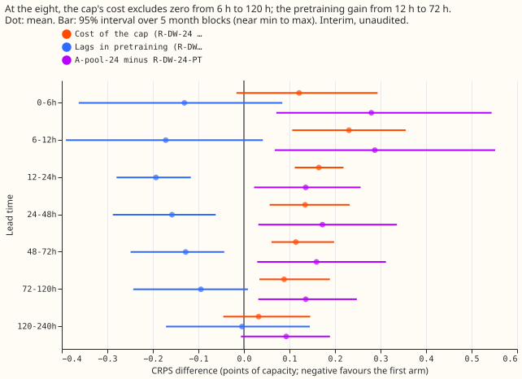

verdict: >-
  Mixed. P1 fails (the cap costs 0.09 to 0.11 at 48-120 h), P2 is supported, P3 fails, and P4 fails.
---

# Lags in pretraining and a 24-hour cap (interim, unaudited)

**Take-home message.** Dropping every reading newer than 24 hours costs the lag-light network about
0.1 CRPS points (points of capacity) at the eight from 6 h to 120 h. Putting the same capped lags
into the ERA5/CAMS pretraining recovers all of that from 12 h to 72 h, so the production recipe can
meet the 24-hour limit with no measured accuracy loss against the uncapped network. The pretrained network then reacts more
strongly to an injected shift in the lags (7.7 points of capacity against a 6.0 limit), and that
leak is the cost to weigh next. Every number here is interim and unaudited.

## Predictions

- **P1 fails.** The cap costs R-DW-24 0.12, 0.23, and 0.16 points at 0-6, 6-12, and 12-24 h at the
  eight (the 0-24 h part holds: at least 0.05), but also 0.13 to 0.11 at 24-72 h and 0.09 at 72-120 h,
  above the 0.05 failure line. The month-block interval excludes zero from 6 h to 120 h (0.03 to
  0.36), and R-DW-24 is worse than R-DW in 5 of 5 folds from 6 h to 120 h.
- **P2 is supported.** R-DW-24-PT beats R-DW-24 by 0.19, 0.16, 0.13, and 0.09 points at 12-24, 24-48,
  48-72, and 72-120 h at the eight. The interval excludes zero from 12 h to 72 h and just reaches
  zero at 72-120 h (-0.24 to 0.01); the sign is negative in 5 of 5 folds from 12 h to 72 h.
- **P3 fails, with a caveat.** A-pool-24 trails R-DW-24-PT by 0.14 to 0.17 points at 24-120 h, over
  the 0.04 limit. A-pool-24 is built in this experiment's harness with A-pool's monthly refit and
  182.6-day half-life, not in experiment 425's own pipeline, so the gap also holds that difference.
- **P4 fails.** The injected-shift leak is 7.75 points of capacity for R-DW-24-PT, 5.43 for R-DW-24,
  5.68 for R-DW, and 4.49 for L-1d. The 95% interval of R-DW-24-PT (5.8 to 12.1) sits above L-1d's
  point value. The leak is highest on the first day after the shift (9.95).

## Other results (eight Primaries, all leads, CRPS in points of capacity)

- **Absolute scores.** R-DW-24-PT 4.72, R-DW 4.71, R-DW-24 4.79, A-pool-24 4.85, L-1d 4.85, A-pool
  4.68, manual heuristic 5.62. The pretrained, capped network matches the uncapped one overall.
- **Readings absent.** Removing all lags at inference costs R-DW-24 0.05, R-DW-24-PT 0.26, and
  A-pool-24 0.38 points. The pretrained network leans on its lags more.
- **The six.** The cap costs almost nothing (R-DW-24 3.43, R-DW 3.45), and R-DW-24-PT is best (3.39).
- **Row drops.** Leaving out A-pool-24's training rows with a missing capped lag changes the score by
  0.003 (4.852 against 4.850), so the drops do not explain the gap.

## Method notes and limits

- **Statistics.** Intervals are 5-block month bootstraps (near the minimum to maximum of the folds).
  The minimum detectable effect from the two L-1d seeds is 0.10 to 0.27 by band. The pre-registered
  Bonferroni count is 4; the tables hold more contrasts, all labelled.
- **Dropout.** Whole origin days are drawn from (seed, day number): 25.5% of days mask all lags and
  4.5% mask only the day lag, the literal reading of "30% of days, 15% of those day-only". Share of
  rows missing the capped day lag in pretraining: 0.65%; the week lag: 0.79%. Dropout also masks
  validation rows used for early stopping.
- **Standardiser.** Lag value statistics come from the uncapped lags and apply unchanged to the
  capped lags.
- **Weather.** Every test row's weather run is at or before its origin (asserted for 153 origins);
  every capped lag is at least 24 h before its origin, checked against an independent loop on 2,000
  rows per fold.
- **Not run.** The lags-aged-by-1, 2, and 3-days test, and the stress leak for A-pool-24 (its monthly
  refit has no day-14 refit to stress). Tail coverage, cold nights, Christmas week, and D15/D18 were
  not tabulated for this write-up; the per-row scores are in the private data folder.
- **Event labels.** NGED's load-shift logs are incomplete, so clean rows may hold unlabelled events,
  and these results are not corrected for that.
