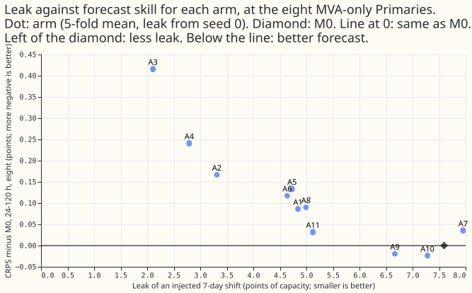
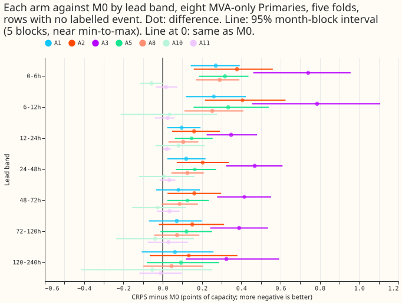
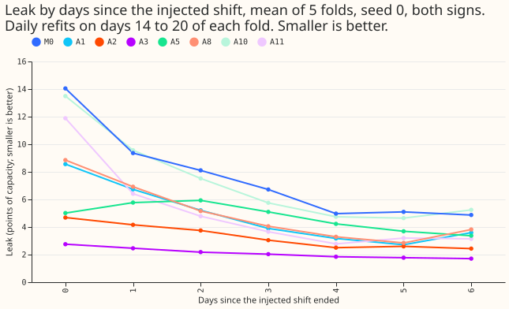

**M0's leak and its skill move together in the step-2 arms: each arm that cut the leak lost skill at
the eight.** The injected-shift leak (a 7-day shift in the recent data, in points of capacity) falls
from 7.60 for M0 to between 2.1 and 5.0 for arms A1 to A6 and A8, which is at or below the release
limit of 6.0. Each of those arms is also worse than M0 at 24 to 120 h at the eight MVA-only
Primaries, by 0.09 to 0.42 points of CRPS, and the stronger the leak cut the larger the loss
([figure 1](figure_1_leak_vs_skill.svg)). The trailing-temperature arm (A9) and the drift embedding
(A10) left the leak at 6.67 and 7.28. The wind arm (A11) cut it to 5.12 with a CRPS change of +0.032
at the eight, but its placebo (A11-null) cut it to 7.15 from 7.60, and A9's placebo differs from A9
by 2.55 points, so leak differences of about 2.5 points are within placebo noise.

**Take-home message and next step.** Training the mixer once on the whole ensemble history (step 2)
and then fine-tuning daily (A1) is the cheapest way to cut the leak, but it gives back about half of
M0's gain over L-1d at the eight (0.086 of 0.166 points). A fine-tune that cannot move far (A2
frozen encoders, A3 penalty, A4 gentle rate) cuts the leak further and loses all of M0's gain at the
eight. Whether the release limit or the gain matters more at the eight is the maintainer's call; the
experiment does not settle it.

## Setup

- **Arms:** A1 to A8 are the plan's arms (step 2 shared by A1 to A5, A6 and A7 as in experiment 554,
  A8 the folded-normal head). A9 adds experiment 515's and 526's three trailing-temperature columns
  to the weather encoder, with a matched shuffled-day placebo (A9-null). A10 adds a per-Primary
  drift embedding with monthly knots, smoothness penalty 10 times the mean squared second
  difference, flat extrapolation, learned over the 2019-09 ERA5 and CAMS history; both encoders are
  frozen in fine-tuning. A11 adds 10 m and 100 m wind u and v (mean and standard deviation), with a
  column-count-matched placebo (A11-null). A11c adds total cloud cover with a placebo (A11c-null),
  on four folds only.
- **Scoring:** five folds of 511 (2025-10, 2025-12, 2026-01, 2026-03, 2026-06), 2 seeds, rows with
  no labelled event, month-block bootstrap with 5 blocks (near the minimum to maximum of the five
  folds), 28 counted tests (11 arms against M0 and the 2 placebo pairs, each at the eight and at the
  six over 24 to 120 h, plus the 2 placebo pairs on cold nights at the eight). The minimum
  detectable effect (MDE) comes from the 5 stored seeds of L-1d in experiment 554. Every real
  weather input of a target comes from the run issued at or before the forecast origin; the scripts
  assert it row by row for the base frames and print one example row per fold. The placebo columns
  take their values from a donor day, which can be a later run, and carry no weather information.
- **Not tuned:** the L2 strength was chosen on fold 2025-10 alone, as the plan said. All four
  strengths were within 0.012 of the best early-stopping loss, and the largest (1.0) was chosen, so
  A3 stays very close to the step-2 weights.

## Results

**CRPS against M0, 24 to 120 h (points of capacity; positive means worse than M0).** Interval:
month-block, 5 blocks. Leave-D8-out: the eight without Primary D8.

| Arm | Leak | Eight | Eight, leave-D8-out | Six |
|---|---|---|---|---|
| M0 | 7.60 | (against L-1d: −0.166) | (−0.071) | (−0.075) |
| A1 | 4.84 | +0.086 (−0.037 to +0.202) | +0.052 (−0.108 to +0.195) | −0.009 (−0.093 to +0.068) |
| A2 frozen encoders | 3.31 | +0.167 (+0.019 to +0.315) | +0.115 (−0.063 to +0.301) | +0.039 (−0.050 to +0.128) |
| A3 penalty | 2.11 | +0.416 (+0.285 to +0.557) | +0.308 (+0.127 to +0.504) | +0.148 (+0.046 to +0.262) |
| A4 gentle rate | 2.79 | +0.241 (+0.114 to +0.367) | +0.164 (−0.027 to +0.343) | +0.061 (−0.028 to +0.158) |
| A5 weight average | 4.73 | +0.133 (+0.021 to +0.252) | +0.098 (−0.053 to +0.259) | +0.023 (−0.052 to +0.103) |
| A6 half-life 180 | 4.64 | +0.117 (+0.024 to +0.277) | +0.108 (−0.038 to +0.311) | +0.043 (+0.001 to +0.088) |
| A7 3-day cadence | 7.95 | +0.035 (+0.018 to +0.055) | +0.039 (+0.024 to +0.057) | +0.048 (+0.017 to +0.092) |
| A8 folded head | 4.99 | +0.090 (−0.009 to +0.190) | +0.046 (−0.094 to +0.171) | −0.010 (−0.093 to +0.066) |
| A9 | 6.67 | −0.020 (−0.054 to +0.022) | −0.019 (−0.049 to +0.012) | −0.004 (−0.095 to +0.087) |
| A10 | 7.28 | −0.024 (−0.184 to +0.162) | −0.057 (−0.256 to +0.170) | −0.157 (−0.362 to +0.038) |
| A11 | 5.12 | +0.032 (−0.050 to +0.100) | +0.039 (−0.036 to +0.092) | +0.066 (+0.034 to +0.091) |

The MDE is 0.18 at the eight, 0.14 at the six, and 0.38 and 0.36 on cold nights at the eight and
six. Most intervals include zero; the intervals above that exclude zero at the 5-block month level
are A2 (eight), A3, A4, A5, A6, A7, and A11 at the six. Five blocks limit the interval to the range
of the five folds, and the cold-night tests rest on 3 blocks, so the Bonferroni-corrected intervals
are weak evidence: A3 (eight and six), A4 (eight), A6 (eight), A7 (eight and six), and A11 (six)
still exclude zero after the correction for 28 tests, and each has the same sign in at least 4 of 5
folds. **A single Primary carries M0's gain:** without D8, M0's gain over L-1d at the eight
falls from 0.166 to 0.071 and no longer excludes zero, so the "share of M0's gain kept" is mostly
D8's.

**Leak by days since the shift.** The leak is largest on the first days after the shift and falls
for every arm except A5, which rises slightly on days 1 and 2; A3 and A2 start lowest. M0 starts at
about 14 points on day 0 and ends near 5.

### Predictions

- **P1 (A2 or A3 reaches a leak of at most 6.0 and keeps 70% of M0's gain): not met.** Both reach
  the leak (3.31 and 2.11) but neither keeps the gain (A2 loses all of it at the eight; A3 ends
  worse than L-1d).
- **P2 (A1 lowers the leak by at least 1.0): met.** A1 lowers it by 2.76.
- **P3 (A6 lowers the leak and loses gain): met.** Leak 4.64; +0.117 at the eight.
- **P4 (A8 changes CRPS by under 0.03): met against A1.** The plan did not name the base arm;
  against A1, A8 differs by 0.004 at the eight at 24 to 120 h (+0.090 and +0.086 against M0) and by
  0.001 at the six (−0.010 and −0.009).
- **A9 (manager's addition; prediction that could fail: A9 minus A9-null on cold nights at the eight
  at most −0.05): not met.** The difference is +0.023 (−0.081 to +0.034), MDE 0.38. At the six on
  cold nights it is −0.273 (−0.427 to −0.156), MDE 0.36, 3 blocks; over all rows at the six it is
  −0.002. Leak: A9 6.67, A9-null 9.22, M0 7.60.
- **A10 (lowers the leak by at least 1.0 against M0 and keeps 70% of the gain at the eight): not
  met.** The leak falls by 0.32 (7.28 against 7.60); the change at the eight is −0.024 (−0.184 to
  +0.162, not shown; the interval is as wide as the MDE of 0.18, so a change of that size is not
  excluded). A10 also freezes both encoders in fine-tuning and has no frozen-encoder control without
  the drift term or placebo, so its result mixes the two changes; A2 shows that freezing alone moves
  the leak and the skill. The knots learned from the 2019-09 history are small and smooth. Their
  mean distance from
  the Primary's mean is 0.24 in 2019-09 to 2020-02 and 0.14 from 2020-09 on, step size is 0.071 over
  the covid months against 0.051 elsewhere, and the net drift from the first to the last knot is
  0.32. The knots move more over the covid months than elsewhere, but not enough to change the leak.
- **A11 wind (u and v, real minus placebo): no wind effect shown at the eight, worse at the six.**
  Eight, 24 to 120 h: +0.008 (−0.055 to +0.065). Six: +0.081 (+0.034 to +0.123), 5 of 5 folds
  positive, MDE 0.14, so the real arm is worse than the placebo at the six. Leak: A11 5.12, A11-null
  7.15, M0 7.60; the placebo also sits below M0, so the leak change is not a wind effect.
- **A11 cloud (four folds from 2025-12, real minus placebo only, winter-to-spring only):** not
  shown. Eight, 24 to 120 h: +0.014 (−0.023 to +0.050); six: +0.033 (−0.025 to +0.099); eight cold
  nights: +0.023 (−0.010 to +0.077). Leave-D8-out, eight: +0.020 (−0.012 to +0.049). Leak: 15.97
  real, 15.66 placebo (4 folds, so not comparable with the five-fold leaks above). Fine-tune rows
  with cloud values per fold: 38,240 in 2025-12, 377,230 in 2026-01, 691,616 in 2026-03, and
  1,374,562 in 2026-06. Both arms hold the value 0 plus a missing flag before 2025-11-21, and the
  ENS cloud cover (0 to 100 percent) was divided by 100 to match the ERA5 scale (0 to 1). Four folds
  with thin early cloud data do not rule out a gain from earlier history, and they give no reason to
  fetch it. In 2025-12 the real and placebo arms differ little, because most of its rows hold the
  value 0 plus the missing flag. The leaks of about 16 are twice the five-fold values and differ by
  0.3, which tells nothing at that spread.

## Checks

- **Audit triggers:** the A9 prediction failed (trigger 2): the three trailing-temperature columns
  did not help on cold nights here, unlike experiment 515. One possible cause is that M0's weather
  encoder takes only 7 ensemble-mean columns and the three added columns share that encoder with
  them; this was not tested. At the six, A9 minus A9-null on cold nights is −0.273 (−0.427 to
  −0.156, 3 blocks), so the columns helped there. Leave-D8-out did not flip the sign of any contrast
  quoted above
  (trigger 4). Trigger 5 (a nested arm beating the arm it contains): A9 is nominally below M0 but
  the interval includes zero, so it does not fire.
- **Fits and budget:** pure fit time (summed `train_seconds`, fine-tune and stress fits) was A1 0.41
  h, A2 0.31, A3 0.89, A4 0.20, A6 1.01, A7 0.36, A8 0.46, A9 0.97, A9-null 1.03, A10 1.49, A11
  1.01, A11-null 1.01, A11c 1.12, A11c-null 1.21 (about 11.5 h in total), plus 0.05 to 0.10 h of
  pretraining per arm of A9 to A11c. The budget agreed with the manager was 8.5 h, so the total
  overran it. The A11 figure of 2.09 h in an interim message summed two overlapping time fields;
  1.01 h is correct.
- **Not done:** the day-ahead and 14-day example forecasts, the tail-coverage and pinball tables
  (q01 to q99), the curtailment-cost metric, the median-minus-mean forecast per site, and the
  load-shift event plots were not produced for this experiment, because no arm reached a state worth
  a production comparison. The label counts are lower bounds, since NGED's event labels are
  incomplete.
- **Code review:** one fresh review of the finished pull request (code, tables, and prose) found the
  corrections made above; earlier code reviews of arms A1 to A9 ran before the first quoted numbers.
