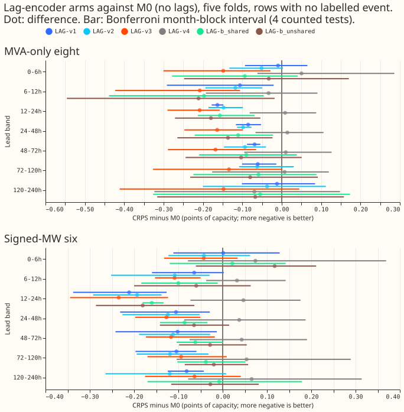
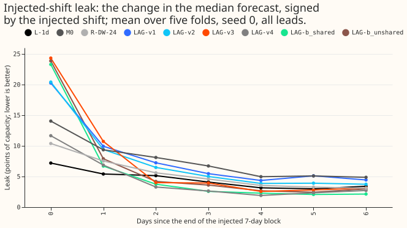

**The lag encoder let the modular demand network use power readings that are at least 24 hours old,
and the network then forecast better than the version without lags. The next step is to cut its
leak of an injected load shift. At 24-120 h at the eight MVA-only Primaries, CRPS (lower is better)
fell from M0's 4.465 to 4.396, 4.385, and 4.315 for the first three variants, and all three score
lower than the 24-hour-capped reference networks of experiment 558 (R-DW-24 4.549, A-pool-24 4.580;
the intervals for v3 against both exclude zero). Every variant that reads lagged power leaks an
injected load shift more than L-1d does (6.1 to 8.1 points of capacity against 4.49).** These
numbers are interim and unaudited.

The network is the modular network M0 of [experiment
545](../00545-modular-lag-free-demand-network-weather-and-datetime-encoders/result.md) plus a lag
encoder. The lags are those of [experiment
558](../00558-lags-in-pretraining-and-24-hour-cap-lag-light-demand-network/result.md): the day lag
and the week lag taken at least 24 hours before the forecast origin, each with a missing flag and an
age, and block dropout that masks whole origin days (30% of origin days mask lags, and on 15% of
those days only the day lag is masked, so about 25% of training rows lose both lags and 5% lose the
day lag only; the 2025-10 pretraining rows measured 23% and 6%). The lag encoder is pretrained on
ERA5/CAMS rows with the same lags and dropout. Every arm refits daily with a 90-day half-life, as M0
does. Arms v1 to v4 use 2 seeds, and the stage B arms use 1 seed.

## Arms and prediction results

- **v1:** lags alone. **v2:** lags plus the datetime features of the target time.
- **v3:** lags plus "expected", the embeddings that copies of the weather encoder and datetime
  encoder (the same weights) give for the weather and datetime of each lag's own time. The weather at
  a lag's time comes from the freshest weather run issued at or before that time.
- **v4:** expected only, with no lagged power (the control).
- **b_shared and b_unshared (stage B, 1 seed):** one lag encoder per lag, with shared or unshared
  weights, each reading one lag with its expected embeddings.

**P1 (v3 beats v1 by at least 0.05 at 24-120 h at the eight): the point estimate meets it, the
interval does not.** The difference is -0.081 (Bonferroni month-block interval -0.217 to +0.014), v3
is worse than v1 in 2 of 5 folds (+0.022 in 2026-01 and +0.001 in 2026-06), and the minimum
detectable effect is 0.116. The stop rule (v3 must beat v1 by 0.03) did not skip stage B. At the six,
v3 minus v1 is -0.004 (interval -0.078 to +0.095).

**P2 (v4 within 0.03 of M0): holds on the point estimate.** v4 minus M0 is +0.010 (interval -0.121 to
+0.116, 3 of 5 folds worse), so a gap up to the minimum detectable effect is not excluded.

**P3 (the best arm within 0.04 of A-pool-24 and beating R-DW-24): the first half failed because v3
is far better, not worse.** v3 is 0.266 better than A-pool-24 (interval -0.401 to -0.110, 0 of 5
folds worse) and 0.234 better than R-DW-24 (interval -0.395 to -0.100, 0 of 5 folds worse).
A-pool-24 is 0.185 worse than uncapped A-pool (4.395), and v3 is 0.080 lower than uncapped A-pool on
the point estimate (no interval was computed).

**P4 (leak of the best arm at most 6.0): failed.** v3 leaks 7.36 points of capacity. The Bonferroni
count is 4 (P1, P2, and the two contrasts of P3, each at 24-120 h at the eight).

## Results

CRPS at 24-120 h, the mean of 5 folds. M0 and v1 to v4 average 2 seeds, and the b arms use 1 seed.
Contrasts against M0 are the Bonferroni month-block interval (4 tests, 5 month blocks, near the
minimum to maximum of the folds) with the number of folds in which the arm is worse. The minimum
detectable effect is 0.116 at the eight. The leak is the injected-shift leak of [experiment
511](../00511-lagless-network-refit-cadence-half-life-and-mixed-pretraining/result.md)'s stress
world (seed 0, all leads, points of capacity), with the fold range in brackets.

| Arm | Eight | Eight minus M0 | Eight, D8 left out | Six | Leak, all leads |
|---|---|---|---|---|---|
| L-1d | 4.631 | | 3.852 | 3.342 | 4.49 (2.59 to 10.47) |
| M0 | 4.465 | | 3.781 | 3.267 | 7.60 (2.44 to 17.48) |
| A-pool (experiment 425) | 4.395 | | 3.633 | 3.280 | not run |
| R-DW-24 (558) | 4.549 | | 3.790 | 3.261 | 5.43 (2.57 to 11.55) |
| A-pool-24 (558) | 4.580 | | 3.807 | 3.413 | not run |
| v1 | 4.396 | -0.069 (-0.093 to -0.038; 0/5) | 3.694 | 3.163 | 8.11 (4.12 to 16.57) |
| v2 | 4.385 | -0.079 (-0.109 to -0.013; 1/5) | 3.641 | 3.148 | 7.55 (3.11 to 16.10) |
| v3 | 4.315 | -0.150 (-0.286 to -0.040; 0/5) | 3.580 | 3.159 | 7.36 (6.28 to 9.25) |
| v4 | 4.475 | +0.010 (-0.121 to +0.116; 3/5) | 3.773 | 3.314 | 4.49 (2.10 to 7.52) |
| b_shared (1 seed) | 4.385 | -0.080 (-0.213 to +0.049; 1/5) | 3.653 | 3.211 | 6.12 (4.95 to 7.32) |
| b_unshared (1 seed) | 4.365 | -0.100 (-0.240 to +0.055; 1/5) | 3.624 | 3.233 | 6.81 (5.06 to 8.84) |

**The lag encoder helps, and the gain of the expected embeddings over lags alone is not shown at the
eight.** v1 to v3 are
better than M0 by 0.069, 0.079, and 0.150, and the intervals exclude zero (v3 is worse than M0 in
none of 5 folds). Leaving D8 out keeps the order (v3 3.580, v2 3.641, v1 3.694, M0 3.781), and v3
minus v1 is then -0.114 (interval -0.297 to -0.005). At the six, v1 to v3 beat M0 by 0.104, 0.118,
and 0.108 and the expected embeddings add nothing (v3 minus v1 -0.004).

**Stage B did not help.** b_unshared minus v3 is +0.050 (interval +0.006 to +0.115, 4 of 5 folds
worse) and b_shared minus v3 is +0.070 (interval +0.026 to +0.102, 5 of 5 folds worse). Both stage B
arms use 1 seed, and v3 averages 2 seeds. b_shared has the lowest leak of the lag arms (6.12).





**The leak sits in the days right after the shifted block.** v3's leak is 24.3 points of capacity on
the day the block ends and 10.7 the next day, then 4.0 and 3.9, below L-1d's 5.1 and 4.1 on days 2
and 3. A lag arm reads the shifted readings directly as its lag inputs while the shifted block is
still the latest data, so a higher leak on the first two days follows from using lags. v4, which
reads no power, leaks 11.7 and 6.9 on those days (the shift reaches it only through retraining).

**Removing the lags gives back most of the gain, and ageing them costs little.** With both lags
removed at inference, CRPS at the eight rises by 0.081 for v1 (4.396 to 4.477), 0.107 for v2 (4.385
to 4.492), 0.100 for v3 (4.315 to 4.415), and 0.140 and 0.152 for the b arms (4.525 and 4.517).
That is as large as or larger than each arm's gain over M0, so v1, v2, and the b arms with lags
removed score near or above M0's 4.465, and v3 stays below it. Ageing the lags by 1, 2, and 3
extra days moves v3 from 4.315 to 4.339, 4.353, and 4.369, and v1 from 4.396 to 4.421, 4.442, and
4.459, so the lag arms degrade gradually when telemetry is late. At the six, v3 with lags removed
scores 3.352, worse than M0's 3.267.

## Checks

- **Lag times, asserted for all rows.** Every day and week lag is at least 24 hours before the
  forecast origin (also when aged by extra days), the day lag is 24 to 48 hours old at zero extra
  days, and the lag indices and ages equal experiment 558's builder
  (`ml-experiments/00558-*/e00558_lags.py`). Example, 2025-10 test row 0: origin 2025-10-01 09:00 UTC,
  target 2025-10-03 07:00 UTC, day lag at 2025-09-30 07:00 UTC, week lag at 2025-09-26 07:00 UTC.
- **Origin-time weather, asserted row by row.** For every test origin (153) the script asserts
  `nwp_init_time <= power_fcst_init_time == origin` and that the weather-run summary exists. For
  every expected input it asserts, on a sample of 200,000 training rows, all test rows of a month,
  and the first 2,000,000 pretraining rows, that the weather run is issued at or before the lag
  time, which is itself at least 24 hours before the origin. Example, 2025-10 training row: lag time
  2024-11-03 18:00 UTC, weather run 2024-11-03 09:00 UTC, forecast origin 2024-11-05 09:00 UTC. A
  lag time with no stored weather run (0.3% to 0.8% of rows) gets zero expected inputs.
- **Code review.** One fresh Sonnet reviewer found no leakage. Its one medium finding (a resumed
  stress run would score a reused fitted network without the shift) was fixed by refusing to resume
  a stress run. Its other findings (a float32 age used to rebuild the lag time in the stress shift,
  as in experiment 544; the unused ERA5/CAMS table built at fine-tuning, fixed; sampled rather than
  full leakage assertions; the expected inputs are not masked by dropout) were noted. The expected
  inputs stay present when lags are masked, so lags removed leaves v4 unchanged.
- **Seeds.** Stage B arms use 1 seed against 2 for the other arms, so the comparisons of stage B
  with v3 mix one and two seeds.
- **Compute.** The fits and scoring in the logs, plus the pretraining training time, took 1.57 h
  (v1), 1.08 h (v2), 1.67 h (v3), 1.85 h (v4), 1.38 h (b_shared), and 1.19 h (b_unshared), 8.74 h in
  total, on a GPU shared with other fits. Row building is not counted.

## Reproduce

```bash
export DATA_PATH_INTERNAL=<private data folder>
for a in v1 v2 v3 v4; do
  ml-experiments/00560-*/run.sh pretrain --arm $a
  ml-experiments/00560-*/run.sh fit --arm $a
  ml-experiments/00560-*/run.sh fit --arm $a --stress --seeds 0
  ml-experiments/00560-*/run.sh assemble --arm $a
done
for a in b_shared b_unshared; do  # 1 seed
  ml-experiments/00560-*/run.sh pretrain --arm $a --seeds 0
  ml-experiments/00560-*/run.sh fit --arm $a --seeds 0
  ml-experiments/00560-*/run.sh fit --arm $a --stress --seeds 0
  ml-experiments/00560-*/run.sh assemble --arm $a --seeds 0
done
# then, with ml-experiments/00524*/env.sh sourced: e00560_rows.py, e00560_score.py,
# e00560_stress.py, e00560_report.py
```

Code reused from earlier experiments: 545 (network parts, fit loop, recipe), 544 (harness and
stress shift), 511, 510, 448, 428, 397 (rows and loop), 558 (capped lags and block dropout), 521
(statistics).
