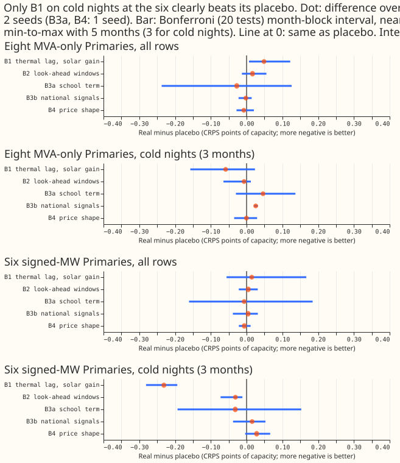

*Status: finished. Every number is interim and unaudited.*

**Take-home message.** None of the extra inputs helped over a whole year. We gave a neural network
that forecasts substation demand (the modular lag-free network of [experiment
545](../00545-modular-lag-free-demand-network-weather-and-datetime-encoders/result.md)) five groups
of inputs that earlier networks found useless, and compared each with a control of the same width
whose columns came from a different day. One group, thermal-lag and solar-gain columns, lowered the
error on cold winter nights at the six signed-MW substations, by 0.231 points of effective capacity
against its control. The same group raised the error on all rows at the eight MVA-only substations.
The next step is a larger cold-night test of that group on the best lagged network (experiment 560,
variant v3). The verdict is **not supported**.

## What was done

- **Network and folds.** Arm M0 of experiment 545, refitted daily, on experiment 511's five folds
  (July 2026 unused), 2 seeds for arms B1, B2, B3b, and 1 seed for the rest. Experiment 554's
  pretrained M0 weights were read, never written.
- **How the columns enter.** The new columns are seen only during fine-tuning on ensemble forecasts,
  through input units initialised to zero, so each arm starts as M0. Experiment 437 pretrained each
  bundle on ERA5 and CAMS rows, so this is a different test. Experiments 559 and 560 also read
  experiment 554's M0 weights.
- **Arms.** B1: thermal-lag and solar-gain columns of [experiment
  437](../00437-neural-demand-thermal-lag-solar-gain-and-tariff-feature-bundles/result.md) (14).
  B2: forward windows from the same run (6). B3a: school-term columns (5). B3b: national signals of
  the previous day (7). B4: the whole-day price shape of [experiment
  513](../00513-lagless-demand-network-whole-day-price-shape-at-training-time/result.md), present in
  a seeded 50% of fine-tuning rows with a flag and absent at scoring (12). Each arm has a
  shuffled-day control of the same width; B4-oracle scores B4's networks with price present.
- **Weather timing.** Every weather input comes from the run issued at or before the forecast
  origin. The fit script asserts that for every row, and the log prints one example row per fold.
  Experiment 437's causality check (later runs deleted, identical result) passed on Primary D2.

## Results

**No arm passes the gate.** The gate was real minus placebo of at most -0.03 on all rows, with a
Bonferroni interval excluding zero (20 primary contrasts, 5-month block bootstrap, near min-to-max).
Differences are CRPS points of effective capacity; negative favours the real columns.

- **B1:** all rows at the eight +0.049 [+0.007, +0.122]; at the six +0.015 [-0.056, +0.167]. On cold
  nights, 3 months: eight -0.059 [-0.157, +0.023], six -0.231 [-0.281, -0.194], with all 3 months
  negative at the six. B1 minus M0 on cold nights at the six is -0.188 [-0.211, -0.126], so the gain
  holds against plain M0 too.
- **B2:** all rows +0.017 (eight) and +0.005 (six). Cold nights at the eight -0.007 [-0.065, +0.012]
  and at the six -0.031 [-0.073, -0.012]. The 1-seed cold-night result at the eight (-0.037) did not
  survive the second seed.
- **B3a (school term, 1 seed):** all rows -0.027 [-0.238, +0.126] at the eight and -0.007 at the six.
- **B3b (national signals):** all rows -0.002 and +0.004; cold nights at the eight +0.026
  [+0.021, +0.031] (worse than its control).
- **B4 (price shape, scored without price):** all rows -0.008 and -0.006 against its control. Against
  plain M0 (1 seed) it is -0.004 at the eight and +0.010 at the six. B4-oracle against M0: -0.011
  (eight) and -0.001 (six), so even a real price shape at scoring gains little.
- **Absolute CRPS, all rows, eight and six:** M0 4.751 and 3.480 (seeds 0 and 1); B1 4.758 and 3.478;
  B2 4.747 and 3.474; B3b 4.726 and 3.468. Cold nights at the six: M0 3.569, B1 3.381, B1 control
  3.612.
- **Minimum detectable effect** (seed spread of two M0 seeds, 5 months): 0.087 (eight) and 0.104
  (six) on all rows, 0.106 and 0.227 on cold nights. Every cold-night contrast except B1 at the six
  sits near or under this, so the cold-night results are suggestive only.

**Predictions.** P1 (B1 and B2 cold nights at the eight at most -0.05): B1 met the point value
(-0.059) with an interval including zero, and B2 did not (-0.007). P2 (school term within 0.03 of its
control): held on all rows. P3 (B4 beats M0 by 0.03 at the six): failed.

## Checks

- **Trigger 5 (a control moves the score):** the shuffled-day controls moved cold-night scores
  against M0 by +0.043 (B1 control) and +0.026 (B2 control) at the six, with intervals that
  exclude zero. We did not test an explanation (extra uninformative inputs may add variance on the
  few cold-night rows), and no audit ran. B1's gain holds against both the control and M0.
- **Not run:** median minus mean forecast per site (the stored forecasts have no mean column), the
  error of the mean forecast beside the quantile score, leave-D8-out, the injected-shift leak check,
  and the lag-encoder re-run on experiment 560's v3 variant. Experiment 560 merged during this
  experiment. The re-run needs new harness code, and only one slice supports it.
- **Placebo limits:** controls take a donor day's columns, which can lie after the row's own origin;
  rows with no donor (clock-change days, the first 5 days of runs) take the column mean (about 0.4%
  of 2026-01 rows); B4's control has no 3-day minimum separation; the two CAMS columns of B1 use the
  valid-day shift though they are constant within a run.
- **Availability at serving:** B1 and B2 need ECMWF runs and, for two B1 columns, the CAMS feed. B3a
  is a fixed calendar. B3b needs daily Elexon and NESO feeds that production does not read today.
  NGED's event logs may be incomplete, so rows with no labelled event can hold unlabelled events.

## What the next experiment should answer

Does B1 lower cold-night error at the six on more than 3 cold months, and on the best lagged network
(experiment 560, variant v3), without the loss on all rows at the eight?
