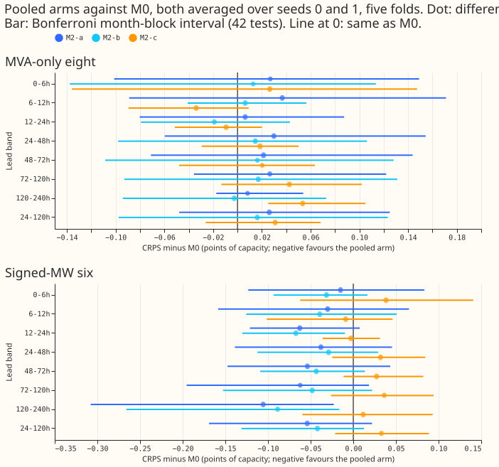
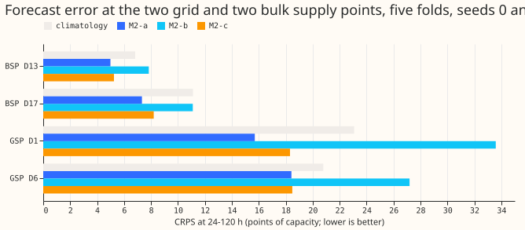
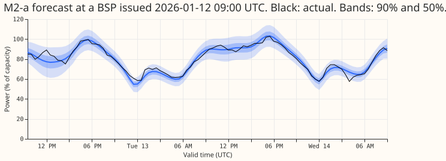
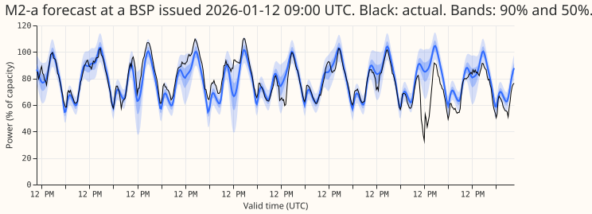
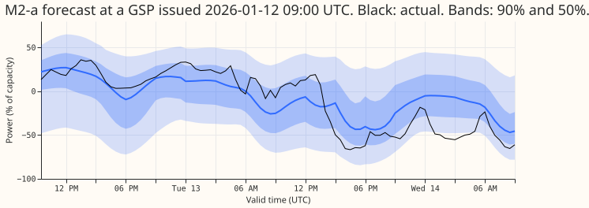
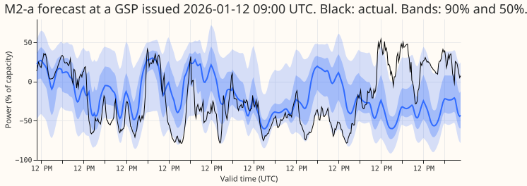

**Adding two bulk supply points (BSPs) and two grid supply points (GSPs) to the training rows of the
demand network did not lower its forecast error at the 16 Primaries.** The change in CRPS (lower is
better) at leads of 24 to 120 h is +0.026 points of capacity at the eight MVA-only Primaries
(Bonferroni interval -0.048 to +0.125) and -0.054 at the six signed-MW Primaries (-0.169 to +0.022).
Both are smaller than the minimum detectable effect (0.113 and 0.128). The same network forecasts
the four extra series better than a climatology. Verdict: not supported.

We asked whether more series help the shared weather and calendar encoders of the modular network M0
([experiment 545](../00545-modular-lag-free-demand-network-weather-and-datetime-encoders/result.md),
replicated in [experiment 554](../00554-m0-replication-five-seeds-leak-mitigations-and-leave-d8-out/result.md)).
[Experiment 563](../00563-pooled-primary-bsp-gsp-data-check/result.md) found only 4 such series, so
the maintainer asked for this reduced test. Each of the four extra series (D1 and D6 are GSPs, D13
and D17 are BSPs) has its own embedding row, and a fixed one-hot series type (Primary, BSP, or GSP)
feeds the datetime encoder. The arms are M2-a (extra series in pretraining and fine-tuning), M2-b
(pretraining only), and M2-c (fine-tuning only, from M0's pretrained weights). The control is M0 with
the same 2 seeds (0 and 1), on the rows of [experiment
511](../00511-lagless-network-refit-cadence-half-life-and-mixed-pretraining/result.md): 5 folds,
daily refit, 90-day half-life, rows with no labelled event. "The eight" are the MVA-only Primaries
and "the six" the signed-MW Primaries; D15 and D18 are report-only. The harness is experiment 554's,
copied into this folder.

## Results

CRPS minus M0 (seeds 0 and 1), pooled over 24 to 120 h; positive means the pooled arm is worse.
Brackets: Bonferroni month-block interval (5 blocks, near the minimum to maximum of the five folds;
42 counted tests: 3 arms times 2 groups times 7 lead bands). The minimum detectable effect (MDE)
comes from the 2-seed spread of M2-a.

| Set | M2-a | M2-b | M2-c | MDE |
|---|---|---|---|---|
| Eight | +0.026 (-0.048 to +0.125) | +0.016 (-0.097 to +0.123) | +0.031 (-0.026 to +0.068) | 0.113 |
| Eight without D8 | +0.035 (-0.036 to +0.126) | +0.028 (-0.066 to +0.132) | +0.049 (-0.005 to +0.087) | 0.092 |
| D8 alone | -0.037 (-0.240 to +0.120) | -0.068 (-0.321 to +0.108) | -0.094 (-0.184 to -0.049) | 0.593 |
| Six | -0.054 (-0.169 to +0.022) | -0.042 (-0.131 to +0.013) | +0.033 (-0.021 to +0.089) | 0.128 |

**The Primaries did not gain.** Absolute CRPS at 24 to 120 h at the eight is 4.491 (M2-a), 4.481
(M2-b), 4.496 (M2-c), 4.465 (M0, seeds 0 and 1), 4.433 (M0, 5 seeds), 4.609 (L-1d, 5 seeds), and
5.521 (`manual_heuristic`). At the six it is 3.213, 3.225, 3.300, 3.267, 3.245, 3.306, and 4.686.
M2-a was worse than M0 in 2 of 5 folds at the eight and in 2 of 5 at the six, with fold signs that
differ between folds. Leaving D8 out does not change any sign. Of the pre-registered predictions,
P1 failed (no gain of 0.05 at the eight), P2 held (M2-b is not shown better than M2-a: minus M2-a is
-0.010, interval -0.069 to +0.035), and P3 was not tested (below).

**The extra series are forecast better by the pooled network than by a climatology, and only if they
are fine-tuned.** CRPS at 24 to 120 h, over the five folds (climatology is the empirical quantiles
of the same month, half-hour, and weekend cell in the 24 months before the test month):

| Series | M2-a | M2-c | M2-b | Climatology |
|---|---|---|---|---|
| D1 (GSP) | 15.70 | 18.31 | 33.59 | 23.08 |
| D6 (GSP) | 18.42 | 18.49 | 27.19 | 20.79 |
| D13 (BSP) | 4.99 | 5.25 | 7.83 | 6.83 |
| D17 (BSP) | 7.33 | 8.20 | 11.10 | 11.11 |

The single-network L-1d of experiment 511 was never fitted to these series, so it is not a
reference here. The GSPs include the BSPs beneath them (NGED's hierarchy file), and no series'
target is another series' input, because the network reads no power.

## Checks

- **Origin-time weather, asserted row by row.** For every test origin the script asserts
  `nwp_init_time <= power_fcst_init_time`, `power_fcst_init_time == origin`, and that the Primaries'
  and the extra series' weather-run files exist and carry the origin. Example, extra series 16 (D1),
  2025-10 test row: target 2025-10-08 20:30 UTC, origin 2025-10-01 09:00 UTC, weather run 2025-10-01
  00:00 UTC. Every training target is after its origin and its weather run exists 9 hours before.
- **Loss weights.** Primary rows keep M0's recency weights. Each extra series' fine-tuning rows are
  scaled so that its total weight equals the mean total weight of a Primary. Pretraining rows have
  weight 1.
- **Confounds the code review found and we accepted.** The input standardiser and the lead-band
  spread medians are fitted on all 20 series' rows, so the Primaries' inputs are scaled slightly
  differently from M0's (largest for M2-c, whose M0 weights were trained on 16-series scaling). The
  Primaries' type input is a constant with random initial weights, and the random initialisations
  differ from M0's because the embedding grew. The sign and size of these effects were not measured.
- **Median forecast minus mean forecast; mean-forecast error beside the CRPS contrasts.** Not
  computed, because the network stores quantiles only.
- **Audit triggers.** Trigger 2: the result contradicts the pre-registered P1, but no earlier
  experiment's finding (experiment 415 found adding the nodes changed the Primaries by -0.022, within
  noise). No explanation was tested and no audit was run. Trigger 4: leaving D8 out flips no sign.
  Trigger 5: M2-b is not better than M2-a by more than its interval.

## Not done

- **The injected-shift leak (P3) was not run**, to stay inside the GPU-hour estimate, so whether the
  extra series raise the leak is unknown.
- **No single-network reference was fitted to the extra series.** The comparison is a climatology.
- **Two seeds only.** The M2-a minimum detectable effect rests on 2 seeds.
- **Interim.** The labels are unaudited, and NGED's event labels are incomplete, so rows that look
  clean may hold unlabelled events.
- **Lead range.** The scores cover leads of 0 to 240 h; the NGED horizon of 1 to 10 days is covered.

## What the next experiment should answer

Whether pooling helps at all needs many more extra series than the 4 NGED holds. With 4 series the
useful question is practical: does one network covering all 20 series match four separate per-series
fits at the extra series?
