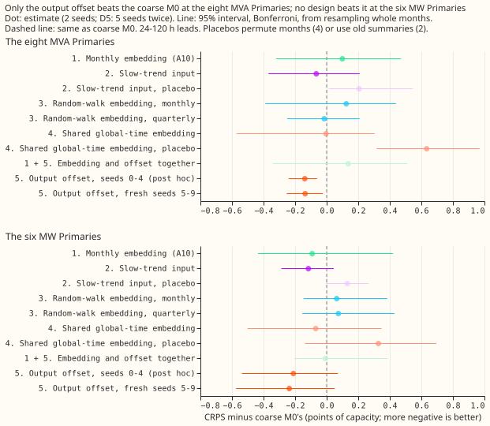
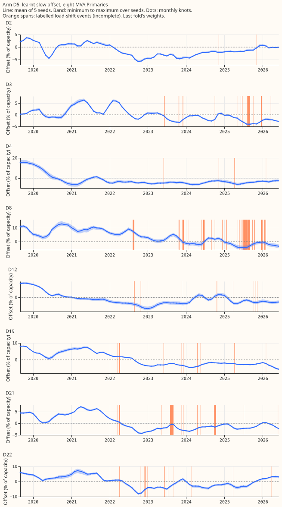
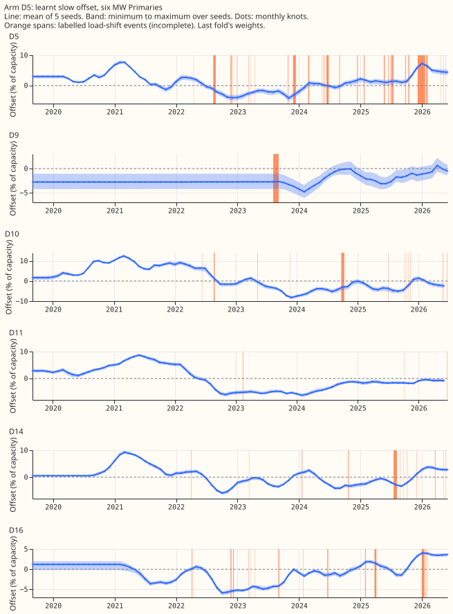
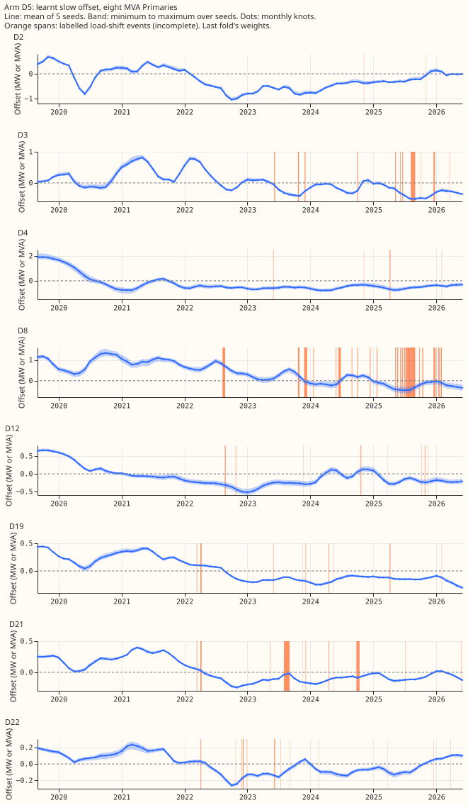
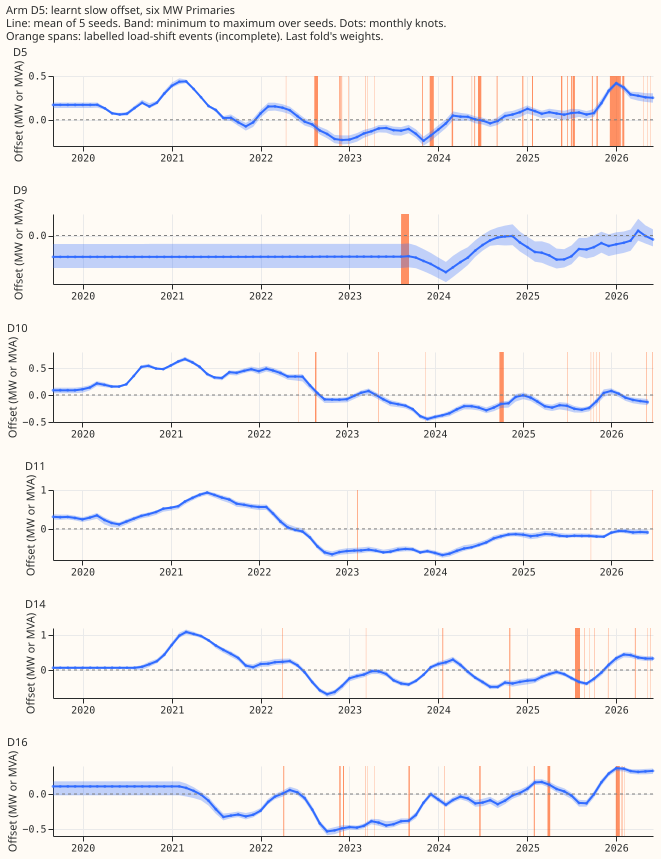
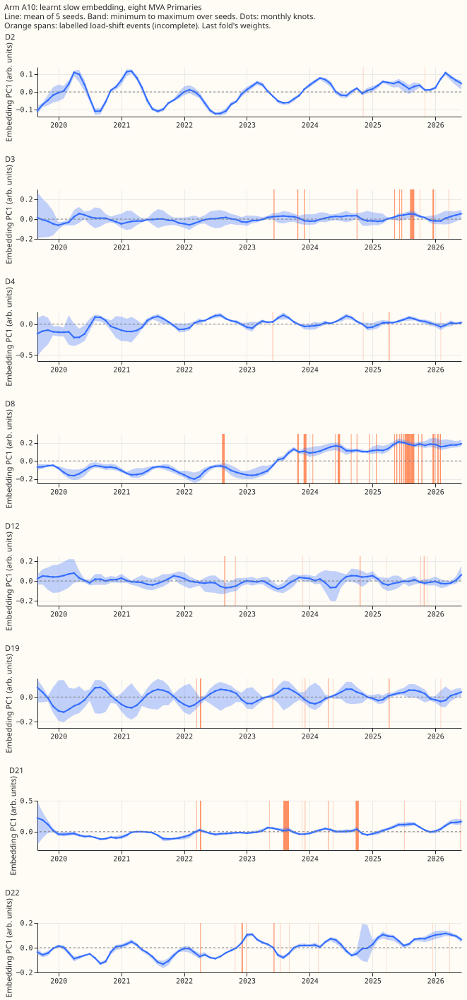
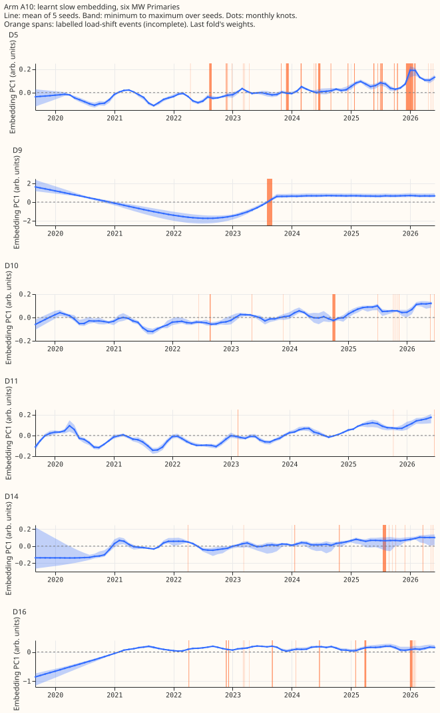

> **Erratum (experiment 580, 2026-11-05).** The real-event absorbed share (74 month-event pairs)
> divides by labelled depths that the telemetry mostly does not show (1 of 184 labelled events is
> verified), so treat it as unproven. It was not recomputed. The other results do not depend on the
> labels and stand. See [experiment
> 580](../00580-verified-load-shift-event-set-and-label-audit/result.md) for the audit of the labels
> against the telemetry.

**We asked which way of giving the demand forecast network a slow-moving signal about each
substation helps, because substations change over years while the network's Primary embedding stays
fixed.** We tried five designs on 16 Primary substations (Primaries; 14 scored, 2 report-only) and
compared each with the plain modular lag-free demand network (M0) refitted every 14 days (the
coarse M0), on five test months. Error is the continuous ranked probability score (CRPS) in points
of capacity, where lower is better, and the leak is how much of an artificial load shift the
forecast absorbs. One design helped: a slow offset, one number per
substation and month, added to the forecast's mean. It lowered the error at the eight substations
that report only apparent power (the eight MVA Primaries) by 0.137 points of capacity on 5 fresh
seeds
(5 to 9) chosen after the first 2 seeds narrowly missed, and its leak was no higher in the two
artificial-shift fits we ran. The other designs did not
help, and the six substations that report signed power (the six MW Primaries) show the same
direction without an interval that excludes zero.

**Verdict: partly supported.** D5 (design 5, the output-side slow offset) is a candidate to keep.
The leak is reported beside it as a flag and does not decide whether to keep it.

## Results

- **D5 against the coarse M0, 24-120 h, positive is worse.** Seeds 0 and 1: -0.111 at the eight MVA
  Primaries (Bonferroni interval -0.195 to +0.017, a near miss) and -0.228 at the six MW Primaries
  (-0.549 to +0.058). Seeds 0 to 4, added after the near miss and therefore **post hoc**: -0.139
  (-0.241 to -0.061) and -0.211 (-0.538 to +0.072). Fresh seeds 5 to 9, the confirmation: -0.137
  (-0.253 to -0.025) at the eight MVA Primaries, with all 5 seeds negative, and -0.237 (-0.574 to
  +0.051) at the six MW Primaries, with all 5 seeds negative. The gain at the eight MVA Primaries is
  confirmed; the gain at the six MW Primaries is not excluded from zero.
- **Absolute score.** CRPS at 24-120 h (mean single-seed): on seeds 0 and 1, the coarse M0 4.762 and
  D5 4.651 at the eight MVA Primaries, and 3.604 and 3.376 at the six MW Primaries; on seeds 5 to 9,
  4.782 and 4.646 at the eight, and 3.712 and 3.475 at the six.
- **Daily refits (seeds 0 and 1), the harness of experiments 511 and 554.** D5 minus M0 is -0.094 at
  the eight MVA Primaries (interval -0.155 to -0.055) and -0.166 at the six MW Primaries (-0.278 to
  -0.034). On cold nights (3 folds) the contrast is -0.160 at the eight (-0.280 to +0.232) and
  +0.117 at the six (-0.270 to +0.259), so cold nights are not shown to improve.
- **Other designs against the coarse M0 (24-120 h, seeds 0 and 1).** A10 (design 1) +0.099 at the
  eight and -0.092 at the six; D2 (design 2, trend summary) -0.066 at the eight and -0.116 at the
  six, with a placebo 0.206 worse at the eight; D3m and D3q (design 3) +0.124 and -0.016 at the
  eight; D4 (design 4) -0.004 at the eight and -0.069 at the six, with a placebo +0.633 worse at the
  eight, so the placebo harms the forecast and is not neutral. Against the coarse M0 at 24-120 h, no
  interval excludes zero except the placebos' (worse). Design 6 (a slow residual correction) is
  worse than every base it was added to (+0.17 at the eight against M0).
- **Hybrid (A10 embedding plus the D5 offset), seeds 0 and 1.** +0.137 at the eight MVA Primaries
  and -0.009 at the six MW Primaries against the coarse M0. Against D5 it is about +0.25 and +0.22
  worse, and against A10 about +0.04 and +0.08. The hypothesis that the offset absorbs level shifts
  and the embedding absorbs changes in behaviour is not supported: adding the embedding removed the
  offset's gain.

## Leak of an injected load shift

- **Daily harness (7-day block, ages 0 to 6, seed 0).** D5 7.17 points of capacity against M0 7.60.
  Step R: A10 6.81 against M0 7.76 (5 seeds).
- **Coarse harness (seeds 0 and 1).** The window is the whole forecast window of the day-14 fit
  (ages 0 to about 16 days), so the figures are not comparable with the daily ones: the coarse M0
  9.76, D5 9.03, A10 11.05, hybrid 10.49, D2 11.44, D3m 11.17, D3q 16.47, and D4 17.99 points of
  capacity. D2's figure is a lower bound only, because the summaries were not shifted. D5's leak is
  below the coarse M0's in both harnesses, but each is a single fit and the ranges overlap, so the
  data show no higher leak and do not show a lower one. No leak was measured on seeds 5 to 9.

## Does the offset absorb a shifted state?

Some load-shift events last months, so a slow offset could treat a shifted state as normal. Labels
are incomplete (clean rows may hold unlabelled events), so each count below is a lower bound.

- **Real events (experiment 556's harness, 74 month-event pairs, seed 0).** The absorbed share is
  3.0% for M0 and 4.3% for D5, a difference of +1.3 points (standard error 0.6), with D5 higher in
  61% of pairs. Most of it falls in the first 3 to 10 days after an event ends (M0 5.1%, D5 7.2%, 42
  pairs); after 10 days both are near zero.
- **Offset movement across events.** Only 9 of the 184 labelled events last half a month or more, so
  the monthly knots cannot see most events. Across those 9 the offset moves 0.42% of capacity
  between the event's start and end, against 0.48% over matched event-free windows.
- **Error after an event ends (daily harness, D5 minus M0, 24-120 h).** Days 0-14 after an event:
  -0.148 at the eight MVA Primaries and -0.183 at the six MW Primaries; days 14-28: -0.187 and
  -0.074; all other rows: -0.082 and -0.180. D5 keeps its gain after events at both groups, though
  the gain at the six MW Primaries is smaller in days 14 to 28. No intervals were computed.
- **Not run.** The variant that fits the offset on rows with no labelled event only was dropped to
  stay within the 10 GPU-h ceiling.

## The learnt offsets

The offsets wander by 5% to 15% of capacity over the series, and the seeds agree to about 0.5% of
capacity. The figures below show the offset per Primary, from the last fold's weights (the mean of
seeds 0 to 4, the band the minimum to maximum), with the labelled events shaded.

## Caveats

- **The 5-seed D5 result is post hoc** (seeds 2 to 4 were added after the seeds 0 and 1 interval
  reached +0.017); seeds 5 to 9 are the confirmation.
- **The screening ran on a coarse refit** (days 0 and 14), two seeds. Cold nights use 3 folds.
- **Placebos harm the forecast** (D4-null +0.633 at the eight), so a gain is not read as the
  difference from a neutral placebo.
- **Saved weights.** D5 pretrained weights are in `pretrained_D5/real` and the fine-tuned weights in
  `models/D5d` (seeds 0 and 1); A10's pretrained weights are experiment 559's
  `pretrained_drift/real`; the hybrid's are in `pretrained_H/real`. The code is
  `e00565_model_variants.py` and `e00565_fit.py`.
- **M0 pretrained weights for seeds 5 to 9** are new files in experiment 554's work folder, written
  by this experiment.

## Plan and method

### Stage 1: design 6, a slow residual correction (CPU only, no fit)

- **Method.** For every stored forecast row of a base arm, with origin `o` and Primary `p`, the
  correction is the exponentially weighted mean of the residuals (actual minus `q50`) of that
  Primary's earlier forecast rows whose target is at most `o` minus 24 h and whose own origin is at
  most `o`. Each row's weight is `0.5^(age / H)`, with age the days between `o` and the row's
  target and `H` 28 or 90 days. The sum is divided by `max(sum of weights, 48)`, so the correction
  shrinks to zero where history is short, and the same shift is added to all 11 quantiles. The
  constants (24 h, 48, and the two half-lives) are fixed here and are not tuned.
- **Why 24 h and not the 6 h delivery delay.** "Lag-free" means no input from the target's own
  series inside 24 h of the origin. The cut is asserted row by row, and one example row is printed.
- **History.** Only the fold's own month supplies residuals, because the stored forecasts cover the
  five fold months and nothing earlier. The 90-day half-life therefore behaves like a mean over the
  fold so far, and the first days of each fold carry little correction.
- **Bases scored.** M0, A1, A10, and A11 (the pooled quantiles of seeds 0 and 1). The base for the
  GPU stages is declared in the stage 2 commit, from experiment 559's write-up, before any fit.
- **Injected-shift leak.** Computed in closed form for the stress world of experiment 511: the
  injected block adds `sign x shift` (capacity fraction) to the actuals of the 7-day block, and
  the forecasts issued before the block's end are unchanged, so the correction's response is the
  weight share of block rows. The response of the base network's own leak to the correction is not
  included, so the figure is an upper bound.
- **Reference.** Experiment 500's 28-day median shift (A-pool, per lead band) cut q99 pinball by
  13%; this stage uses a per-Primary mean over all leads and does not reproduce 500's table.

### Step R: five-seed replication of A10 against M0 (GPU)

- **Fits.** A10 seeds 2 to 4 are new fits with experiment 559's code, run in place; seeds 0 and 1
  are
  experiment 559's. M0 seeds 0 to 4 are experiment 554's. Both sets are daily-refit fits on the five
  folds of 511, so the pairs match by fold and seed. Each seed is scored on its own (widened by
  1.15,
  as the stored row tables are) and the contrast of a row is the mean over seeds of the paired
  difference.
- **Counted contrasts: 8.** Two row sets (the eight and the six) x three lead bands (24-48, 48-72,
  and
  72-120 h), and the cold-night rows of each set at 24-120 h (3 folds hold cold nights). The
  minimum detectable effect is 1.96 x the seed-to-seed standard deviation of the contrast, pooled
  within folds, divided by the square root of 5.
- **Leak.** The injected 7-day shift of experiment 511 on all five seeds of both arms (M0 seeds 1 to
  4 are new fits run with experiment 554's code). Real-event leak from experiment 556's harness is
  not
  run here.

### Stages 2 to 4: the model designs (coarse screening, GPU)

- **Base.** Experiment 559 names no arm on the gain-and-leak frontier without a drift term. The base
  is therefore the coarse refit of M0 (C-M0: ERA5 and CAMS pretrained weights of experiment 554 and
  a
  fresh mixer, 90-day half-life; CRPS 4.465 at the eight and leak 7.60 points in the daily harness).
  The reference design is the coarse refit of A10 (C-A10).
- **Coarse refit.** The screening fits twice per fold, on days 0 and 14 (cadence `h`), so that the
  injected-shift control exists at day 14; the daily harness is not run. Seeds 0 and 1, five folds.
  The injected-shift leak is a single fit at day 14 with the block injected, seed 0, scored over the
  forecast window that follows (days 14 to the fold's end).
- **Arms.** D3m (design 3, monthly knots, L2 on first differences, encoders not frozen), D3q (the
  same
  with quarterly knots), D4 (design 4, one embedding per month shared by all Primaries, per-Primary
  scale, encoders frozen) and D4-null (permuted month index), D5 (design 5, per-Primary slow offset
  added to the component means, first-difference penalty, encoders frozen). The penalty weight is
  10 for every design and is not tuned. D2 (design 2, slow-trend summary input) and D2-null (its
  placebo, with summaries from 30 days earlier) were run the same way.
- **Pass rule.** An arm passes when its CRPS at 24-120 h is at least 0.03 better than C-M0 at the
  eight
  or the six, with a Bonferroni month-block interval (36 counted contrasts) that excludes zero, and
  its injected-shift leak is at most C-M0's plus 1.0 point. At most 3 passing arms get the daily and
  per-event refits.
- **Predictions that could fail.** As in the brief: design 3 within 0.03 of design 1; design 4 gains
  at least 0.03 at both groups and its placebo does not match it; design 5 gains at least 0.05 at
  the
  eight with leak at most the base's plus 1.0.

## Step R result

**A10 (the monthly drift embedding) is no better than M0 at the eight, is better at the six, is
worse
on cold nights, and leaks about 1 point less.** The pre-registered prediction fails: the leak falls
by
0.95 points rather than the 1.0 predicted, and the sign of A10 minus M0 at the eight is not the same
in 4 of 5 seeds.

- **Eight, 24-120 h.** A10 minus M0 is +0.010 (positive is worse; Bonferroni interval -0.31 to 0.29,
  minimum detectable effect 0.133), with per-seed values -0.001, -0.035, +0.085, -0.066, and +0.068.
  A10 keeps about 94% of M0's gain over L-1d, but the difference between the two arms is not shown.
- **Six, 24-120 h.** A10 minus M0 is -0.134 (interval -0.37 to 0.15, minimum detectable effect
  0.073).
  All 5 seeds are negative and 4 of 5 folds favour A10, but the interval includes zero.
- **Cold nights (3 folds hold them).** A10 is worse by +0.183 at the eight (interval 0.08 to 0.23)
  and
  by +0.454 at the six (interval -0.39 to 0.86, 5 of 5 seeds worse). Experiment 559's two-seed gain
  on
  cold nights at the six (-0.348) does not replicate.
- **Injected load-shift leak (all 5 seeds, mean of 5 folds).** A10 6.81 points of capacity (seed
  range 5.96 to 7.28) against 7.76 for M0 (7.50 to 8.03). A10 is lower in all 5 seeds, by 0.31 to
  2.08.
