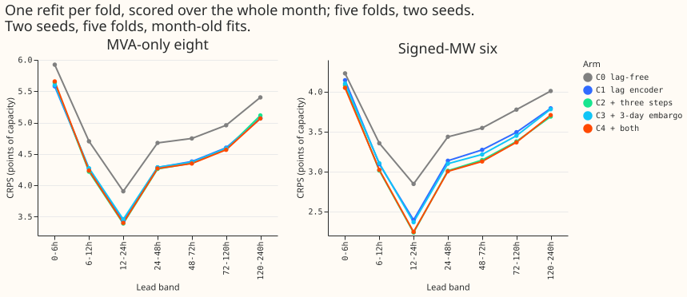
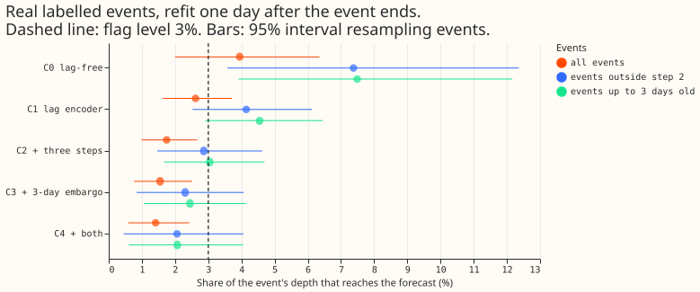
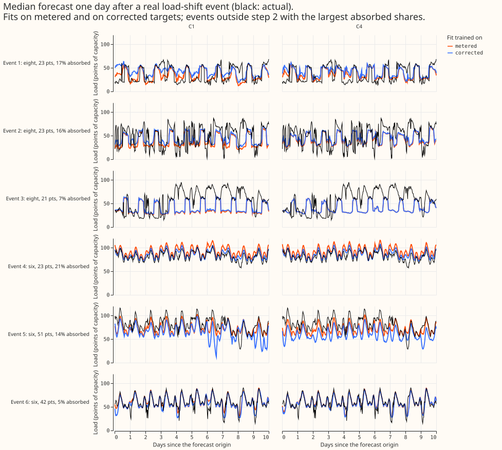

> **Erratum (experiment 580, 2026-11-05).** The real-event absorbed shares (0.026, 0.040, and 0.014
> of the labelled depth) divide by labelled depths that the telemetry mostly does not show (1 of 184
> labelled events is verified), so treat them as unproven. They were not recomputed. The CRPS,
> coverage, and lag-encoder results do not depend on the labels and stand. See [experiment
> 580](../00580-verified-load-shift-event-set-and-label-audit/result.md) for the audit of the labels
> against the telemetry.

 **A larger refit leak for the lag-encoder network than for the lag-free network is not shown, and
the three-step schedule and the embargo cut the leak by a third to a half. The larger leak is the
lag channel, which neither protection lowers. Across 74 (month, event) pairs of real labelled
load-shift events, the share of an event's depth that reaches the forecast after a refit one day
later is 0.040 for the lag-free network (C0), 0.026 for the lag-encoder network (C1), and 0.017,
0.016, and 0.014 for C2 (three-step schedule), C3 (embargo), and C4 (both). Following lags
corrupted by an event moves the forecast by 0.12 to 0.13 of depth in every lag arm.**

The lag-encoder network is LAG-v3 of [experiment
560](../00560-modular-lag-encoder-capped-lags-and-block-dropout/result.md), the modular network M0
of [experiment
545](../00545-modular-lag-free-demand-network-weather-and-datetime-encoders/result.md) plus an
encoder over capped day and week lags. The three-step schedule is the A1 schedule of [experiment
559](../00559-m0-leak-ladder-three-step-schedule-frozen-encoders-and-penalty/result.md): ERA5/CAMS
pretraining, then a step 2 that trains a fresh mixer and the encoders on all rows up to the first
cutoff of the fold minus 3.5 hours, then the fine-tune from the step-2 weights. The embargo is the
F3d-E3 arm of [experiment
556](../00556-lag-free-finetune-absorption-of-load-shift-events-and-unlearn-time/result.md): the
fine-tune drops targets whose valid time is within 3 days of the cutoff. The real events are the
labelled load-shift events of [experiment
400](../00400-lagged-lagless-forecast-blend-around-load-shifts-stored/result.md), corrected with
the step table of [experiment
435](../00435-stage-0-recalibration-table-for-untrusted-inputs-and-tails/result.md) at depth
factor 1.0.

## Arms and prediction results

- **C0:** lag-free M0, fitted from the pretrained weights of [experiment
  554](../00554-m0-replication-five-seeds-leak-mitigations-and-leave-d8-out/result.md). **C1:**
  LAG-v3, reusing experiment 560's day-0 fine-tunes. **C2:** C1 with the three-step schedule.
  **C3:** C1 with the embargo. **C4:** both, with its own embargoed step-2 weights.
- **Coarse cadence:** one fit per fold at the month's first cutoff, scored over the whole month,
  with 2 seeds and five folds (2025-10, 2025-12, 2026-01, 2026-03, 2026-06). July 2026 is unused.
- **Real-event harness:** for each event, the network is fine-tuned at the first cutoff at least 1
  day after the event's end, once on the metered targets and once with the labelled step removed
  from that event's targets. The absorbed share is the sign of the event times the mean difference
  of the two median forecasts over the following 7 days at the event's Primary, divided by the
  event's labelled depth. A 1-day cutoff age lets the 3-day embargo drop an event's rows.
  Experiment 556 used 3 days, so C1 also ran at 3 days.

**P1 (C4 keeps at least 70% of C1's gain at the eight, and leaks within the lag-free 0.015): holds
on this page's numbers, and the coarse cadence flatters it.** C1 is 0.369 better than C0 at 24-120
h at the eight (4.465 against 4.834), and C4 is 0.397 better (4.437), so C4 keeps all of the gain.
C4's leak is 0.014 at a 1-day cutoff age, against 0.015 at 3 days in experiment 556, so the two
are not like for like.

**P2 (C1 leaks more than the lag-free 0.015, and C3 and C4 cut it by at least 30%): the first half
is not supported and the second half holds.** The 0.015 yardstick was experiment 556's lag-free
network at a 3-day cutoff age. At the same 1-day age, C0 leaks 0.040 and C1 0.026 (interval for C1
minus C0 -0.033 to +0.001, equal medians of 0.004, and two January 2026 events drive C0's mean),
and C1 at 3 days leaks 0.014. C3 and C4 cut C1's leak by 41% and 46%, and C2 by 34%.

## Results

CRPS at 24-120 h, points of capacity, the mean of five folds and 2 seeds. Contrasts are the
Bonferroni month-block interval (8 tests, 5 month blocks, near the minimum to maximum of the folds)
with the number of folds in which the first arm is worse than C1. The minimum detectable effect is
0.116 at the eight and 0.155 at the six.

| Arm | Eight | Eight, D8 left out | Six | Eight minus C1 | Six minus C1 |
|---|---|---|---|---|---|
| C0 (lag-free) | 4.834 | 4.138 | 3.633 | +0.369 (+0.092 to +0.676; 5/5) | +0.285 (+0.213 to +0.479; 5/5) |
| C1 (LAG-v3) | 4.465 | 3.713 | 3.348 | | |
| C2 (three steps) | 4.442 | 3.683 | 3.227 | -0.023 (-0.089 to +0.021; 2/5) | -0.121 (-0.325 to +0.034; 1/5) |
| C3 (embargo) | 4.458 | 3.691 | 3.301 | -0.007 (-0.038 to +0.026; 2/5) | -0.046 (-0.185 to +0.049; 3/5) |
| C4 (both) | 4.437 | 3.660 | 3.215 | -0.028 (-0.087 to +0.009; 2/5) | -0.133 (-0.385 to +0.050; 1/5) |

**The lag encoder's gain over the lag-free network is shown at both sets, and a cost of the
protections is not shown.** C0 minus C1 has an interval that excludes zero at the eight and the
six. The protections' contrasts against C1 are negative (better) with intervals that include zero,
and the upper end at the eight is at most +0.026. The minimum detectable effect (0.116) exceeds
the porting threshold of 0.05, and at the six the C3 and C4 upper ends are +0.049 and +0.050, so a
cost up to the threshold is not excluded. Leaving D8 out, the C4 minus C1 interval at the eight is
-0.106 to -0.004 and excludes zero. Leaving primary 15 out does the same, while leaving primary 2,
8, or 13 out leaves it including zero, so the flip reflects a few sites' differences and not D8
alone.

Real-event leak: the mean absorbed share of an event's labelled depth, with a 95% interval from
resampling events. The "outside step 2" column keeps the 34 pairs whose event ended after the fold's
first cutoff, so that step 2 never saw the event. The last column keeps the 55 pairs where the
embargo left rows to correct.

| Arm | All 74 pairs | 34 pairs outside step 2 | 55 pairs with rows left |
|---|---|---|---|
| C0 (lag-free) | 0.040 (0.020 to 0.064) | 0.074 (0.036 to 0.124) | |
| C1 | 0.026 (0.016 to 0.037) | 0.041 (0.025 to 0.061) | 0.029 |
| C2 | 0.017 (0.010 to 0.027) | 0.029 (0.015 to 0.046) | |
| C3 | 0.016 (0.008 to 0.025) | 0.023 (0.008 to 0.041) | 0.021 |
| C4 | 0.014 (0.006 to 0.024) | 0.021 (0.005 to 0.041) | 0.019 |

**The protections cut the refit leak on the same events.** On the 74 pairs, C2 minus C1 is -0.0087
(interval -0.014 to -0.004), C3 minus C1 is -0.0107 (-0.017 to -0.006), and C4 minus C1 is -0.0120
(-0.020 to -0.005). On the 34 pairs outside step 2 the cuts are 31%, 44%, and 50%. Fifteen events
appear in two folds, so the 74 pairs are 59 distinct events and are not independent. At the flag
level of 0.03 (mean without the event of largest depth), C0 is flagged (0.039) and C1 to C4 are
not.

**The embargo's zeros are by construction for 19 of the 74 pairs.** When the event ended less than
3 days before the cutoff, the embargo drops all of the event's rows, so C3 and C4 have nothing to
absorb. The last column of the table gives the mean over the pairs that kept rows.

**The larger leak is the lag channel, and neither protection lowers it.** At inference, correcting
the lags that lie inside an event moves the forecast by 0.122 of the event's depth for C1, 0.122
for C2, 0.129 for C3, and 0.129 for C4 (43 events, intervals about 0.11 to 0.15). That is about 5
times C1's refit leak and 8 to 9 times that of C3 and C4 (the two measures cover different event
sets, 43 events and 74 pairs). A lag encoder is meant to follow lags, so following is not a harm
by itself. It is the channel to weigh against the accuracy gain at normal lags.

## Checks

- **The coarse cadence flatters C1, C2, and C4.** One fit per month leaves the fit up to 30 days
  old. By week of the month, C1 minus C0 at the eight is -0.08 in week 0 (the closest analogue of
  a daily refit) and -0.43, -0.27, -0.58, and -0.73 in weeks 1 to 4, so the pooled -0.37 is larger
  than the gain under a fresh fit. C4 minus C1 at the eight is +0.05 in week 0 and -0.03 to -0.10
  later, so the three-step schedule (+0.03) and both protections together (+0.05) cost accuracy
  under a fresh fit and help a stale one, while the embargo alone is -0.003 in week 0. At the six,
  C2 minus C1 and C4 minus C1 are negative in every week.
- **Absolute numbers are month-old-fit numbers.** In 2025-10, C1 at the coarse cadence scores 5.16
  against 5.02 for experiment 560's daily-refit LAG-v3 on origins from day 3 on, and 7.04 against
  5.71 in 2026-03.
- **40 of the 74 pairs sit in step 2.** Their event had ended before the fold's first cutoff, so
  step 2 trained on it uncorrected for the metered and the corrected fit alike, and only the
  fine-tune sees the correction. The "outside step 2" column is the measure of the schedule's
  effect.
- **Pretraining and noise.** ERA5/CAMS pretraining never sees the correction, so the share
  measures the fine-tune channel only. Events with few corrected rows give shares of 0.0001 to
  0.004, so a mean over 74 pairs carries about 0.0005 of noise, and the C3 to C4 gap of 0.0014
  (0.0024 outside step 2) should not be read.
- **Weather at the origin, lags 24 hours old.** Every test origin asserts `nwp_init_time <=
  power_fcst_init_time` and that each lag is at least 24 hours before the origin, for every row.
  The assertion that the weather run behind a lag's expected embedding is issued at or before the
  lag's time covers a sample of 200,000 rows per month. Example, 2025-10 test row 0: origin
  2025-10-01 09:00 UTC, target 2025-10-03 07:00 UTC, day lag at 2025-09-30 07:00 UTC.
- **Audit.** Two audit triggers fired: the result contradicted its prediction (P2's first half),
  and leaving one site out flipped a planned contrast at the eight (C4 minus C1). The audit
  reproduced every headline number to 4 decimals from the stored forecasts, and all ten of its
  findings are accepted and written into this page: the cadence, the step-2 pairs, the yardstick,
  the site threshold effect, the lag channel, and the 59 distinct events.
- **Not computed.** The median minus the mean per site, the error of the mean beside each quantile
  contrast, tails, cold nights, Christmas week, and a repeat-seed noise floor for the absorbed
  share.
- **The labelled events are incomplete.** NGED's logs may miss events, so clean-lag rows may hold
  unlabelled events and the real-event counts are lower bounds.
- **Weights.** The fine-tuned weights of C0 to C4 are saved under `work/models/<arm>/`, and the
  step-2 weights under `work/step2/` and `work/step2_embargo/`, in the experiment's private data
  folder.

## Limits

- Five month blocks give 3,125 distinct resamples, so each interval is near the minimum to maximum
  of the fold means.
- This part did not run the T factor (the corrected target with abnormal lags kept), synthetic ARAs,
  or arms C5 to C10.
