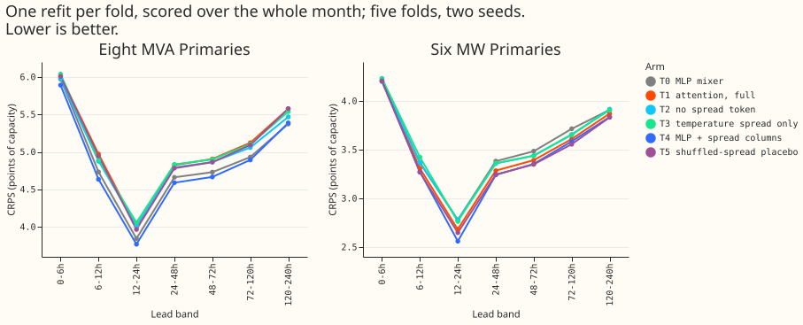
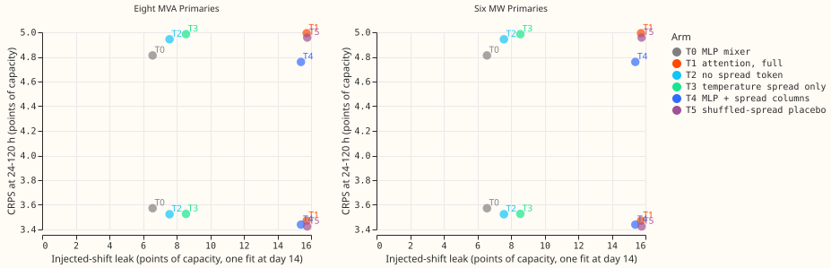

**A self-attention mixer over the encoder outputs forecasts Primary demand no better than the MLP
mixer, and at the eight MVA Primaries it is worse.** We asked whether the final block of the modular
demand network does better when it reads each encoder's output as its own token and attends over the
tokens, with an extra token carrying the lead time and the disagreement between weather-ensemble
members. We fitted the original and five variants once per test month, scored five months, and
checked
each against an injected sudden shift in recent demand. The attention variant was 0.180 points of
capacity worse at the eight MVA Primaries (CRPS at 24-120 h, interval +0.053 to +0.331) and 0.101
better at the six MW Primaries (interval -0.207 to -0.002). The placebo with the spread shuffled
between days did as well at the six MW Primaries, so the spread is not what helped.

The design is `attention_mixer_modular_brief.md`; the encoders, the pretraining, the three-step
schedule, and the injected shift come from [experiment
554](../00554-m0-replication-five-seeds-leak-mitigations-and-leave-d8-out/result.md), [experiment
559](../00559-m0-leak-ladder-three-step-schedule-frozen-encoders-and-penalty/result.md), and
[experiment
566](../00566-combination-block-lag-encoder-with-three-step-schedule-and-embargo-real-event-leak/result.md).
The attention block follows [Vaswani et al. (2017)](https://doi.org/10.48550/arXiv.1706.03762).

## Arms and prediction results

- **Base recipe:** experiment 554's M0 encoders with ERA5 and CAMS pretraining, then experiment
  559's
  A1 schedule (step 2 on all rows up to the first cutoff, then a fine-tune with the 90-day
  half-life).
  Attention arms pretrain their own encoders under an attention mixer without the spread token.
- **Arms and mixer parameters:** T0 MLP mixer 25,118 (hidden width 119). T0z is T0 with its 7
  stored spread columns set to zero (added after the code review, a spread-free MLP). T1 attention,
  25,161. T2 no spread token, 22,537. T3 temperature spread only, 24,777. T4 T0 plus the 7-column
  spread block, 25,281. T5 T1 with the block shuffled between days of the same Primary and month.
  The spread block holds the ensemble standard deviation of 2 m temperature, 10 m wind speed,
  shortwave radiation, the u and v components of 10 m wind, and total cloud cover, each divided by
  its
  per-Primary training median, plus a cloud-missing flag. Cloud files exist only for runs from
  2025-11-21, so the 2025-10 fold has no cloud and the 2025-12 and 2026-01 folds have it for part of
  their training rows.
- **Arm T6** (own-lag and neighbour-lag tokens) was not run: it waits for experiment 567.
- **Scoring:** one fit per fold and seed, 5 folds (2025-10, 2025-12, 2026-01, 2026-03, 2026-06), 2
  seeds, rows with no labelled event, 5-block month bootstrap (near the minimum to maximum of the
  folds), Bonferroni count 36. The daily-refit arms use seed 0 only, so their minimum detectable
  effect
  is larger than the 0.116 and 0.155 quoted.

**P1 (T1 beats T0 by 0.05 at the eight MVA Primaries and 0.03 at the six MW Primaries): fails at the
eight MVA Primaries, holds at the six MW Primaries.** P2 (T1 beats T2 by 0.03, gain in the top
spread
tercile): fails at the eight MVA Primaries, and at the six MW Primaries the gain (0.051) passes the
0.02
threshold but its interval includes zero; T1 minus T2 is +0.049 (-0.054 to +0.126) at the eight MVA
Primaries and -0.051
(-0.186 to +0.043) at the six MW Primaries. P3 (T1 beats T3 by 0.02): fails at the eight MVA
Primaries (+0.008), and at the six MW Primaries the
gain (0.055) passes the threshold but its interval includes zero (T1 minus T3 -0.055). P4 (T4 at
least 0.02 worse than T1): fails in the opposite direction, T4 is
better than T1 by 0.233 (-0.284 to -0.146) at the eight MVA Primaries. P5 (T5 within 0.02 of T2):
fails at the six MW Primaries, where T5 minus T2 is -0.098 (-0.180 to +0.016). P6 (weather weight
above
Primary weight in every lead band; Primary weight not rising with lead): the attention-weight clause
holds (Checks); the leak clause fails, with T1 at 15.7 points against T0's 6.6. The leak is reported
beside CRPS, not as a gate (maintainer policy of 2026-11-05).

## Results

CRPS at 24-120 h, points of capacity. Contrasts are Bonferroni month-block intervals (36 tests, 5
blocks). The minimum detectable effect (MDE) is 0.116 at the eight MVA Primaries and 0.155 at the
six
MW Primaries. Daily refit: seed 0, one fine-tune per day.

| Arm | Eight MVA Primaries | Six MW Primaries | Stress leak (points) |
|---|---|---|---|
| T0 MLP mixer | 4.812 | 3.572 | 6.57 |
| T0z spread-free MLP | 4.872 | 3.518 | 7.28 |
| T1 attention, full | 4.992 | 3.472 | 15.74 |
| T2 no spread token | 4.943 | 3.523 | 7.58 |
| T3 temperature spread only | 4.985 | 3.526 | 8.56 |
| T4 MLP with spread columns | 4.759 | 3.439 | 15.40 |
| T5 shuffled-spread placebo | 4.957 | 3.425 | 15.77 |
| T0, daily refit | 4.532 | 3.309 | |
| T4, daily refit | 4.510 | 3.206 | |
| Stored: M0 (daily), L-1d, A-pool | 4.465, 4.631, 4.395 | 3.267, 3.342, 3.280 | |

| Contrast | Eight MVA Primaries | Six MW Primaries |
|---|---|---|
| T1 minus T0 | +0.180 (+0.053 to +0.331; worse in 5/5 folds) | -0.101 (-0.207 to -0.002; better in 5/5) |
| T4 minus T0 | -0.053 (-0.138 to +0.058) | -0.133 (-0.292 to -0.037; better in 5/5) |
| T4 minus T1 | -0.233 (-0.284 to -0.146; better in 5/5) | -0.032 (-0.209 to +0.082) |
| T5 minus T2 | +0.014 (-0.148 to +0.118) | -0.098 (-0.180 to +0.016) |
| T0z minus T0 | +0.060 (-0.036 to +0.261) | -0.054 (-0.127 to +0.012) |
| T4 daily minus T0 daily | -0.022 (-0.101 to +0.065) | -0.103 (-0.236 to +0.002) |

Leaving Primary D8 out, T1 minus T0 at the eight MVA Primaries is +0.182 (+0.062 to +0.290), so the
result does
not depend on one Primary.

**The leak is higher for every arm that reads the spread block, including the placebo.** One
fine-tune at day 14 on targets shifted up and down by three standard deviations of a Primary's
weekly
mean over the 7 days before the cutoff; the leak is the sign times the change in the median forecast
over the following 7 days. T0, T0z, T2, and T3 leak 6.6 to 8.6 points of capacity, and T1, T4, and
T5
leak 15.4 to 15.8 (fold range 4.7 to 27). This is one fit at the age of the block's end, not the
seven
daily cutoffs of experiment 559, so the numbers are not comparable with its 6.0-point flag. T5 keeps
each day's block within its month, so a block column that tells the date (the cloud-missing flag is
1
before 2025-11-21) survives the shuffle. We did not test the cloud-missing-flag explanation.

**Real labelled load-shift events (74 events, daily refit, seed 0, refit one day
after the event ends).** The share of an event's depth that reaches the forecast is 0.020 for T0
(95% interval from resampling events 0.012 to 0.029) and 0.037 for T4 (0.017 to 0.066); T4 minus T0
is +0.017 (+0.002 to +0.041) on the same 74 pairs. Without the event with the largest share the
means are 0.018 and 0.026. On the 34 pairs whose event ended after the fold's first cutoff the
means are 0.031 and 0.062, and T4 is above the 0.03 flag level of experiment 566. T4 daily scores
0.022 better than T0 daily at the eight MVA Primaries, inside the minimum
detectable effect, and absorbs more of a real event.

**Slices (24-120 h).** On cold nights T1 minus T0 is +0.321 at the eight MVA Primaries (-0.223 to
+0.697) and +0.031 at the six MW Primaries (-0.074 to +0.098). T4 minus T0 on cold nights is -0.167
(-0.379 to +0.269) and -0.373 (-0.491 to +0.071). In the top spread tercile at the six MW Primaries,
T1 minus T0 is -0.180 (-0.344 to -0.002) and T5 minus T2 is -0.144 (-0.236 to -0.025), so the
placebo gains as much where the spread is largest. Christmas week sits in one fold, so it has no
interval (T4 minus T0 -0.217 and -0.366).

## Checks

- **Attention weights (T1, last layer, mean over heads):** the weight from the query token to the
  weather token is 0.231 to 0.254 across the lead bands and to the Primary token 0.196 to 0.218, so
  the
  weather token is above the Primary token in every band and the Primary weight falls with lead. The
  spread token's weight rises from 0.194 (6-24 h) to 0.242 (240-336 h). The weights are close to
  uniform, and they are a diagnostic, not an explanation ([figure
  3](figure_3_attention_weights.svg)).
- **Origin-time weather:** each spread column comes from the ensemble run keyed by the row's origin.
  Example, 2025-10 test row: the run issued 2025-10-30 00:00 UTC serves origin 2025-10-30 09:00 UTC
  and valid time
  2025-11-05 04:30 UTC (Primary 7, block 1.31, 1.02, 0.00, 0.65, 0.87, 0.00, cloud-missing flag 1).
  The assertion that `nwp_init_time <= power_fcst_init_time` holds for all rows of every test
  origin.
- **Code review:** one fresh Sonnet review of the model, spread, and fit code found no leakage and
  seven findings; the spread-free MLP T0z, the parameter-count assertion, the per-Primary check on
  the
  placebo, and the run time on the printed example were added. A second review of the daily-refit
  and
  real-event code found no bug. Its caveats apply: the corrected-target shift also reaches
  early-stopping rows, and events that ended before the fold's first cutoff sit in step 2 for both
  fits.
- **Comparisons that are not like for like:** T0 starts from experiment 554's pretrained encoders
  and
  the attention arms from encoders pretrained here under an attention mixer. T0 reads M0's 7 stored
  spread columns, which T1 replaces with a different set, and lead reaches T1, T3, and T5 only
  through
  the spread token (dropped with probability 0.1 in training). The lead-on-query option was not run.
- **Coarse cadence:** one fit per fold leaves the fit up to 30 days old, so the absolute scores are
  month-old-fit scores. Daily refits lower T0 by 0.280 at the eight MVA Primaries (interval -0.445
  to
  -0.086) and are the fairer comparison with experiment 559's M0.
- **Un-standardised spread:** three of the seven block columns are recovered from columns clipped at
  five standard deviations, so they cap at five; the cap was not counted per fold.
- **Not computed:** the median minus the mean per site, the tail coverage and pinball tables, the
  day-ahead and 14-day example forecasts, load-shift time series plots, T6, and daily refits for T1
  and T5 (agreed with the manager because the placebo matched T1). NGED's event labels are
  incomplete,
  so real-event counts are lower bounds.
- **Audit triggers:** two fired: a nested arm beat the arm containing its inputs (T4 beats T1), and
  the result
  contradicts its prediction (P1, P4, P5). The prediction failures are explained above by the
  placebo and
  the MLP control. The headline contrasts are re-derived by `e00568_score.py` from the stored
  per-row
  scores. No separate audit agent was run.
- **Weights:** fine-tuned weights of every arm are in `work/models/<arm>/` (coarse fits, and daily
  fits
  for T0 and T4), step-2 and pretrained weights in `work/step2/` and `work/pretrained/ATT/`, in the
  experiment's private data folder. About 3 GPU-hours were used (estimated from logged run times).
