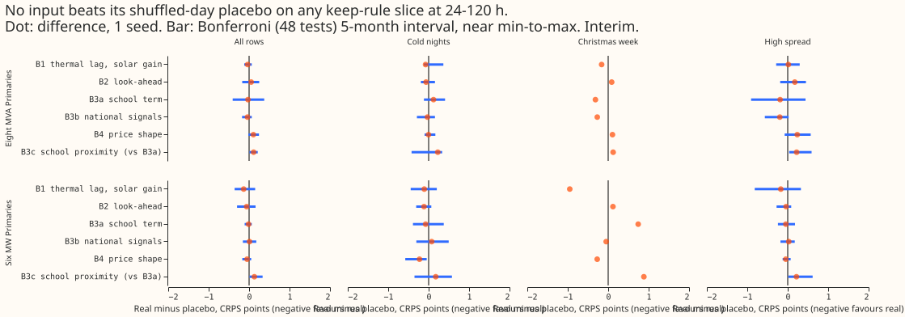

*Status: finished. Every number is interim and unaudited.*

**Take-home message.** We gave a neural network that forecasts substation demand six groups of extra
inputs, this time during pre-training on weather-model reanalysis (ERA5) and satellite-derived solar
(CAMS) rows as well as during fine-tuning on ensemble forecasts. Each group entered through the part
of the network that matches its content. We compared each group with a **shuffled-day placebo**:
columns of the same width taken from a different day. Errors are CRPS (continuous ranked probability
score) in points of effective capacity (percentage points of a substation's rated capacity); smaller
is better. No group beat its placebo by its minimum detectable effect on any of the four slices that
can justify keeping an input, so the verdict is **not supported**. The next step is a second seed
and
a plain M0 re-pre-trained the same way.

## What was done

- **Network and folds.** The modular lag-free network of [experiment
  554](../00554-m0-replication-five-seeds-leak-mitigations-and-leave-d8-out/result.md) (arm M0),
  refitted once per fold (coarse refit, scored for the whole month) on experiment 511's five folds,
  July 2026 unused, seed 0. Plain M0 (stored pre-trained weights, seeds 0 and 1) is the control. The
  code reuses experiments 437, 448, 511, 515, 554, and 562.
- **Routes.** B1 (thermal lag, solar gain, 14 columns) and B2 (look-ahead windows, 6) enter the
  weather encoder. B3a (school terms, 5 columns plus a presence flag) and B3c (B3a plus 5 columns
  gated by the count of schools within 2 km) enter the datetime encoder. B3b (national signals of
  the previous day, 7 plus a flag) and B4 (whole-day price shape, 12) enter a small parallel encoder
  that feeds both mixers.
- **Pre-training history.** School terms exist from 2021-09, national signals from 2023-01, and the
  price shape from 2023, while pre-training starts in 2019-09. Earlier pre-training rows get zeros
  and a presence flag of 0.
- **School proximity.** The count of open schools within 2 km comes from the Department for
  Education's "Get Information about Schools" register
  ([source](https://get-information-schools.service.gov.uk/Downloads), Open Government Licence v3.0,
  downloaded 2026-11-05 into the private data folder).
- **Weather timing.** Fine-tuning and scoring rows assert, row by row, that the weather run is
  issued at or before the forecast origin. One example row per fold is in the logs: origin
  2025-10-01 09:00, weather run 2025-10-01 00:00. Pre-training rows use the same ERA5 and CAMS
  stand-ins as the 37 base inputs.
- **Statistics.** Month-block bootstrap with 5 blocks (near the minimum to maximum of the folds),
  per-fold signs, the minimum detectable effect (MDE) from the fold-by-seed spread of plain M0 seeds
  0 and 1, 48 counted contrasts (6 contrasts x 2 groups x 4 keep-rule slices) for the Bonferroni
  interval, and 120 uncorrected "hurt" checks (6 x 2 x 10 slices). Heatwave and high-PV-ramp days
  were not scored.

## Step 1: school terms in experiment 562

- **The spread of the school-term effect across Primaries is smaller than seed noise.** Real minus
  placebo ranges from -0.230 to +0.314 points (standard deviation 0.137 over 16 Primaries); plain M0
  seed 0 minus seed 1 on the same rows has standard deviation 0.224. Only D8 has a 5-block interval
  that excludes zero, on the harmful side.
- **School proximity does not explain the spread.** Spearman correlation of the effect with open
  schools within 2 km is +0.28 (bootstrap over Primaries -0.30 to +0.72), within 5 km -0.09. The
  pre-registered expectation (at most -0.3, interval excluding zero) fails. D15 and D18 share one
  location.

## Results

- **No group improves any keep-rule slice by its MDE.** Real minus placebo on all rows, 24-120 h,
  eight MVA Primaries and six MW Primaries: B1 -0.036 and -0.135; B2 +0.052 and -0.059; B3a -0.028
  and -0.013; B3b -0.040 and +0.010; B4 +0.106 and -0.049. The MDE on all rows is 0.103 and 0.299.
  On cold nights the largest gain is B4 at the six MW Primaries, -0.225 (interval -0.58 to -0.05),
  against an MDE of 0.72.
- **Three contrasts are worse.** B4 at the eight MVA Primaries on all rows (+0.106, worse in 4 of 5
  folds, MDE 0.103), B3c minus B3a at the eight on all rows (+0.112, 4 of 5 folds) and on rows with
  no labelled event (+0.100). B3c minus B3a at the six is +0.131 (Bonferroni interval +0.01 to
  +0.34).
- **Every extra-input arm is worse than plain M0.** On all rows, 24-120 h, M0 scores 4.902 (eight)
  and 3.668 (six) on seed 0, and 4.917 and 3.724 on seed 1. The arms score 4.87 to 5.10 and 3.68 to
  3.93. The difference includes a different initialisation, because widening a layer changes the
  random draws.
- **Injected-shift leak (interim).** Injecting a 7-day shift into the fine-tuning history moved the
  median forecast by this share of capacity (all lead times, mean of 5 folds; fold range in
  brackets): M0 9.8 [1.9, 25.6], B1 5.3 [1.0, 13.6], B1 placebo 10.9 [2.2, 28.4], B3a 2.2 [1.1,
  3.8], B3a placebo 8.4 [1.5, 21.6]. The real columns carry less of the injected shift than their
  placebos in this single seed; the fold ranges overlap, and the leak does not enter the keep rule.

**Predictions.** P1 failed (B1 cold nights at the six: -0.107 against an MDE of 0.72). P2 failed
(B3a -0.028 at the eight, interval includes zero). P3 failed for B3b (-0.040, interval includes
zero, below the MDE) and B4 (+0.106, harmful), and held for B2. P4 failed (B3c worse than B3a by
0.112), as the step-1 correlation suggested.

## Checks

- **Single seed.** The MDE comes from two M0 seeds, and the arms have one. A gain smaller than 0.10
  points (eight) or 0.30 (six) on all rows could not have been seen.
- **Placebo limits.** Pre-training placebos take a donor day from the pre-refit side; a placebo row
  keeps the real row's presence flag, so a donor from before 2021-09 or 2023 can give zeros where
  the real row has values. Cut-day-14 placebo fits use donor days drawn for the month's start, not
  day 14.
- **High-spread slice.** The stored scores hold no ensemble-spread column, so the slice is the top
  tercile of M0's own q95 minus q05 within Primary, fold, and lead band.
- **Not scored.** Heatwave and high-PV-ramp days, per-Primary tables, example forecast plots, and
  the leak for arms other than M0, B1, B1p, B3a, and B3ap. NGED's event logs may be incomplete, so
  rows with no labelled event can hold unlabelled events.
- **Availability at serving.** B1 and B2 need ECMWF runs and, for two B1 columns, the CAMS feed. B3a
  is a fixed calendar. B3b needs daily Elexon and NESO feeds that production does not read today.

## What the next experiment should answer

Does a plain M0 re-pre-trained with the same code, and a second seed for every arm, shrink the gap
to the arms, and does B1 still lower cold-night error at the six MW Primaries once the control is
matched?
