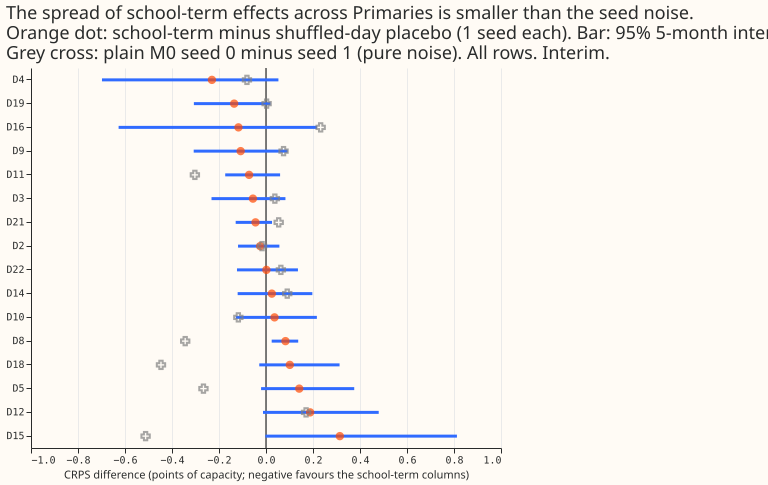

*Status: planned. Nothing below has a result yet.*

**Take-home message.** To be written after the scores are read.

## Plan

- **Base network.** Arm M0 of [experiment 554](../00554-m0-replication-five-seeds-leak-mitigations-and-leave-d8-out/result.md), refitted once per fold (coarse refit) on experiment 511's five folds (July 2026 unused), seed 0 first and seed 1 if the GPU budget allows.
- **Pre-training.** Every arm is pre-trained per fold on ERA5 and CAMS rows (experiment 448's rows, with experiment 437's `dense_arrays` for B1 and B2) with its extra columns; the added input units start random, not zero.
- **Routes.** B1 and B2 enter the weather encoder; B3a and B3c enter the datetime encoder; B3b and B4 enter a parallel encoder (32 hidden units, 16 outputs) concatenated into both mixers.
- **Missing history.** A school calendar exists from 2021-09, national signals from 2023-01, and the price shape from 2023, while pre-training history starts in 2019-09. Pre-training rows without a source get zero columns and a presence flag of 0.
- **Placebos.** Each real arm has a shuffled-day placebo of the same width (experiment 515's donor days, same month, day type and length, at least 3 days away, same side of the refit), in both stages.
- **School proximity (B3c).** From the Department for Education's "Get Information about Schools" register (open data, Open Government Licence v3.0, downloaded 2026-11-05 into this experiment's private folder; [source](https://get-information-schools.service.gov.uk/Downloads)): the count of open schools within 2 km of each Primary, as a share of the largest count, multiplies the five school columns.
- **Weather timing.** Fine-tuning and scoring rows assert, row by row, that the weather run is issued at or before the forecast origin and print one example row per fold. Pre-training rows use the same ERA5 and CAMS stand-ins as the 37 base inputs, by construction.
- **Leak.** Each arm refits once at day 14 with and without the injected 7-day shift of experiment 511's harness; the leak is the signed change in the median forecast, as in experiment 554.
- **Statistics.** Month-block bootstrap with 5 blocks (near the minimum-to-maximum of the folds), per-fold signs, the MDE beside every contrast, and the Bonferroni count as a number.
- **Budget.** At most 4 GPU hours; one GPU process under 8 GB of host memory; a fit starts only when available memory exceeds 20 GB and fewer than 4 GPU processes run.

## What step 1 found (school terms in experiment 562)

- **The spread of B3a's effect across Primaries is smaller than seed noise.** Real minus placebo ranges from -0.230 to +0.314 points (standard deviation 0.137 over 16 Primaries); plain M0 seed 0 minus seed 1 on the same rows has standard deviation 0.224. Only D8 has a 5-block interval that excludes zero, on the harmful side. Interim and unaudited.
- **School proximity does not explain the spread.** Spearman correlation of the effect with open schools within 2 km is +0.28 (bootstrap over Primaries -0.30 to +0.72) and with schools within 5 km is -0.09. The pre-registered expectation (a rank correlation of at most -0.3 with an interval excluding zero) fails. D15 and D18 share one location, so their counts are identical.
