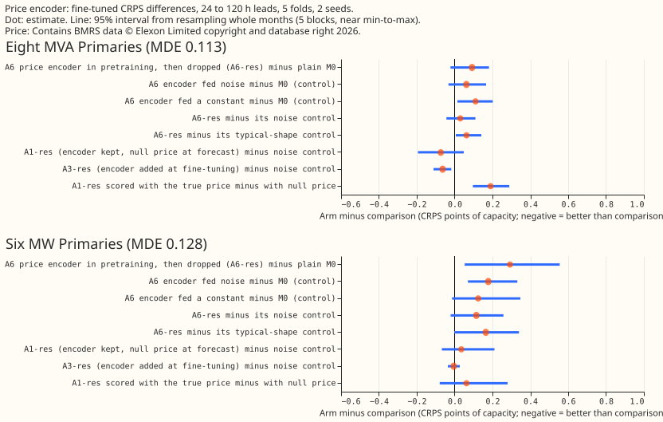
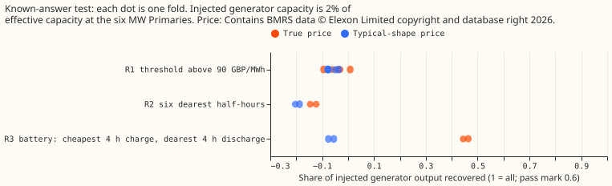

*Status: finished. Every number is interim and unaudited.*

**Take-home message.** We asked whether teaching a neural network that forecasts substation demand
about electricity prices, while it learns from weather and calendar inputs, would make its weather
and calendar parts learn cleaner patterns. The price part is thrown away before the forecast is made,
so no price feed is needed in production. It did not help. After fine-tuning, the forecast was worse
than a forecast built without any price part: by 0.29 points of capacity at the six MW Primaries and
by 0.09 at the eight MVA Primaries. Errors are CRPS (continuous ranked probability score) in points
of effective capacity; smaller is better. A control that fed the same extra part noise, or a
constant, was almost as bad, so the harm comes from the extra part and not from price. A controlled
test, in which we added a synthetic price-driven generator to six real series, showed the price part
could not find the simple threshold or rank rules, and found a battery rule only partly. The next
step is a repeat of that controlled test with a generator large enough to see, before any more
real-data price work. The verdict is **not supported**.

## What was done

- **Network and folds.** The modular lag-free network of [experiment
  554](../00554-m0-replication-five-seeds-leak-mitigations-and-leave-d8-out/result.md) (arm M0), on
  experiment 511's five folds, July 2026 unused, **refitted once a month**, 2 seeds (0 and 1).
  Pre-training used the same ERA5 and CAMS rows as experiment 554, written again here for every arm so
  that arms differ only in the price part. Fine-tuning followed experiment 554's M0 recipe exactly,
  with a fresh mixer.
- **The price encoder.** A new neural network part that reads three windows of the true price (97
  half-hours either side of the target, 7 days of hourly means, and 28 days of daily summaries), a
  short vector of hand-made shape features, a bank of eight learned price-day shapes, and attention
  over the fine window. It outputs 16 numbers, or a learned null vector when price is absent. Price
  comes from Elexon's market index price, the system price minus the market index price, and the net
  imbalance volume, 2019-09 to 2026-09, fetched for this experiment (see below).
- **Arms.** A6: price encoder in pre-training only; the weather encoder, datetime encoder, and
  embedding go to a fresh price-free mixer. A1: price encoder kept in fine-tuning, present in a
  seeded 50% of rows, null vector at forecast. A3: as A1 but the encoder is new at fine-tuning.
  Each comes with price inputs of kind `res` (calendar-residualised), `raw`, `p1` (a shuffled day),
  `p2` (the typical shape for month, half-hour, and day type), `noise`, or `const`. M0 is the control
  with no price part. A "-oracle" arm scores the same fitted networks with the true price present.
  M0-R of the brief is identical to M0 here, because M0's fine-tuning mixer is already fresh.
- **Standing rules.** Every weather input comes from the run issued at or before the forecast origin,
  asserted row by row, with one example row printed per fold. Price windows may look 14 days forward
  in the oracle (true price) but are cut at the refit time for every training row, so no price from
  the test month reaches training. Scoring reads the uncut series only for the "-oracle" arms.
- **Price data and licence.** See the last section.

## Results

- **Absolute CRPS, 24 to 120 h leads.** Plain M0: 4.834 (eight MVA Primaries) and 3.633 (six MW
  Primaries). A6-res: 4.926 and 3.926. A6 fed noise: 4.896 and 3.811. A6 fed a constant: 4.945 and
  3.758. A3-res: 4.784 and 3.748. A1-res: 4.875 and 4.118.
- **None of the six counted tests passes.** The tests are T1 and T2, A6-res minus A6-noise; T3 and
  T4, A1-res minus A1-noise; at the eight and the six, 24 to 120 h, Bonferroni count 6. A6-res minus
  A6-noise is +0.03 at the eight (minimum detectable effect, MDE, 0.113) and +0.115 at the six (MDE
  0.128): worse, not better, and below the MDE. A1-res minus A1-noise is -0.073 at the eight (2 of 5
  folds better) and +0.035 at the six. T5 and T6 (arm A7) were not run.
- **Pre-training with price made the fine-tuned stack worse.** A6-res minus M0 is +0.092 at the eight
  (interval -0.022 to +0.181, 4 of 5 folds worse) and +0.293 at the six (interval +0.053 to +0.555, 5
  of 5 folds worse). Noise and constant inputs account for much of it (+0.06 and +0.11 at the eight,
  +0.18 and +0.13 at the six). Prediction A6-1 (a gain of at least 1% at the Primaries) fails.
- **Which kind of price did least harm.** Residualised price (`res`) beat raw price at the eight by
  0.05 (A6-raw minus A6-res -0.051, within the MDE), against the prediction that raw would be worse.
  A6-res was 0.05 worse than its shuffled-day control at the eight and 0.235 worse at the six (5 of 5
  folds each). The typical-shape control (`p2`) was better than the real price by 0.063 and 0.165.
- **Scoring with the true price was not better.** A1-res scored with the true price minus scored with
  the null vector: +0.19 at the eight (5 of 5 folds worse, interval +0.096 to +0.289) and +0.063 at
  the six. The kept encoder, shown the true price, did worse than with the null vector.
- **Pre-training validation loss.** Mean validation negative log-likelihood over 5 folds and 2 seeds
  (oracle price present, lower is better): M0 0.4891, A6-p2 0.4765, A6-const 0.4917, A6-raw 0.4996,
  A6-res 0.5034, A6-p1 0.5345, A6-noise 0.5489. A6-res is above M0 in 5 of 5 folds (+0.005 to
  +0.024). The typical-shape price is below M0 in 5 of 5 folds (-0.001 to -0.024).
- **Leave-D8-out.** A6-res minus M0 is +0.087 at the eight without D8 (interval -0.024 to +0.192, 3
  of 5 folds worse) and +0.127 at D8 alone (interval -0.183 to +0.423); the sign matches the eight's.
  D15 and D18 are report-only; every set is in `work/scores/contrasts.csv`.

## Known-answer test

We subtracted a synthetic price-driven generator from the six MW Primaries' pre-training rows, at 2%
of each Primary's effective capacity (0.1 to 0.2 MW), and asked how much of the injected output the
price part's forecast change recovered. M0 without price was trained on the same rows to give the
baseline. "Recovered" is one minus the mean squared gap between the injected output and the forecast
change, relative to the mean squared injected output; 0.6 is the pass mark of the brief.

- **K2 fails for the threshold and rank rules.** R1 (full output above 90 GBP per MWh) recovered -0.09
  to +0.01 across 5 folds, and R2 (six dearest half-hours) -0.15 and -0.12 (2 folds). The learned
  threshold (K1) was never found: the fitted response did not reach half of full output at any price,
  and the gain at prices above 150 GBP per MWh was 11% to 18% of capacity, against 100% injected.
- **R3, the battery rule, was found partly.** Recovered 0.46 and 0.44 (2 folds), below the 0.6 pass
  mark. The typical-shape control recovered -0.06 and -0.08, so the recovery is price-specific (K3
  passes).
- **K4 was not run in the intended form.** The brief's test fine-tunes after discarding the price
  part. We ran only a pre-training form: contaminating the training rows only, and scoring clean rows.
  The price network scored worse (validation NLL 0.853 and 0.809 against 0.698 and 0.675 for M0),
  because it applies the rule to clean rows that do not obey it. That says nothing about damage to the
  discarded-encoder stack. K4 is not tested.
- **The injected generator may be too small.** At 0.1 to 0.2 MW it sits far below the forecast's
  spread. A failure to recover it shows the encoder at this size cannot see a 2%-of-capacity rule,
  and does not show the encoder cannot learn such rules.

## Step 0 (report-only)

- **Step 0(a).** Stored experiment 554 M0 forecast residuals of the 16 Primaries, on the 13 months of
  price then on disk, regressed on same-time price features after removing the half-hour-by-weekend
  mean: in-sample R-squared 0.2% to 4.1%, and leave-one-month-out R-squared negative at all 16
  (-0.3% to -16%). That shows no linear rule transfers across months. It does not rule out a nonlinear
  rule. Script: `e00570_step0a.py`.
- **Step 0(b) and 0(c) were not run:** the metered-battery check and the measured BSP-and-GSP
  minimum detectable effects. The MDEs quoted are the brief's two-seed values.

## What was not done

The brief listed more than the budget and the time allowed. Not run: the national-weather part of the
residualisation (the residual is calendar-only), arm A7 and its shuffled control, arm A6-F (frozen
encoders), the feature ladder and arm G1, the four BSP and GSP pooled structures, the probes of the
encoder outputs (A6-2) and partial dependence, and the oracle arms A4 and A5. The known-answer test
covers only the six MW Primaries, rule R1 on 5 folds and rules R2 and R3 on 2 folds; the K1 minimum
run time is not measured; the shuffled-day control was dropped from it. No cold-night, Christmas, tail
coverage, or curtailment-cost slice was scored, and the page draws no example forecast.

GPU time was about 5.3 hours (wall clock at full GPU use), under the 6-hour ceiling.

## Checks

- **Median minus mean forecast per site.** Not computed.
- **Error of the mean or median forecast beside each quantile-score contrast.** Not computed.
- **Triggers that fired.** (1) Controls failed: the known-answer test failed for R1 and R2. (5) A
  control that should change nothing moved the score by more than its own paired interval's
  half-width: the noise-fed and constant-fed encoders moved CRPS by +0.18 and +0.13 at the six.
  The audit that these triggers call for is in the pull request.
- **Scored rows.** Each fold's forecasts cover targets inside the fold month only (the 237,026 rows
  of the experiment 511 row set, 1,142,520 over five folds with all arms finite); the longest leads of
  origins in the last 10 days of each month are not scored.

## Lessons for later experiments

- **Do not add a price encoder to pre-training of the modular lag-free network.** A noise-fed encoder
  of the same size harms almost as much, so the extra encoder is the cost.
- **A known-answer test must inject a visible generator.** At 2% of capacity, the test cannot tell
  "the encoder cannot learn the rule" from "the rule is below the noise".
- **The typical-shape price lowered pre-training validation loss in 5 of 5 folds.** Calendar
  information fed through the encoder may help pre-training; this page did not test it.

## Price data and licence

- **Licence:** "Copyright: Licence to use BMRS open data", Elexon Limited
  (<https://www.elexon.co.uk/bsc/operations-settlement/bsc-central-services/balancing-mechanism-reporting-agent/copyright-licence-bmrs-data/>),
  read verbatim on 2026-11-05. It grants "a worldwide, royalty-free, perpetual, non-exclusive
  licence to Use the BMRS Data", and the licence text lists copying, publishing, distributing, and
  adapting among the permitted uses. It sets no research-specific term and no limit on publishing
  derived results. Attribution line, required on every chart of price data: "Contains BMRS data ©
  Elexon Limited copyright and database right 2026."
- **Fetch:** market index price (`APXMIDP` provider) and system price with net imbalance volume, for
  2019-09-01 to 2025-08-31, through the public keyless API with 2 threads, about 4,300 small
  requests and 18 MB, no cost. Saved under this experiment's private data folder (`market_early/`),
  never committed. The longer series is `*_2019-09_to_2026-09.parquet` there.
- **Gaps:** 72 whole days of market index price and 9 whole days of system price are not published
  (listed by the fetch script); the price encoder treats them as missing.
- **Definition is unchanged across the span:** the system sell and buy prices are identical in every
  row from 2019 to 2026 (single imbalance price), and every zero market index price coincides with
  zero traded volume, so zero-volume rows are masked. The market index mean is 37 GBP per MWh in
  2019, 198 in 2022 (the gas shock), and 72 to 103 in 2024 to 2026, which is why the transform
  normalises by trailing 28-day statistics.

## Maintainer decisions

- **Step 0 was report-only and the known-answer test a check, not a gate** (2026-11-05). The real-data
  arms ran regardless, with the budget capped at 6 GPU-hours.
