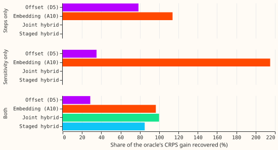

**We asked whether a slow output offset takes level shifts while a drift embedding takes changes in
behaviour, using worlds where the answer is known.** We injected a known component into the demand
series of six Primary substations (three MVA, three MW), fitted the offset (D5), the embedding (A10),
the joint hybrid, and a staged hybrid, and measured how much of the CRPS gain of an oracle (a
network given the true component) each recovered. **In the readable world the embedding recovered
nearly all of it and the offset alone under a third, so the hypothesis is not supported.** The
results are interim and unaudited, from one fold (2025-12) and two seeds.

## Results

- **First worlds were unreadable.** With steps of 3% to 6% of capacity and sensitivity up to 0.4%
  per degree, the oracle gained 0.27 CRPS points over the drift-free base (2 folds, 2 seeds), and the
  oracle was worse than frozen D5 (recovery above 100% for several arms). The seed spread of the
  base was 0.1 to 0.18. This world was dropped, as the pre-registered pass condition requires.
- **Worlds with tripled amplitudes (`-big`), fold 2025-12, injected Primaries, 24-120 h.** Oracle gain
  over the base: 2.76 points in the combined world (seed spread of the base about 0.7), 2.71 in the
  steps-only world (1 seed), 0.35 in the sensitivity-only world (0.75 at the three MVA Primaries and
  -0.06 at the three MW Primaries), so the sensitivity-only world is unreadable and its contrasts are
  dropped.
- **Combined world (2 seeds), recovery of the oracle gain.** A10 96.5%, joint hybrid 99.9%, staged
  hybrid 85.0%, D5 28.6%. At the three MVA Primaries D5 recovered -10.6% and at the three MW
  Primaries 53.6%. CRPS minus D5: A10 -1.87, joint hybrid -1.96, staged hybrid -1.55.
- **Steps-only world (1 seed).** D5 recovered 78.6% and A10 113.9%. The offset does take steps, but the
  embedding does too, so the prediction that the embedding recovers at most 40% fails.
- **Untouched Primaries (combined world).** CRPS of the other ten Primaries: base 5.61; A10 5.70, D5
  5.59, joint hybrid 5.61, staged hybrid 5.46. Differences are within the seed spread.
- **Predictions.** S0 failed (step 0). W-level fails (A10 recovered more than 60% of the steps).
  W-behaviour could not be tested (unreadable world). W-both: the joint hybrid recovered over 60%,
  but the selected construction does not beat the joint hybrid. W-compete fails: the joint hybrid
  did not recover less than the better single component. W0 and the real-data check were not run.
- **Stop rule.** No hybrid construction beat the joint hybrid's recovery in the combined world, so the
  real-data check was skipped. The film and orthogonal hybrids were fitted in the first combined
  world only (unreadable), where no ranking is possible.

## What was not done

- The 2026-06 fold, the clean control W0, the evening-bump world, and the oracle-based seed-spread
  minimum detectable effect were not run: the first worlds consumed most of the budget (about 2.5
  GPU-hours of the 4 GPU-hours ceiling) before the manager asked for larger effects.
- Component-level recoveries (offset path against the injected path, implied sensitivity against the
  injected sensitivity) were planned as read-outs and not computed, so the selection rule was not
  applied; the CRPS recovery is the only recovery reported.
- Caveats: one fold and two seeds (one seed for the single-component worlds) give no intervals;
  the free-encoder base and oracle are compared with frozen-encoder arms, which can lower the frozen
  arms' recovery; the oracle sees the realised temperature, which forecast-driven arms do not.
  NGED generator series are not plotted.

## Lessons and next step

No amplitude between the unreadable and the tripled worlds was tried. A sensible next
experiment is a sensitivity-only world with amplitudes that make it readable on several folds, and the
film and orthogonal hybrids in a readable world.

## Plan as written before any fit

Experiment 565 found that adding the drift embedding to the
output offset removed the offset's gain. This experiment asks whether that failure came from the two
components competing for the same slow variance, by (1) building worlds with a known injected
answer, (2) building the hybrid four ways, and (3) checking the best construction on the real data.

## Step 0 result (CPU and one GPU pass over experiment 565's stored hybrid fits)

**The prediction S0 failed: the embedding and the offset do not compete through correlated level
paths.** Over the five fold months and seeds 0 and 1 (fits of day 14), the mean per-Primary
correlation between the embedding's level path and the offset's level path is 0.09 at the eight MVA
Primaries, 0.04 at the six MW Primaries, and 0.04 at D15 and D18 over all months, and 0.21, 0.15, and
0.67 over the last 12 months. The embedding carries 93% to 99% of the slow variance (embedding path
variance 0.15 to 0.56 in standardised units squared, offset 0.006 to 0.007). So the joint hybrid is
dominated by the embedding. Low correlation with a dominant embedding is a winner-take-all form of
competition, so step 0 neither supports nor refutes the hypothesis. As the brief states, the
correlation criterion failed, so the staged and orthogonal constructions are less certain to help.

## Design

- **Worlds** (real ERA5 weather and real Primary series; injection into the cleaned power over
  capacity, so training, pre-training, and scoring actuals all carry it). Injected Primaries: 6 (3 MW,
  3 MVA) with the fewest labelled events, not D8 or D14. Wa: 3 abrupt steps per Primary (3% to 6% of
  effective capacity, random sign, at least 60 days apart, one in the 15 months before a fold's start
  and one 20 to 40 days before it, none in a scored month); Wa-in has one step inside the scored
  month (report-only). Wb1: extra load of s(t) times the heating degrees below 15 degrees Celsius,
  s rising linearly from 0 (2023-01) to 0.4% of capacity per degree (2025-06), then constant. Wb2
  (reference arms only): an evening bump, 17:00 to 21:00 local, amplitude rising from 0 to 3% of
  capacity. Wc: Wa and Wb1 together. W0: no injection. Folds: 2025-12 and 2026-06 for the synthetic
  worlds, all five for the real data.
- **Arms** on the lag-free base: D5, A10, H-joint (565's hybrid), H-staged (offset fitted first and
  frozen, then the embedding and mixer fitted), H-film (the embedding is a per-channel scale of 1 plus
  delta on the weather encoder's output, dimension 3, strong L2 shrinkage, no additive path, offset
  fitted jointly), H-orth (H-film plus a penalty that makes the embedding's mean effect on the mixture
  location zero within every Primary and month, and a penalty on the squared covariance of the two
  level paths; covariance rather than correlation because the first penalty drives the embedding's
  level path towards zero, where a correlation is unstable). H-staged-S (the abrupt-step offsets of
  addendum 24) is not run: its known-answer test has not yet been run.
- **Oracle:** the base network given the true injected component, standardised by the Primary's
  target standard deviation, as one extra input to the mixer in pre-training and fine-tuning.
- **Recovery** = (CRPS of the base without drift minus the arm's) / (the base's minus the oracle's) on
  the injected Primaries at 24-120 h, per fold. Seeds: 2 for Wc and the real data, 1 for Wa, Wb1, W0.
- **Timing asserts** (row by row, one printed example per arm): the weather comes from the ensemble run
  at or before the origin minus 9 h (the harness assertions of experiments 510 and 565); the base has
  no lag column; the injected truth enters only the target and, in the oracle only, the oracle input.
- **Standing practices followed:** cleaned data everywhere, D15/D18 cut, saved fitted models, stored
  predictions reused (565's D5, A10, and H on the real data), coarse refits (days 0 and 14). Departed
  from: none. Earlier advice followed: carry slow change as an offset (565); the A10 embedding added
  to D5 lost the gain (565), which this experiment tests rather than repeats.

## Choices fixed after the plan review, before any fit

- **Component recoveries in Wc** (needed by the selection rule) are read-outs, not CRPS: step
  recovery is the R-squared of the arm's total monthly level path (offset plus the embedding's
  level path) against the injected step path over the 24 months before the fold; sensitivity
  recovery is the R-squared of the implied sensitivity (slope of the mixture-location change
  against heating degrees, newest embedding knot against the 2023-01 knot) against s(t). The
  oracle-based CRPS recovery is the pooled measure, reported beside them.
- **Oracle ceiling:** in Wb1 and Wc the oracle is given the realised-temperature component, which no
  forecast-driven arm sees, so 100% recovery is not reachable and the W-both threshold is read with
  that in mind.
- **Frozen versus free encoders:** the base (M0w) and oracle fine-tune free encoders; D5, A10 and the
  hybrids freeze them, as in experiment 565. Recovery is measured against the free base, so a frozen
  arm can show lower recovery partly because of the freezing.
- **H-film is not strictly level-free:** the scale change of a GELU output can move the mixture
  location. Its level path is reported as a read-out; only H-orth penalises it. H-orth's penalty is
  measured on 64 fixed probe rows per Primary pooled over months, not per month, and in
  fine-tuning acts on the one trainable knot, so it is weak there.
- **Staged hybrid:** the encoders copied from D5 stay trainable in staged pre-training while the
  offset knots are frozen.
- **Seeds and intervals:** Wa-in and Wb2 use 1 seed; synthetic results use 2 folds, so they are
  reported as per-fold values with the minimum detectable effect from the W0 seed spread, not as
  intervals. W0 is reported as CRPS differences only. The offset has monthly knots, so step dates
  are resolved to a month, not 3 days.
- **Timing asserts** are the harness asserts of experiment 565 (summary file of the run exists at
  or before the origin minus the publication delay; nwp_init_time <= power_fcst_init_time on every
  test row). No slow summary input exists, so the end-time assert has nothing to check.

## Cost and stop rules

Ceiling 4 GPU-hours (unmeasured guess in the brief: oracles 0.4, synthetic cells 2.2, real-data check
1.2). The first cell's cost is measured and the total projected; the manager is told before 4 GPU-h
is exceeded. If no hybrid beats H-joint's minimum recovery in Wc, the real-data check is skipped.
