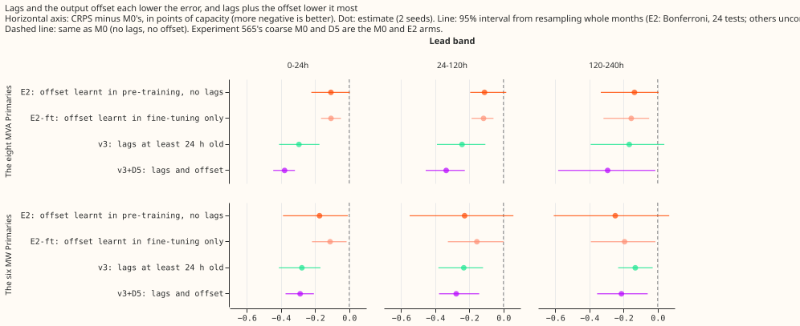

**We asked whether a slow offset added to the demand forecast makes power lags unnecessary.** The
forecast comes from a neural network for demand at 16 primary substations (Primaries). Lags are the
half-hourly power readings from the previous day and week. The offset is one number per Primary and
month, added to the forecast's mean. We fitted the network with the offset and no lags (arm E2),
with lags and no offset (arm v3), and with both (arm v3+D5) on five test months, one per fold. Error
is the continuous ranked probability score (CRPS) in points of capacity, where lower is better, for
forecasts 24 to 120 hours ahead unless a band is named. **At the eight Primaries that report only
apparent power (the eight MVA Primaries), E2 was behind v3+D5 by 0.224 points (interval excludes
zero) and behind v3 by 0.131 points (interval includes zero). At the six Primaries that report
signed power (the six MW Primaries), E2 and v3 were not distinguishable (+0.005).** All numbers are
interim and unaudited, because no audit has run.

**Verdict: partly supported.** The data support lags and the offset together at the eight MVA
Primaries. They do not show that either replaces the other at the six MW Primaries. The brief's
stop rule needs a gain of at least 0.10 at both groups, and v3+D5 beat E2 by 0.224 at the eight
and 0.049 at the six, so the rule is not met. Whether Part 2 also runs on v3+D5 is the maintainer's
decision.

Arm labels: M0 has no offset and no lags; E2 has the offset learnt in pre-training and no lags;
E2-ft has the offset learnt in fine-tuning only; v3 has lags at least 24 hours old and no offset;
v3+D5 has both; v3-3.5 has lags at least 3.5 hours old. D5 is the name of the offset in experiment
565.

## Setup

- **Reused from [experiment 565](../00565-drift-embedding-variants-six-designs/result.md):** M0 (no
  offset, no lags) is its `C-M0` and E2 is its `D5`, both coarse refits on days 0 and 14 of each
  fold
  (five folds, seeds 0 and 1). Step 0: D5 learnt its monthly knots in pre-training (from 2019-09,
  slope penalty of weight 10, added to the three mixture means) and fine-tuning trained only the
  newest knot, so E2 is exactly D5.
- **New fits** (code `ml-experiments/00572-*/`, copying experiments 560 and 565): E2-ft (every knot
  learnt in fine-tuning only), v3 (experiment 560's [v3
  weights](../00560-modular-lag-encoder-capped-lags-and-block-dropout/result.md),
  refitted coarse), v3+D5 (v3 plus the offset, pre-trained here with lags and block dropout), and
  v3-3.5
  (lags at least 3.5 h old, report only). E2-ft and v3+D5 freeze the weather and datetime encoders
  as
  D5 does; v3 and v3-3.5 do not, as in experiment 560.
- **Timing asserts** (printed in the fit logs): weather from the run issued at the origin minus 9 h
  (every test origin), every lag at least the cap before the origin (`lag_indices` asserts all
  rows; the printed example check samples 200,000 rows), and the 24 h cap matches experiment 560's
  columns exactly. Example: origin 2025-10-01 09:00, target 2025-10-03 07:00, weather run
  2025-10-01 00:00, day lag at 2025-09-30 07:00.
- **Code review:** one fresh Sonnet review before the first fit. Review findings applied: the
  stress-run guard, and the unaged missing-lag code in the aged variants. Not changed: the example
  check samples rows, and a crash between writing a forecast and its twins fails loudly in assemble.

## Results

CRPS (mean single-seed), points of capacity:

| Group, band | M0 | E2 | E2-ft | v3 | v3+D5 | v3-3.5 |
|---|---|---|---|---|---|---|
| Eight, 0-24 h | 4.484 | 4.377 | 4.378 | 4.190 | 4.105 | 4.120 |
| Eight, 24-120 h | 4.762 | 4.651 | 4.646 | 4.520 | 4.427 | 4.489 |
| Eight, 120-240 h | 5.300 | 5.164 | 5.145 | 5.134 | 5.007 | 5.102 |
| Six, 0-24 h | 3.294 | 3.121 | 3.183 | 3.017 | 3.007 | 2.962 |
| Six, 24-120 h | 3.604 | 3.376 | 3.448 | 3.371 | 3.327 | 3.337 |
| Six, 120-240 h | 3.953 | 3.705 | 3.760 | 3.823 | 3.741 | 3.806 |

Counted contrasts at 24-120 h (first arm minus second, Bonferroni 24 tests, 5-block month
bootstrap near the minimum to maximum of the folds; positive means the first arm is worse; minimum
detectable effect, MDE, beside each; folds in which the first arm is worse):

- **E2 minus M0:** eight -0.111 (-0.195 to +0.017, MDE 0.125, 1 of 5), six -0.228 (-0.549 to +0.058,
  MDE 0.189, 1 of 5).
- **E2 minus v3:** eight +0.131 (-0.127 to +0.336, MDE 0.123, 3 of 5), six +0.005 (-0.091 to +0.243,
  MDE 0.202, 1 of 5).
- **E2 minus v3+D5:** eight +0.224 (+0.006 to +0.394, MDE 0.077, 4 of 5), six +0.049 (-0.139 to
  +0.128, MDE 0.182, 4 of 5).
- **v3+D5 minus v3:** eight -0.093 (-0.153 to -0.041, MDE 0.127, 0 of 5), six -0.044 (-0.191 to
  +0.166, MDE 0.088, 2 of 5).
- **Other bands:** at 0-24 h, E2 minus v3 is +0.187 at the eight (-0.094 to +0.400) and +0.104 at
  the
  six; at 120-240 h it is +0.030 and -0.117, and E2 minus v3+D5 is +0.157 (-0.044 to +0.438) and
  -0.036. Leave-D8-out leaves every 24-120 h sign unchanged (E2 minus v3+D5 +0.289 at the
  eight).
- **Descriptive, uncorrected:** v3-3.5 minus E2 at 0-24 h is -0.257 at the eight and -0.159 at the
  six; v3-3.5 minus v3 is -0.070 and -0.055 (0 of 5 folds worse). E2 minus E2-ft at 24-120 h is
  +0.006 at the eight and -0.072 at the six (negative means E2 is better).

**Predictions.**

- **P1 fails at the eight, holds at the six:** E2 is behind v3 by 0.131 at the eight (fails at
  0.10),
  and level at the six (+0.005).
- **P2 holds:** v3-3.5 beats E2 by 0.257 and 0.159 at 0-24 h, but v3-3.5 beats v3 by only 0.070 and
  0.055, so most of the gain over E2 comes from lags at least 24 h old.
- **P3 fails at the eight (the criterion names v3 and is read here as covering v3+D5 too):** E2 is
  behind v3+D5 by 0.157 at 120-240 h (fails at 0.05), and behind v3 by 0.030; at the six, E2 is
  ahead of both.
- **P4 is not supported as worded:** v3+D5 beats v3 by 0.093 at the eight (interval excludes zero)
  and 0.044 at the six (interval includes zero). Both gains are below the MDE of 0.127 and 0.088, so
  the "at least the MDE" clause is not met, and both are above 0.03, so the "fails if within 0.03"
  clause is not met either. The interval comes from the month blocks and the MDE from the seed
  spread, so a gain can be below the MDE with an interval that excludes zero.
- **P5 holds at the six only:** E2 beats E2-ft by 0.072 at the six and is 0.006 worse at the eight;
  E2-ft's knots start at zero and see only the ensemble history.
- **P6 not measured:** the real-event absorbed-share harness was not run for the new arms.

**Slices at 24-120 h, E2 minus v3+D5, positive means E2 is worse.** Cold winter nights: +0.260 at
the eight (MDE 0.106) and -0.129 at the six; Christmas week (a single block, so no interval): +0.436
(MDE 0.432) and -0.488; D8 alone -0.230; D14 alone +0.209 at the six; rows with no labelled event
+0.259 and +0.049. D15 and D18 are in the report-only tables in the private scores folder.

## Leak and lag removal

- **Injected 7-day shift (seed 0, coarse window of the day-14 fit, points of capacity, mean of five
  folds with range):** M0 9.76 (1.89 to 25.56), E2 9.03 (4.05 to 22.23), E2-ft 10.48, v3 7.28
  (4.65 to 12.41), v3+D5 7.29 (3.96 to 10.27), v3-3.5 6.33 (4.12 to 10.82). Lower is better. The
  ranges overlap, so the data do not show that one arm leaks less than another. The real-event
  absorbed share (the primary leak measure) was not
  run for E2-ft, v3+D5, or v3-3.5.
- **Lags removed or aged (24-120 h, eight):** v3 4.520 normal, 4.767 removed (back to M0's 4.762),
  4.552 aged one day, 4.631 aged three days. v3+D5 4.427, 4.647 removed, and 4.526 aged three days.
  v3-3.5 4.489, 4.788 removed, and
  4.606 aged three days. Aged by one day, v3 scores 4.552, v3+D5 4.457, and v3-3.5 4.527, so one day
  of ageing loses little of the gain; removing the lags loses all of it.

## Checks

- Median minus mean forecast per site was not computed.
- Audit triggers: trigger 2 (P1 and P3 fail) was answered by the leave-D8-out and per-fold checks
  above, which leave signs unchanged; the quantile-score and mean-error contrast comparison was not
  run, so trigger 3 is unchecked; no nested arm lost to its parent at 24-120 h at the eight. No
  audit
  was run.
- Coarse v3 here scores 4.520 at the eight, against 4.315 for experiment 560's daily refits; the two
  harnesses differ, and only coarse arms are compared on this page.

## What the next experiment should answer

Part 2 could build its two offsets on v3+D5 as well as on E2, because the offset and the lags carry
different information at the eight MVA Primaries. Whether to do so is the maintainer's decision.
