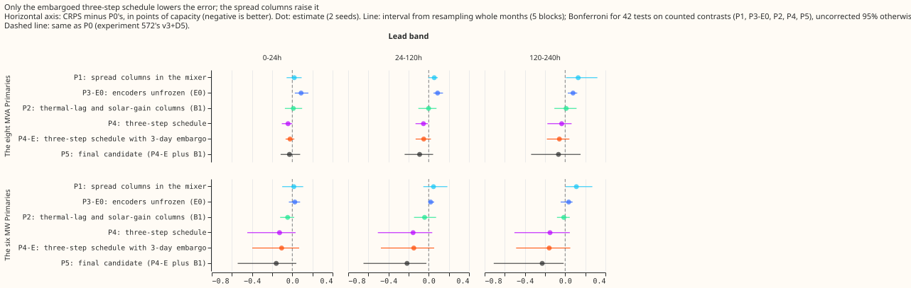
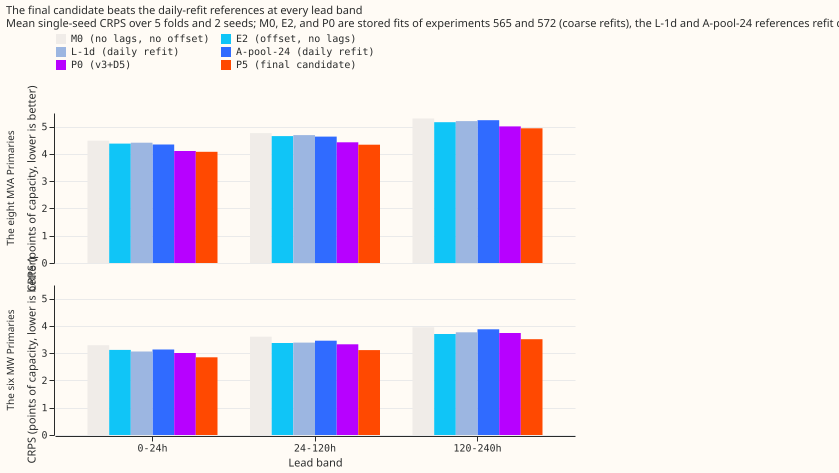
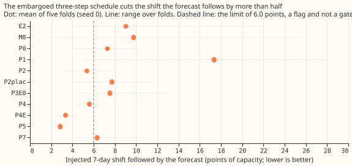

**We asked which add-ons improve the modular demand network that combines power lags and a slow
output offset.** The network forecasts demand at 16 primary substations (Primaries). Its base
recipe, P0, is [experiment
572's](../00572-two-offset-part-1-lags-versus-the-slow-output-offset/result.md) v3+D5: a lag encoder
for the previous day's and week's power, plus one offset per Primary and month, fine-tuned daily. We
tested four add-ons against P0 on five test months: the multi-variable ensemble spread in the mixer
(P1), thermal-lag and solar-gain columns through the weather encoder (P2), unfrozen encoders in
fine-tuning (P3-E0), and a three-step schedule (P4, and P4-E with a 3-day embargo). We then combined
the survivors (P5). Error is the continuous ranked probability score (CRPS) in points of capacity,
where lower is better. **The three-step schedule with the embargo, combined with the thermal-lag
columns, is the only combination that helped: P5 is 0.090 below P0 at 24 to 120 hours at the eight
Primaries that report apparent power (the eight MVA Primaries, interval includes zero) and 0.215
below at the six Primaries that report signed power (the six MW Primaries, interval excludes
zero).** P5 beats the previous best recipe E2 and the daily-refit A-pool-24 by about 0.3 at both
groups, and follows an injected 7-day shift of the history 2.9 points against P0's 7.3. All numbers
are interim and unaudited, because no audit has run.

**Verdict: partly supported.** Of the four add-ons, one earns its place (P4-E), one is neutral on
error and helps the leak (P2), and two make the forecast worse (P1 and P3-E0). P5 meets every
pre-registered P5 prediction but one that was not run (leave-one-out removals). The numbers do not
show that P5 beats P0 at the eight MVA Primaries by the minimum detectable effect.

Arm labels: P0 is experiment 572's v3+D5. E2 is experiment 565's D5 (offset, no lags). P1 adds the 7
spread columns of [experiment
568's](../00568-attention-mixer-modular-network-with-lead-and-spread-token/result.md) T4 to the
fine-tuning mixer. P2 passes the thermal-lag and solar-gain columns (B1) of [experiment
569](../00569-modular-network-inputs-through-matching-encoders-in-pretraining-and-fine-tuning-run-1/result.md)
through the weather encoder; P2-plac is the same with the days shuffled. P3-E0 unfreezes the weather
and datetime encoders in fine-tuning. P4 fits a fresh mixer on the whole ensemble history before the
daily fine-tune; P4-E adds the 3-day embargo of [experiment
556](../00556-lag-free-finetune-absorption-of-load-shift-events-and-unlearn-time/result.md). P5 is
P4-E plus B1. P6 is P5 plus three trailing-temperature columns (6, 24, and 72 h) from [experiment
515](../00515-lagless-demand-network-trailing-weather-window-features/result.md). P7 is P0 with lags
at least 3.5 h old. A-pool-24 is [experiment
558's](../00558-lags-in-pretraining-and-24-hour-cap-lag-light-demand-network/result.md) network with
a 24-hour lag cap, and L-1d is [experiment
511's](../00511-lagless-network-refit-cadence-half-life-and-mixed-pretraining/result.md) network
refitted daily; both references are refitted daily.

## Setup

- **P3 as planned was identical to P0.** The plan gave the lag encoder's expected embeddings from a
  frozen copy of the encoders trained on ERA5 and CAMS alone (E1). P0 already uses exactly those
  encoders, frozen, so P3 and P0 have identical weights. The contrast that tests a different
  question is P3-E0 (encoders unfrozen), which replaces P3 in the counted family. The Bonferroni
  count stays 42.
- **Reused from earlier experiments:** P0 and its pre-training are [experiment
  572's](../00572-two-offset-part-1-lags-versus-the-slow-output-offset/result.md) `V3D5` and
  `pretrained_V3D5`; E2 is experiment 565's D5; the fine-tune is [experiment
  559's](../00559-m0-leak-ladder-three-step-schedule-frozen-encoders-and-penalty/result.md) one-step
  schedule (frozen encoders, fresh mixer seed 12345, 90-day half-life, early stopping). The folds
  are 2025-10, 2025-12, 2026-01, 2026-03, and 2026-06, refitted at days 0 and 14 of each fold, with
  seeds 0 and 1. The stress run injects a 7-day shift at day 14 (seed 0).
- **B1 at lag times.** The thermal-lag and solar-gain columns enter the weather encoder at the
  target time. At a lag's own time the lag encoder's expected embeddings read 0 in the B1 slots,
  because the lagged power has no matching columns.
- **Three-step schedule.** Step 1 pre-trains on ERA5 and CAMS rows. Step 2 fits a fresh mixer on the
  whole ensemble history up to the cutoff minus 3.5 h, without recency weighting. Step 3 is the
  daily fine-tune from the step-2 weights, with the mixer at its ordinary learning rate. P4-E
  removes the 3 days before the cutoff from steps 2 and 3.
- **Timing asserts** are printed in the fit logs, one example per arm and lead band. Example for the
  0-24 h band: origin 2025-12-01 09:00, weather run 2025-12-01 00:00 (origin minus 9 h), target
  2025-12-02 07:30, day lag at 2025-11-30 07:30 (at least 24 h before the origin).
- **Statistics.** 42 counted tests (four add-one contrasts, plus P5 against P0, E2, and A-pool-24,
  each at 2 groups and 3 lead bands) plus a separate family of 2 (P2 against P2-plac on cold winter
  nights, once per group). Intervals resample the five months as five blocks. Minimum detectable
  effect (MDE) is printed beside every contrast.
- **Leak.** The primary leak measure is the share of the labelled load-shift events' depth that the
  fitted forecast absorbs (experiment 556's harness). The harness scored 37 of the 74 labelled
  events: the others end too late for a fit at least 3 days later within 30 days. The flag at 6.0
  points on the injected shift is a flag, not a gate.
- **Budget.** The fits stayed below the 6 GPU-h ceiling. The leave-one-out removals, the stretch E3
  arm, seeds 2 to 4, and the daily-refit harness were not run.

## Results

CRPS (mean single-seed), points of capacity, lower is better:

| Arm | Eight MVA 0-24 h | 24-120 h | 120-240 h | Six MW 0-24 h | 24-120 h | 120-240 h |
|---|---|---|---|---|---|---|
| M0 (no lags, no offset) | 4.484 | 4.762 | 5.300 | 3.294 | 3.604 | 3.953 |
| E2 | 4.377 | 4.651 | 5.164 | 3.121 | 3.376 | 3.705 |
| A-pool-24 | 4.345 | 4.634 | 5.234 | 3.136 | 3.458 | 3.876 |
| L-1d | 4.410 | 4.689 | 5.201 | 3.063 | 3.388 | 3.767 |
| P0 | 4.105 | 4.427 | 5.007 | 3.007 | 3.327 | 3.741 |
| P5 | 4.078 | 4.337 | 4.941 | 2.847 | 3.112 | 3.513 |
| P6 | 4.092 | 4.357 | 4.931 | 2.860 | 3.121 | 3.544 |

**Add-one contrasts, all rows (CRPS minus P0's; negative is better).** Intervals are Bonferroni
month-block intervals at 42 tests.

| Arm | Group | 0-24 h | 24-120 h | 120-240 h | MDE (24-120 h) |
|---|---|---|---|---|---|
| P1 spread | eight | +0.019 | +0.055 | +0.129 (excl. 0) | 0.144 |
| P1 spread | six | +0.016 | +0.047 | +0.111 (excl. 0) | 0.170 |
| P3-E0 unfrozen | eight | +0.087 (excl. 0) | +0.088 (excl. 0) | +0.078 (excl. 0) | 0.096 |
| P3-E0 unfrozen | six | +0.025 | +0.019 | +0.035 | 0.145 |
| P2 thermal-lag | eight | +0.010 | -0.002 | +0.010 | 0.099 |
| P2 thermal-lag | six | -0.046 | -0.041 | -0.013 | 0.161 |
| P4 three-step | eight | -0.042 (excl. 0) | -0.052 (excl. 0) | -0.035 | 0.078 |
| P4 three-step | six | -0.127 | -0.155 | -0.151 | 0.172 |
| P5 final candidate | eight | -0.028 | -0.090 | -0.067 | 0.103 |
| P5 final candidate | six | -0.160 | -0.215 (excl. 0) | -0.228 (excl. 0) | 0.225 |
| P5 minus E2 | eight | -0.299 (excl. 0) | -0.315 (excl. 0) | -0.224 | 0.143 |
| P5 minus E2 | six | -0.273 (excl. 0) | -0.264 (excl. 0) | -0.192 (excl. 0) | 0.156 |
| P5 minus A-pool-24 | eight | -0.267 (excl. 0) | -0.297 (excl. 0) | -0.294 (excl. 0) | 0.151 |
| P5 minus A-pool-24 | six | -0.288 (excl. 0) | -0.346 (excl. 0) | -0.363 (excl. 0) | 0.133 |

- **Spread columns (P1) hurt.** CRPS rises in every lead band at both groups, and the 120-240 h rise
  has an interval that excludes zero. The leak rises to 17.4 points.
- **Unfreezing the encoders (P3-E0) hurts at the eight MVA Primaries,** with the interval excluding
  zero in every lead band. The real-event absorbed share does not move (-0.0004, interval from
  -0.0048 to +0.0034), so the 556 prediction (a fall of at least 0.005) fails.
- **Thermal-lag and solar-gain columns (P2) are neutral on error.** Against the shuffled-day
  placebo, P2 is 0.152 lower on cold winter nights at the six MW Primaries (family of 2, interval
  -0.251 to -0.106, MDE 0.291), which meets the pre-registered threshold of -0.05. At the eight MVA
  Primaries P2 is 0.035 higher than its placebo on cold winter nights, and its leak is 5.4 against
  the placebo's 7.7.
- **The three-step schedule (P4) lowers CRPS a little at the eight and more at the six, and P4-E
  lowers the leak.** Adding the embargo changes CRPS by at most 0.02 in any row (P4-E minus P4, all
  within the MDE).
- **P6 adds nothing beyond P5.** P6 minus P5 is +0.005 (eight) and +0.020 (six) for all rows, both
  within the MDE, so the pre-registered gain of 0.05 on cold winter nights does not appear (P6 is
  0.108 below P0 there at the eight, P5 is 0.214 below).

**Keep rule (addendum 14).** P5's improvement over P0 at the six MW Primaries at 120-240 h (0.228)
exceeds the MDE (0.178) and its Bonferroni interval excludes zero, so P5 as a whole meets the rule.
P4 meets it on one pre-registered slice: cold winter nights at the six MW Primaries, -0.403 against
an MDE of 0.298 (interval -0.618 to -0.083), with no other slice hurt. P2 does not meet it (its
cold-winter-night gain at the six MW Primaries is -0.079 against an MDE of 0.109), and is kept in P5
by the maintainer's policy for B1. P1 is rejected.

**Slices (CRPS minus P0's, all lead bands).**

| Slice | Group | P5 | P6 | MDE (P5) |
|---|---|---|---|---|
| Cold winter nights | eight | -0.214 | -0.108 | 0.256 |
| Cold winter nights | six | -0.604 (excl. 0) | -0.558 (excl. 0) | 0.289 |
| Evenings (17:00-20:59 local) | eight | -0.103 | -0.086 | 0.173 |
| Evenings (17:00-20:59 local) | six | -0.278 (excl. 0) | -0.228 (excl. 0) | 0.203 |
| High-spread tercile | eight | -0.071 | -0.041 | 0.139 |
| High-spread tercile | six | -0.174 (excl. 0) | -0.155 (excl. 0) | 0.144 |

The slice intervals here are uncorrected 95% intervals. The spread columns (P1) do not concentrate
their gain in the high-spread tercile: P1 is 0.084 (eight) and 0.111 (six) higher there, so the
pre-registered P1 prediction fails.

**Leak (injected 7-day shift, points of capacity; mean of five folds and range).**

| Arm | Leak | Range |
|---|---|---|
| M0 | 9.76 | 1.89-25.56 |
| E2 | 9.03 | 4.05-22.23 |
| L-1d | 7.19 | 3.41-11.16 |
| P0 | 7.29 | 3.96-10.27 |
| P7 | 6.33 | 4.12-10.82 |
| P1 | 17.35 | 4.98-28.26 |
| P3-E0 | 7.53 | 4.58-12.71 |
| P2 | 5.37 | 3.39-7.94 |
| P2-plac | 7.72 | 3.68-11.74 |
| P4 | 5.60 | 4.29-6.68 |
| P4-E | 3.35 | 2.48-4.41 |
| P5 | 2.85 | 2.35-3.24 |
| P6 | 2.72 | 2.00-3.34 |

**Real-event absorbed share (37 labelled events, seed 0; the share of an event's depth that the
forecast absorbs).** Differences from P0 are paired, with events resampled as clusters of (Primary,
month).

| Arm | Mean share | Depth-weighted | Minus P0 | Interval |
|---|---|---|---|---|
| P0 | 0.0172 | 0.0166 | 0 | n/a |
| P2 | 0.0192 | 0.0191 | +0.0020 | -0.0019 to +0.0057 |
| P3-E0 | 0.0168 | 0.0170 | -0.0004 | -0.0048 to +0.0034 |
| P4-E | 0.0126 | 0.0116 | -0.0047 | -0.0136 to +0.0008 |
| P5 | 0.0139 | 0.0162 | -0.0034 | -0.0129 to +0.0041 |
| P6 | 0.0103 | 0.0093 | -0.0069 | -0.0160 to -0.0008 |

## Predictions

| Prediction | Result |
|---|---|
| P0 beats E2 by at least 0.15 at 24-120 h, eight MVA Primaries | **Passes:** -0.224 |
| P1 gains at least 0.03 at 24-120 h at one group, concentrated in the high-spread tercile | **Fails:** P1 is +0.055 and +0.047, and worse in the top tercile |
| P2 minus placebo on cold winter nights at the six MW Primaries is at most -0.05, no other slice hurt | **Passes:** -0.152. The placebo contrast at the eight is +0.035 (not a harm by the pre-registered rule) |
| P3 lowers the absorbed share by at least 0.005 with CRPS within the MDE | **Fails:** share -0.0004, CRPS +0.088 at the eight (P3-E0, since P3 equals P0) |
| P4-E lowers the shift by at least 1.0 point, share at most 0.017, CRPS cost at most 0.05 | **Passes:** shift 3.35 against 7.29, share 0.0126, CRPS lower than P0 |
| P5 within 0.04 of A-pool-24, beats E2 by at least 0.15, lower absorbed share, no Primary worse than L-1d by over 1.0 | **Passes:** 0.297 better than A-pool-24, 0.315 better than E2, share 0.0139 against 0.0172, worst Primary D5 at +0.67 (0-24 h) |
| P5 with lags aged one extra day keeps at least 60% of its lag gain | **Passes:** keeps 91% at the eight (24-120 h) |
| Each leave-one-out removal costs at least the factor's slice MDE | **Not run** |
| P6 adds at least 0.05 on cold winter nights over P5 | **Fails:** P6 minus P5 is within the MDE in every row |

## Caveats

- The reference arms A-pool-24 and L-1d are refitted daily, while P0, P5, and P6 are refitted at
  days 0 and 14 of each fold. The comparison favours the references, so P5's lead over them is
  conservative on cadence and open on everything else.
- The real-event contrast is clustered by Primary and month, so its intervals are wide. Only P6's
  interval excludes zero. The NGED event labels are incomplete, so the share counts are lower bounds
  on the true shifts in the history.
- The inside-event slice, scored against actuals corrected by the labels, is descriptive (see
  `inside_events_nra.csv` in the private data folder).
- All arms except P3-E0 freeze the encoders in fine-tuning.
- P7 (lags at least 3.5 h old, report-only) is 0.062 higher than P0 at 24-120 h at the eight
  (interval excludes zero), as in experiment 572.
- Two seeds and five months: the intervals are wide, and a five-block bootstrap cannot reach the
  confidence of a larger sample.
- The weights of P0, P5, and P6 are in the private data folder under `work/weights`.
