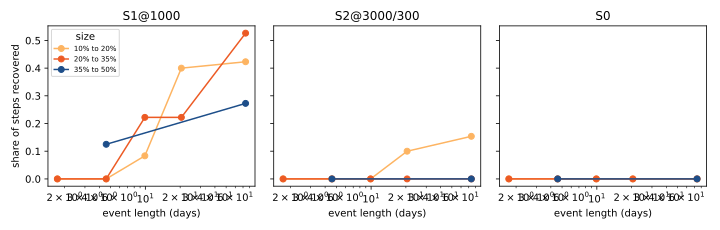
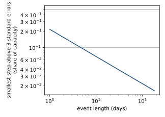

*Terms: S0, S1, and S2 are the monthly-knot, daily-knot, and gated-jump offsets of experiment 573.
Kl, Kp, and K0 are the worlds defined below. MVA and MW Primaries are the eight substations that
report apparent power only and the six that report signed power.*

**We ask whether the offsets that failed on small steps can find large ones.** [Experiment
573](../00573-stepwise-output-offset-known-answer-step-recovery/result.md) added steps of 2% to 6%
of capacity to real Primary series and found that no tested offset recovered more than 23% of the
steps of 3% or more. A labelled load-shift is much larger, so the failure may mean only that small
steps drown in weather-error noise. Here we add steps drawn from the sizes and durations of the
labelled events to the same series, with the network frozen and only the offset refitted, as in
experiment 573.

## Design

**Sizes and durations come from the labelled events.** The 184 events in experiment 400's
`events_corrected.parquet` have depth quartiles of 11%, 19%, and 31% of the Primary's capacity, and
length quartiles of 0.4, 2.1, and 3.6 days (the full printout is in the results). Only 65% last a
day or more. The injected events use depth 10% to 50% of capacity (log-uniform) and duration 1 to
180 days (log-uniform), the ranges the manager's note proposed, so the test covers the long events
that a daily-knot offset might reach. The labelled events themselves are mostly shorter, which the
results discuss.

- **Kl (large single steps):** per injected Primary, events starting between 2022-01-01 and
  2026-05-31 with 30 days or more between the end of one and the start of the next (about 2 events
  a year), a random sign, and a reversal at the end. At the three injected MVA Primaries an event is
  always a gain, because a loss could clip at zero. Three random draws of the world.
- **Kp (mirrored pairs):** a donor Primary changes by x and a neighbour on an edge of
  `Primary Substation Interconnections.csv` changes by -rho times x in MW (rho uniform from 0.6 to
  1.0), with the same onset and end; about 30% of events have no recipient. Donors and recipients
  are among the same six injected Primaries, so the ten untouched Primaries stay clean. No MVA
  Primary loses load. Three draws.
- **K0:** experiment 573's clean world. Its fitted paths are reused to count false steps of 5% or
  more; the ten untouched Primaries in Kl and Kp give a second count.
- **Arms:** S0, S1 at total-variation weights 3000 and 1000, and S2 at gate weights 300 and 30 on
  each, exactly as experiment 573's full run. No new tuning.

**Weather timing (standing rule).** The network is experiment 554's pre-trained M0 with its
outputs cached by experiment 573's `e00573_cache.py`, which asserts row by row that each row's origin
is not after the fold's refit, the target is not after the refit minus the cutoff age, and the origin
precedes the target, and prints one example row. This experiment reads that cache and changes no
weather input.

**Scoring.** A step is the change at an event's onset. It counts as recovered when the offset has a
step of the same sign within 3 days of the onset (within 1 day for steps of 20% or more) and within
25% of its size. The return step is scored separately. Only events that finish at least 10 days
before the fold's span ends and have at least 100 cached rows on each side of both changes are
scored. Recall is reported by size bin (10% to 20%, 20% to 35%, 35% to 50%) and duration bin (1 to 3
days, 3 to 14 days, 14 to 30 days, 30 to 180 days; the note's 3 to 14 days is split at 7 days for the
first prediction). For a pair, both halves must be recovered. The detectability curve uses, per
injected Primary, the standard deviation of the offset-free daily residual of the frozen network
(in the clean world), and the smallest step that exceeds three standard errors after n days is three
times that standard deviation over the square root of n.

**Statistics.** Per-fold results are shown beside the pooled results. No contrasts are counted.
Intervals on recall are binomial, not month-block bootstraps, because the quantity is a count of
injected steps.

**Advice followed.** The plan follows experiment 573's advice to use known-answer worlds before
real data, and keeps its monthly knots as the slow-drift reference.

## Results

**Verdict: not supported. Take-home: a free per-day offset cannot find label-sized steps, so Step D
is cancelled.** The first prediction fails clearly: its best arm recovers 32%, under the 50% at
which it was called failed. Draws are the random worlds of Kl and Kp. The headline pool is the
latest fold (refit 2026-06) with five draws of each world. The two earlier folds (2025-10 and
2026-01) have three draws and are shown as per-fold signs only, because the folds' training spans are
nested and so not independent. The other two folds of experiment 573 were not run, to stay inside
the compute budget. The Bonferroni count is 0.

**Labelled events are shorter than the events we injected.** The 184 labelled events have depth
quartiles of 11%, 19%, and 31% of capacity, and length quartiles of 0.4, 2.1, and 3.6 days. Of the
events, 65% last a day or more, and 1.6% last over 30 days. The injected events (1 to 180 days)
therefore test mostly longer events than the labels hold.

### Recovery of steps of 20% or more that last 7 days or more (prediction 1)

False steps are those of 5% of capacity or more per Primary-year, on all 16 Primaries in experiment
573's clean world (K0) and on the ten untouched Primaries in Kl.

| Arm | Recall (latest fold, n = 53) | Per fold (2025-10, 2026-01, 2026-06; draws 0 to 2) | False steps per Primary-year, K0 / Kl |
|---|---|---|---|
| S0 | 0.00 (±0.00) | 0, 0, 0 | 0.00 / 0.00 |
| S1, weight 3000 | 0.00 (±0.00) | 0, 0, 0 | 0.01 / 0.02 |
| S1, weight 1000 | 0.32 (±0.13) | 0.38, 0.31, 0.37 | 0.29 / 0.28 |
| S2, 3000 / gate 300 | 0.00 (±0.00) | 0, 0, 0 | 0.24 / 0.17 |
| S2, 3000 / gate 30 | 0.00 (±0.00) | 0, 0, 0 | 0.25 / 0.19 |
| S2, 1000 / gate 300 | 0.08 (±0.07) | 0.07, 0.03, 0.10 | 0.78 / 0.60 |
| S2, 1000 / gate 30 | 0.08 (±0.07) | 0.03, 0.07, 0.10 | 0.90 / 0.81 |

The intervals are binomial half-widths, which are also the minimum detectable effect beside each
recall. Recall of the return step is about the same (S1 at weight 1000: 0.26 ±0.12).

**Recall rises with event length but stays low.** For steps of 20% or more, S1 at weight 1000
recovers 0% of events of 1 to 3 days (n = 22), 4% of 3 to 7 days (n = 25), 17% and 18% of the two
bins from 7 to 30 days (n = 12 and 11, unresolved), and 43% of 30 to 180 days (n = 30, ±18). Recall
does not rise with size: S1 at weight 1000 recovers 20%, 19%, and 14% of the three size bins (10%
to 20%, 20% to 35%, and 35% to 50%).

### Level-following check (not planned)

**The offset itself under-reaches.** For events of 20% or more lasting 30 days or more (n = 30,
latest fold), the table gives the offset's change over the event as a share of the injected step.

| Arm | Median share of the injected step | Share within 25% of the step |
|---|---|---|
| S0 | 0.02 | 0.00 |
| S1, weight 3000 | 0.09 | 0.00 |
| S1, weight 1000 | 0.49 | 0.27 |
| S2, 3000 / gate 300 | 0.14 | 0.03 |
| S2, 1000 / gate 30 | 0.43 | 0.17 |

The step extractor therefore did not miss a step that the offset held. In most of these events the
offset never moved to the injected level.

### Other predictions

- **Recall for 1-day steps is at most 30% at every size below 50% (holds, unresolved).** Every
  arm recovered none of the 15, 10, and 2 steps in the three size bins, but each bin holds fewer
  than 20 steps.
- **Recall falls with duration, matching the detectability curve (fails).** The curve gives the
  smallest step above three standard errors as 22% of capacity at 1 day, 8% at 7 days, and 4% at 30
  days (from the median daily residual spread of 7.2% of capacity). A step of 20% or more lasting 7
  days exceeds the curve by a wide margin, yet the best arm recovers 17% of such steps. The
  curve assumes independent daily residuals, which weather errors are not, so it is optimistic.
- **Both halves of a pair recovered in at least 70% of pairs (fails, unresolved).** The best arm
  (S1 at weight 1000) recovers both halves of 17% of 12 pairs with a donor step of 20% or more
  lasting 7 days or more; the pair counts are too small to resolve.
- **S0 recovers under 20% of steps lasting under 30 days (holds).** It recovers 0 of 125.

## What the next experiment should answer

Step D is cancelled by the decision rule. If load-shifts are to be found from the forecast, the step
needs to enter the model as an explicit input or state (a labelled-event flag, or a level state
estimated with a filter), and the test is whether that improves the forecast on the rows near events.
Penalty weights below 1000 were not tested here because the experiment kept experiment 573's grid
unchanged; experiment 573 saw many false steps at weight 300.

## Code

- `ml-experiments/00575-*/e00575_world.py`: worlds Kl and Kp. `e00575_run.py`: fits and scores.
  `e00575_report.py` and `e00575_smear_check.py`: the tables and figures above.
- Reused from experiment 573: `e00573_steps.py` (fits, extractor, penalty grid), `e00573_world.py`,
  and the cache of the frozen network (experiment 554's pre-trained weights); from experiment 400,
  `events_corrected.parquet`. The cache asserts the weather timing row by row, as experiment 573's
  `e00573_cache.py` does.
