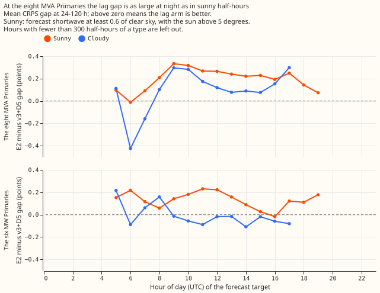
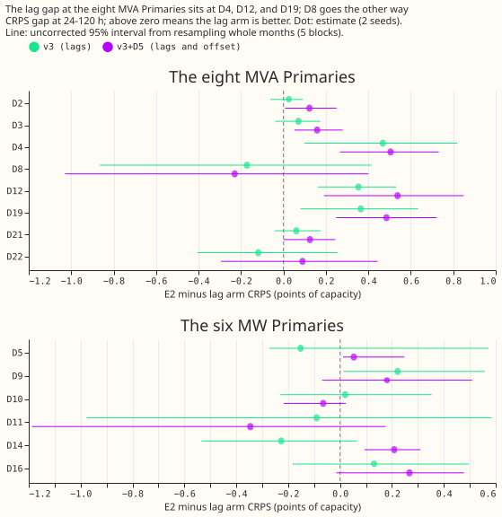

**Lags beat the lag-free network at the eight MVA Primaries in sunny half-hours and at night, not
mainly in sunny ones, and not because of D8.** The maintainer's two hypotheses were that the gap
sits in sunny half-hours (hypothesis a) and that D8, a Primary with a gas generator (Gas A),
supplies much of it (hypothesis b). Neither hypothesis holds. The gap is as large at night and in
low sun as in sunny half-hours, and D8 pulls the gap down, so leaving D8 out raises it. Three
Primaries (D4, D12, and D19) hold 85% of the v3+D5 gap. **Next step: find what D4, D12, and D19 have
in common.** All numbers are interim and unaudited. The page re-scores the stored forecasts of
[experiment 572](../00572-two-offset-part-1-lags-versus-the-slow-output-offset/result.md) (E2, v3,
v3+D5; two seeds; five folds). E2 is experiment 572's lag-free network with the output offset
(experiment 565's D5), v3 is its network with lags and no offset, and v3+D5 has both. The gap is
E2's CRPS minus the lag arm's, in points of capacity at 24-120 h unless a band is named, and
positive means the lag arm is better.

**Verdict: not supported** (both hypotheses). Pa is not met. The sunny to cloudy ratio in daytime
half-hours is 1.7 for v3+D5 (0.230 and 0.134, intervals overlap), under the 2 predicted and above
the 1.5 that would fail the prediction. The three largest half-hour types hold more than half of the
gap, as predicted, but all three are night or low-sun types, and the night gap (0.244) equals the
sunny gap, which a correction of reverse flow cannot produce. Pb fails: leaving D8 out removes none
of the gap and raises it.

## Results

Bonferroni count: 12 (2 contrasts x 2 groups x 3 lead bands), applied to the first table only. Every
other interval is uncorrected and descriptive. The month-block bootstrap has 5 blocks, which is near
the minimum to maximum of the five folds. MDE is the seed-noise half-width, given beside each
contrast.

| Group, band | E2 minus v3 (interval, MDE, folds positive) | E2 minus v3+D5 (interval, MDE, folds positive) |
|---|---|---|
| Eight MVA Primaries, 0-24 h | +0.187 (-0.069 to +0.391, 0.109, 4/5) | +0.271 (+0.097 to +0.463, 0.062, 5/5) |
| Eight MVA Primaries, 24-120 h | +0.131 (-0.127 to +0.329, 0.123, 3/5) | +0.224 (+0.033 to +0.394, 0.077, 4/5) |
| Eight MVA Primaries, 120-240 h | +0.030 (-0.117 to +0.189, 0.230, 2/5) | +0.157 (-0.044 to +0.407, 0.187, 3/5) |
| Six MW Primaries, 0-24 h | +0.104 (-0.003 to +0.271, 0.150, 4/5) | +0.114 (+0.027 to +0.171, 0.153, 4/5) |
| Six MW Primaries, 24-120 h | +0.005 (-0.087 to +0.228, 0.202, 1/5) | +0.049 (-0.136 to +0.128, 0.182, 4/5) |
| Six MW Primaries, 120-240 h | -0.117 (-0.456 to +0.123, 0.083, 2/5) | -0.036 (-0.380 to +0.143, 0.104, 3/5) |

The 24-120 h figures match the experiment 572 page. The lower end of the E2 minus v3+D5 interval at
the eight MVA Primaries is +0.033 here and +0.006 there, because the resampling draws differ.

**Sunny, cloudy, and night (hypothesis a).** Each half-hour is labelled by the shortwave radiation
the ensemble forecast gave for it, from the weather run issued 9 hours before the origin. A
half-hour is sunny when the sun is above 5 degrees and the forecast shortwave is at least 0.6 of
clear-sky radiation (a standard clear-sky formula). Solar elevation uses one point (53.0 N, 2.0 W)
for every Primary. Sunny half-hours hold 24% of the eight MVA Primaries' rows, cloudy 15%, and night
or low sun 61%.

- **At the eight MVA Primaries, 24-120 h, E2 minus v3+D5:** sunny +0.230 (+0.156 to +0.373, MDE
  0.204, 5/5), cloudy +0.134 (-0.103 to +0.447, MDE 0.169, 4/5), night or low sun +0.244 (+0.088 to
  +0.371, MDE 0.079, 5/5). E2 minus v3 is +0.147, -0.077, and +0.177.
- **By solar elevation, E2 minus v3+D5:** below the horizon +0.232, 0-10 degrees +0.337, 10-25
  degrees +0.179, above 25 degrees +0.162 (+0.120 to +0.188, 3/5). The gap is largest in the hours
  around sunrise and sunset, and the highest sun carries the smallest gap.
- **By lead band, sunny minus cloudy, E2 minus v3+D5:** 0-24 h +0.262 and +0.109, 24-120 h +0.230
  and +0.134, 120-240 h +0.233 and +0.149. Night or low sun is +0.315 at 0-24 h and +0.127 at
  120-240 h (interval includes zero).
- **By season, E2 minus v3+D5:** December to February +0.193, March to May +0.255, June to August
  +0.121, September to November +0.345. Intervals for March to May, June to August, and September to
  November are degenerate (one fold each), so those are point estimates only.
- **By hour of day:** the first figure shows the gap in sunny half-hours above the cloudy gap from
  about 10:00 to 15:00 UTC at the eight MVA Primaries. At the six MW Primaries, the cloudy gap is at
  or below zero from 09:00 UTC.
- **The three largest half-hour types** (day-light class x season, 24-120 h) are night or low sun in
  September to November, December to February, and March to May. They hold 65% of the E2 minus v3+D5
  gap and 88% of the E2 minus v3 gap, against 55% of the rows. The concentration follows the number
  of half-hours, and no sunny type ranks in the top three.

**One Primary (hypothesis b), at 24-120 h:**

| Primary | E2 minus v3 | E2 minus v3+D5 (interval) | Share of the v3+D5 gap |
|---|---|---|---|
| D2 | +0.025 | +0.122 (+0.008 to +0.250) | 6.8% |
| D3 | +0.071 | +0.159 (+0.053 to +0.279) | 8.8% |
| D4 | +0.468 | +0.505 (+0.266 to +0.732) | 28.2% |
| D8 | -0.172 | -0.230 (-1.029 to +0.401) | -12.8% |
| D12 | +0.353 | +0.537 (+0.191 to +0.849) | 30.0% |
| D19 | +0.364 | +0.485 (+0.249 to +0.722) | 27.1% |
| D21 | +0.060 | +0.125 (0.000 to +0.243) | 7.0% |
| D22 | -0.119 | +0.090 (-0.294 to +0.444) | 5.0% |

- **Without D8, the eight MVA Primaries show a larger gap.** E2 minus v3+D5 rises from +0.224 to
  +0.289 (+0.202 to +0.374, MDE 0.099, 5/5) and E2 minus v3 from +0.131 to +0.175 (+0.049 to +0.294,
  MDE 0.095, 4/5). Without D8, the sunny gap is +0.229, the cloudy gap +0.224, and the night or low
  sun gap +0.329 (v3+D5), so the sunny and cloudy gaps match.
- **D4, D12, and D19 hold 85% of the v3+D5 gap** and 37.5% of the rows. The interval for each of the
  three excludes zero. They also hold 75.6% of the summed gap of the seven Primaries with a positive
  gap, so the share does not depend on D8's negative contribution. D8 and D22 are the two Primaries
  where v3 is behind E2.
- **At the six MW Primaries**, the gap is near zero overall (+0.049 for v3+D5, interval includes
  zero), and shares of a total near zero are not meaningful, so none are quoted. Per Primary, four
  of six favour v3+D5 (D16 +0.267, D14 +0.209, D9 +0.181, D5 +0.053) and two go the other way (D11
  -0.346, D10 -0.065).
- **At the six MW Primaries, the gap is largest in sunny half-hours**: sunny +0.133 (+0.072 to
  +0.190, MDE 0.336, 5/5) and cloudy -0.024 for v3+D5; sunny +0.088 and cloudy -0.242 for v3. The
  MDE is larger than the gap, so this is a lead, not a finding.

## Setup and checks

- **Code:** `ml-experiments/00576-*/e00576_gap.py` and `e00576_figures.py`, importing experiment
  572's scoring module and experiments 448, 470, and 521's helpers. No fit ran.
- **Weather timing:** every half-hour's weather comes from the run issued at origin minus 9 h; the
  script asserts that the run precedes the origin and that the target follows the origin, for every
  row, and prints one example row. The label is used only to slice the scores.
- **Limits:** solar elevation uses one point for every Primary, not each Primary's own latitude. The
  ensemble-mean shortwave is smoother than the weather a Primary saw, so some half-hours labelled
  cloudy had sun.
