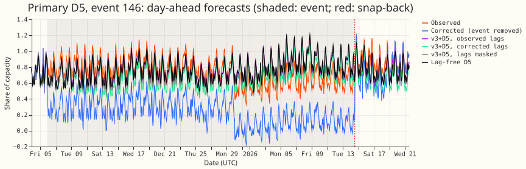
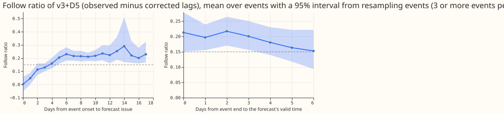
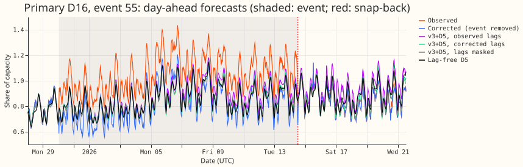
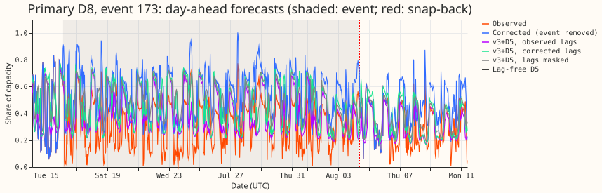
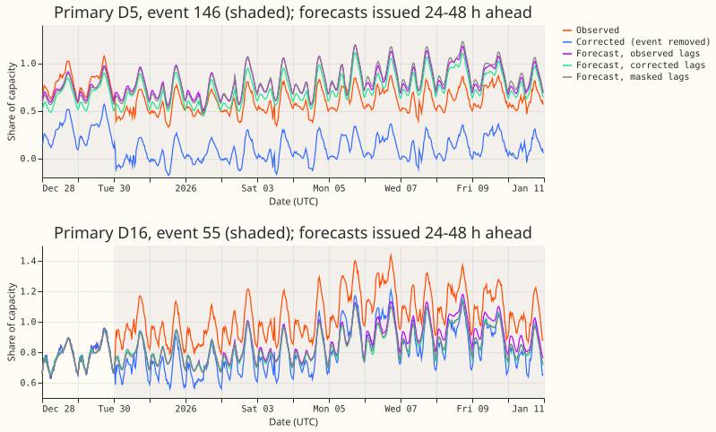
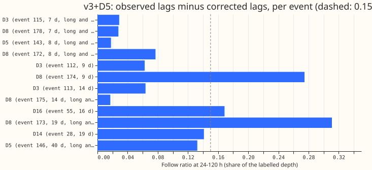
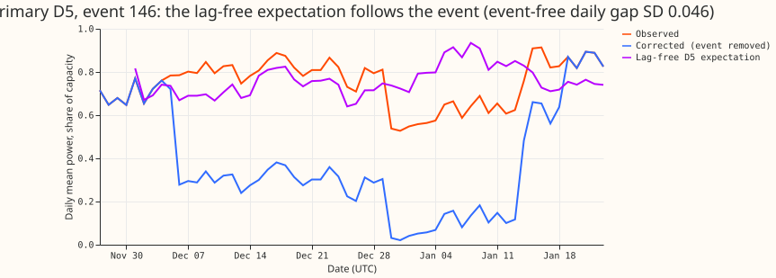

**The forecast follows long, deep load-shift events, and the lags account for a modest share of
that: 0.087 of the event's depth on average over the whole event (median 0.029), 0.163 after day 4,
and 0.175 in the 7 days after the event ends, when day-old and week-old lags still contain the event
and the forecast stays shifted after the snap-back.** We asked whether the neural network that reads
power lags follows long, deep events in NGED's log of load transfers between Primaries, and whether
a gate that drops the lags during such an event would stop it. We re-forecast the v3+D5 network
(lags plus a slow output offset) of experiment 572 with the lags taken from the NRA-corrected power,
which has the logged load transfer added back, and compared the two forecasts at 24-120 h ahead. NRA
is NGED's normal running arrangement. The after-day-4 and after-end intervals are 0.11 to 0.23 and
0.13 to 0.23 (7 long-and-deep events). Over all 12 long events in the folds, the mean after day 4 is
0.185 (0.14 to 0.23), and all 12 are positive. A descriptive gate with untuned thresholds triggered
on 2 of 12 events. All numbers are interim and unaudited. **Next step:** decide with the maintainer
whether the gate is worth tuning on injected worlds, or whether to test a control on the offset and
the fine-tune instead.

**Verdict: not supported.** The prediction that the lag effect is at least 0.30 on obvious events
fails. Obvious events among the long-and-deep ones (E-obv, defined in the plan) number 0: no long-
and-deep event shows 3 consecutive days with a daily gap above 3 event-free standard deviations from
the lag-free D5 expectation. One shorter event passes the rule (event 55, D16, 16% deep, not long
and deep). The whole-event mean is under the 0.15 stop line and the mean after day 4 is just above
it, so the stop rule is borderline. At the manager's request the gates G1 and G2 with action A2 were
run as a descriptive check on stored forecasts (below); G3, A1, A3, A4, and the injected-world
tuning were not. Bonferroni count: 0 of the 8 planned tests were run. All numbers are descriptive,
with n = 7 long-and-deep events (12 long events in the folds), so only a large difference could be
resolved.

## The forecast being examined

The network is the v3+D5 arm of experiment 572, in `ml-experiments/00572-*/e00572_fit.py`
(`Spec("V3D5", "24h", "lagoff", True)`, line 104). Line references below are to the files in `ml-
experiments/`, in the folders of experiments 572, 560, 559, 545, 510, 428, 397, and 558.

- **Encoders.** A weather encoder (7 weather columns plus an 8-dimensional Primary embedding, 64
  hidden units, 32 outputs, dropout 0.1) and a datetime encoder (21 columns, the same sizes)
  (`e00560_model.py:57-71`). A lag encoder (mode v3) reads the day lag and the week lag, each as a
  value, a missing flag, and an age, plus 4 "expected" embeddings that pass the weather and datetime
  rows of the lag times through the same frozen encoders (`e00560_model.py:77-124`).
- **Mixer and head.** A mixer of 2 hidden layers of 64 units reads the encoder outputs and the
  Primary embedding (fine-tuning adds 7 weather spread columns and 2 lead columns)
  (`e00560_model.py:93-157`). The head is a 3-component Gaussian mixture, trained on its negative
  log-likelihood, and read out at 11 quantile levels from 0.01 to 0.99 (`e00397_models.py:19-91`).
- **D5 offset.** One monthly knot per Primary from 2019-09 to the fold month, interpolated linearly
  by the target's valid time, added to the 3 component means (`e00572_model.py:52-66`,
  `e00559_extra.py:363-388`). All knots are learnt in pre-training. In fine-tuning only the newest
  knot is trained and the older knots are fixed (`e00572_model.py:35-39,69-81`). A smoothness
  penalty on the knots has weight 10 (`e00565_model_variants.py:27`).
- **Pre-training.** ERA5 and CAMS weather estimates standing in for forecasts, with every row
  cleaned of flagged half-hours, no recency weights, learning rate 5e-4, and early stopping on held-
  out weeks, one fit per fold and seed (`e00572_fit.py:567-647`, `e00448_run.py:123-179`). Block
  dropout masks all lags on 25.5% of origin days and only the day lag on 4.5%
  (`e00558_lags.py:18-64`).
- **Fine-tuning.** Ensemble-mean weather of daily runs from 2024-04-01, over the 730 days before the
  fit, with a recency weight of 0.5 to the power (age in days / 90), a fresh mixer (learning rate
  5e-4, seed 12345), the lag encoder and the Primary embedding at 2e-4, and the weather and datetime
  encoders frozen (`e00572_fit.py:211-259`, `e00510_common.py:50-61,261-279`). There is no embargo
  and no three-step schedule.
- **Refit cadence and seeds.** One coarse fit on day 0 and one on day 14 of each fold month, each
  scoring the origins until the next cutoff, with seeds 0 and 1; the forecasts here are the seed
  mean (`e00572_fit.py:63,131-138`). Origins are daily at 09:00 UTC, the ensemble run at 00:00 UTC
  plus a 9 h publication delay, with leads up to 240 h (`e00087_common.py:93,231`).
- **Lags.** The day lag and the week lag are the latest values at least 24 h before the origin
  (`cap_steps` 48), asserted row by row (`e00572_lags.py:132-143,193-222`). The 3.5 h in the brief
  belongs to arm V35 and to the training cut-off age, not to this network. The gate of the brief
  reads observations up to the origin minus 3.5 h; no gate was run here.
- **Cleaning.** Half-hours flagged `substation_zero` are dropped, and for D15 and D18 everything
  before 2025-03-01. Labelled load-shift events are not dropped (`e00510_common.py:97-100`).
- **The two twins.** The lags-masked twin sets both lag inputs to the missing state with the same
  fitted weights (`e00572_lags.py:182-190`). The corrected-lag twin rebuilds the lag values from the
  cleaned power plus the NRA correction of experiment 435, leaving the lag times unchanged
  (`e00578_fit.py:48-64`).

## The metrics

Every metric below is computed per event on the valid times inside the event, for forecasts issued
24 to 120 h earlier, from the seed-mean median forecast. *Depth* is the labelled size of the event
as a signed share of the Primary's effective capacity (positive when the transfer raised the
Primary's load). The code is `ml-experiments/00578-*/e00578_nra.py`, which reads the tables from
`e00578_follow2.py` and writes `nra_metrics.csv`.

- **Follow ratio** = mean over valid times of (median forecast with the observed lags minus median
  forecast with the NRA-corrected lags) divided by the depth. 0 means the lags do not move the
  forecast; 1 means the lags move it by the whole event. Worked example with illustrative numbers:
  depth 0.23, forecast 0.80 with observed lags and 0.75 with corrected lags, so (0.80 - 0.75) / 0.23
  = 0.22.
- **Lag effect** = the same, with the lags-masked twin in place of the corrected-lag forecast. It
  measures what reading the lags adds, whether or not the lags are right. Example: 0.80 with lags
  and 0.72 masked gives 0.35.
- **Error during the event** = mean of the absolute difference between the median forecast and the
  observed power, divided by the absolute depth. Example: an absolute error of 0.04 at depth 0.23 is
  0.17.
- **Recovery error** = the same error over the 7 days after the event ends, when power has snapped
  back. It is high when the forecast stays shifted.
- **Level share** = sum of (forecast minus corrected power) over sum of (observed minus corrected
  power). 0 means the forecast sits at the counterfactual level; 1 means it reproduces the event's
  level.
- **Absorbed share and the 74 pairs.** The share of an event's depth that a fine-tune absorbs into
  the next week's median, taken from [experiment 566][e566]: 0.026 for the lag network and 0.040
  for the lag-free network over 74 (month, event) pairs (59 distinct events). Not recomputed here.
- **Lag-following on the 43 events.** Correcting the lags inside an event moves the lag network's
  forecast by 0.122 of the depth (43 events, intervals about 0.11 to 0.15), from the same page of
  experiment 566. This page's follow ratio is the same quantity for 12 long events (mean 0.110), at
  24-120 h.
- **Injected 7-day shift leak.** A step of 10% of capacity in the fine-tuning targets reaches the
  next week's median by 26% of the step after 7 days, from [experiment 556][e556]. Not recomputed here.

Glossary. **NRA** is NGED's normal running arrangement; the
corrected power is the metered power with a logged departure from it removed. **Depth** and **follow
ratio** are defined above. **Fold** is one scored month of experiment 572, fitted on data before it.
**D3** to **D22** are anonymised Primary labels; the eight MVA Primaries have no signed power, the
six MW Primaries do.

## Results

**Which events can be tested.** Of 184 labelled events (experiment 400), 23 last at least 7 days.
Their median depth is 22.1% of effective capacity, and 12 are at least that deep (long and deep).
Five of the 12 (ids 122, 85, 183, 157, and 136) cannot be tested, because the ensemble weather
summaries start on 2024-04-01. The other 7 lie in the five folds of experiment 572 (ids 115, 146,
178) or in the two folds added here, 2025-07 and 2025-08 (ids 143, 172, 173, 175). Five more events
of at least 7 days (ids 28, 55, 112, 113, 174) lie in the folds and are shown beside them. Duration
quartiles (days): 0.15, 0.4, 2.1, 3.6, 39.7; depth quartiles (% of capacity): 1.6, 10.9, 19.2, 31.3,
99.6.

| Event | Primary (group) | Days, depth | Follow | Lag effect | Error during | Recovery error | Level share |
|---|---|---|---|---|---|---|---|
| 115 | D3 (eight MVA) | 7.0, 25.0%, long and deep | 0.03 | -0.02 | 0.10 | 0.11 | 0.94 |
| 178 | D8 (eight MVA) | 7.0, 31.0%, long and deep | 0.03 | 0.07 | 0.40 | 0.42 | 0.65 |
| 143 | D5 (six MW) | 8.4, 42.8%, long and deep | 0.02 | 0.00 | 0.08 | 0.15 | 1.01 |
| 172 | D8 (eight MVA) | 8.4, 23.6%, long and deep | 0.08 | 0.16 | 0.66 | 0.77 | 0.80 |
| 112 | D3 (eight MVA) | 9.4, 14.4% | 0.06 | -0.04 | 0.12 | 0.10 | 1.03 |
| 174 | D8 (eight MVA) | 9.4, 17.8% | 0.27 | 0.40 | 0.58 | 0.62 | 1.00 |
| 113 | D3 (eight MVA) | 14.2, 17.8% | 0.06 | 0.03 | 0.09 | 0.12 | 0.99 |
| 175 | D8 (eight MVA) | 14.2, 22.1%, long and deep | 0.02 | -0.27 | 0.53 | 0.72 | 0.87 |
| 55 | D16 (six MW) | 15.5, 16.5% | 0.17 | 0.16 | 1.06 | 0.52 | 0.24 |
| 173 | D8 (eight MVA) | 19.3, 23.0%, long and deep | 0.31 | 0.43 | 0.68 | 0.40 | 0.66 |
| 28 | D14 (six MW) | 19.5, 20.4% | 0.14 | -0.00 | 0.15 | 0.14 | 0.97 |
| 146 | D5 (six MW) | 39.7, 50.7%, long and deep | 0.13 | 0.01 | 0.28 | 0.21 | 1.04 |

**Counts behind each number.** Follow ratio, lag effect, error, and level share: 12 events at 7
Primaries (D3, D5, D8, D14, D16) in 7 folds, of which 7 are long and deep (D3, D5, D8). The lag-free
D5 network exists only in the five old folds, so it has 4 events (55, 115, 146, 178).

**Follow ratio by day.** Over the 7 long-and-deep events, the mean follow ratio after day 4 is 0.163
(95% interval from resampling events 0.11 to 0.23; median 0.13; 2 of 7 above 0.15), and over the 7
days after the event ends it is 0.175 (0.13 to 0.23). Over all 12 long events the values are 0.185
(0.14 to 0.23) and 0.19 (0.15 to 0.24), all 12 positive. The per-day curve (figure above) rises from
0.00 on day 0 to 0.16 on day 4, and stays between 0.15 and 0.22 for the week after the end.

Day-ahead plots for the other testable events: [115](day_ahead_event115.svg),
[143](day_ahead_event143.svg), [172](day_ahead_event172.svg), [175](day_ahead_event175.svg),
[178](day_ahead_event178.svg).

**The forecast already holds the event's level.** With observed lags the median level share over the
12 long events in the folds is 0.95, with corrected lags 0.84, with masked lags 0.96, and for the
lag-free D5 network 0.73 (4 events). So the forecast reproduces most of a long event's level even
when it reads no event lags. That comparison does not isolate the offset: the corrected-lag forecast
uses weights fine-tuned on the uncorrected targets, so the offset and the fine-tune are both
candidates. The exception is the example pair at D16 (event 55) with level share 0.24 with observed
lags and 0.12 with corrected or masked lags.

**Cross-check.** Experiment 566 measured 0.122 of the depth on 43 events for correcting the lags.
The 12 long events here give a mean of 0.110, so the two agree.

**Not run.** G3, A1, A3, A4, the injected-world tuning, and CRPS on rows with no labelled event. The
lag-free D5 network was not re-fitted for 2025-07 and 2025-08, so those events have no figures for
it.

## A descriptive gate on the lags (G1, G2, action A2)

The thresholds are untuned and the numbers are descriptive. The gate reads the daily mean gap
between the observed power and the lags-masked v3+D5 day-ahead forecast (the lag-free expectation,
issued at least 24 h earlier) over the last 3 complete UTC days before the origin. It triggers when
the gap keeps one sign on all 3 days and exceeds both 3 event-free standard deviations of that
Primary's daily gap (0.05 to 0.62 of capacity as the threshold, D15 the largest) and 5% of capacity.
G2 also needs a neighbouring Primary, from the interconnection list, with a sustained gap of the
opposite sign. The gate releases after 2 days below half the threshold. Action A2 replaces the
forecast of a gated origin by the lags-masked twin's. The code is `e00578_gate.py`.

**The gate triggers on 2 of the 12 long events.** G1 triggers on event 55 (D16) 3 days after onset
and gates 60% of its origin days, and on event 146 (D5) 4 days after onset, gating 82% of origin
days. G2 triggers on the same two events, event 146 only 28 days after onset. Neither gate triggers
on the other 10 events, including the D3 and D8 events, because the gap stays under the threshold.
That is 17% of the events, against the 70% predicted.

**Effect of A2.** On event 55, the follow ratio falls from 0.169 to 0.019 during the event and from
0.359 to 0.073 in the 7 days after it, and the error in those 7 days (divided by depth) falls from
0.52 to 0.33. During the event the error rises from 1.06 to 1.21 times the depth. On event 146 the
follow ratio during the event moves from 0.132 to 0.122 (G1) and rises from 0.135 to 0.174 after the
event, while the error after the event falls from 0.21 to 0.17. The mean over all 12 events moves
little because 10 events are not gated: the follow ratio goes from 0.110 to 0.097 during the event
and from 0.190 to 0.169 after it.

**Cost on event-free days.** On 2,557 Primary-origin days at least 3 days away from any labelled
event, G1 gates 24 days, which is 3.4 false triggers per Primary-year (above the 3 that the brief
allows), and G2 gates none. The mean absolute error of the median forecast with A2 is 0.0614 against
0.0612 ungated for G1, as fractions of capacity (a median absolute error, not CRPS). Unlogged events
sit among these days, so the false-trigger rate is an upper bound.

## Method notes

- The re-forecast of the five old folds equals experiment 572's stored v3+D5 forecasts exactly
  (maximum absolute difference 0.0 over 1,142,520 rows).
- Weather: every forecast row uses the ensemble run issued at or before the origin minus 9 h
  (example row: origin 2026-06-08 09:00, run 2026-06-08 00:00). Every lag, observed or corrected, is
  at least 24 h before the origin; the corrected variant leaves the lag times unchanged.
- Event-free gap standard deviations and the lag-free expectation use experiment 565's D5 forecasts,
  the shortest stored lead per half-hour.
- GPU time: about 0.5 GPU-h (unmeasured), against a ceiling of 4. Reused code: experiments 400, 435,
  556, 565, 572, and 575. How to recompute: `e00578_step0.py`, then `e00578_fit.py` through
  `run.sh`, then `e00578_follow2.py`, `e00578_level.py`, `e00578_nra.py`, and `e00578_figures.py`.
- The clean-lag rows may hold events no label covers, because NGED's logs may miss events, so these
  counts are lower bounds.

[e566]: ../00566-combination-block-lag-encoder-with-three-step-schedule-and-embargo-real-event-leak/result.md
[e556]: ../00556-lag-free-finetune-absorption-of-load-shift-events-and-unlearn-time/result.md
