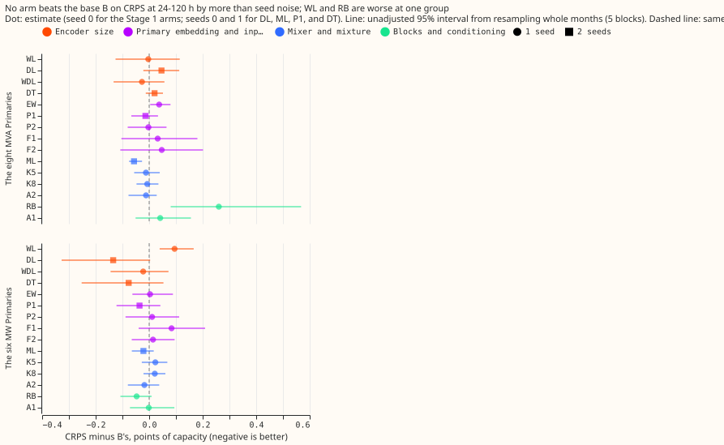
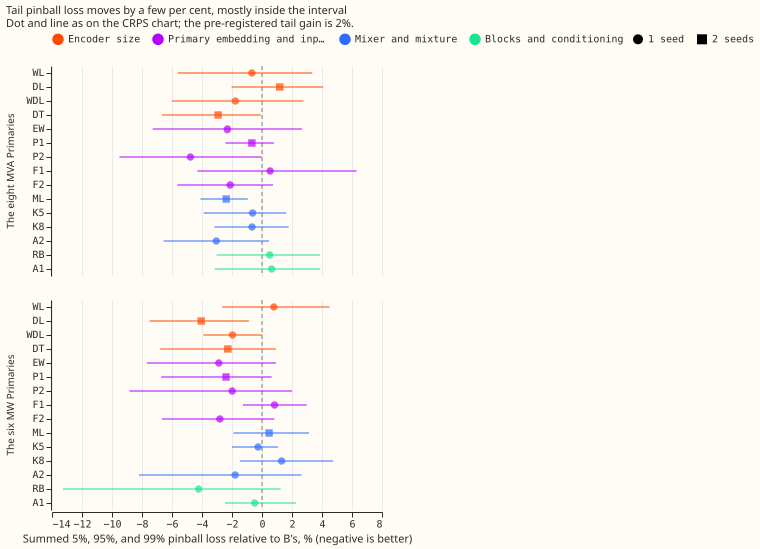

We asked whether the modular demand network, which forecasts a Primary substation's demand from a
weather encoder, a datetime encoder, a lag encoder, and a mixer, is held back by the size of its
encoders, by what the encoders are given, or by its design. We changed one part of the network at a
time (15 arms), refitted each arm on the same five test months as experiment 572's best network, and
compared the error with that network's (the base B). **Making the encoders bigger or adding datetime
inputs did not lower the error beyond what a different random seed changes.** The one gain that
looks large is the bigger datetime encoder at the six MW Primaries (-0.135 points of capacity), and
a copy of that encoder with no extra capacity achieved more than half of it.

*Every number is interim and unaudited. The Primaries are the D-numbers of the experiment 521 site
map. The real-event absorbed share and the encoder probes of the brief were not run (see "Not
run").*

## What the base holds, and what was changed

**The base datetime encoder already holds hour harmonics 1 and 2 and a day-of-week one-hot.** Its 21
input columns are `cos_zenith`, `sin_azimuth`, `cos_azimuth`; `sin_hour`, `cos_hour`, `sin_hour_2`,
`cos_hour_2` (local hour); `dow_1` to `dow_7`; `covid`; `christmas_inside`, `christmas_days`,
`christmas_tent`; and `bank_holiday`, `nearest_days`, `nearest_inside`. F1 therefore adds only 14
columns (hour harmonics 3 and 4 of the fractional local hour, 2 day-of-week harmonics, 3 day-of-year
harmonics), and F2 adds a fifteenth column, an Economy 7 proxy (1 between 00:30 and 07:30 local time
with a 10-minute logistic ramp at each edge; the real tariff window varies by supplier). The base
has 3,104 weights in the weather encoder and 4,000 in the datetime encoder.

**Arms run** (code in `ml-experiments/00579-*/`, one change each to B; the encoder-changing arms
were pre-trained afresh on the ERA5 and CAMS rows):

- **Encoder size:** WL, DL, WDL (2 hidden layers of 256 units and 64 outputs in the weather encoder,
  the datetime encoder, or both; DL has 89,920 datetime-encoder weights), and DT (C-tied: DL's shape
  with each layer's units a weight-tied copy of 64-unit layers, 8,160 weights, so it keeps DL's
  depth but not its width).
- **Embedding and inputs:** EW (Primary embedding 16 wide instead of 8), P1 (separate 16-wide
  embedding for the datetime encoder), P2 (learnt half-hour-of-day embedding per Primary), F1, F2.
- **Mixer and mixture:** ML (3 layers of 256), K5 and K8 (5 and 8 mixture components), A2 (rank-4
  per-Primary adapter on the mixer's last layer). These four re-use experiment 572's stored encoders
  and fine-tune only.
- **Blocks and conditioning:** RB (pre-layer-norm residual blocks in both encoders and the mixer;
  with one hidden layer this is about 4 times the encoder weights, so RB tests depth and size as
  well as block type), A1 (FiLM conditioning of both encoders by the Primary embedding).

B is experiment 572's v3+D5 (stored forecasts and weights). The new code reproduces its fit exactly
on one fold and seed (20 epochs, validation negative log-likelihood 0.396829 in both). In P1 and P2
the extra embeddings train in fine-tuning at the normal rate while the encoder layers stay frozen,
as the shared Primary embedding does in B.

## Result

**Stage 1 (seed 0, all arms) and Stage 2 (seed 1 for DL, ML, P1, and DT).** CRPS at 24-120 h, in
points of effective capacity (B is 4.427 at the eight MVA Primaries and 3.327 at the six MW
Primaries; M0 is 4.803 and 3.641):

| Arm | Eight MVA Primaries | Six MW Primaries | Tail pinball relative to B, eight / six |
|---|---|---|---|
| WL | -0.003 | +0.095 | -0.7% / +0.8% |
| DL (2 seeds) | +0.046 | -0.135 | +1.2% / -4.1% |
| DT (2 seeds) | +0.020 | -0.077 | -2.9% / -2.3% |
| WDL | -0.027 | -0.022 | -1.8% / -2.0% |
| EW | +0.037 | +0.003 | -2.3% / -2.9% |
| ML (2 seeds) | -0.057 | -0.021 | -2.4% / +0.5% |
| K5 | -0.012 | +0.023 | -0.6% / -0.3% |
| K8 | -0.007 | +0.021 | -0.7% / +1.3% |
| RB | +0.260 | -0.047 | +0.5% / -4.2% |
| F1 | +0.032 | +0.084 | +0.5% / +0.8% |
| F2 | +0.047 | +0.014 | -2.1% / -2.8% |
| P1 (2 seeds) | -0.014 | -0.036 | -0.7% / -2.4% |
| P2 | -0.003 | +0.011 | -4.8% / -2.0% |
| A1 | +0.041 | -0.001 | +0.6% / -0.5% |
| A2 | -0.012 | -0.018 | -3.0% / -1.8% |

Negative CRPS differences are improvements. **No arm met the CRPS rule** (a gain of at least the
minimum detectable effect with 4 of 5 folds agreeing). The two-seed minimum detectable effect is
0.123 at both groups (the brief's stored-seed values were 0.113 and 0.128), and the noise of a
difference between two single-seed fits is about 0.25. The tail rule (2% gain) was met by 12 of 14
Stage 1 arms, which shows that it is too loose for single-seed contrasts. I therefore chose the
Stage 2 arms by hand: DL (the maintainer's hypothesis, and the largest six-MW gain), ML (the
clearest sign at the eight MVA Primaries), and P1.

**Stage 2 counted tests** (16, Bonferroni, month-block interval of 5 blocks, which is near the
minimum to maximum of the folds): only ML at the eight MVA Primaries excludes zero (CRPS -0.057,
interval -0.079 to -0.012; tail pinball -2.4%, which is -0.047 in loss units, interval -0.096 to
-0.014), and the gain is under half of the minimum detectable effect. DL at the six MW Primaries is
-0.135 with interval -0.437 to 0.044. DL against DT is -0.058 at the six MW Primaries (interval
-0.205 to 0.031) and +0.026 at the eight (interval -0.085 to 0.131). Leave-D8-out: ML gains -0.046
without D8 (4 of 5 folds), so the ML sign does not rest on D8.

**Slices at the six MW Primaries (descriptive; slice minimum detectable effects are 0.38 for cold
winter nights and 0.97 for Christmas week).** DL changes cold winter nights by -0.434 (3 of 5 folds
better) and Christmas week by -1.156 (1 of 5 folds better, interval wide), so the gain is largest in
the slices the maintainer's hypothesis names, but both are inside their slice minimum detectable
effect. F1 and F2 change cold winter nights by -0.164 and -0.046 at the six MW Primaries and
Christmas week by +0.443 and +0.619; they do not show a gain. Sunny days: no arm moves them beyond
0.19.

**Leak.** The injected 7-day shift (stress, in points of capacity) is 7.29 for B, 6.59 for DL, 6.45
for ML, and 6.72 for P1, so the three Stage 2 arms are within 1.0 of B, and all four are above the
flagged 6.0 limit, B included. Lags aged by one extra day cost every arm about 0.02 to 0.04 at
24-120 h, as for B.

**K5 and K8 did not collapse.** The smallest average component weight over the 10 fits was 0.058
(K5) and 0.040 (K8), above the 0.02 flag.

**The 16-Primary table** (`primaries.csv`, seed 0) shows the Stage 2 arms at or better than M0 at 14
of 16 Primaries. The exceptions are D8, where M0 scores 9.46 against 9.96 for B, 10.23 for DL, 9.69
for ML, and 9.74 for P1, and D5, where M0 scores 5.78 against 5.94 for B and 5.97 for DL. DL is 0.27
worse than B at D8 and 0.77 better at D15. A2 does not improve the four Primaries with the largest
error (D15, D8, D12, D5): it worsens D15, D12, and D5 and improves D8.

## Predictions

- **DL gains at least 0.05 at one group, largest on cold winter nights and Christmas week:** met in
  size and in slice pattern at the six MW Primaries (-0.135), not at the eight MVA Primaries
  (+0.046); the interval includes zero.
- **WL within 0.03 of B:** not met at the six MW Primaries (+0.095, worse); met at the eight MVA
  Primaries. XL was not run.
- **F1 gains at least 0.03 on cold winter nights or Christmas week:** met in size on cold winter
  nights (-0.052 and -0.164) inside the slice minimum detectable effect; Christmas week is worse.
  **F2 gains at least 0.03 on cold winter nights:** met in size at the six MW Primaries only
  (-0.046).
- **P1 and P2 gain at least 0.03 at one group:** P1 yes in size (-0.036 at the six MW Primaries,
  inside the minimum detectable effect); P2 no.
- **K5 and K8 lower tail pinball by at least 2% with no collapse:** not met (-0.6% and -0.7% at the
  eight MVA Primaries).
- **RB, GB, ML, A1, A2, EW within the minimum detectable effect of B:** RB is 0.26 worse at the
  eight MVA Primaries (interval excludes zero); ML, A1, A2, and EW are within it. A2 does not
  improve the weakest 4 Primaries. GB was not run.
- **C-tied within the minimum detectable effect of B; fails if it gains at least half of the large
  arm's gain:** DT gains 0.077 of DL's 0.135 at the six MW Primaries, so this prediction fails.
- **Leak:** the injected shift of each Stage 2 arm is within 1.0 of B's; the real-event absorbed
  share was not run.

## Not run

- **F3, U, and GB** were cut to stay under the 5 GPU-h ceiling, and **XL** was not run because no
  encoder-size arm cleared the screen. EW was run at 16 only.
- **The real-event absorbed-share harness and the probes of addenda 8 and 9** were not run, because
  the harness code of experiments 556 and 566 is not ported to the new arms and experiment 572 also
  left it out. The leak result above is the injected shift alone.
- **Seeds 2 to 4** were not run, so every contrast has 1 or 2 seeds.

## Checks

- **Median forecast minus mean forecast per site:** not computed.
- **Error of the mean or median forecast beside the quantile-score contrasts:** not computed; the
  tail pinball loss at the 5%, 95%, and 99% quantiles is reported beside CRPS.
- **Audit triggers:** the C-tied prediction failed (DT gained more than half of DL's gain), which is
  the explanation to test next (more seeds), not a method fault; no other trigger fired. No audit
  was run.
- **Timing asserts** (row by row, with examples printed in the checks JSON files): weather from the
  run at or before the origin minus 9 h; every lag at or before the origin minus 24 h; every extra
  datetime column a function of the valid time's grid index only (asserted against the valid time
  for training and test rows).
- **Cost:** about 3.4 GPU-h of wall time on a shared GPU (Stage 1 about 2.3 h, Stage 2 and C-tied
  about 1.1 h).

## What the next experiment should answer

Does DL's six-MW-Primaries gain survive 5 seeds, and does DT's gain survive them too? If DT's does,
the gain comes from training noise or regularisation, and the datetime encoder is not
capacity-limited.
