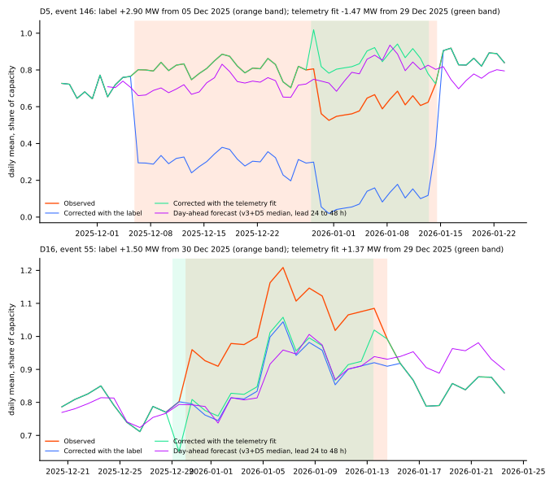
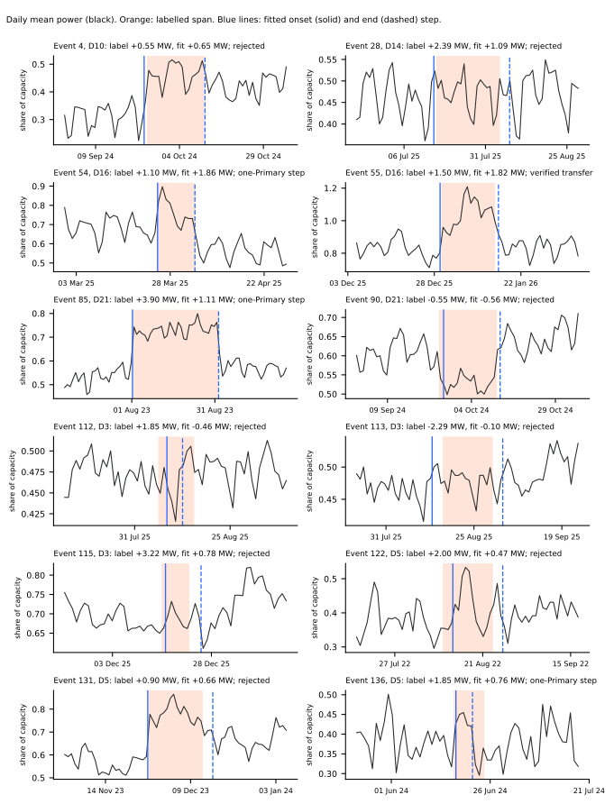
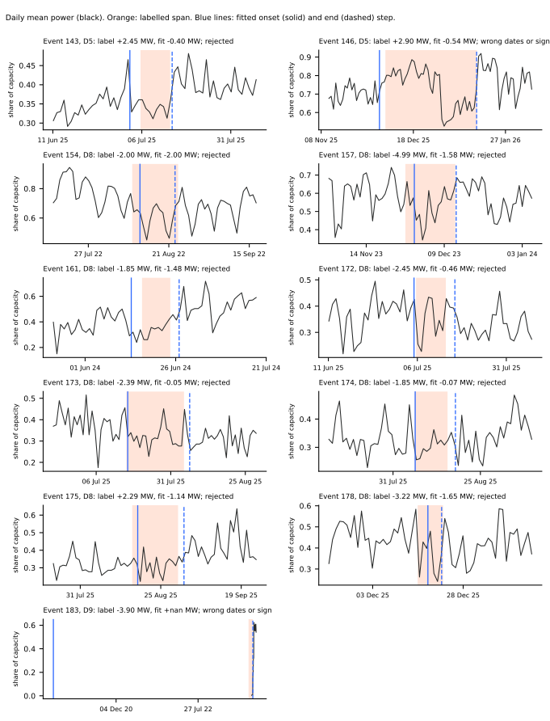
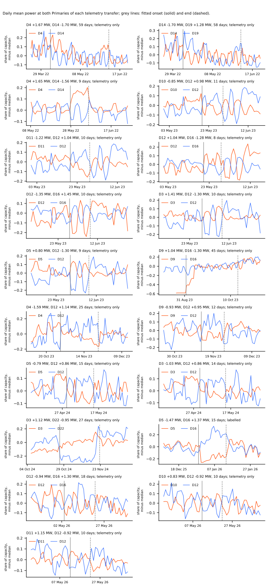
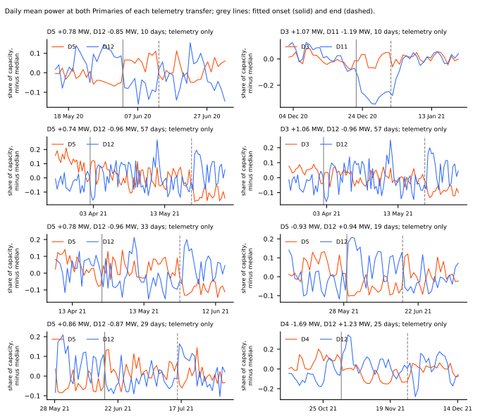

**We asked how many of NGED's labelled load-shift events (transfers of load between two Primaries)
show up as steps in the Primaries' own power readings.** We treated each label as a candidate window
only. We measured the step at the start and at the end of each event in the cleaned half-hourly
power at the labelled Primary, required the step to exceed that Primary's own noise, and required a
mirrored step at a second Primary. Only **1 of the 23 events of at least 7 days, and 1 of all 184
events, passed.** The verdict word is "supported": the plan review predicted at most 6 of 23.

**Take-home message: the labels do not describe the telemetry well enough to build a corrected
target from them.** The sign convention of the correction is right, so the errors are in the labels'
dates, signs, and depths. Event 146 shows it: the label says D5 carried 2.9 MW more from 2025-12-05
to 2026-01-14, the correction removed that amount, and the corrected power fell to 0.2 to 0.4 of
capacity, which D5 never reads. D5 shows no step on 2025-12-05. It drops by about 1.5 MW on
2025-12-29, mirroring D16, and recovers on 2026-01-13. Experiment 578 and its neighbours need an
erratum (last section).

## What a rejection means

**A rejected event is not proven absent.** A 3-day step must exceed the 95th or 99th percentile of
|step| at event-free dates, which is 0.07 to 0.45 (95th) and 0.10 to 0.56 (99th) of capacity
depending on the Primary. A transfer of 1 to 2 MW at a 10 MW Primary is 10% to 20% of capacity,
which weather and holidays also produce. So the check finds large steps only. Labelled events NGED
did not log, or logged with wrong values, stay unknown. NGED's logs are incomplete, so rows the
check treats as event-free may still hold events.

## How the check works

- **Candidate window.** The labelled onset and end, searched within 3 days each side.
- **Step.** At a candidate time, the median of each half-hour of the day over the 3 days after minus
  the same over the 3 days before, averaged over the 48 half-hours (1 day or 6 hours for shorter
  events).
- **Noise threshold (per Primary).** The 99th percentile of |step| on dates more than 4 days from
  every labelled onset and end at that Primary, and at least 5% of capacity. The strict rule asks
  each Primary alone to clear the 99th percentile. The pair rule asks both Primaries of a mirrored
  pair to clear the 95th percentile, because the same mirrored step at two Primaries on the same
  dates is much rarer by chance.
- **A verified step pair** has onset and end steps of opposite sign, within a factor of 2 in size.
- **A verified transfer** needs the same at the partner Primary, onsets and ends within 1 day,
  opposite signs, and load conserved to within 30% (the sum of signed MW under 30% of the larger).
- **Sign convention.** Depth is signed MW; positive means the Primary carries more power after the
  onset. The counterfactual is `observed - depth` inside the event. Experiments 435, 566, and 578
  apply the same convention (`corrected = observed + shift`, `shift = -f1.0`, `f1.0 = +depth_mw /
  capacity_mw` inside the event). A unit check (`e00580_check_sign.py`) builds a synthetic event of
  +0.3 of capacity and confirms that the stored correction recovers the baseline exactly, that this
  experiment's `correct()` agrees, and that a label of the opposite sign doubles the event.

## Results

**Of the 23 labelled events of at least 7 days, 1 is verified.** The counts, by label length:

| Label length | Events | Verified transfer | Telemetry shows a different transfer (wrong dates or sign) | Step at one Primary only | Rejected | Too short to check |
|---|---|---|---|---|---|---|
| at least 7 days | 23 | 1 | 2 | 3 | 17 | 0 |
| 1 to under 7 days | 96 | 0 | 3 | 11 | 82 | 0 |
| 6 hours to under 1 day | 46 | 0 | 0 | 0 | 46 | 0 |
| under 6 hours | 19 | 0 | 1 | 0 | 0 | 18 |
| all | 184 | 1 | 6 | 14 | 145 | 18 |

**No pair passes the strict rule (99th percentile at both Primaries).** The pair rule (95th
percentile) finds 27 mirrored sustained pairs in the telemetry, 19 inside the labelled period
(2022-03 to 2026-06) and 8 before it. Only 1 of the 27 matches a label. Hand-checking the plots, 2
are clear (D3 and D22 in October and November 2024; D5 and D16 in December 2025 and January 2026), 1
is plausible, 1 is an artefact (the D9 record starts), and the rest show no clear step at both
Primaries (many involve D12, whose readings oscillate day to day). The labelled period holds at most
2 clear sustained transfers, and 1 is unlabelled.

**Every event of at least 7 days, with its fit:**

| Event | Primary | Label | Labelled dates | Fitted dates | Fitted depth | Class |
|---|---|---|---|---|---|---|
| 4 | D10 | +0.55 MW | 2024-09-24 to 2024-10-11 | 2024-09-23 to 2024-10-11 | +0.65 MW | rejected |
| 28 | D14 | +2.39 MW | 2025-07-15 to 2025-08-04 | 2025-07-15 to 2025-08-07 | +1.09 MW | rejected |
| 54 | D16 | +1.10 MW | 2025-03-24 to 2025-04-03 | 2025-03-24 to 2025-04-03 | +1.86 MW | unpaired step |
| 55 | D16 | +1.50 MW | 2025-12-30 to 2026-01-14 | 2025-12-29 to 2026-01-15 | +1.82 MW | verified transfer |
| 85 | D21 | +3.90 MW | 2023-08-01 to 2023-09-01 | 2023-08-01 to 2023-09-01 | +1.11 MW | unpaired step |
| 90 | D21 | -0.55 MW | 2024-09-24 to 2024-10-11 | 2024-09-25 to 2024-10-12 | -0.56 MW | rejected |
| 112 | D3 | +1.85 MW | 2025-08-06 to 2025-08-15 | 2025-08-08 to 2025-08-12 | -0.46 MW | rejected |
| 113 | D3 | -2.29 MW | 2025-08-16 to 2025-08-30 | 2025-08-13 to 2025-09-02 | -0.10 MW | rejected |
| 115 | D3 | +3.22 MW | 2025-12-15 to 2025-12-22 | 2025-12-16 to 2025-12-25 | +0.78 MW | rejected |
| 122 | D5 | +2.00 MW | 2022-08-09 to 2022-08-23 | 2022-08-12 to 2022-08-26 | +0.47 MW | rejected |
| 131 | D5 | +0.90 MW | 2023-11-26 to 2023-12-12 | 2023-11-26 to 2023-12-15 | +0.66 MW | rejected |
| 136 | D5 | +1.85 MW | 2024-06-16 to 2024-06-24 | 2024-06-17 to 2024-06-21 | +0.76 MW | unpaired step |
| 143 | D5 | +2.45 MW | 2025-07-05 to 2025-07-13 | 2025-07-02 to 2025-07-14 | -0.40 MW | rejected |
| 146 | D5 | +2.90 MW | 2025-12-05 to 2026-01-14 | 2025-12-03 to 2026-01-14 | -0.54 MW | wrong dates or sign |
| 154 | D8 | -2.00 MW | 2022-08-09 to 2022-08-23 | 2022-08-12 to 2022-08-22 | -2.00 MW | rejected |
| 157 | D8 | -4.99 MW | 2023-11-26 to 2023-12-12 | 2023-11-29 to 2023-12-12 | -1.58 MW | rejected |
| 161 | D8 | -1.85 MW | 2024-06-16 to 2024-06-24 | 2024-06-13 to 2024-06-26 | -1.48 MW | rejected |
| 172 | D8 | -2.45 MW | 2025-07-05 to 2025-07-13 | 2025-07-05 to 2025-07-16 | -0.46 MW | rejected |
| 173 | D8 | -2.39 MW | 2025-07-16 to 2025-08-04 | 2025-07-16 to 2025-08-06 | -0.05 MW | rejected |
| 174 | D8 | -1.85 MW | 2025-08-06 to 2025-08-15 | 2025-08-06 to 2025-08-17 | -0.07 MW | rejected |
| 175 | D8 | +2.29 MW | 2025-08-16 to 2025-08-30 | 2025-08-17 to 2025-09-01 | -1.14 MW | rejected |
| 178 | D8 | -3.22 MW | 2025-12-15 to 2025-12-22 | 2025-12-18 to 2025-12-22 | -1.65 MW | rejected |
| 183 | D9 | -3.90 MW | 2023-08-01 to 2023-09-01 | no data | no data | wrong dates or sign |

**Why the long events fail.** Of the 145 rejected events, 102 have an onset step below noise, 100 an
end step below noise, and 97 both. The D3 and D8 pairs (events 112 to 115 and 172 to 178) have a
labelled MW at D3 that shows no step, and at D8 events 154 and 161 show steps of -2.00 and -1.48 MW
that match the label but sit below D8's noise threshold (about 2.4 MW). Event 85 (D21, +3.9 MW)
shows a real step of about 1.1 MW with no partner, because D9 has no telemetry before 2023-09-01.

**Event 55 is verified, and event 146 is its mirror with the wrong sign and dates.** The figure
shows both before and after correction, against the day-ahead forecast.

D5 reads 0.8 of capacity, drops to 0.55 on 2025-12-29, and returns to 0.9 on about 2026-01-14. The
label-corrected series (blue, top) removes +2.9 MW from 2025-12-05 and falls to 0.3, then to 0.0
once the true drop adds to it. Event 143 (D5, +2.45 MW, 2025-07-05 to 2025-07-13) behaves the same
way: no step, and a label-corrected power with a mean of -0.09 of capacity and 63% of half-hours
below zero, at a demand Primary.

**Hand check of every event of at least 7 days.** Each panel shows the daily mean at the labelled
Primary, the label span shaded, and the fitted onset and end marked.

**The telemetry transfers, with the labels left out.**

| Transfer | Primaries | Fitted dates | Length (days) | Fitted depth at each | Hand check |
|---|---|---|---|---|---|
| 8 | D4 and D14 | 2022-04-07 to 2022-06-05 | 59 | +1.67 and -1.70 MW | not confirmed (no clear step at both Primaries) |
| 9 | D14 and D19 | 2022-04-08 to 2022-06-05 | 58 | -1.70 and +1.28 MW | not confirmed (no clear step at both Primaries) |
| 10 | D4 and D14 | 2022-05-27 to 2022-06-05 | 9 | +1.65 and -1.56 MW | plausible (D4 steps, D14 unclear) |
| 11 | D10 and D12 | 2023-05-19 to 2023-05-30 | 11 | -0.85 and +0.98 MW | not confirmed (no clear step at both Primaries) |
| 12 | D11 and D12 | 2023-05-19 to 2023-05-29 | 10 | -1.22 and +1.04 MW | not confirmed (no clear step at both Primaries) |
| 13 | D12 and D16 | 2023-05-20 to 2023-05-28 | 8 | +1.04 and -1.28 MW | not confirmed (no clear step at both Primaries) |
| 14 | D12 and D16 | 2023-05-28 to 2023-06-08 | 10 | -1.35 and +1.45 MW | not confirmed (no clear step at both Primaries) |
| 15 | D3 and D12 | 2023-05-29 to 2023-06-08 | 10 | +1.41 and -1.30 MW | not confirmed (no clear step at both Primaries) |
| 16 | D5 and D12 | 2023-05-30 to 2023-06-08 | 9 | +0.80 and -1.30 MW | not confirmed (no clear step at both Primaries) |
| 17 | D9 and D16 | 2023-09-01 to 2023-10-16 | 45 | +1.04 and -1.30 MW | data artefact (D9 record starts) |
| 18 | D4 and D12 | 2023-10-29 to 2023-11-23 | 25 | -1.59 and +1.14 MW | not confirmed (no clear step at both Primaries) |
| 19 | D9 and D12 | 2023-11-12 to 2023-11-24 | 12 | -0.93 and +0.95 MW | not confirmed (no clear step at both Primaries) |
| 20 | D5 and D12 | 2024-04-29 to 2024-05-14 | 15 | -0.79 and +0.86 MW | not confirmed (no clear step at both Primaries) |
| 21 | D3 and D12 | 2024-04-30 to 2024-05-14 | 14 | -1.03 and +0.86 MW | not confirmed (no clear step at both Primaries) |
| 22 | D3 and D22 | 2024-10-26 to 2024-11-22 | 27 | +1.12 and -0.95 MW | clear |
| 23 | D5 and D16 | 2025-12-29 to 2026-01-13 | 15 | -1.47 and +1.37 MW | clear |
| 24 | D12 and D16 | 2026-05-03 to 2026-05-21 | 18 | -0.94 and +1.30 MW | not confirmed (no clear step at both Primaries) |
| 25 | D10 and D12 | 2026-05-11 to 2026-05-21 | 10 | +0.83 and -0.92 MW | not confirmed (no clear step at both Primaries) |
| 26 | D11 and D12 | 2026-05-12 to 2026-05-22 | 10 | +1.15 and -0.92 MW | not confirmed (no clear step at both Primaries) |

## Is the error in the code or in the labels?

**The labels are wrong, not the code.** The code applies `corrected = observed - label depth` over
the label span, which removes a labelled event of the labelled sign (unit check above). Event 146
and event 143 fail because the label's span, sign, and size do not match the telemetry. A corrected
power below zero at a demand Primary (event 143) is a symptom of a label for a step that is not in
the data.

## What changes in earlier results

**Recomputed with the verified set (cheap, from stored forecasts; one transfer, so descriptive).**
The table shows the follow ratio of the v3+D5 network (median with observed lags minus median of the
twin, over the fitted depth, 24-120 h, positive means towards the event) on the verified D5 and D16
pair, at the fitted dates.

| Primary | Phase | Twin | Follow ratio | Half-hours |
|---|---|---|---|---|
| D16 | whole event | lags masked | 0.16 | 2844 |
| D16 | after day 4 | lags masked | 0.21 | 2076 |
| D16 | 7 days after the end | lags masked | 0.40 | 1344 |
| D5 | whole event | lags masked | 0.04 | 2964 |
| D5 | after day 4 | lags masked | 0.09 | 2196 |
| D5 | 7 days after the end | lags masked | 0.10 | 1344 |

At D16 the follow ratio against the corrected-lag twin is 0.17, 0.24, and 0.36 in the same three
phases, so the twin choice matters little there. At D5 the follow is small. The level share (how
much of the event's level the forecast reproduces) is noisy on one event: 0.27 at D5 and -0.14 at
D16 against the telemetry counterfactual, against 1.04 for event 146 against the label
counterfactual, which is the figure the label error produced. Each ratio is one event, so no
interval is shown.

**Not recomputed.** The real-event absorbed shares of experiments 565 and 566 (74 month-event pairs)
need one refit per pair, so they were not repeated. Only 2 of the 41 (fold month, labelled event)
overlaps in the five fold months of 578 belong to the verified event 55, so 565's and 566's shares
of a labelled depth are mostly shares of a depth the telemetry does not show.

## The injected event bank

The bank (`injected_event_bank.parquet`, 358 designs; `e00580_bank.py`) follows the Opus plan
review: mirrored transfers between connected Primaries from experiment 400's list (excluding D15 and
D18), 15%, 30%, and 50% of the smaller capacity, lengths of 3, 7, 15, and 30 days, an onset at 00:00
or at 12:00 UTC, 3 start dates in each of the five fold months, one event per design. The donor
changes by a depth and the recipient gains the same MW. `inject()` of experiment 402 draws depths,
lengths, and dates at random, so the bank fixes the design in its own module and keeps `inject()`'s
load-conserving convention. A known-answer check confirms that `correct()` returns the original
power and that the two depths sum to zero MW. Use it twice: in the lags only (forecast-time
following) and in the lags and the fine-tune targets (absorption).

## ERRATUM for experiments 578, 566, and 565

- **Experiment 578:** the follow ratios, level shares, and normal-running-arrangement (NRA) coverage
  for events 115, 143, 146, 28, 112, and 113 and the other labelled events (all but event 55) used a
  corrected power that does not match the telemetry; do not quote them. The headline "whole event
  0.087, after day 4 0.163" and "the corrected-lag forecast still reproduces a median 0.84 of the
  event's level" are not supported. The event 55 numbers stand. The verdict "not supported" rested
  on P1 over a set the audit shrinks to one event.
- **Experiment 566:** the real-event absorbed shares (0.026, 0.040, 0.014 of the labelled depth)
  divide by labelled depths that the telemetry mostly does not show. Treat them as unproven. The
  CRPS, coverage, and lag-encoder results do not depend on the labels and stand.
- **Experiment 565:** the real-event absorbed share (74 pairs) has the same problem; the other
  results stand.

## Checks

- **Median minus mean forecast, per site:** not applicable (no forecast is fitted).
- **Error of the mean or median beside every quantile contrast:** not applicable.
- **Triggers:** none fired (no control, contrast, or nested arm).
- **Standing rule on weather inputs:** not applicable; no weather input enters.
- **Interval statistics:** none; the table is counts. No bootstrap or Bonferroni count applies.
- **Unlogged events:** NGED's logs may miss events, so rows with no labelled event may still hold
  events.
- **Lead range:** not applicable (no forecast). NGED care about 1 to 10 days.

## What the next experiment should answer

Does a lag network that reads a robust multi-week summary of its lags keep its gain and stop
following injected long events? Run it on the injected event bank, and ask NGED to correct the
labels for events 146, 143, and the D3, D5, and D8 events.
