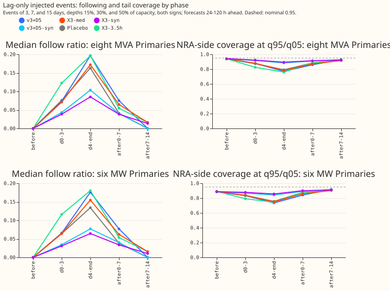
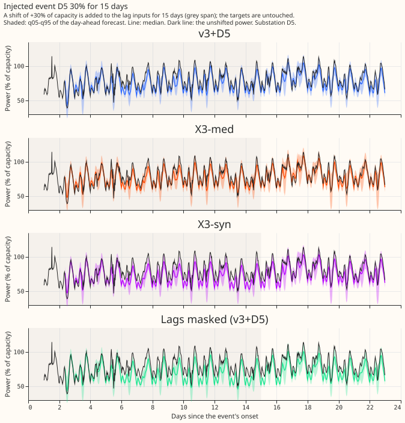
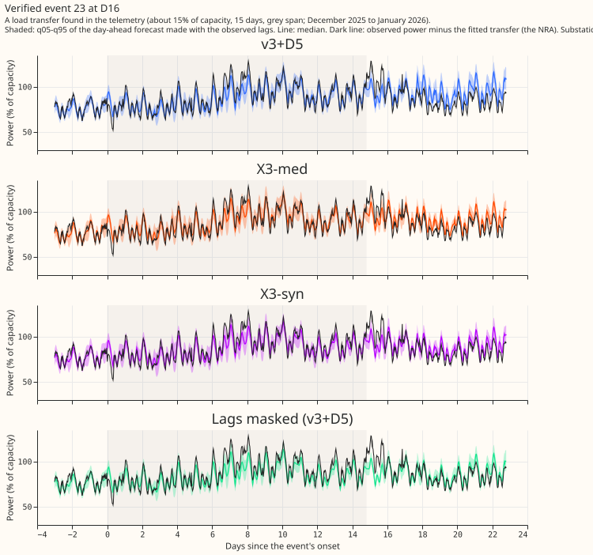
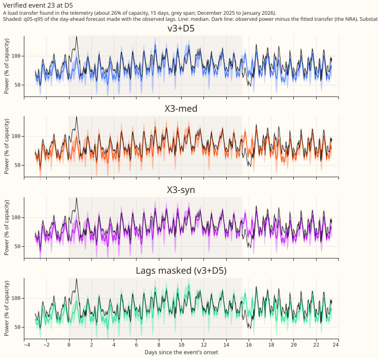

**A median over five weeks of power lags does not stop the forecast following a load-shift event,
but training on synthetic lag-only events does roughly halve it.** We asked whether the neural
network that reads a day-old and a week-old reading of a Primary's power can be made to ignore an
event that sits in a few of its lags. We built a variant that reads the median of five same-weekday
readings and their spread (X3-med). We then added a shift of 15%, 30%, or 50% of capacity to the lag
inputs of every Primary for 3 to 30 days, in 24 passes that give every Primary every depth and
length with both signs, and measured how far the day-ahead forecast moved. The real power, the
target, was never shifted, so the unshifted power is the reference (the normal running arrangement,
NRA). We also scored the one verified real transfer of the telemetry set of [experiment
580](../00580-verified-load-shift-event-set-and-label-audit/result.md) that lies inside the five
fold months, and the May 2026 transfers. All numbers are interim and unaudited.

**Verdict: partly supported.** X3-med passes its accuracy condition and misses its following target;
the synthetic-event variant, which is a post hoc change of the planned X3-syn, meets the target's
direction but not its size. In CRPS (points of capacity, 24-120 h) at the eight MVA Primaries,
lag-free D5 scores 4.651, v3+D5 4.427, and X3-med 4.423, so X3-med keeps 102% of the lag gain. At
the six MW Primaries v3+D5 scores 3.327 and X3-med 3.328. The median follow ratio (the share of the
injected depth that the median forecast moves towards) is 0.065 after the end against a predicted
0.05 or less, and 0.172 from day 4 to the end against 0.196 for v3+D5. The prediction that v3+D5
follows at least 0.15 after the end also fails: it follows 0.075.

## Injected bank

Each row is a mean over events of 3, 7, and 15 days (480 events at the eight MVA Primaries and 360
at the six MW Primaries per phase from day 4 to the end), forecasts 24-120 h ahead, two-seed means.
"Safe side" is the share of NRA readings on the side of q95 (event raised load: q05) where the
shifted forecast is wrong. The nominal value is 0.95.

| Arm | Eight MVA: follow, day 4 to end | Eight MVA: follow, 0-7 d after | Eight MVA: safe side q95/q05, day 4 to end | Six MW: follow, day 4 to end | Six MW: safe side, day 4 to end | Six MW: safe side, 0-7 d after |
|---|---|---|---|---|---|---|
| v3+D5 | 0.196 | 0.075 | 0.770 | 0.176 | 0.735 | 0.841 |
| X3-med | 0.172 | 0.065 | 0.785 | 0.155 | 0.750 | 0.858 |
| X3-syn | 0.085 | 0.038 | 0.894 | 0.064 | 0.856 | 0.900 |
| v3+D5-syn | 0.104 | 0.040 | 0.885 | 0.077 | 0.842 | 0.890 |
| Placebo (weeks 6-10) | 0.163 | 0.041 | 0.792 | 0.134 | 0.757 | 0.876 |
| X3-3.5h | 0.196 | 0.055 | 0.760 | 0.180 | 0.744 | 0.875 |

- **The day lag carries the following.** From day 4 to the end, v3+D5 follows 0.181 (7-day events),
  0.194 (15-day), and 0.198 (30-day) of the depth. A 7-day event contaminates 1 or 2 of the 5 weekly
  lags, a 30-day event 4 or 5, and the following is the same, so the weekly lags are not the
  channel. X3-med follows more than v3+D5 for 30-day events (0.231 against 0.198 from day 4, 0.148
  against 0.082 in the week after the end), the design limit of a median over 5 weeks.
- **The follow ratio falls as the depth rises** (v3+D5: 0.209, 0.193, 0.172 at depths of 15%, 30%,
  and 50%), so the network does not follow a large shift in proportion.
- **The placebo** reads weeks 6 to 10 and keeps about half of the lag gain at the eight MVA
  Primaries (4.532), so recency matters there. At the six MW Primaries it scores 3.289, better than
  v3+D5 (3.327), so recency does not matter there.
- **X3-3.5h** (report only) lowers CRPS at the eight MVA Primaries (4.402 at 24-120 h, contrast at
  0-24 h of -0.089 against v3+D5, interval -0.154 to -0.023, minimum detectable effect 0.108) and
  follows as much as v3+D5.
- **CRPS cost of the synthetic events** (positive is worse), counted contrasts against v3+D5: at the
  eight MVA Primaries X3-syn +0.037 (0-24 h) and +0.032 (24-120 h); at the six MW Primaries +0.081
  and +0.071. All 8 counted intervals that were run include zero (Bonferroni count 12, of which the
  4 X3-set cells were not run). The same cost for v3+D5-syn is +0.012 to +0.058 and is descriptive.
  The two-seed minimum detectable effect is 0.06 to 0.15.
- **Event-free calibration is unchanged.** On rows with no labelled or verified event within 7 days
  (24-120 h), the share of readings at or below q95 is 0.919 (v3+D5) and 0.918 (X3-syn) at the eight
  MVA Primaries, and 0.897 and 0.894 at the six MW Primaries. Pinball loss at q05 and q95 is 0.007
  and 0.009 for all arms. Every arm's upper tail is too narrow, as the plan review found for v3+D5.

## Verified events

The telemetry set of experiment 580 holds 7 transfers from 2024-04-01. Demand frames start in July
2025, so only transfer 23 (D5 and D16, 29 December 2025 to 13 January 2026, 26% and 15% of capacity)
and the May 2026 transfers 24 to 26 can be scored. The numbers below are descriptive: 1 transfer is
far fewer than the 10 needed for a test. The NRA reference is the observed power minus the fitted
transfer.

| Arm | Transfer 23: safe side q95/q05, day 4 to end | Transfer 23: 0-7 d after | Transfer 23: q05-q95 coverage, 0-7 d after | Transfer 23: follow, day 4 to end |
|---|---|---|---|---|
| v3+D5 | 0.839 | 0.494 | 0.488 | 0.199 |
| X3-med | 0.864 | 0.516 | 0.504 | 0.169 |
| X3-syn | 0.903 | 0.593 | 0.587 | 0.104 |
| v3+D5-syn | 0.900 | 0.454 | 0.449 | 0.131 |

- **After the transfer ends, the tails miss the NRA about half the time**, for every arm (0.45 to
  0.59 against 0.90), including X3-syn. Part of that is an ordinary miss: before the event the
  q05-q95 coverage at D5 is 0.73 to 0.77.
- **The May 2026 transfers** at D10, D11, D12, and D16 lie in a fold where v3+D5 and X3-med cover
  the NRA on only 0.17 to 0.45 of rows before and during the events, so they say little about lags.
  In the June fold, 7 to 14 days after the ends, all arms cover 0.92 to 0.94 of the NRA.

## What changed from the plan

- **X3-set** was not run. The condition (X3-med keeps 80% of the lag gain) held, but X3-med did not
  move the following, so a learned set encoder on the same inputs had no stated reason to.
- **X3-syn** was built on X3-med, not on X3-set, and v3+D5 with the same synthetic events
  (v3+D5-syn) was added as a control. It shifts the lag inputs on 5% of each Primary's time, with
  random depths, lengths, and signs, seeded by the fold month, and leaves the targets clean. This is
  post hoc.
- **Fold months.** Only the five folds of experiment 572 were used. The extra months planned for the
  verified transfers of 2024 cannot be built, because the demand frames start in July 2025. The
  2026-05 fold reuses the v3+D5 weights of experiment 582.
- **The lag-free D5 reference** and the recalibrated control of experiment X2 were not built for the
  tail tables.
- **Statistics.** Intervals for CRPS are the 5-block month bootstrap at the Bonferroni level of 12
  tests; the injected-bank and real-event numbers carry no intervals. The unlogged-event caveat
  applies: NGED's logs may miss events, so the "no labelled or verified event" rows may hold events.

## Checks

- **Median forecast minus mean forecast per site and the error of the median beside each quantile
  contrast** were not computed; the contrasts above are quantile scores only.
- **Audit triggers.** Trigger 2 fired: v3+D5's following after the end (0.075) is below the 0.15 the
  prediction assumed, taken from experiment 578's labelled events. The explanation tested here is
  that the following is nearly independent of event length, so it is carried by the day lag, and
  that the labelled events of experiment 578 were in part mislabelled ([experiment
  580](../00580-verified-load-shift-event-set-and-label-audit/result.md)). No other trigger fired;
  leaving one Primary out was not run.
- **Leakage checks.** Each lag is at least 24 h (X3-3.5h: 3.5 h) before the forecast origin, each
  lag's weather run is at or before the lag time, and each forecast's weather run is at or before
  the origin (asserted row by row; the example rows print in the fit logs). One Sonnet code review
  before the first fit found no problems.

## What the next experiment should answer

Whether the synthetic-event fine-tune keeps its gain when events are also present in the training
targets, and whether a gate or a union band (experiments X2 and X4 of the plan review) lifts the
coverage after an event ends from about 0.5 to the 0.90 target, since the lag network alone does
not.

Scripts: `ml-experiments/00581-robust-multiweek-lag-encoder-x3/` (`e00581_arm.py` wraps experiment
572's fit; `e00581_report.py` prints every table above). Code reused from experiments 560, 565, 572,
578, and 580.
