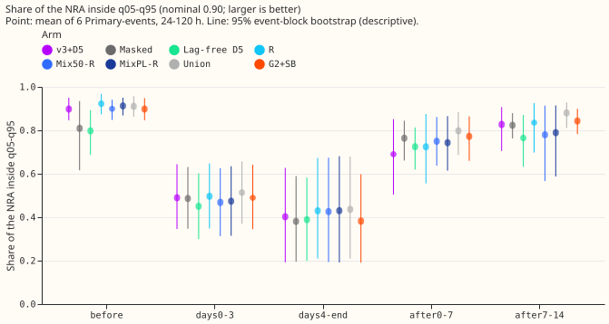
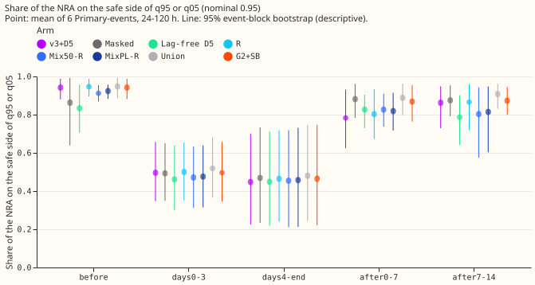
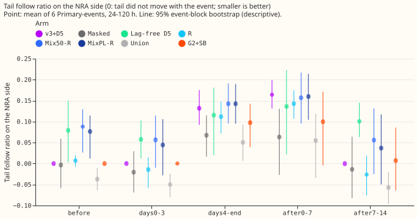
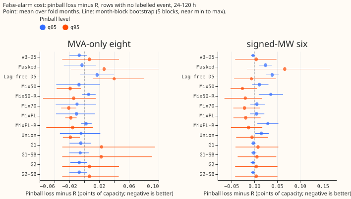
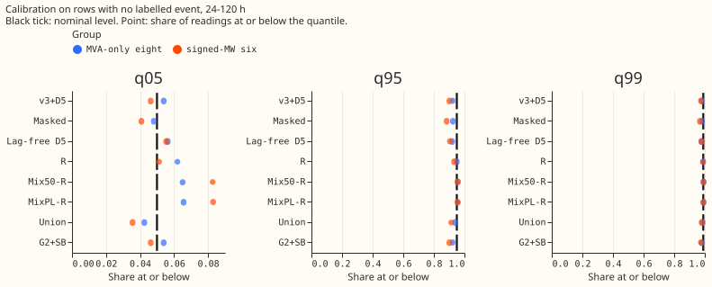
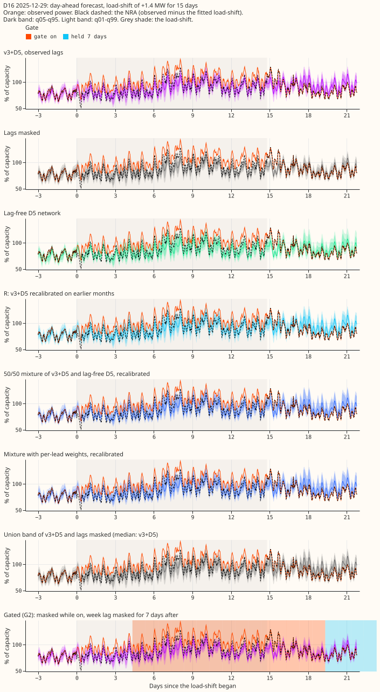

**Take-home message: the forecast with lags stops covering the normal running arrangement (NRA) once
a
long load-shift ends, and in the test pair hiding the lags for the week after the end raised
coverage from 0.40 to 0.64.** We asked how often the 5% to 95% band of an electricity-demand
forecast issued 1 to 5 days ahead holds
the power a substation would have drawn without a logged transfer of load (the NRA), during and
after long transfers that the telemetry itself confirms (experiment 580). We took the stored
forecasts of
experiments 565 (lag-free network), 572 (lag network), and 578 (gate), added one new test month (May
2026), and rebuilt the NRA as the
observed
power minus each transfer's fitted depth. [A plain-language explanation of every metric, with a
worked example, is here](metrics-explained.md).

**Result: partly supported.** The clean test is one pair, the 15-day mirrored transfer between D5
and
D16 in December 2025 and January 2026. The other four events (D10, D11, D12 and D16 in May 2026)
fail a
plausibility check (below), so they are shown but not used for the verdict. Every number is at
24-120
hours lead, from the mean of 2 seeds, and descriptive: 2 Primary-events cannot support an interval.

| Arm (D5 and D16, 24-120 h) | Inside q05-q95, days 4 to end | Inside q05-q95, 0-7 days after | NRA-side share at q95 or q05, 0-7 days after |
|---|---|---|---|
| v3+D5 (lags) | 0.80 | 0.40 | 0.54 |
| Lags masked | 0.72 | 0.64 | 0.79 |
| Week lag only masked | 0.74 | 0.63 | 0.78 |
| Lag-free D5 | 0.76 | 0.58 | 0.73 |
| R (v3+D5 recalibrated on earlier months) | 0.85 | 0.45 | 0.59 |
| 50/50 mixture, recalibrated | 0.89 | 0.58 | 0.72 |
| Mixture with per-lead weights, recalibrated | 0.90 | 0.55 | 0.69 |
| Union band (lags and masked) | 0.86 | 0.67 | 0.81 |
| Gated (G2), masked while on, week lag masked 7 days after | 0.74 | 0.64 | 0.80 |

- **P1 holds:** after the end, v3+D5 covers the NRA on 0.40 of rows (prediction: at most 0.60). D5
  gives
  0.31 and D16 gives 0.48.
- **P2 partly holds:** the gated arm lifts after-end coverage by 0.25, but reaches 0.64, not the
  predicted 0.75.
  The week-lag-only rule adds 0.07 at D16 and 0.00 at D5 on top of masking while the gate is on, so
  the gate is
  nearly the same as masking.
- **P3 fails:** on rows with no labelled event the unrecalibrated 50/50 mixture beats R by 0.019
  points of
  capacity at q95 at the eight MVA Primaries (interval -0.037 to -0.005) and by 0.026 at the six MW
  Primaries
  (-0.052 to 0.006). The prediction allowed 0.01. The recalibrated mixtures lose 0.006 and 0.036
  points of pinball loss at q05 against R.
- **Stop rule not met:** R alone lifts after-end coverage from 0.40 to only 0.45.
- **v3+D5 is miscalibrated at the top:** on rows with no labelled event 0.922 (eight MVA Primaries)
  and 0.902
  (six MW Primaries) of readings fall below q95, against 0.95.

**The May 2026 load-shifts fail a plausibility check.** Inside these load-shifts the lags-masked and
lag-free forecasts
cannot know about the transfer, so their median should sit about one depth away from the observed
power. For
D16 (depth 0.14 of capacity), D10 (0.15) and D11 (0.11) the lag-free forecast's median sits 0.03,
0.01 and 0.01 from the
observed
power (the masked forecast: 0.05, 0.01 and 0.02; D12, depth 0.43, is not checked), and every arm
covers the NRA on only 0.15 to 0.32 of rows from day 4 to the end. For the
December load-shift the gap is
0.22 (D5 depth 0.26) and 0.22 (D16 depth 0.15). It is unproven whether the fitted depths or the NRA
reference is wrong, so these
four events carry no verdict here.

**Day-ahead forecasts with the q05-q95 and q01-q99 bands for each event and each arm** (3 days
before
onset to 7 days after the end; the last panel also marks the days the gate is on and the 7 days it
is held):
[D5 2025-12](event_D5_2025-12-29.svg), [D16 2025-12](event_D16_2025-12-29.svg),
[D16 2026-05](event_D16_2026-05-04.svg), [D12 2026-05](event_D12_2026-05-03.svg),
[D10 2026-05](event_D10_2026-05-11.svg), [D11 2026-05](event_D11_2026-05-12.svg).

## What is not done

- **The injected event bank of experiment 580 is not used.** It would turn 2 clean real events into
  hundreds of
  tests of the after-end claims; it needs about 1,400 forward passes and was left for a follow-up.
- **Three transfers of 2024** (verified in the telemetry) cannot be forecast: the stored demand
  frames start on
  2025-07-02, so no earlier test month can be built with the 572 recipe. 2025-07 is the first
  possible month.
- **The avoidable-curtailment difference** is not computed. The gate triggered on 28 of 2,934
  origin-days with no
  labelled event for G1 (3.5 per Primary-year) and on none for G2.
- **Phases are by valid time.** The sign rule in the experiment plan for the follow ratio ("s is -1
  when the
  transfer raised load")
  contradicts its own meaning ("positive means moved towards the event"). We used the meaning.

## Injected load-shifts from experiment 581

**On 1,248 injected Primary-events, the lag network's after-end coverage falls to 0.77, and masking
the lags or the union band restores it to 0.86 or 0.92.** Experiment 581 forecast the lag network
with a constant shift added to the lag inputs only, for every Primary in four test months (2025-12,
2026-01, 2026-03, 2026-06) and 24 passes. The shift has a depth of 0.15, 0.30, or 0.50 of capacity,
a length of 3, 7, 15, or 30 days, and a sign that either raises or lowers the lags. The observed
power is unchanged, so it is the NRA, and the gates are not scored (they see no gap). We reuse 581's
stored forecasts, so no forward pass was repeated and no GPU time was spent. Arms that never read
the lags are the stored forecasts of this experiment. R, the union band, and the mixtures are
rebuilt from the injected forecast with the factors and weights fitted on earlier months. The 14
Primaries of the eight MVA and six MW groups are scored (D15 and D18 are left out), at 24-120 h,
with every second half-hour.

Share of the NRA inside the q05-q95 band (target 0.90), mean over events, by phase:

| Arm | Before | Days 0-3 | Day 4 to end | 0-7 days after | 7-14 days after |
|---|---|---|---|---|---|
| v3+D5 | 0.87 | 0.85 | 0.78 | 0.77 | 0.88 |
| Lags masked | 0.88 | 0.84 | 0.86 | 0.86 | 0.88 |
| Week lag masked | 0.87 | 0.84 | 0.86 | 0.86 | 0.88 |
| Lag-free D5 | 0.90 | 0.86 | 0.87 | 0.84 | 0.86 |
| R | 0.89 | 0.87 | 0.80 | 0.79 | 0.90 |
| Union | 0.90 | 0.87 | 0.91 | 0.92 | 0.90 |
| Mix50-R | 0.91 | 0.90 | 0.90 | 0.87 | 0.89 |
| MixPL-R | 0.91 | 0.89 | 0.88 | 0.86 | 0.89 |

- **The injected result agrees with the December pair:** v3+D5 loses coverage from the lag shift,
  and the loss is larger at greater depth (0-7 days after: 0.82, 0.76, and 0.74 at depths 0.15,
  0.30, and 0.50).
- **R alone does not repair it:** 0.79 after the end, against 0.77 for v3+D5.
- **The union band comes closest to target (0.92)** because its lower and upper edges take the wider
  of the lag network and the masked twin. It does so by widening.
- **Interval and spread:** the event-block interval of v3+D5 after the end is 0.72 to 0.82
  (leave-one-Primary-out range 0.70 to 0.85), against 0.89 to 0.94 for the union band.
- **Length does not matter beyond 3 days:** coverage after the end is the same for lengths of 7, 15,
  and 30 days (0.76 for v3+D5), because only the week lag at the end of the shift enters the
  forecast, and the 3-day shift is only partly in it (0.81).
- **Scope:** the lag shift is a stylised stand-in for a real transfer, because the real transfer
  also changes the targets and the neighbour's lags. The tables are `bank_event_phase.csv` and
  `bank_summary.csv` in the private data folder.

## Checks

- **Median minus mean forecast:** not applicable; the arms are quantile forecasts with no separate
  mean. The
  q50 follow ratio sits beside the q05-q99 ratios in `event_phase.csv`.
- **Reproduction:** the v3+D5 and lags-masked forecasts of 2025-12 and 2026-01 match experiment
  578's stored
  forecasts to a maximum absolute difference of 0.
- **Statistics:** event intervals are 95% event-block bootstraps over 6 Primary-events with a
  leave-one-Primary-out range, descriptive only. False-alarm intervals come from 5 month blocks,
  which are close
  to the minimum to maximum of the months; the Bonferroni count is 4 per arm, and the 95% interval
  is not
  adjusted for it, so only the Mix50 intervals that exclude zero are worth reading and they are
  small
  (the minimum detectable effect is about 0.04 points: 1.4 times the interval half-width for the six
MW Primaries and about 2.5 times for the eight MVA Primaries).
- **Months and rows:** every arm exists on 574,755 rows in 5 months (2025-12, 2026-01, 2026-03,
  2026-05,
  2026-06). The first fold month with each arm has no recalibration fit and is dropped.
- **Standing weather rule:** the forecasts come from experiment 572's code, which asserts for every
  test origin
  that the weather run was issued at or before the origin (`nwp_init_time <= power_fcst_init_time`);
  an example
  row: origin 2026-01-01 09:00, weather run 2026-01-01 00:00, valid time 2026-01-05 09:00.
- **Audit triggers:** the check that a lag-blind forecast sits about one depth from the observed
  power failed for the May transfers, so the write-up
  reviewer was
  asked to recompute the December headline numbers from the stored forecasts.
- **Code review:** a fresh Sonnet review of the code found no leak and no sign error. Findings
  applied: the
  gate state no longer carries over a gap between fold months; the 5-day overlap of recalibration
  training rows
  with the first origins of the fold month is purged; the gate noise floor is guarded. Not applied:
  the d0 and d14
  files never overlap on a key.

## What the next experiment should answer

Recheck the fitted depths of the May 2026 transfers against a forecast that never saw them, then run
the
after-snap-back rule and the union band on the injected event bank of experiment 580, where the
answer is known.
