**Widening the band for 7 days after the gap collapses covers the normal running arrangement (NRA) no
better than widening it for 7 random days.** The rule is seen too late: the lag network is already
back to normal when the gap collapses, so the wider band lands on forecasts that no longer need it.
Only the arm that stays wide whenever the gate has been on (A2) lifts coverage after the end to about
0.92 on injected events, and A2 is almost the same as a union band that is always on. Verdict: not
supported.

Experiment 582 found that after a load-shift ends, the forecast's q05-q95 band holds the NRA (the
power the substation would have drawn without the load-shift) on too few rows. We asked whether a rule
that watches the gap between the recent power readings and a forecast made without them, and widens
the band for 7 days after that gap collapses, closes the shortfall. We re-scored the stored X3-syn
forecasts of [experiment 581](../00581-robust-multiweek-lag-encoder-x3/result.md) on 1,248 injected
events and on the verified December load-shift, and compared the rule with the same rule fired on
random days. The rule is a version of experiment 578's gate on the lags and experiment 582's union
band; nothing is refitted.

## Figures

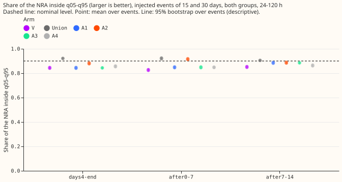

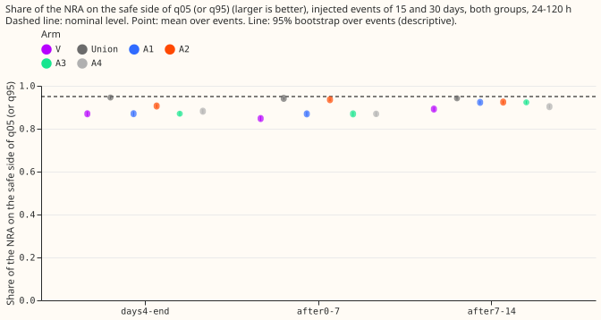

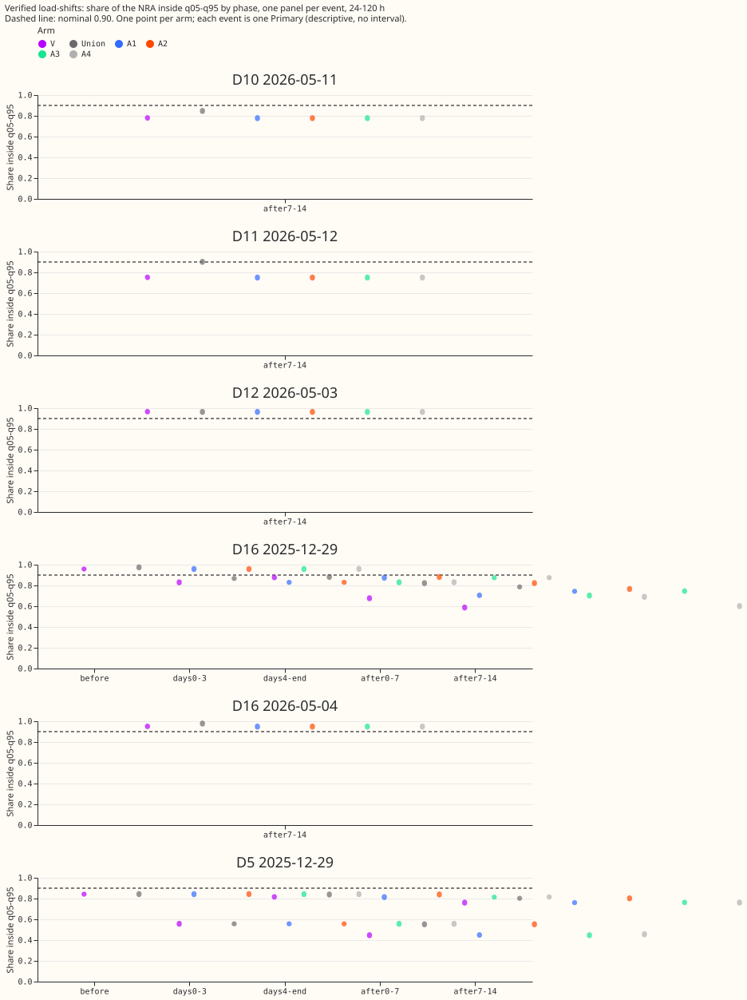

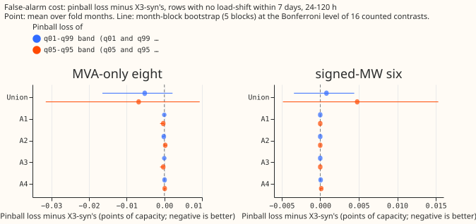

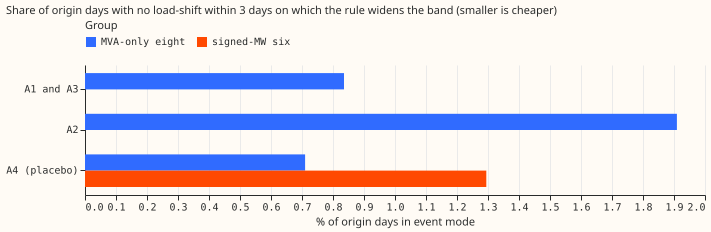

Day-ahead forecasts around the verified pair (coloured strips mark origin days in event mode):

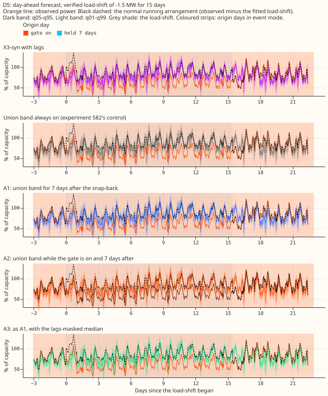

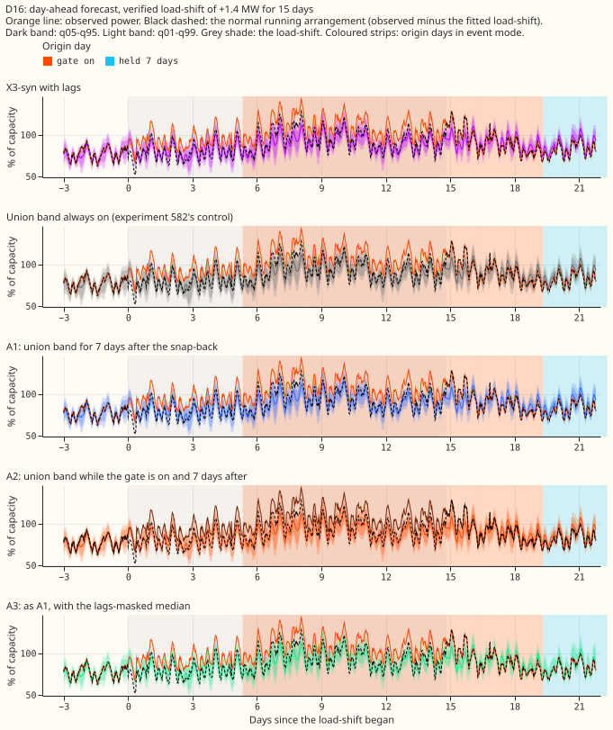

Day-ahead forecasts around injected events (a fixed selection rule: month 2025-10, the
lowest-numbered Primary of each group for three length, depth, and sign combinations):

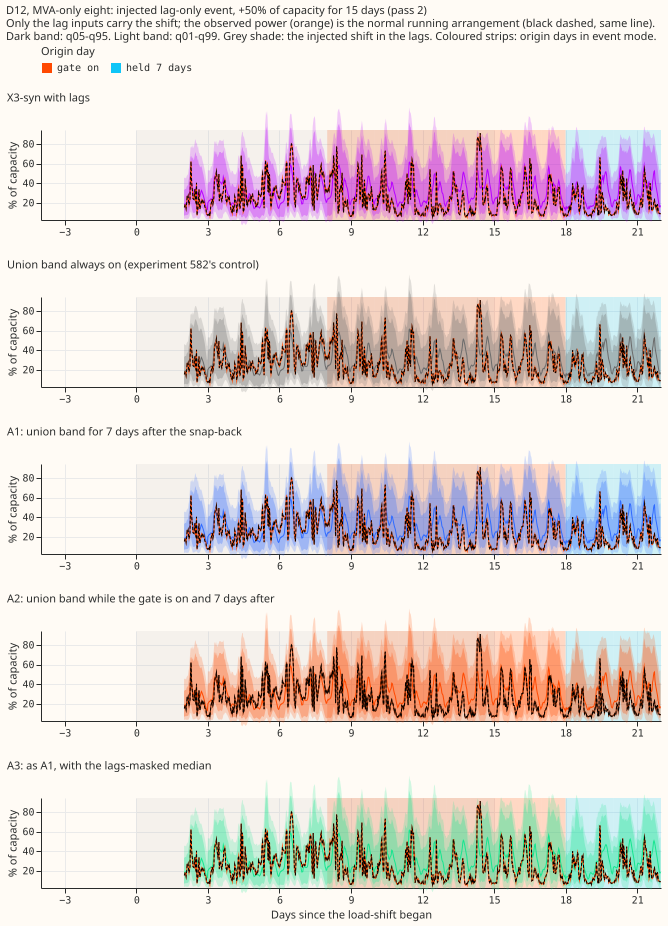

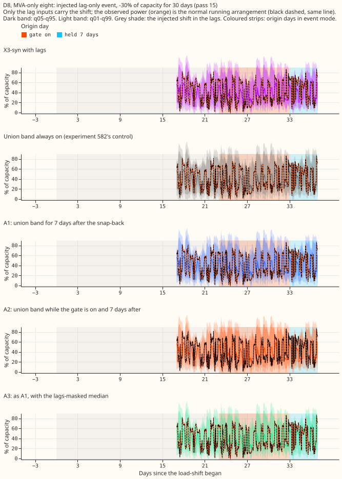

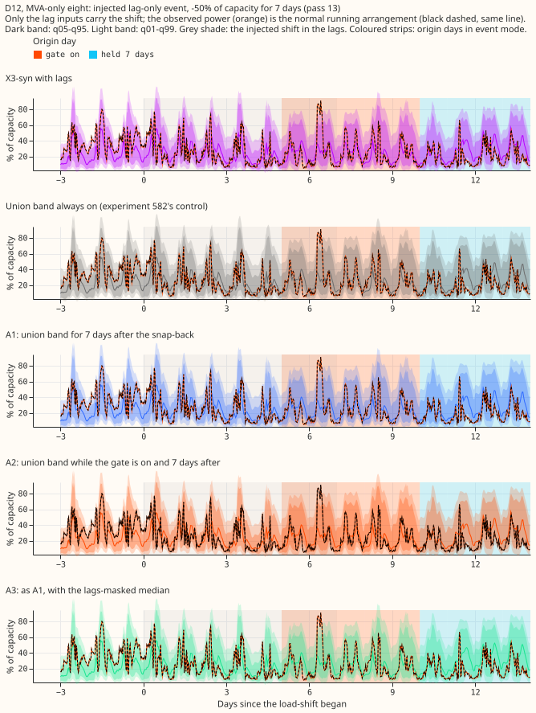

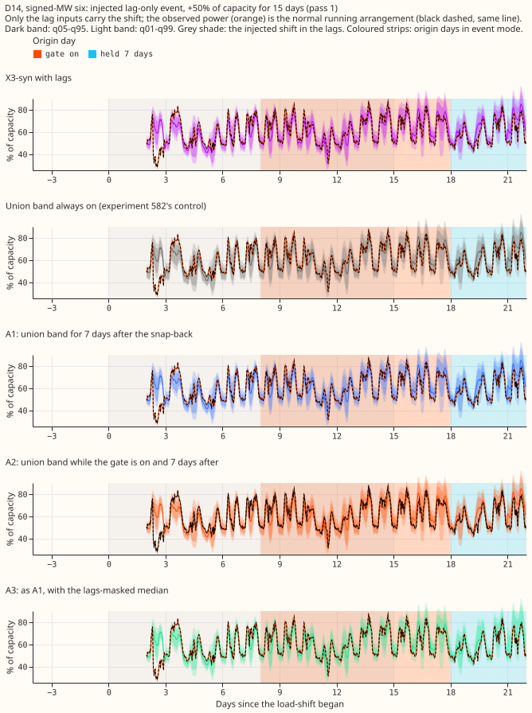

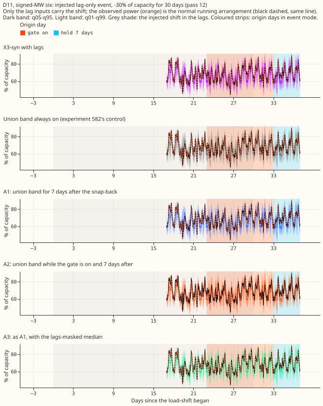

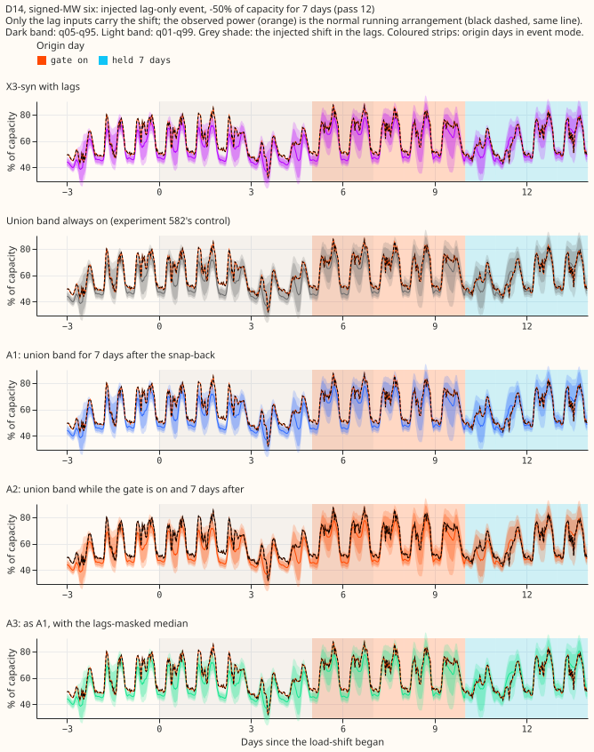

Full stored horizon of one run (X3-syn stores 0 to 120 h only, so no 14-day horizon exists here):

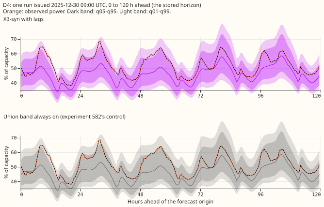

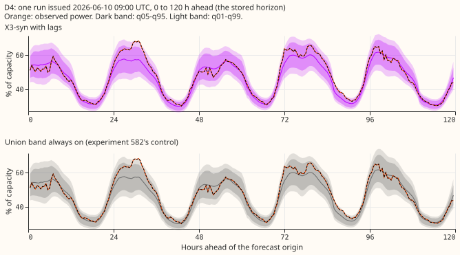

Other cuts (all lengths, each group alone) sit beside this page as `coverage90_*` and `nra_side95_*`.

## Results

- **Arms:** V is X3-syn with lags; M is the same weights with lags masked; Union is the widest of both
  bands on every row (experiment 582's control); A1 is the union band for 7 days from the origin day
  a snap-back is seen; A2 is the union band while the gate is on plus those 7 days; A3 is A1 with the
  lags-masked median; A4 is A1 at random days (20 draws, same count per Primary).
- **Gate:** own gap only (experiment 578's G1), 3 sustained days above max(3 standard deviations, 5%
  of capacity), reading only days at least 24 h old (newest day read: origin day minus 2). Snap-back:
  the newest gap day falls below half the threshold. Row set: the five fold months with stored X3-syn
  forecasts; 24-120 h unless stated; July 2026 unused. Retraining: none; the weights are
  experiment 581's.
- **Injected bank, 24-120 h, 0-7 days after the end, 15 and 30 day events (672 Primary-events, both
  groups), q05-q95 coverage with 95% event-bootstrap interval:**

| Arm | Coverage after end | Days 4 to end |
|---|---|---|
| V (X3-syn) | 0.826 (0.816 to 0.837) | 0.844 |
| M (lags masked) | 0.876 | 0.882 |
| Union (always on) | 0.921 (0.915 to 0.927) | 0.921 |
| A1 | 0.848 (0.839 to 0.857) | 0.844 |
| A2 | 0.915 (0.909 to 0.922) | 0.880 |
| A3 | 0.848 | 0.844 |
| A4 (placebo) | 0.847 (0.837 to 0.856) | 0.856 |

- **A1 against the placebo:** A1 minus A4 is +0.0014 (interval -0.0002 to +0.0031, audit). The hold
  covers 25% of after-end rows, and a random hold covers 21%.
- **Per group and length:** the same pattern holds at the eight MVA Primaries and the six MW Primaries
  and at 7, 15, and 30 days (A1 within 0.004 of A4 except the six MW Primaries at 15 days, 0.871
  against 0.867).
- **Tails (24-120 h, injected 15 and 30 days, after the end):** NRA-side share at q05 or q95 is 0.848
  (V), 0.869 (A1), 0.936 (A2), 0.941 (Union), against 0.95 nominal. Pinball at q01 and q99 and the
  coverage at q01-q99 are in `bank_summary.csv` (private data folder).
- **Verified D5 and D16 pair, after the end (descriptive; one transfer pair, not two independent
  events):**

| Event | V | A1 | A2 | Union |
|---|---|---|---|---|
| D16 | 0.677 | 0.703 | 0.822 | 0.822 |
| D5 | 0.447 | 0.447 | 0.552 | 0.552 |

- **D5 is not a detection result:** its gate turned on 19 days before the event, on a gap of the
  opposite sign, and did not release until 14 days after the end. A2 equals Union there because the
  gate was on, and A1 equals V because no snap-back fell inside the window.
- **Timing on the bank:** the gate triggered on 83% to 88% of events, a median 4 to 6 days after the
  onset, and the snap-back came a median 2 days after the end (87% of events). The gate does not fire
  at Primaries with a high threshold (largest: 0.61 of capacity at one MVA Primary).
- **Cost on days with no load-shift (24-120 h, mean pinball in points of capacity, A1 and A2 against
  V):** at the eight MVA Primaries, q05-q95 band -0.0003 and +0.0002, q01-q99 band 0.0000 and
  -0.0001; at the six MW Primaries exactly 0. The half-width of the Bonferroni interval (the minimum
  detectable effect here) is under 0.001 for A1 and A2. For comparison, the always-on union changes
  the same loss by -0.007 to +0.005 and widens the 90% band by 9% (eight) and 8% (six).
- **Activity and false triggers:** the gate is on for 1.1% of event-free origin days at the eight MVA
  Primaries and 0% at the six MW Primaries; there were 2 false triggers, 0.87 per Primary-year at the
  eight MVA Primaries and 0.47 over all 16 Primaries (prediction: at most 1; fails above 3).
- **Predictions:** P1 holds numerically (A1 0.848, and V already covers 0.844 from day 4 to the end)
  but not because of the rule. P2 holds (cost under 0.001 points, under 1 false trigger per
  Primary-year). P3 fails: the placebo's lift (+0.021) is 94% of A1's (+0.022), not under a quarter.
  Bonferroni count: 16 (4 arms, 2 groups, 2 coverage bands, event-free rows).

## Checks

- **Median minus mean forecast, per site:** only 11 quantiles are stored, so the mean forecast does
  not exist. As a proxy, X3-syn's median minus the mean of its 11 quantiles is -0.008 of capacity on
  average (standard deviation 0.026), pooled over sites.
- **Mean-forecast error beside the quantile contrasts:** not available, for the same reason; the
  median's absolute error is in `event_free.csv` (`ae50`) and does not change for A1, A2, and A3
  except through A3's median swap on held days.
- **Triggers fired:** trigger 1 (a placebo control matched the rule). A fresh Sonnet audit
  re-derived every headline number from the stored forecasts with its own code, and all reproduced.
  It showed the placebo equals the rule because the injected contamination is gone before the
  snap-back is seen. Triaged: accepted, and it is the finding of this page.
- **Code review (before the first run):** a fresh Sonnet review found no leakage and six issues; four
  were fixed (event-free rows and activity shares polluted by holds after real events, false-trigger
  rate understated by month-start days that cannot trigger, misleading trigger-time rows, and a
  point estimate that did not match its interval). Two were kept as caveats: the design limit that a
  rule keyed on origin day covers about half of after-end rows (valid-time phases), and the gate
  threshold being computed on all five months.

## Caveats and what to try next

- **Width is untested:** Union and A2 may gain coverage only because they are wider. A control that
  scales X3-syn's band to the same mean width is the next test (not run).
- **Only 2 verified events,** one transfer pair. The injected bank uses lag-only shifts with a
  constant depth, with the observed power unchanged, so the gate sees the injected lags and not a
  change in the power.
- **Unlogged events:** NGED's logs may miss events, so the event-free rows may hold events no label
  covers, the cost on them is optimistic, and the real-event slices undercount.
- **Horizon:** X3-syn stores 0 to 120 h. NGED cares about 1 to 10 days, so these results cover the
  short end only.
- **Next:** a rule fired by the lags themselves (a robust z-score of the newest day lag) would act
  at the snap-back itself rather than 2 days later; the gate cannot see the end earlier than the
  24 h age rule allows.
- **Reuse:** code in `ml-experiments/00583-after-snap-back-event-band-on-x3-syn/`, importing
  experiments 578, 581, and 582; no fitted models, no new forecasts; tables in
  `data/ml-experiments/00583-after-snap-back-event-band-on-x3-syn/`.
