**The best forecast of the normal running arrangement that we can assemble from merged results keeps
its q05-q95 band around the normal running arrangement (NRA) on 0.93 of rows after a load-shift
ends, up from 0.76, but on the one real load-shift pair it still falls short of 0.90.** We asked
whether a neural-network forecast trained on lag inputs that carry synthetic load-shifts, plus a
band that widens when a gate sees a load-shift, can put the NRA (the power a substation would have
drawn without the load-shift) inside its 90% band on 90% of rows in the week after the load-shift
ends. We scored it on 1,248 injected load-shifts (a constant shift added to the lag inputs only) and
on the verified December 2025 pair, and compared it with a band widened by a constant factor to the
same width. The gated band reaches 0.927, the matched-width band 0.890, so about 0.04 is more than
extra width. The real pair gives 0.84 (D16) and 0.58 (D5).

Verdict: **partly supported**. Nothing here is adopted for production. All numbers come from the
five fold months, with refits on days 0 and 14.

## Figures

Coverage by phase, then the width control, then the day-ahead forecasts of every arm.

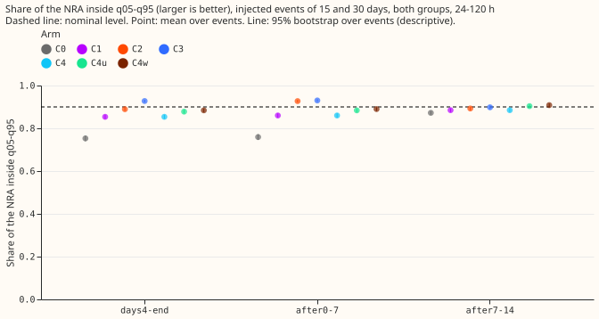

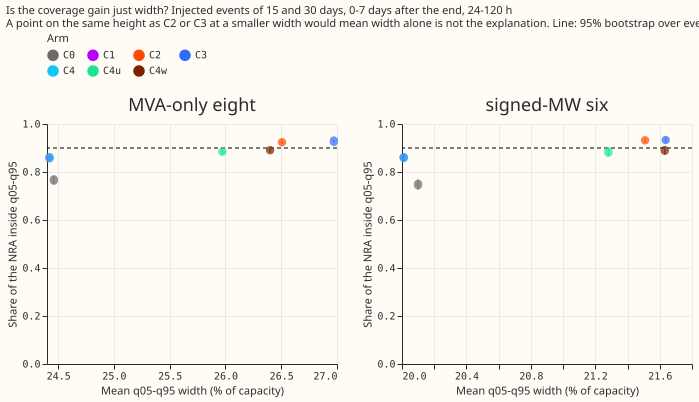

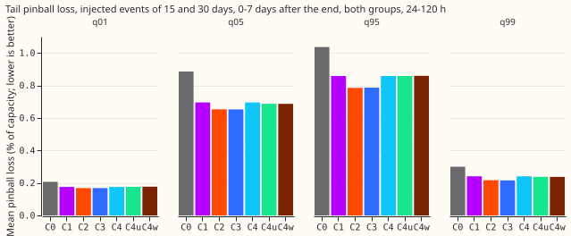

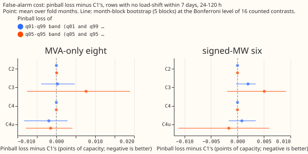

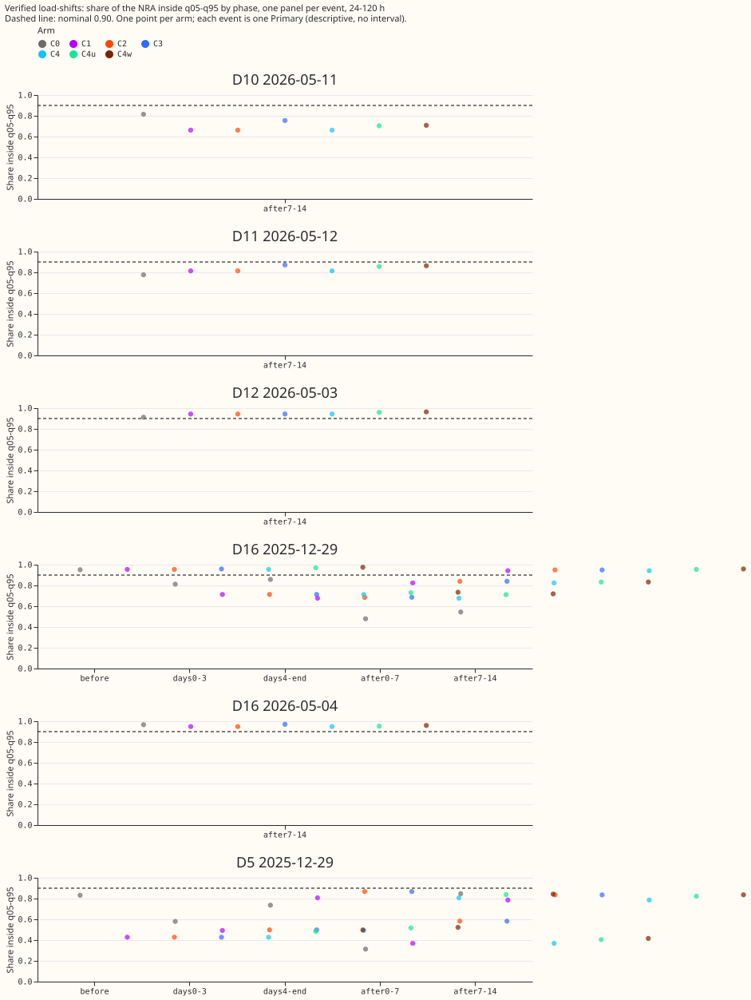

Day-ahead forecasts (issued 09:00 the day before the valid day) around the verified December pair.
The gate at D5 was on for the whole window, so its strip covers the plot.

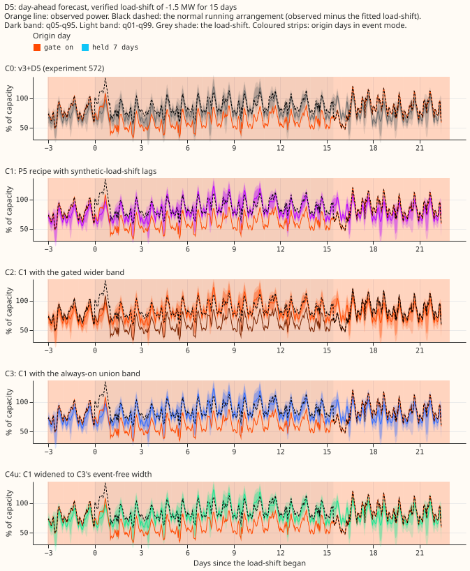

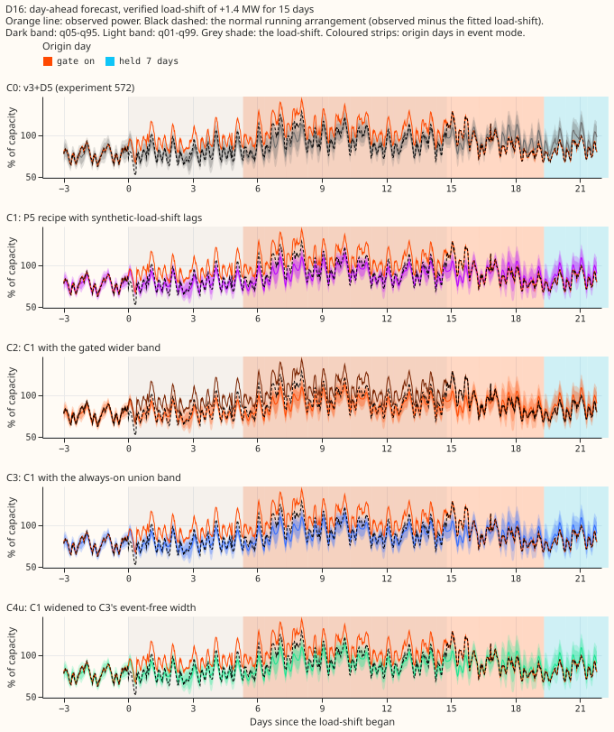

Day-ahead forecasts around four injected events (fixed rule: month 2025-10, the lowest-numbered
Primary of each metering group, 15 days at 50% of capacity, up and down). Each of the five arms is
one panel.

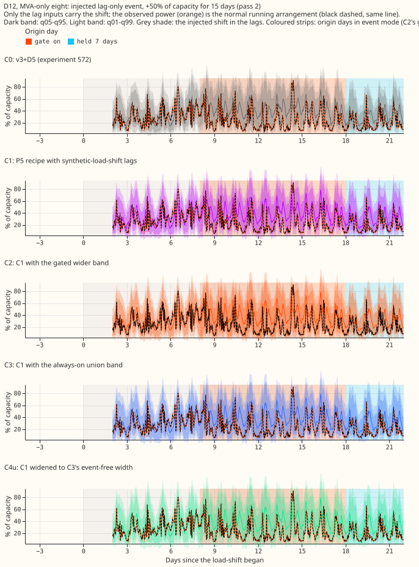

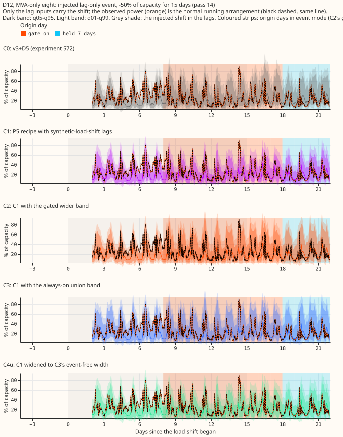

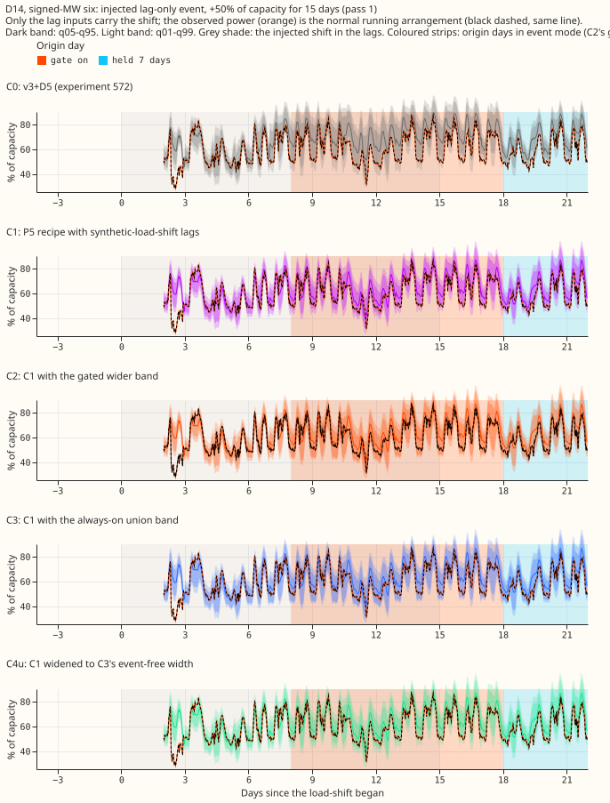

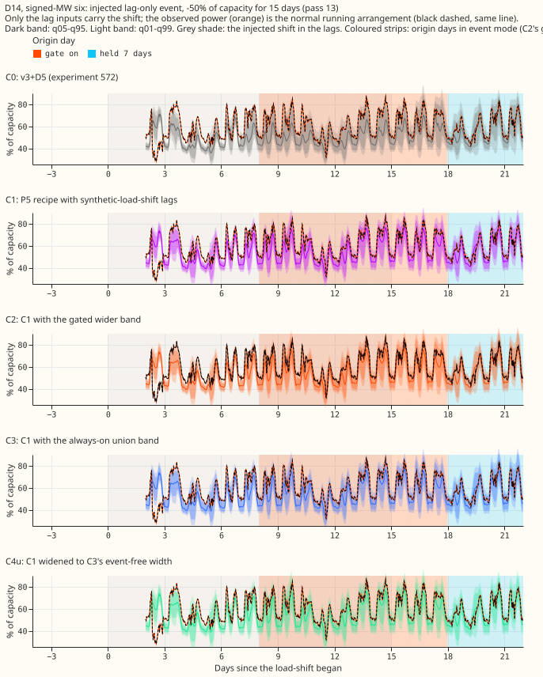

Other cuts (all lengths, one-sided shares, each group alone) sit beside this page as `coverage90_*`
and `nra_side95_*`. Stored forecasts cover 0 to 120 hours only, so no 14-day horizon plot exists;
NGED care about 1 to 10 days, so every number here is a short-lead result.

## Arms and what each one is

- **C0:** the v3+D5 forecast of [experiment
  572](../00572-two-offset-part-1-lags-versus-the-slow-output-offset/result.md) (stored): a neural
  network that reads day-old and week-old power lags, with a slow output offset, refitted on days 0
  and 14 of each fold month.
- **C1:** the P5 recipe of [experiment
  574](../00574-part-d-primaries-only-modular-recipe-lag-encoder-offset-and-add-one-arms/result.md)
  (embargoed three-step schedule with the thermal-lag and solar-gain columns), with one new
  fine-tune per fold month, refit day, and seed (20 fits) in which the lag inputs carry lag-only
  synthetic load-shifts on 5% of each Primary's time, the recipe of [experiment
  581](../00581-robust-multiweek-lag-encoder-x3/result.md) (depths 15%, 30%, 50% of capacity,
  lengths 3, 7, 15, 30 days, random sign). The targets stay clean. Step 2 and the B1 statistics are
  experiment 574's stored files.
- **C2:** C1 with the gated band of [experiment
  583](../00583-after-snap-back-event-band-on-x3-syn/result.md) (A2): the widest of C1's band and
  its lags-masked twin's band while the gate on the lags is on and for 7 days after it releases, C1
  elsewhere. The gate, its 3-day sustain rule and its 24 h lag age rule are experiment 583's.
- **C3:** C1 with the union band on every row ([experiment
  582](../00582-nra-tails-on-verified-load-shift-events/result.md)'s control).
- **C4:** C1 scaled about its median by 1.0001 so that its mean q05-q95 width on event-free rows at
  24 to 120 h equals C2's. **C4u:** the same, scaled by 1.0635 to equal C3's. **C4w (post hoc):**
  scaled by 1.081, the ratio of C2's to C1's mean width on the after-end rows of the injected bank.

## Results

- **Row set:** `experiment_470_intersection_v1`, five fold months (2025-10, 2025-12, 2026-01,
  2026-03, 2026-06), 24 to 120 h unless stated, July 2026 unused, D15 and D18 cut before 2025-03-01,
  cleaned data. Seeds 0 and 1 averaged. Retraining: coarse refits (days 0 and 14); the contrast
  could depend on the cadence.
- **Coverage after the end** (injected 15 and 30 day events, 672 Primary-events, 0 to 7 days after
  the end, q05-q95, 95% event bootstrap interval):

| Arm | Both groups | Eight MVA Primaries | Six MW Primaries | Mean width, % of capacity |
|---|---|---|---|---|
| C0 | 0.759 (0.746 to 0.772) | 0.767 | 0.748 | 22.75 |
| C1 | 0.860 (0.850 to 0.870) | 0.859 | 0.861 | 22.69 |
| C2 | 0.927 (0.921 to 0.933) | 0.924 | 0.932 | 24.54 |
| C3 | 0.930 (0.924 to 0.936) | 0.928 | 0.933 | 24.88 |
| C4 | 0.860 (0.850 to 0.870) | 0.860 | 0.861 | 22.69 |
| C4u | 0.884 (0.875 to 0.893) | 0.884 | 0.883 | 24.13 |
| C4w (post hoc) | 0.890 (0.881 to 0.899) | 0.891 | 0.889 | 24.53 |

- **From day 4 of the event to its end** (756 Primary-events): C0 0.753, C1 0.854, C2 0.889, C3
  0.928, C4u 0.878, C4w 0.884. C2 stays below 0.90 there because the gate fires a median 4 to 6 days
  after onset in experiment 583's data.
- **Tails, after the end, both groups** (mean pinball loss, % of capacity; lower is better):

| Arm | q01 | q05 | q95 | q99 |
|---|---|---|---|---|
| C0 | 0.207 | 0.885 | 1.036 | 0.300 |
| C1 | 0.175 | 0.695 | 0.858 | 0.241 |
| C2 | 0.169 | 0.653 | 0.785 | 0.217 |
| C3 | 0.168 | 0.652 | 0.787 | 0.216 |
| C4w | 0.177 | 0.686 | 0.859 | 0.237 |

- **Safe side of q05 or q95:** the one-sided share of the NRA is 0.771 (C0), 0.876 (C1), 0.943 (C2),
  0.945 (C3), and 0.901 (C4w), against 0.95 nominal.
- **Event-free rows, 24 to 120 h** (rows with no labelled or verified event within 7 days; 578,209
  rows at 16 Primaries): C1 minus C0, month-block bootstrap at the Bonferroni level of 16 counted
  tests, in points of capacity. CRPS (2 × mean pinball over the 11 stored quantile levels): eight
  MVA Primaries -0.064 (-0.250 to +0.101), six MW Primaries -0.142 (-0.453 to +0.012), minimum
  detectable effects 0.175 and 0.233. Pinball at q05 and q95: -0.030 (minimum detectable effect
  0.085) and -0.041 (-0.113 to -0.013, excludes zero). Absolute CRPS: C0 3.146 and 2.611, C1 3.081
  and 2.465.
- **False-alarm cost of the bands** (pinball loss at q05 and q95 minus C1's, minimum detectable
  effect in brackets): C2 +0.0001 (0.0001) at the eight MVA Primaries and 0.0000 at the six MW
  Primaries; C3 +0.0076 (0.0132) and +0.0050 (0.0055); C4u -0.0015 (0.0060) and -0.0016 (0.0086).
  The gate was on for 0.4% of event-free origin days at the eight MVA Primaries (1 false trigger,
  0.44 per Primary-year) and for none at the six MW Primaries.
- **Verified December pair, 0 to 7 days after the end, 24 to 120 h (descriptive; one transfer, two
  Primaries):**

| Event | C0 | C1 | C2 | C3 | C4u |
|---|---|---|---|---|---|
| D16 | 0.479 | 0.824 | 0.840 | 0.840 | 0.833 |
| D5 | 0.313 | 0.369 | 0.583 | 0.583 | 0.405 |

- **Real-event caveat for C1:** before the event, D5's coverage is 0.428 for C1 and 0.832 for C0,
  and D16's coverage from day 4 to the end is 0.677 for C1 and 0.858 for C0. Experiment 574's P5
  without synthetic lags (scored on the same rows as a diagnostic) gives 0.505 and 0.710, so the
  difference comes from the P5 recipe and not from the synthetic lags, which raise D16's coverage
  after the end from 0.775 to 0.824. The gate at D5 was on for 19 days before the event, on a gap of
  the opposite sign.
- **Architecture and training regime:** every arm is the modular lag-encoder mixture-density neural
  network of experiments 560 to 574 with a monotone-quantile output (11 stored quantiles). C0 is
  one-step fine-tuning from experiment 572's pre-training. C1 to C4w use experiment 574's three-step
  schedule (pre-train on ERA5 and CAMS, a fresh mixer on the whole ensemble history with a 3-day
  embargo, then a daily fine-tune with the embargo), where the daily fine-tune alone is re-run here.
- **Predictions:** P1 holds (C2 0.927 against at least 0.90). P2 fails as worded (C4 covers 0.860,
  not at most 0.85): the pre-registered control had a factor of 1.0001 and so tested nothing about
  width. C2 exceeds C4 by 0.067, but exceeds the stricter post hoc C4w by 0.037, which is not within
  0.03 and not at least 0.05. P3 holds (C1 loses no CRPS to C0; C2 and C3 add under their minimum
  detectable effects). P4 holds (D5 0.583 and D16 0.840 against 0.313 and 0.479 for C0).
- **Decision rule:** coverage 0.90 or more on the injected bank holds for C2 and C3; extra
  event-free loss within the minimum detectable effect holds for both; a margin of 0.05 over the
  width-matched control holds against C4 and fails against C4w. Bonferroni count: 16.
- **Not computed:** the avoidable-curtailment cost, which needs node-level forecasts with
  generators; BG2, `manual_heuristic`, and climatology rows (this experiment is a coverage test on
  stored Primary forecasts, not a headline score); weekly refits.

## Checks

- **Median forecast minus mean of the 11 stored quantiles, event-free rows, % of capacity:** C0
  -0.58 (eight MVA Primaries) and -0.25 (six MW Primaries); C1 -0.52 and -0.38. Only quantiles are
  stored, so the mean forecast is not stored.
- **Error of the median beside the quantile contrasts:** mean absolute error of the median,
  event-free, % of capacity: C0 5.61 and 4.74, C1 5.52 and 4.47 (eight MVA, six MW). It points the
  same way as the quantile contrasts.
- **Triggers fired:** trigger 2 (the D5 and D16 coverage of C1 contradicts experiment 581's finding
  that all arms covered D5 before the event on 0.75 to 0.83); the explanation was tested above with
  P5 without synthetic lags. P2's control failure is explained above (a degenerate factor, not a
  defect in the method). No other trigger fired; leaving one Primary out was not run.
- **Reviews:** a fresh Sonnet review of the fit wrapper before the first fit found no leakage or
  write-location problems and four lint and guard items, all fixed. A fresh Sonnet agent re-derived
  the headline numbers (reported in the pull request).

## Caveats

- **Only one real transfer pair** (D5 and D16, December 2025), so every real-event number is
  descriptive.
- **Injected events** add a constant shift to the lag inputs only, so the gate reads the injected
  lags and not a change in the power; the injected bank therefore flatters any rule keyed on the
  lags.
- **Unlogged events:** NGED's logs may miss events, so the event-free rows may hold events no label
  covers. The false-alarm loss is then too low, and the real-event slices undercount.
- **Horizon:** stored forecasts cover 0 to 120 h; NGED care about 1 to 10 days.
- **D15 and D18** (report-only): C1's pinball loss at q95 is 2.78 against 2.50 for C0 on event-free
  rows.
- **Width factors** were fitted on event-free rows, apart from the post hoc C4w factor, which was
  read from the bank's after-end widths (not a coverage number).

## What the next experiment should answer

Whether the P5 recipe's weaker December D5 and D16 coverage is a property of the recipe or of that
one pair, tested on the May 2026 transfers once enough unlogged events are ruled out, and whether a
gate that reads the lags themselves, and so fires at the snap-back, lifts the day-4-to-end coverage
of C2 from 0.889 to 0.90.

## Plain-language definitions

- **Coverage:** the share of half-hours at which the true NRA lies inside the stated band; a 90%
  band should contain it on 0.90 of rows.
- **One-sided share on the safe side:** the share of readings on the side of q05 (or q95) where a
  following forecast is wrong; nominal 0.95.
- **Pinball loss at q05 (or q95, q01, q99):** the penalty for a quantile forecast, small when the
  quantile sits where the reading falls; it is the loss the tails are scored on.
- **Gate:** a rule that turns on when the recent power lags disagree with a forecast made without
  them for 3 days in a row.
- **Width:** the distance between q05 and q95, in per cent of capacity.

Further definitions, with worked examples, are in [experiment 582's metrics
page](../00582-nra-tails-on-verified-load-shift-events/metrics-explained.md).

Scripts: `ml-experiments/00584-nra-candidate-pack-x6/` (`e00584_arm.py` wraps experiment 574's fit;
`e00584_score.py` wraps experiment 583's scoring and adds the width controls; `e00584_report.py`
prints every table above). Code reused from experiments 572, 574, 580, 581, 582, and 583. Fitted
weights (`.pt`) and tables are in `data/ml-experiments/00584-nra-candidate-pack-x6/` (private); the
C1 weights are under `c1/work/models/P5`.
