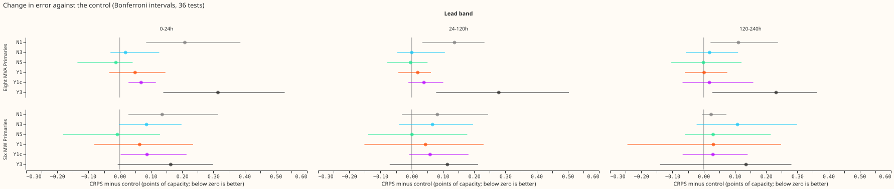
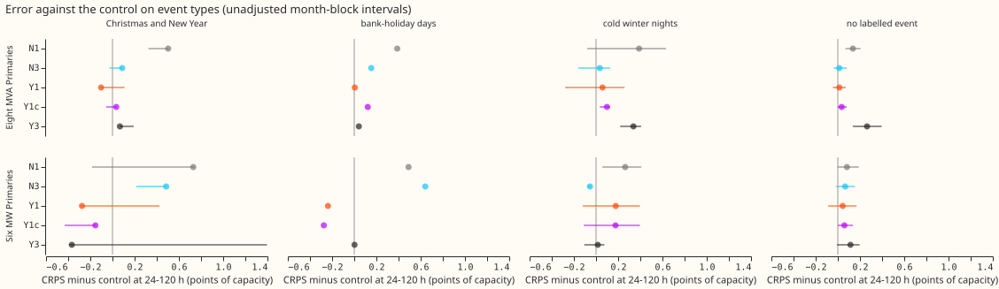
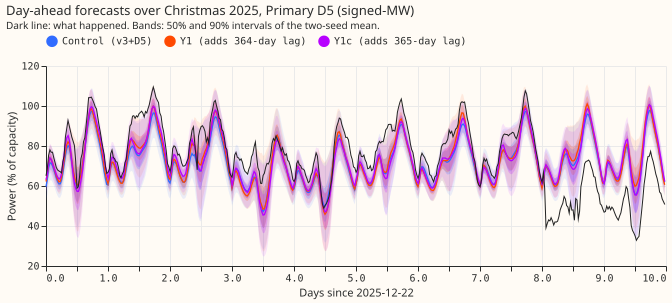
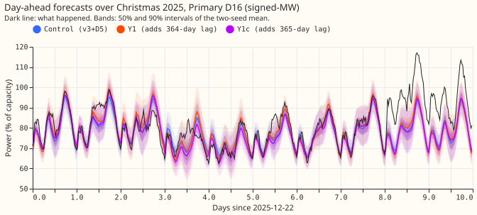
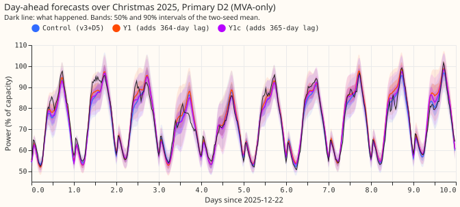
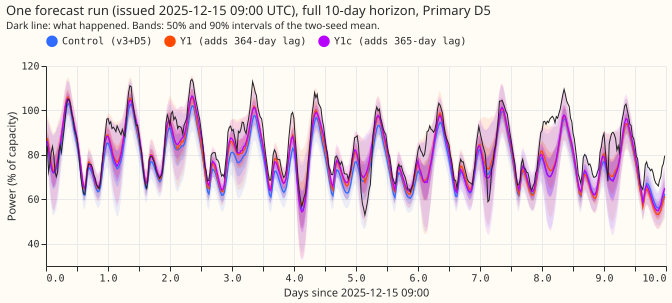

**Reading a power value from one year earlier did not lower the forecast error on all rows, and it helped only at Christmas and New Year at the six MW Primaries; it also made the forecast follow a load-shift event no less and cover the normal running arrangement (NRA) worse.** We gave the neural network that forecasts a Primary's demand (the modular demand network, with the slow output offset D5; experiment 572's v3+D5 is the control N2) more power lags and asked two questions the maintainer set as the main hope. First, does a year-ago lag, or a different number of lags, lower the forecast's leak during a load-shift event? Second, does it improve the forecast at Christmas and New Year, at Easter, and on bank holidays? CRPS on all rows (the continuous ranked probability score, in points of capacity, lower is better) is reported beside both. All numbers are two-seed means over five fold months (2025-10, 2025-12, 2026-01, 2026-03, 2026-06) and are interim and unaudited.

**Verdict: partly supported.** Of the two questions, only the Christmas one has an answer in favour, and it rests on one December fold at the six MW Primaries.

- **Load-shift leak: no arm helps except the arm with no day lag, and that arm is worse on CRPS.** On the injected bank (a lag-only shift added to the recent lags, the real power untouched), from day 4 to the end of the event, the control follows 0.196 of the depth at the eight MVA Primaries. Y1 follows 0.168, Y1c 0.170, and Y3 0.171, but the share of NRA readings on the safe side of q95 or q05 falls from 0.770 to 0.706, 0.710, and 0.675, because the year-ago lags narrow the 90% interval by 12 to 14% and the interval then covers the NRA less. N1 (no day lag) follows least (0.116) and keeps the safe side at 0.855, and it costs 0.137 CRPS at 24-120 h.
- **Christmas and New Year: Y1, Y1c, and Y3 improve the six MW Primaries beyond the minimum detectable effect (MDE) at 120-240 h, and nothing improves the eight MVA Primaries.** At the six MW Primaries, 120-240 h, the CRPS contrast against the control is −0.53 for Y1 (MDE 0.44), −0.32 for Y1c (MDE 0.07), and −0.65 for Y3 (MDE 0.05). At the eight MVA Primaries the contrasts are +0.03 (Y1) and +0.08 (Y1c), inside the MDE. Easter has no scored rows, because no fold month contains it.
- **All rows: no arm improves by its MDE.** Y1 and Y1c are within 0.09 of the control at both groups and all lead bands, N3 and N5 are within 0.02 at the eight MVA Primaries, and Y3 is worse by 0.28 at the eight MVA Primaries, 24-120 h (MDE 0.18).

Under the maintainer's keep rule, a slice gain stays unless it actively hurts (worse than the control by more than the larger of 0.03 and the contrast's MDE, with the interval excluding zero, or worse in 4 of 5 folds). Y1 meets the slice route at one cell (six MW Primaries, Christmas and New Year, 120-240 h) and does not actively hurt anywhere on all rows, so it is kept by the rule. Y1c has a gain of the same size but actively hurts at the six MW Primaries, 0-24 h (+0.088, interval +0.003 to +0.214, MDE 0.048), so it is not kept. Y3 actively hurts at the eight MVA Primaries and is not kept. We still do not recommend porting Y1: its gain is one December fold, the slice route is not corrected for 4 slices times 2 groups times 6 arms, and the injected bank says the extra lag makes the tails less safe.

## Definitions

- **Lag.** The Primary's cleaned power at an earlier time, at least 24 h before the forecast origin. The control reads a one-day lag and a one-week lag.
- **Year-ago lag.** Y1 reads the power 364 days earlier (the same weekday and half-hour). Y1c reads the power 365 days earlier (the same calendar date, a different weekday). Y3 reads 357, 364, and 371 days earlier, each in its own input slot.
- **N1, N3, N5.** N1 drops the day lag. N3 adds a second weekly lag, 14 days earlier. N5 is experiment 581's X3-med, stored: a median and spread of five weekly lags in place of the one-week lag (a different layout from the brief's shared encoder).
- **Follow ratio.** The share of an injected shift's depth by which the median forecast moves. **Safe side.** The share of NRA readings on the side of q95 (event raised load) or q05 (event cut load) where a shifted forecast is wrong; nominal 0.95.
- **MDE.** The smallest contrast two seeds can detect; it is printed beside every contrast. **Bonferroni count 36** (6 arms against the control, times 2 groups, times 3 lead bands). Bands are 0-24 h, 24-120 h, and 120-240 h ahead.

## Load-shift events

**On the injected bank no extra lag makes the forecast safer; the year-ago lags make it less safe.** Each row below is a mean over 480 events at the eight MVA Primaries and 360 at the six MW Primaries (lengths of 3, 7, and 15 days), 24-120 h ahead, from day 4 to the end of the event. The control and N5 reuse experiment 581's stored event tables. The bank shifts only the recent lags, so it measures whether the extra lags dilute following, not contamination of the year-ago lag itself.

| Arm | Eight MVA: follow | Eight MVA: safe side | Eight MVA: 90% width | Six MW: follow | Six MW: safe side | Six MW: 90% width |
|---|---|---|---|---|---|---|
| Control (N2) | 0.196 | 0.770 | 0.268 | 0.176 | 0.735 | 0.211 |
| N1 | 0.116 | 0.855 | 0.262 | 0.110 | 0.816 | 0.203 |
| N3 | 0.192 | 0.722 | 0.255 | 0.170 | 0.690 | 0.193 |
| N5 | 0.172 | 0.785 | 0.263 | 0.155 | 0.750 | 0.200 |
| Y1 | 0.168 | 0.706 | 0.235 | 0.156 | 0.657 | 0.173 |
| Y1c | 0.170 | 0.710 | 0.238 | 0.158 | 0.656 | 0.173 |
| Y3 | 0.171 | 0.675 | 0.230 | 0.161 | 0.635 | 0.166 |

- **The day lag carries the following.** N1 follows 0.116 against 0.196, which supports experiment 581's reading that the day-old lag, not the weekly lags, is the channel. N1 pays for it with +0.137 CRPS at the eight MVA Primaries, 24-120 h (interval +0.034 to +0.233, MDE 0.155).
- **Year-ago lags shave following by 0.026 to 0.028 and narrow the intervals.** They narrow the 90% interval by 12 to 14%, which lowers the safe-side share by 0.06 to 0.10. Following 0.168 against 0.196 is a gain in the median and a loss in the tails.
- **After the event ends (0 to 7 days), the arms differ little**: follow 0.065 to 0.092, safe side 0.809 (Y3) to 0.874 (N1) at the eight MVA Primaries, against 0.860 for the control.
- **Real events.** Experiment 581 found only one verified transfer (number 23, at D5 and D16, 29 December 2025 to 13 January 2026) inside the five folds, so these numbers are descriptive, not a test, and the unlogged-event caveat applies. Weighted over D5 and D16, 24-120 h, day 4 to the end: the control follows 0.200 with a safe side of 0.834; N1 0.130 and 0.861; N5 0.168 and 0.860; Y1 0.192 and 0.781; Y1c 0.152 and 0.769; Y3 0.191 and 0.754. In the week after the transfer ends, q05-q95 covers the NRA on only 0.488 of readings for the control and 0.424 for Y1 and Y1c (0.364 for Y3), against the nominal 0.90. No year-ago arm improves the tails there. The two Primaries sit in a short December fold, and the D5 and D16 Christmas plots below show its first 3 days. Six real-event plots across both metering groups cannot be made from one transfer.
- **Y1-mask.** The forecast from Y1's saved weights, with the year-ago lag set to missing wherever it lies in a verified load-shift event, differs from Y1 on 23,140 of 2,285,040 rows (1.0%). On those rows the median moves by 0.012 points of capacity on average (0.006 signed); on every other row it does not move. Contamination of the year-ago lag is therefore too rare in these folds to matter for CRPS, and Y1-mask is descriptive.

## Christmas and New Year, Easter, and bank holidays

**At the six MW Primaries every year-ago arm improves Christmas and New Year at 120-240 h, with Y3 largest; at the eight MVA Primaries none does.** Christmas and New Year is 24 December to 2 January, which in these folds means the December fold only (one Christmas). Entries are CRPS minus the control (points of capacity; negative is better), with the MDE in brackets. The slice route is not corrected across slices.

| Group and band | Control CRPS | N1 | N3 | N5 | Y1 | Y1c | Y3 |
|---|---|---|---|---|---|---|---|
| Eight MVA, 0-24 h | 3.63 | +0.61 (0.37) | +0.20 (0.57) | −0.11 (0.46) | +0.01 (0.15) | +0.03 (0.38) | +0.21 (0.43) |
| Eight MVA, 24-120 h | 3.92 | +0.50 (0.51) | +0.09 (0.54) | −0.12 (0.47) | −0.10 (0.31) | +0.03 (0.31) | +0.07 (0.66) |
| Eight MVA, 120-240 h | 4.35 | +0.33 (0.46) | +0.14 (0.51) | −0.12 (0.38) | +0.03 (0.31) | +0.08 (0.66) | +0.05 (0.26) |
| Six MW, 0-24 h | 3.82 | +0.63 (0.90) | +0.41 (0.62) | −0.11 (0.65) | −0.21 (0.44) | −0.16 (0.22) | −0.20 (0.19) |
| Six MW, 24-120 h | 4.14 | +0.73 (0.91) | +0.49 (1.50) | +0.02 (0.60) | −0.28 (0.55) | −0.15 (0.26) | −0.37 (0.12) |
| Six MW, 120-240 h | 4.33 | +0.58 (1.39) | +0.65 (0.60) | +0.12 (0.45) | **−0.53 (0.44)** | **−0.32 (0.07)** | **−0.65 (0.05)** |

- **Y3 also beats its MDE at 0-24 h and 24-120 h at the six MW Primaries** (−0.20 against 0.19, and −0.37 against 0.12). The MDEs are small because the slice holds one fold, so they understate how far another Christmas could move the result.
- **Y1 (weekday-aligned) beat Y1c (calendar-aligned) at the six MW Primaries, the reverse of the prediction.** The plan expected Y1c to win, because 364 days before 25 December is Boxing Day. The six MW Primaries are mostly generation, which follows weather more than the calendar.
- **Bank-holiday days** (25 and 26 December and 1 January, so inside the same fold): at the six MW Primaries Y1 −0.24 (0.39), Y1c −0.28 (0.29) at 24-120 h and −0.37 (0.36), −0.31 (0.32) at 120-240 h, so Y1 only just clears its MDE. At the eight MVA Primaries every arm is within its MDE, and N1 is worse at 24-120 h (+0.39, MDE 0.31).
- **Easter** is empty: Easter fell outside every fold month, so the hypothesis about it is not tested.
- **Cold winter nights** (a pre-registered slice): no arm improves any cell beyond its MDE; the largest gain is Y1 at the eight MVA Primaries, 120-240 h (−0.07, MDE 0.18).
- **False-alarm cost on rows with no labelled event** (24-120 h): N1 +0.14 and Y3 +0.26 at the eight MVA Primaries, MDE 0.14 and 0.15, the same as on all rows. Y1 +0.01 and Y1c +0.03.

## All rows

**Changing the number of recent lags does not help; dropping the day lag hurts; adding three year-ago lags hurts most.** Absolute CRPS (points of capacity; mean of the two seeds; lower is better) is below, with the manual heuristic (M0) and lag-free D5 (E2) for scale.

| Group and band | M0 | E2 | Control | N1 | N3 | N5 | Y1 | Y1c | Y3 |
|---|---|---|---|---|---|---|---|---|---|
| Eight MVA, 0-24 h | 4.484 | 4.377 | 4.105 | 4.314 | 4.124 | 4.093 | 4.155 | 4.174 | 4.420 |
| Eight MVA, 24-120 h | 4.762 | 4.651 | 4.427 | 4.564 | 4.427 | 4.423 | 4.447 | 4.466 | 4.706 |
| Eight MVA, 120-240 h | 5.300 | 5.164 | 5.007 | 5.118 | 5.026 | 5.006 | 5.008 | 5.025 | 5.239 |
| Six MW, 0-24 h | 3.294 | 3.121 | 3.007 | 3.143 | 3.093 | 2.999 | 3.071 | 3.094 | 3.170 |
| Six MW, 24-120 h | 3.604 | 3.376 | 3.327 | 3.409 | 3.394 | 3.328 | 3.372 | 3.386 | 3.441 |
| Six MW, 120-240 h | 3.953 | 3.705 | 3.741 | 3.765 | 3.850 | 3.772 | 3.773 | 3.771 | 3.877 |

Counted contrasts against the control (positive is worse), with the Bonferroni month-block interval (count 36) and the two-seed MDE, at the eight MVA Primaries:

| Arm | 0-24 h | 24-120 h | 120-240 h |
|---|---|---|---|
| N1 | +0.209 [+0.085, +0.386], MDE 0.141 | +0.137 [+0.034, +0.233], MDE 0.155 | +0.111 [+0.022, +0.238], MDE 0.231 |
| N3 | +0.019 [−0.030, +0.127], MDE 0.098 | +0.000 [−0.046, +0.106], MDE 0.117 | +0.019 [−0.057, +0.110], MDE 0.160 |
| N5 | −0.012 [−0.135, +0.041], MDE 0.170 | −0.004 [−0.078, +0.051], MDE 0.154 | −0.001 [−0.104, +0.121], MDE 0.143 |
| Y1 | +0.049 [−0.034, +0.146], MDE 0.091 | +0.019 [−0.043, +0.061], MDE 0.109 | +0.001 [−0.061, +0.075], MDE 0.124 |
| Y1c | +0.069 [+0.028, +0.116], MDE 0.142 | +0.039 [−0.011, +0.101], MDE 0.135 | +0.018 [−0.068, +0.159], MDE 0.187 |
| Y3 | +0.315 [+0.140, +0.529], MDE 0.127 | +0.279 [+0.078, +0.504], MDE 0.177 | +0.232 [+0.028, +0.363], MDE 0.183 |

At the six MW Primaries every interval includes zero except N1 at 0-24 h (+0.136 [+0.028, +0.315], MDE 0.225, so inside the MDE) and Y1c at 0-24 h (+0.088 [+0.003, +0.214], MDE 0.048, so beyond it). Y3 is +0.163 at 0-24 h (MDE 0.141), +0.114 at 24-120 h (MDE 0.146), and +0.136 at 120-240 h (MDE 0.136), all with intervals that include zero.

**Y3's loss comes from training, not from the year-ago lags at inference.** Forecasting again with Y3's weights and every extra lag forced missing (post hoc) scores 4.759 at the eight MVA Primaries, 24-120 h, against 4.706 with the lags and 4.427 for the control. So the three year-ago lags contribute little at inference, and the weights themselves are worse. A hypothesis that a mismatch of lag dropout between training and scoring explained the loss was tested and not supported. The cause is unproven. The same check on Y1 gives 4.472 forced missing against 4.447 with the lag, so Y1's year-ago lag is worth 0.025.

### Per-Primary gains

CRPS minus the control at 24-120 h (points of capacity; negative is better). D15 and D18 are report-only and lack year-ago lags before 2026-03.

| Primary | Group | Control CRPS | N1 | N3 | N5 | Y1 | Y1c | Y3 |
|---|---|---|---|---|---|---|---|---|
| D15 | Report-only | 15.70 | +0.41 | +0.11 | -0.23 | +0.38 | +0.56 | +0.45 |
| D18 | Report-only | 3.65 | -0.05 | -0.01 | -0.07 | -0.04 | +0.04 | +0.27 |
| D2 | Eight MVA | 2.34 | +0.04 | -0.03 | -0.03 | +0.04 | +0.00 | +0.18 |
| D3 | Eight MVA | 1.60 | +0.07 | +0.04 | +0.00 | +0.10 | +0.04 | +0.17 |
| D4 | Eight MVA | 2.76 | +0.03 | -0.07 | -0.01 | -0.06 | -0.07 | -0.02 |
| D8 | Eight MVA | 9.83 | +0.33 | -0.09 | -0.15 | +0.08 | +0.18 | +0.53 |
| D12 | Eight MVA | 8.80 | +0.43 | +0.25 | +0.11 | -0.09 | +0.14 | +0.89 |
| D19 | Eight MVA | 3.49 | +0.03 | -0.07 | +0.03 | +0.08 | +0.09 | +0.13 |
| D21 | Eight MVA | 2.48 | +0.05 | -0.03 | -0.01 | +0.06 | +0.02 | +0.09 |
| D22 | Eight MVA | 4.12 | +0.12 | -0.01 | +0.01 | -0.05 | -0.09 | +0.26 |
| D5 | Six MW | 5.96 | +0.05 | -0.08 | +0.06 | -0.22 | -0.10 | -0.02 |
| D9 | Six MW | 2.78 | +0.00 | -0.08 | +0.01 | -0.08 | -0.06 | +0.05 |
| D10 | Six MW | 4.18 | -0.06 | +0.08 | -0.09 | +0.16 | +0.20 | +0.36 |
| D11 | Six MW | 3.90 | +0.32 | +0.18 | -0.06 | -0.01 | -0.01 | -0.24 |
| D14 | Six MW | 2.76 | +0.07 | +0.03 | +0.01 | +0.06 | -0.01 | +0.17 |
| D16 | Six MW | 4.13 | +0.08 | +0.04 | -0.23 | +0.28 | +0.29 | +0.22 |

Single Primaries swing by up to 0.9 either way, in both directions, and the arms disagree on the sign, so no Primary-level pattern is reliable. The largest single losses are Y3 at D12 (+0.89) and Y1c at D15 (+0.56, report-only).

## Tail calibration

Pinball loss and coverage of the quantile forecasts, 24-120 h, per arm (pinball loss / share of readings at or below the quantile; nominal 0.01, 0.05, 0.95, 0.99).

| Arm | q01 | q05 | q95 | q99 |
|---|---|---|---|---|
| Eight MVA: control | 0.205 / 0.004 | 0.779 / 0.027 | 0.939 / 0.938 | 0.266 / 0.985 |
| Eight MVA: Y1 | 0.215 / 0.008 | 0.792 / 0.039 | 0.934 / 0.933 | 0.262 / 0.983 |
| Eight MVA: Y1c | 0.213 / 0.006 | 0.797 / 0.035 | 0.961 / 0.931 | 0.276 / 0.982 |
| Eight MVA: Y3 | 0.249 / 0.010 | 0.850 / 0.042 | 1.010 / 0.929 | 0.300 / 0.981 |
| Six MW: control | 0.154 / 0.003 | 0.573 / 0.026 | 0.690 / 0.926 | 0.187 / 0.985 |
| Six MW: Y1 | 0.152 / 0.006 | 0.569 / 0.034 | 0.718 / 0.911 | 0.194 / 0.980 |
| Six MW: Y1c | 0.152 / 0.005 | 0.567 / 0.032 | 0.736 / 0.909 | 0.210 / 0.976 |
| Six MW: Y3 | 0.154 / 0.006 | 0.579 / 0.039 | 0.743 / 0.909 | 0.222 / 0.977 |

The year-ago arms move the lower tail towards nominal (q05 coverage 0.027 to 0.039 at the eight MVA Primaries) and the upper tail away from it (q95 coverage 0.938 to 0.931, q95 pinball loss up at the six MW Primaries by 0.03 to 0.05). N1, N3, and N5 are within 0.003 of the control on coverage. The avoidable-curtailment cost was not computed (see What changed from the plan).

## Predictions against results

The predictions are in the front matter; this is how each fared. A "within 0.03" claim is withdrawn wherever the printed MDE exceeds 0.03, which was every cell.

- **Y1 lowers CRPS at 120-240 h by 0.05 at one group: failed.** +0.001 (eight MVA) and +0.031 (six MW).
- **Y1 does not help Christmas and New Year: failed at the six MW Primaries** (−0.53, MDE 0.44, at 120-240 h), held at the eight MVA Primaries.
- **Y1c lowers Christmas CRPS by 0.10 beyond the MDE at one group: met at one cell** (six MW, 120-240 h, −0.32 against 0.07), not at the other cells.
- **Y1 does not improve cold winter nights: held** (no cell beyond the MDE).
- **Y3 beats Y1 by under 0.03: failed.** Y3 is 0.259 worse than Y1 at the eight MVA Primaries, 24-120 h.
- **N1 is worse by 0.10 at 0-24 h: held at the eight MVA Primaries** (+0.209, interval excludes zero, MDE 0.141), inside the MDE at the six MW Primaries.
- **N3 and N5 within 0.03 of the control: withdrawn** (MDE above 0.03 everywhere). N5 matches experiment 581's finding at the eight MVA Primaries.
- **Y1-mask changes CRPS by under 0.03: consistent**, though CRPS was not scored; the median moves by 0.012 on 1.0% of rows.

## What changed from the plan

- **Year-ago lags use ERA5 and CAMS weather in fine-tuning**, not zero embeddings. Our plan zeroed the expected-weather embeddings where the weather run is missing; 66% of fine-tuning rows had no ENS weather for the lag time, so the ERA5/CAMS pre-training table supplies it for lags of 300 days or more.
- **Easter** has no rows, and **N5Y1** was not run, because neither N5 nor Y1 cleared the all-rows keep route.
- **The avoidable-curtailment cost** was not computed. Pinball loss and coverage at q01, q05, q95, and q99 stand in for it.
- **Forced-missing forecasts** of Y1 and Y3 are post hoc.
- **Base recipe** is v3+D5 (experiment 572), not the P5 recipe of experiment 574. A kept arm's survival on P5 is the next experiment.
- **Bonferroni count 36** held; the slice route is uncorrected.

## Checks

- **Row keys.** The code asserts that the stored control, the stored N5, and every new arm share identical row keys on the five months and refit days 0 and 14, and that the stored checks files show seeds 0 and 1 and the same recipe.
- **Leakage.** Each lag is at least 24 h before the forecast origin, each lag's weather run is at or before the lag time, and each year-ago lag is exactly 364 or 365 days earlier; nothing after 2026-06-30 (asserted).
- **Audit.** A fresh Sonnet audit re-derived the headline contrasts from stored forecasts and found the same numbers; Y3's cause is unproven.
- **A scorer bug found and fixed during writing.** The first run of the holiday slices wrapped month times 100 in 8-bit integers and scored most rows as holidays; the numbers on this page come from the corrected run.

## Caveats

- **Unlogged events.** NGED's logs may miss load-shift events, so the "no labelled event" rows may hold events, and counts of events are lower bounds.
- **One Christmas.** The Christmas and bank-holiday slices come from the December fold alone. The year-ago lag also needs 364 days of history: D15 and D18 lose it before 2026-03, and 15% of training rows lie before the start of the power history.
- **Weather for year-ago lags** is ERA5 and CAMS in fine-tuning and ENS summaries in scoring for lags inside the ENS period, so the two differ.
- **Clock changes.** The UTC grid shifts the local hour by one near clock changes, for 1 to 2 weeks a year, for year-ago lags.
- **Horizon and cadence.** Scores are over the 10-day horizon with monthly refits on days 0 and 14.
- **Base.** The base is v3+D5, not the P5 recipe.

## What the next experiment should answer

Whether the Christmas gain of Y1 at the six MW Primaries repeats on a second and third Christmas, which needs the long-history demand frames, and whether a gate that holds the year-ago lag back when the recent lags look contaminated keeps the gain without narrowing the tails.

Scripts: `ml-experiments/00585-lag-count-and-year-ago-lags-through-the-lag-encoder/` (`e00585_arm.py` wraps experiment 572's fit; `e00585_score.py`, `e00585_report.py`, `e00585_tails.py`, `e00585_mask.py`, and `e00585_figures.py` produce every table and figure above). Code reused from experiments 397, 422, 428, 510, 511, 558, 559, 560, 565, 572, and 581.
