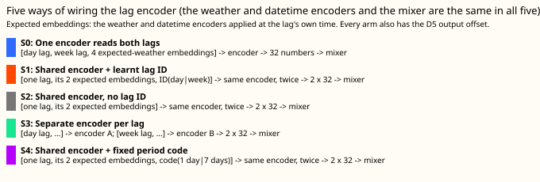
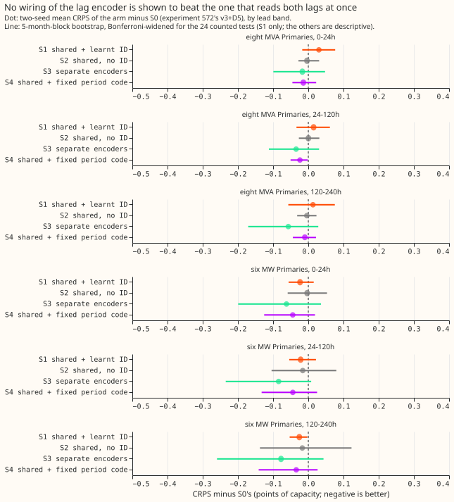
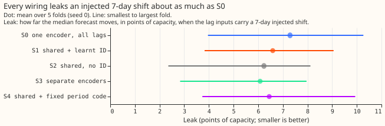
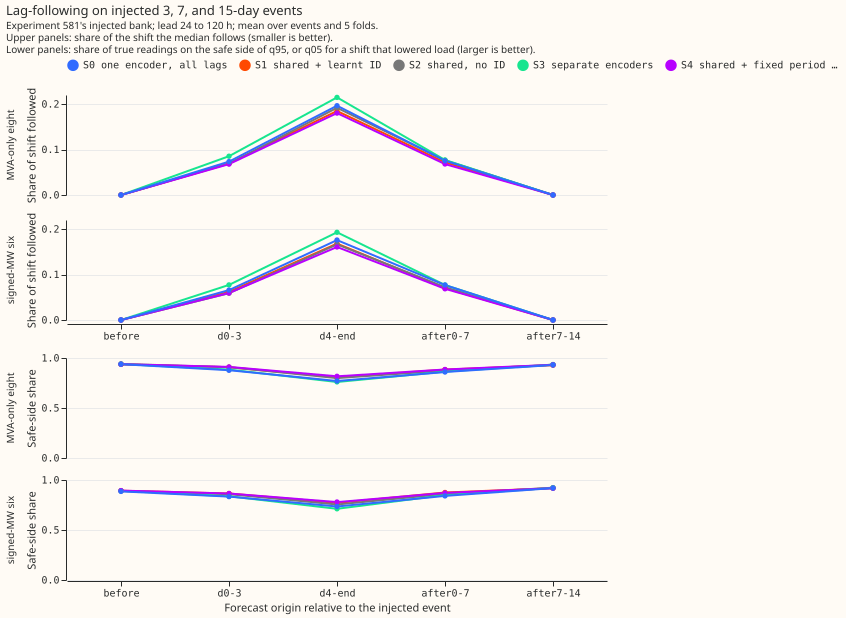
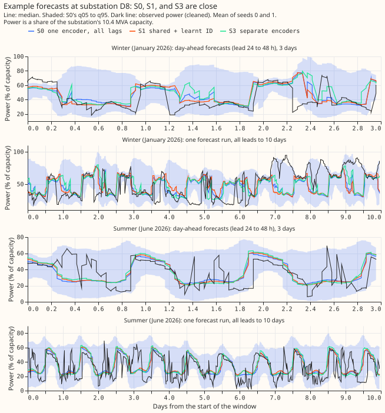

**Take-home.** Telling a shared lag encoder which lag it is reading does not improve the forecast,
and none of the other wirings of the day lag and the week lag is shown to beat reading both lags in
one encoder. The differences are at most 0.08 points of capacity, and the seed noise of this design
is 0.13 to 0.33. The maintainer's hunch (shared weights plus a lag ID is best) is therefore neither
supported nor refuted. Wiring did not change the leak of an injected load shift either.

We asked how the encoder that reads the power from one day ago and one week ago should be wired into
the demand network. We built four rewirings of experiment 572's v3+D5 network, refitted each on the
same five test months with two seeds, and compared them with experiment 572's stored forecasts. The
network and recipe are [experiment 560's lag
encoder](../00560-modular-lag-encoder-capped-lags-and-block-dropout/result.md) and [experiment 572's
output offset](../00572-two-offset-part-1-lags-versus-the-slow-output-offset/result.md), and the
injected load shifts are [experiment 581's
bank](../00581-robust-multiweek-lag-encoder-x3/result.md). The verdict is inconclusive for the stage
run here (two lags); the wide layout of stage 2 has not been run.

## Arms and numbers

- **Arms:** S0 (experiment 572's stored v3+D5, seeds 0 and 1), S1 (shared encoder plus a learnt
  8-number lag ID), S2 (shared, no ID), S3 (a separate encoder per lag), S4 (shared plus a fixed
  9-number code of the lag's period in days). S2 and S3 are experiment 560's b_shared and b_unshared
  refitted on the D5 recipe. S4's code has only 2 distinct rows (day and week), so S4 against S1
  tests a learnt against a fixed 2-valued identity, not richer information.
- **Weights per fine-tuned model file** (including the unused pre-training mixer; excludes the knot
  buffer): S0 41,986; S1 42,322; S2 41,794; S3 48,738; S4 42,370.
- **Setting:** coarse refits (days 0 and 14 of each of 5 fold months: 2025-10, 2025-12, 2026-01,
  2026-03, 2026-06), cleaned data, D15 and D18 cut at 2025-03-01, weather from the run at or before
  origin minus 9 h, day and week lags at least 24 h old, July 2026 unused. Fitted weights are in the
  experiment's private data folder (`arms/<arm>/work/models`). The wiring contrasts use the same two
  seeds throughout; S1 to S4 were pre-trained afresh and S0 uses experiment 572's pre-training, so
  S1 minus S0 also contains pre-training noise.
- **Absolute CRPS (points of capacity, 2-seed mean, all rows):** at 24-120 h at the eight MVA
  Primaries S0 4.427, S1 4.442, S2 4.427, S3 4.393, S4 4.403; at the six MW Primaries S0 3.327, S1
  3.306, S2 3.311, S3 3.243, S4 3.283. References at the eight: E2 (lag-free D5) 4.651 and M0 4.762
  (24-120 h). Every lag arm beats the lag-free arms by 0.2 to 0.3 at the eight.
- **Counted contrasts (24 tests; intervals are Bonferroni-widened 5-month-block bootstraps), 24-120
  h, eight / six:** S1 minus S2 +0.015 (-0.027 to +0.057) / -0.006 (-0.079 to +0.096); S1 minus S3
  +0.050 (-0.048 to +0.214) / +0.063 (-0.036 to +0.276); S1 minus S0 +0.015 (-0.045 to +0.080) /
  -0.022 (-0.067 to +0.048); S4 minus S1 -0.039 (-0.088 to +0.018) / -0.022 (-0.147 to +0.065).
  Every counted interval at every band includes zero. The MDE beside these is 0.13 to 0.33.
- **Descriptive:** S3 minus S0 -0.035 (eight) and -0.084 (six) at 24-120 h; S2 minus S0 +0.000 and
  -0.016; S4 minus S0 -0.024 (interval -0.050 to -0.002, one uncorrected test) and -0.044.
- **Cold winter nights (descriptive, not Bonferroni-corrected across slices):** S4 minus S1 is
  -0.112 (-0.207 to -0.013) at the eight and -0.089 (-0.134 to -0.002) at the six, but the slice MDE
  is 0.37 and 0.39, so the keep rule does not keep S4 (the effect is below the MDE).
- **Christmas week:** only one fold (2025-12) covers it, so the slice has no interval; S3 minus S0
  is -0.125 at the eight and -0.763 at the six with MDEs of 0.48 and 1.79. Easter and bank holidays
  are not scored here.
- **Leak (injected 7-day shift, seed 0, mean over 5 folds, range):** S0 7.29 (3.96 to 10.27), S1
  6.59 (3.83 to 9.06), S2 6.23 (2.35 to 8.12), S3 6.08 (2.83 to 7.96), S4 6.45 (3.73 to 9.94). No
  arm is worse than S0.
- **Injected-bank following, days 4 to the end of the event, lead 24-120 h (share of the shift the
  median follows; share of true readings on the safe side of q95 or q05), eight / six:** S0 0.196
  and 0.77 / 0.176 and 0.74; S1 0.185 and 0.81 / 0.168 and 0.77; S2 0.192 and 0.80 / 0.166 and 0.76;
  S3 0.215 and 0.76 / 0.193 and 0.71; S4 0.180 and 0.82 / 0.161 and 0.78. S3 follows the shift most
  and S4 least; no intervals were computed.
- **Tails, 24-120 h (pinball at q01, q05, q95, q99 in points of capacity; coverage below q01, q05,
  q95, q99):** the eight at S0 0.195, 0.760, 0.966, 0.288 with 0.009, 0.046, 0.910, 0.973; the other
  arms differ by under 0.04 in pinball and under 0.01 in coverage, except q95 pinball of the six (S0
  0.953; S1 0.901; S2 0.886; S3 0.882; S4 0.900). Tables are in the private `scores` folder.

## Checks

- **Median minus the mean of the nine central quantiles, per group** (a proxy, because the stored
  frames hold quantiles, not a mean): -0.5 to -0.6 points at the eight and -0.13 to -0.21 at the
  six, the same in every arm, so no arm shifts the forecast.
- **Error of the median forecast beside the CRPS contrasts** (mean absolute error, 24-120 h,
  points): at the eight S0 6.289, S1 6.309, S2 6.298, S3 6.249, S4 6.270; at the six S0 5.521, S1
  5.442, S2 5.421, S3 5.389, S4 5.432. The ordering matches the CRPS ordering at both groups (S3
  lowest).
- **Triggers:** trigger 2 fired (S2 minus S0 is +0.000 at the eight, against experiment 560's +0.070
  for b_shared minus v3). The explanation, tested here: experiment 560 had no offset and one seed,
  and this design's seed MDE is 0.145 at the eight, so +0.070 lies inside seed noise. No audit was
  run. The leave-one-site-out check (trigger 4) and a comparison of interval widths with experiment
  572's (trigger 6) were not run.

## Caveats

- **Two seeds** give an MDE of 0.13 to 0.33, so only a gain above about 0.15 could have been seen.
- **Unlogged events:** NGED's logs may miss load-shift events, so clean-lag rows may hold events no
  label covers; the injected bank is synthetic and the real-event slices undercount.
- **Lead range:** the scored leads are 0 to 240 h, the horizon NGED care about.
- **Stage 2 (wide layout) is not run**, so the question of more than two lags is open.
