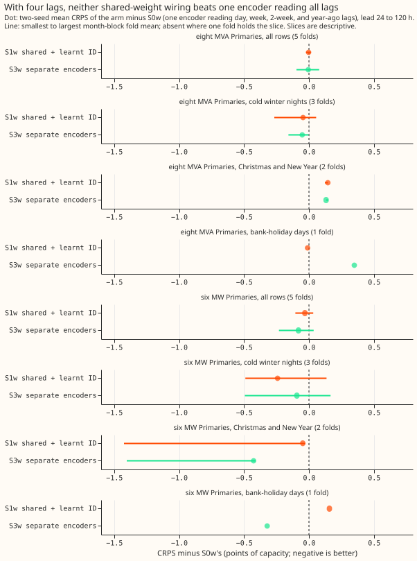
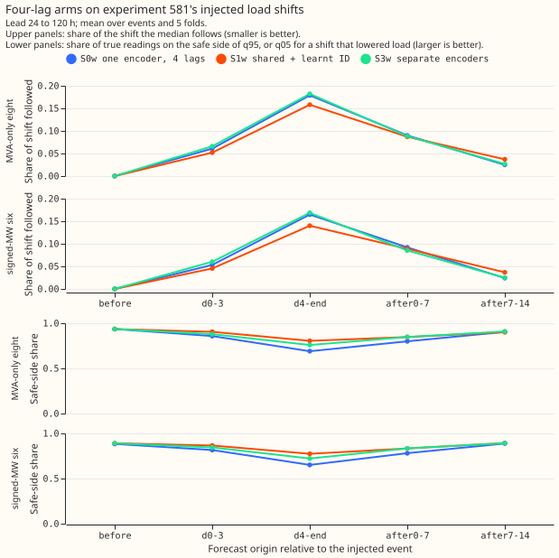

**Take-home.** No way of wiring the lag encoder is shown to beat S0 (one encoder reading all the
lags at once). That holds with two lags (day and week) and with four (day, week, 2-week, and
year-ago). The differences are at most 0.11 points of capacity in any lead band, and this design
cannot detect a difference below 0.10 to 0.30 points. The maintainer's hunch (a shared encoder plus
a lag ID is best) is therefore neither supported nor refuted. Wiring showed no detectable difference
in the leak of an injected load shift either (one seed).

**Terms.** *CRPS* is the continuous ranked probability score of the forecast, in points of capacity.
The *lag encoder* is the part of the demand neural network that reads the power from earlier days.
*One encoder for all lags* reads the lags as one input. *Shared* means one encoder with one set of
weights reads each lag in turn. A *lag ID* tells the shared encoder which lag it is reading, either
as a learnt 8-number embedding or as a fixed code of the lag's period. *Separate* means one encoder
with its own weights per lag. *Leak* is how far the median forecast moves, in points of capacity,
when the lag inputs carry an injected 7-day load shift. *MDE* is the smallest difference the
two-seed design could detect. *The eight* and *the six* are the eight MVA Primaries and the six MW
Primaries.

We asked how the encoder that reads the power from one day ago and one week ago should be wired into
the demand network. Stage 1 built four rewirings of experiment 572's v3+D5 network, refitted each on
the same five test months with two seeds, and compared them with experiment 572's stored forecasts.
Stage 2 repeated the comparison on [experiment 585's
layout](../00585-lag-count-and-year-ago-lags-through-the-lag-encoder/result.md) with four lags. The
network and recipe are [experiment 560's lag
encoder](../00560-modular-lag-encoder-capped-lags-and-block-dropout/result.md) and [experiment 572's
output offset](../00572-two-offset-part-1-lags-versus-the-slow-output-offset/result.md), and the
injected load shifts are [experiment 581's
bank](../00581-robust-multiweek-lag-encoder-x3/result.md). The verdict is inconclusive for both
stages.

## Predictions

- **P1 (S1 beats S2 by at least 0.03):** failed. S1 minus S2 is +0.015 at the eight and -0.006 at
  the six at 24-120 h.
- **P2 (S2 is worse than S0 by at least 0.03):** failed. S2 minus S0 is +0.000 at the eight, where
  experiment 560 found +0.070 without the offset.
- **P3 (S1 within 0.03 of S0, or better):** withdrawn, because the MDE exceeds 0.03. The point
  estimates are +0.015 and -0.022.
- **P4 (S3 within 0.03 of S1):** withdrawn for the same reason. S3 is 0.050 below S1 at the eight
  and 0.063 below at the six, inside the MDE.
- **P5 (S4 within 0.03 of S1):** withdrawn for the same reason. S4 minus S1 is -0.039 and -0.022.
- **P6 (S1's leak at most S0's):** held in seed 0 (6.59 against 7.29), but the fold ranges overlap
  and only one seed was run, so no difference is shown.

## Two lags (stage 1)

- **Arms:** S0 (experiment 572's stored v3+D5, seeds 0 and 1), S1 (shared encoder plus a learnt
  8-number lag ID), S2 (shared, no ID), S3 (a separate encoder per lag), S4 (shared plus a fixed
  9-number code of the lag's period in days). S2 and S3 are experiment 560's b_shared and b_unshared
  refitted on the D5 recipe. S4's code has only 2 distinct rows (day and week), so S4 against S1
  compares a learnt with a fixed 2-valued identity, not richer information.
- **Weights per fine-tuned model file** (including the unused pre-training mixer; excludes the knot
  buffer): S0 41,986; S1 42,322; S2 41,794; S3 48,738; S4 42,370.
- **Setting:** coarse refits (days 0 and 14 of each of 5 fold months: 2025-10, 2025-12, 2026-01,
  2026-03, 2026-06), cleaned data, D15 and D18 cut at 2025-03-01, weather from the run at or before
  origin minus 9 h, day and week lags at least 24 h old, July 2026 unused. Fitted weights are in the
  experiment's private data folder (`arms/<arm>/work/models`). S1 to S4 were pre-trained afresh and
  S0 uses experiment 572's pre-training, so S1 minus S0 also contains pre-training noise.
- **Absolute CRPS (points of capacity, 2-seed mean, all rows), 24-120 h:** at the eight S0 4.427, S1
  4.442, S2 4.427, S3 4.393, S4 4.403; at the six S0 3.327, S1 3.306, S2 3.311, S3 3.243, S4 3.283.
  References at the eight: E2 (lag-free D5) 4.651 and M0 4.762. Every two-lag arm beats E2 by 0.21
  to 0.26 at the eight.
- **Counted contrasts (24 tests; Bonferroni-widened 5-month-block bootstrap), 24-120 h, eight /
  six:** S1 minus S2 +0.015 (-0.027 to +0.057) / -0.006 (-0.079 to +0.096); S1 minus S3 +0.050
  (-0.048 to +0.214) / +0.063 (-0.036 to +0.276); S1 minus S0 +0.015 (-0.045 to +0.080) / -0.022
  (-0.067 to +0.048); S4 minus S1 -0.039 (-0.088 to +0.018) / -0.022 (-0.147 to +0.065). Every
  counted interval in every band includes zero. The MDE beside these is 0.13 to 0.30 per contrast;
  the full list is in the private `scores` folder.
- **Descriptive:** S3 minus S0 -0.035 (eight) and -0.084 (six) at 24-120 h; S2 minus S0 +0.000 and
  -0.016; S4 minus S0 -0.024 (interval -0.050 to -0.002, one uncorrected test) and -0.044.
- **Cold winter nights (descriptive, not Bonferroni-corrected across slices):** S4 minus S1 is
  -0.112 (-0.207 to -0.013) at the eight and -0.089 (-0.134 to -0.002) at the six, but the slice
  MDEs are 0.37 and 0.39, so the keep rule does not keep S4.
- **Christmas week:** only one fold (2025-12) covers it, so the slice has no interval; S3 minus S0
  is -0.125 at the eight and -0.763 at the six with MDEs of 0.48 and 1.79.
- **Leak (injected 7-day shift, seed 0 only, mean over 5 folds, range):** S0 7.29 (3.96 to 10.27),
  S1 6.59 (3.83 to 9.06), S2 6.23 (2.35 to 8.12), S3 6.08 (2.83 to 7.96), S4 6.45 (3.73 to 9.94).
  The ranges overlap, so no arm is shown to leak less or more than S0.
- **Injected-bank following, days 4 to the end of the event, lead 24-120 h (share of the shift the
  median follows; share of true readings on the safe side of q95 or q05), eight / six:** S0 0.196
  and 0.77 / 0.176 and 0.74; S1 0.185 and 0.81 / 0.168 and 0.77; S2 0.192 and 0.80 / 0.166 and 0.76;
  S3 0.215 and 0.76 / 0.193 and 0.71; S4 0.180 and 0.82 / 0.161 and 0.78. S3 follows the shift most
  and S4 least; no intervals were computed.
- **Tails, 24-120 h:** coverage below q95 is 0.910 to 0.919 for all five arms at the eight and 0.866
  to 0.877 at the six. Pinball loss at q95 at the six is 0.953 for S0 and 0.882 to 0.901 for the
  other four arms. Other tail numbers differ between arms by under 0.04 in pinball and 0.01 in
  coverage.

## Four lags (stage 2)

- **Arms:** S0w (one encoder reads the day, week, 2-week, and year-ago lags, as in experiment 585),
  S1w (shared encoder plus a learnt lag ID), S3w (a separate encoder per lag). Settings, seeds,
  folds, and data are those of stage 1.
- **Absolute CRPS, 24-120 h, eight / six:** S0 (two lags) 4.427 / 3.327; S0w 4.497 / 3.345; S1w
  4.494 / 3.313; S3w 4.491 / 3.264.
- **Counted contrasts (12 tests, Bonferroni intervals), eight / six:** at 24-120 h S1w minus S0w is
  -0.003 (-0.028 to +0.018; MDE 0.099) / -0.031 (-0.121 to +0.059; MDE 0.164), and S3w minus S0w is
  -0.005 (-0.135 to +0.111; MDE 0.127) / -0.081 (-0.305 to +0.056; MDE 0.116). Across all 12, one
  interval excludes zero: S1w minus S0w at the six at 120-240 h, -0.064 (-0.135 to -0.015), against
  an MDE of 0.258, so the keep rule does not keep S1w.
- **Adding the extra lags to one encoder (S0w minus S0, descriptive):** +0.112 at 0-24 h (+0.086 to
  +0.143), +0.070 at 24-120 h (+0.022 to +0.115), and +0.065 at 120-240 h (-0.034 to +0.165) at the
  eight; +0.017 at 24-120 h (-0.045 to +0.109) at the six. The extra lags did not improve CRPS.
- **Slices at 24-120 h (S1w minus S0w / S3w minus S0w; descriptive, one to three folds):**
    - Cold winter nights (3 folds): eight -0.045 (MDE 0.312) / -0.052 (MDE 0.370); six -0.242 (MDE
      0.751) / -0.093 (MDE 0.240).
    - Christmas and New Year (2 folds): eight +0.146 (MDE 0.388) / +0.132 (MDE 0.332); six -0.048
      (MDE 0.709) / -0.426 (MDE 0.490).
    - Bank-holiday days (1 fold): eight -0.011 (MDE 0.526) / +0.349 (MDE 0.770); six +0.158 (MDE
      0.841) / -0.322 (MDE 0.393).
    - No effect reaches its MDE. Easter has no scored days.
- **Four lags against two, S0w minus S0 (and the other arms minus S0), at Christmas, New Year, and
  bank holidays:** S0w minus S0 is +0.123 (MDE 0.188) at the eight at Christmas and New Year and
  +0.321 (MDE 0.227) on bank-holiday days; at the six it is -0.085 (MDE 0.556) and -0.203 (MDE
  0.516). At the eight, four lags are worse on bank-holiday days (+0.321 is above its MDE of 0.227,
  one fold); the +0.123 at Christmas and New Year is below its MDE of 0.188. S1w and S3w minus S0 at
  the eight are +0.269 and +0.255 at Christmas and New Year (MDEs 0.544 and 0.427) and +0.310 and
  +0.670 on bank-holiday days (MDEs 0.299 and 0.543). S3w minus S0 at the six is -0.511 (MDE 0.477)
  and -0.525 (MDE 0.123), and S1w minus S0 at the six is -0.133 and -0.046 (MDEs 0.213 and 0.326).
- **Injected-bank following, days 4 to the end of the event, lead 24-120 h (share of the shift the
  median follows; safe-side share at q95 or q05; width of the 90% band), eight / six:** two-lag S0
  0.196, 0.77, 0.268 / 0.176, 0.74, 0.211; S0w 0.179, 0.69, 0.238 / 0.165, 0.65, 0.177; S1w 0.158,
  0.805, 0.259 / 0.140, 0.77, 0.200; S3w 0.182, 0.76, 0.263 / 0.169, 0.72, 0.200. S1w is the safest
  on the side of the shift, and its bands are wider than S0w's, so part of that gain may come from
  width.
- **After the shift ends (days 0 to 7), safe-side share at q95 or q05, eight / six:** S0 0.86 /
  0.84; S0w 0.80 / 0.78; S1w 0.85 / 0.83; S3w 0.85 / 0.83. S1w also keeps following the shift for
  longer than S0w: in days 7 to 14 it still follows 0.037 of the shift, against 0.025 for S0w.
- **Leak under the injected 7-day lag shift was not run in stage 2.** The stage 2 numbers above come
  from experiment 581's injected bank only, and no interval was computed for them.

## Checks

- **Median minus the mean of the nine central quantiles, per group (a proxy, because the stored
  frames hold quantiles, not a mean):** the median sits 0.5 to 0.6 points of capacity below that
  mean at the eight and 0.13 to 0.21 below at the six, and the gap is the same in every two-lag arm.
  The wirings therefore do not move the centre of the forecast distribution differently.
- **Error of the median forecast beside the CRPS contrasts (mean absolute error, 24-120 h,
  points):** at the eight S0 6.289, S1 6.309, S2 6.298, S3 6.249, S4 6.270; at the six S0 5.521, S1
  5.442, S2 5.421, S3 5.389, S4 5.432. S3 is lowest under both measures at both groups. The order of
  the other arms differs between the two measures.
- **Triggers:** trigger 2 fired (S2 minus S0 is +0.000 at the eight, against experiment 560's +0.070
  for b_shared minus v3). Experiment 560 had no offset and one seed, and this design's MDE at the
  eight is 0.145, so +0.070 lies below what this design detects. No audit was run. The
  leave-one-site-out check (trigger 4) and a comparison of interval widths with experiment 572's
  (trigger 6) were not run.

## Caveats

- **Two seeds** give an MDE of 0.10 to 0.30 per contrast (0.10 to 0.22 at the eight and 0.12 to 0.26
  at the six for the counted four-lag contrasts), so only a gain above about 0.1 to 0.3 could have
  been seen.
- **Slice contrasts have one to three folds.** The Christmas and bank-holiday slices carry the
  largest MDEs, and Easter is empty.
- **Unlogged events:** NGED's logs may miss load-shift events, so clean-lag rows may hold events no
  label covers. The injected bank is synthetic, and the real-event slices undercount.
- **Leak is from seed 0 only,** and for the four-lag arms it was not run.
- **Lead range:** the scored leads are 0 to 240 h, the horizon NGED cares about.
- **Compute:** process-hours were not metered, so the 3 GPU-h ceiling may have been crossed.
