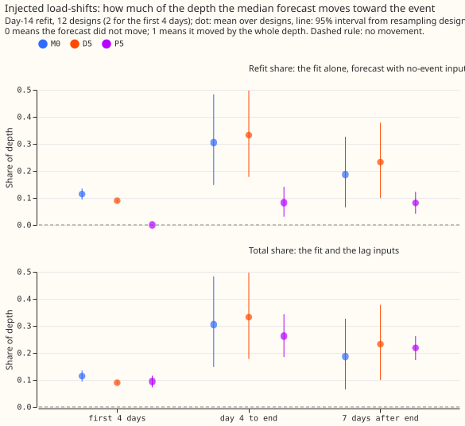
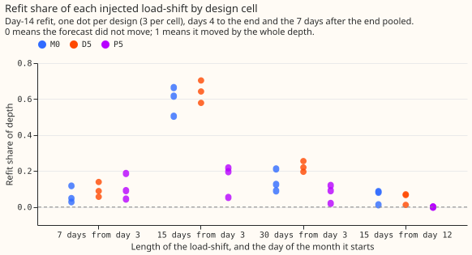
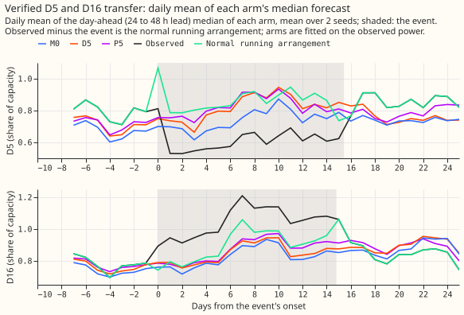
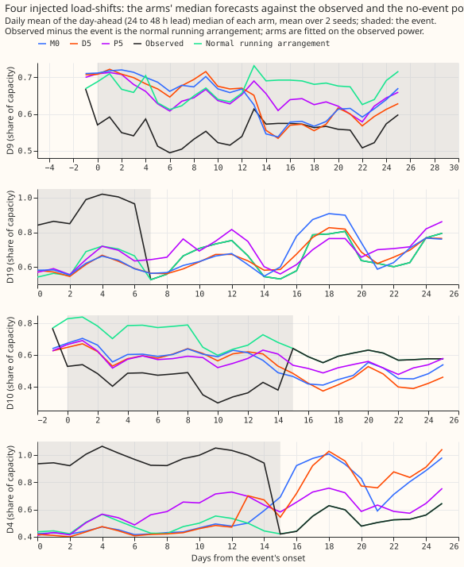
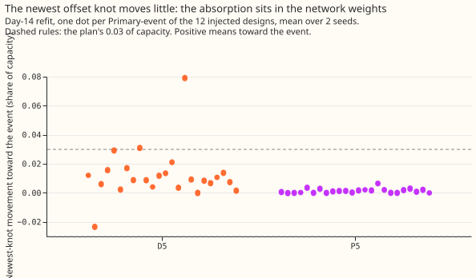

**We asked how much of a load-shift a demand forecast learns when its neural network is refitted
on power readings that contain the load-shift.** National Grid Electricity Distribution (NGED)
moves load between neighbouring primary substations (Primaries) for days or weeks, so the readings
at one Primary rise and at its neighbour fall by the same amount in megawatts (MW). The size of that
change as a share of the Primary's capacity is the load-shift's *depth*. We took one load-shift
confirmed in the telemetry (Primaries D5 and D16, 2025-12-29 to 2026-01-13, [experiment
580](../00580-verified-load-shift-event-set-and-label-audit/result.md)) and 12 load-shifts of known
depth that we added to the readings of two connected Primaries. For each, we refitted three demand
neural networks on the first day and on the fifteenth day of a month, once on readings with the
load-shift and once on readings without it. We then measured how far the first fit's median forecast
sits from the second's toward the load-shift, as a share of the depth: 0 means the forecast did not
move and 1 means it moved by the whole depth. [Experiment
565](../00565-drift-embedding-variants-six-designs/result.md) and [experiment
566](../00566-combination-block-lag-encoder-with-three-step-schedule-and-embargo-real-event-leak/result.md)
reported such shares (0.014 to 0.040 of the labelled depth) from NGED's labelled events, which
experiment 580 could not confirm.

**Take-home message: a refit moves the median forecast toward a running load-shift by more than
predicted, and by a very different amount from one load-shift to the next.** On the injected
load-shifts, at the refit on day 14, the neural network without an offset (M0) moves the median
forecast by 0.19 of the depth in the 7 days after the load-shift ends (95% interval 0.06 to 0.33),
and the one with a slow output offset (the D5 arm) by 0.23 (0.10 to 0.38). The embargoed recipe
(P5, which leaves out the newest 3 days of training targets) moves it by 0.08 (0.04 to 0.12), plus
about 0.14 from its power-lag inputs, for a total of 0.22 (0.17 to 0.26). The prediction was at
most 0.05. Three 15-day designs that start on day 3 carry the means: the medians over the 12
designs are 0.08 (M0), 0.11 (the D5 arm), and 0.07 (P5). The verdict "refuted" applies to the
claim that the share is small; whether the offset raises the share above M0's is not settled (the
difference is +0.046, with a corrected interval from -0.001 to +0.093).

**Terms.** *M0* is the neural network with no offset and no power lags ([experiment
565](../00565-drift-embedding-variants-six-designs/result.md), arm `C-M0`). *The D5 arm* adds a
slow per-Primary output offset (experiment 565's arm `D5`); the Primaries D5 and D16 are separate
from it. *P5* adds a power-lag encoder, the offset, and a three-step fitting schedule with a 3-day
embargo ([experiment
574](../00574-part-d-primaries-only-modular-recipe-lag-encoder-offset-and-add-one-arms/result.md)).
A *refit* trains a neural network on the 90-day, recency-weighted history up to the refit day. A
*design* is one injected load-shift with its two Primaries. The **refit share** is the event's
sign times the median forecast of the fit on readings with the load-shift, run on inputs without
it, minus the median forecast of the fit on readings without it, over the depth. The **total share**
runs the first fit on inputs that contain the load-shift, so it adds the effect of P5's power lags.
Phases follow the forecast's valid time: before the load-shift, its first 4 days, day 4 to its end,
and the 7 days after its end.

## Results

- **Arms and recipe.** M0, the D5 arm, and P5 as above, refitted on days 0 and 14, seeds 0 and 1,
  on cleaned power, with Primaries D15 and D18 excluded. Step 2 and the pre-training are the stored
  weights of experiments 565 and 574, which never see an injected load-shift. Weather comes from
  the run at or before the origin minus 9 hours (asserted by the harness), and lag inputs are at
  least 24 hours old. A refit on the observed power reproduces the stored forecast to at most 5e-6
  of capacity, so every fit here is a refit through the stored fit's code.
- **Designs.** 12 designs drawn with fixed seed 20261106 from experiment 580's bank of 358: the
  nine cells of depth 15%, 30%, and 50% of the smaller capacity by length 7, 15, and 30 days, each
  starting on day 3 of its fold month, and three 15-day designs that start on day 12. Each design
  has two Primary-events, 24 per arm. The bank has no 10% or 25% depths.
- **The cause of the spread between design cells is not tested.** Refit shares by cell (days 4 to
  the end and 7 days after pooled; 3 designs per cell; mean and range). The D5 arm: 7 days from
  day 3 +0.095 (0.057 to 0.140); 15 days from day 3 +0.642 (0.579 to 0.704); 30 days from day 3
  +0.224 (0.196 to 0.255); 15 days from day 12 +0.050 (0.012 to 0.071). M0: +0.064, +0.595, +0.142,
  +0.060. P5: +0.108, +0.156, +0.077, 0.000. Each cell differs in month and Primary pair as well as
  in length.
- **Refit share at the day-14 refit, injected designs: mean (95% interval from resampling designs).**
  Days 4 to the end (9 designs): M0 +0.305 (0.148 to 0.483), the D5 arm +0.332 (0.178 to 0.497),
  P5 +0.082 (0.030 to 0.141). The 7 days after the end (12 designs): M0 +0.186 (0.064 to 0.327),
  the D5 arm +0.232 (0.100 to 0.378), P5 +0.082 (0.042 to 0.122). The first 4 days rest on 2
  designs and carry no interval: M0 +0.114, the D5 arm +0.090, P5 0.000.
- **Medians over designs at the day-14 refit.** Days 4 to the end: M0 +0.263, the D5 arm +0.318,
  P5 +0.047. The 7 days after the end: M0 +0.083, the D5 arm +0.107, P5 +0.069.
- **Total share at the day-14 refit.** P5: +0.262 (0.189 to 0.341) in days 4 to the end and +0.219
  (0.173 to 0.264) in the 7 days after the end, so its lag inputs add about 0.18 and 0.14. M0 and
  the D5 arm read no power lags, so their total and refit shares are equal.
- **Day-0 refit, where the load-shift is not yet in the training rows.** Refit shares are 0 to
  1e-8 for all three arms. P5's total share is +0.014, +0.074, and +0.136 in the first 4 days,
  day 4 to the end, and the 7 days after the end, which is lag following alone.
- **Contrasts of the refit share at the day-14 refit, paired by design, Bonferroni over 6 tests.**
  The minimum detectable effect is each interval's half-width. The D5 arm minus M0: days 4 to the
  end +0.028 (-0.027 to +0.104; 0.066), the 7 days after the end +0.046 (-0.001 to +0.093; 0.047).
  P5 minus the D5 arm: days 4 to the end -0.250 (-0.407 to -0.109; 0.149), the 7 days after the
  end -0.151 (-0.321 to -0.021; 0.150). The first-4-days contrasts rest on 2 designs and are not
  interpreted. P5 minus the D5 arm contains the embargo, the three-step schedule, and the lag
  encoder, so it does not isolate any one of them.
- **Newest offset knot at the day-14 refit, injected, toward the load-shift (share of capacity).**
  The D5 arm: mean +0.012, largest +0.079, with 2 of 24 Primary-events above 0.03. P5: mean +0.001,
  largest +0.006. The D5 arm's refit share corresponds to +0.059 of capacity absorbed on average
  (mean depth 0.243 of capacity), so the newest knot carries about a fifth of the movement. Which
  other parameters carry the rest was not tested.
- **Tail shares (refit, day-14 refit, days 4 to the end).** M0: q01 +0.40, q05 +0.37, q50 +0.31,
  q95 +0.36, q99 +0.38. The D5 arm: +0.41, +0.38, +0.33, +0.35, +0.35. P5: +0.07, +0.07, +0.08,
  +0.12, +0.13. The whole forecast distribution moves with the median, and P5's upper tail moves
  slightly more.
- **Verified D5 and D16 pair (one pair; descriptive).** At the 2026-01 day-14 refit, 7 days after
  the end, the refit shares at Primaries D5 and D16 are: M0 +0.177 and +0.085, the D5 arm +0.357
  and +0.165, P5 +0.038 and +0.113. P5's total shares are +0.172 and +0.293. At the 2025-12 refits
  and the 2026-01 day-0 refit (which holds about 3 days of the load-shift) the refit shares run
  from 0 to 0.13, and P5's total share at the 2026-01 day-0 refit is +0.133 to +0.198. The
  no-event readings subtract the fitted constant depth, which carries a load mismatch of 0.017 of
  capacity between the two Primaries.
- **The erratum numbers of experiments 565 and 566.** Their real-event shares (0.014 to 0.040 of
  the labelled depth) refer to events that had ended before the refit. The injected 7-day designs
  match that case, because the load-shift ends 5 days before the day-14 refit: M0 +0.064, the D5
  arm +0.095, and P5 +0.108 (3 designs each, ranges 0.03 to 0.19). The real-event shares on those
  pages remain unproven, and these figures are the replacement for comparing recipes.

## Predictions

- **P1 (at most 0.05 of depth at the D5 arm and at P5, and the newest knot at most 0.03 of
  capacity, for 15 and 30 day events at 30% and 50% depth in the 7 days after the end): failed for
  the D5 arm only.** On those 6 designs the D5 arm has a mean of +0.279 (median +0.139), above the
  failure line of 0.10. P5 has +0.060, which is above 0.05 and below 0.10. The knot averages
  +0.012, below 0.03.
- **P2 (the D5 arm within 0.03 of M0 in every phase): failed on the point estimate in one phase.**
  The difference is +0.046 in the 7 days after the end, and its corrected interval (-0.001 to
  +0.093) includes 0.03.
- **P3 (day-0 refit shares of 0 for M0 and the D5 arm, and P5's total share equal to its lag
  following): held.**
- **P4 (the verified pair within 0.05 of the injected mean of the same arm in the 7 days after the
  end): held for 3 of 6 Primary-arm pairs.** The injected means are M0 0.186, the D5 arm 0.232, and
  P5 0.082. The verified refit shares are within 0.05 for M0 at Primary D5 (0.177), and for P5 at
  both Primaries (0.038 and 0.113). They are not for M0 at Primary D16 (0.085) or for the D5 arm
  at either Primary (0.357 and 0.165).

## Checks

- **Median minus mean forecast per site:** not applicable, because only quantiles are stored.
- **Error of the mean forecast beside the quantile contrast:** not applicable, because the measure
  is a difference of forecast quantiles, and all five quantile shares have the same sign.
- **Triggers fired.** Trigger 2 (the result contradicts its prediction) fired. A fresh Sonnet
  audit re-derived the shares from the raw forecast files and reproduced every printed number to 3
  decimals. Trigger 5 (a nested arm beats the arm that contains it) fired in form: P5 has a lower
  refit share than the D5 arm that P5 contains, and the contrast contains the embargo, the
  three-step schedule, and the lag encoder. Triggers 1, 3, 4, 6, and 7 did not fire: leaving one
  design out flips no sign, and dropping design 234 shrinks the D5 arm minus M0 difference in days
  4 to the end to +0.009. The refit placebos (the day-0 refit, and the 14 uninvolved Primaries at
  day 14, which move by about 0.001 of capacity) show the shares are not fit noise.
- **Reviews.** A Sonnet code review before the first run found 5 problems, all fixed. A Sonnet audit
  and a Sonnet write-up review (numbers and prose) followed, and their findings are applied.

## Caveats

- **One verified pair.** The real-event numbers rest on one verified pair, so the injected
  designs are the main evidence.
- **Few designs.** Each cell holds 3 designs that differ in month and Primary pair, and the
  bootstrap resamples 9 or 12 designs.
- **Lead range.** The shares pool all leads of the forecast, up to 10 days.
- **Early stopping.** The number of training epochs differs between the two fits of a design by 2
  to 4 on average, and by up to 17.
- **Unlogged load-shifts.** NGED's logs may miss load-shifts, so the fits on the other months can
  contain load-shifts that no label covers.
