**The plots show the candidate forecast (C2) widening its 90% band after a load-shift ends and
covering the normal running arrangement (NRA) on more rows than the earlier v3+D5 forecast (C0) in
most cases, and changing nothing on days with no load-shift.** The NRA is the power a substation
would have drawn without the load-shift. The one real, telemetry-verified case, the December 2025
transfer between substations D5 and D16, is mixed: C2 covers D5 on only 0.46 of rows before the
event.

A load-shift moves part of one primary substation's demand onto another, so the recent power
readings no longer show the NRA. **How to read the plots:** each panel shows day-ahead forecasts
(the forecast issued the day before the valid day) for one primary substation (a Primary). The grey
band and line are C0's q05 to q95 range and median. The orange band and dark orange line are C2's.
The black solid line is the observed power. The black dashed line is the NRA. The grey shade is the
load-shift. The sky-blue bar along the bottom marks origin days on which the gate (a rule that fires
when the lagged power disagrees with a forecast made without it) was on, or held for 7 days after it
released. C2 is the [experiment
584](https://openclimatefix.github.io/nged-ml-research/ml-experiments/00584-nra-candidate-pack-x6/result/)
forecast: the P5 recipe trained with synthetic load-shifts in the lag inputs, with a wider band
while the gate is on. C0 is the [experiment
572](https://openclimatefix.github.io/nged-ml-research/ml-experiments/00572-two-offset-part-1-lags-versus-the-slow-output-offset/result/)
forecast. Nothing here is adopted for production.

Verdict: **partly supported**. P1 holds, P2 fails at the MVA-only Primaries, and P3 is descriptive.

## Verified real events

The December 2025 pair is the only telemetry-verified transfer from [experiment
580](https://openclimatefix.github.io/nged-ml-research/ml-experiments/00580-verified-load-shift-event-set-and-label-audit/result/)
that falls in a fold month with stored forecasts. Each figure has the whole window (14 days before
the start to 14 days after the end) and a zoom on the 7 days after the end.

D5 carried 1.5 MW less during the load-shift. The gate was on for the whole window, so the band is
the wider union band throughout, and the sky-blue bar spans it.

D16 carried the mirror load. Look at the zoom: after the end, C2's band is wider than C0's and
contains the NRA more often.

The gate at D5 was on for every origin day in the window. At D16 it fired 5 days after the start and
released 19 days after.

Share of the NRA inside the q05 to q95 band, by phase. Rows are day-ahead rows only, so the numbers
differ slightly from the 24 to 120 h rows of [experiment
584](https://openclimatefix.github.io/nged-ml-research/ml-experiments/00584-nra-candidate-pack-x6/result/).
Widths are in per cent of capacity. Both events belong to one transfer, so every number is
descriptive.

| Event | Phase | Rows | C0 | C2 | C0 width | C2 width |
|---|---|---|---|---|---|---|
| D5 2025-12-29 | before | 336 | 0.80 | 0.46 | 23.0 | 19.6 |
| D5 2025-12-29 | days0-3 | 144 | 0.58 | 0.48 | 22.8 | 19.3 |
| D5 2025-12-29 | day4-end | 597 | 0.75 | 0.87 | 22.4 | 20.3 |
| D5 2025-12-29 | after0-7 | 336 | 0.34 | 0.57 | 20.3 | 21.5 |
| D16 2025-12-29 | before | 336 | 0.95 | 0.95 | 14.9 | 12.1 |
| D16 2025-12-29 | days0-3 | 144 | 0.81 | 0.72 | 14.8 | 12.4 |
| D16 2025-12-29 | day4-end | 567 | 0.90 | 0.68 | 17.8 | 15.0 |
| D16 2025-12-29 | after0-7 | 336 | 0.33 | 0.85 | 17.9 | 20.4 |

## Labelled events (label not verified by the power readings)

These are NGED's labelled events of 3 days or more that fall in a fold month with stored forecasts
(11 events, so fewer than the 12 allowed). The dashed blue line is the observed power minus the
labelled depth, which is what the NRA would be if the label were right. **NGED's labels are known to
be imperfect, so a plot where the forecast does not follow the label is not an error.** The status
comes from [experiment
580](https://openclimatefix.github.io/nged-ml-research/ml-experiments/00580-verified-load-shift-event-set-and-label-audit/result/):
only event 55 is verified, and event 146's label has the wrong dates and sign. Events 177 to 182 are
the mirrored halves of labelled pairs at D5, D3, and D8.

D5, event 146 (+2.90 MW, 39.6 days from 2025-12-05). 580 status: label has wrong dates or sign.
Gate-on origin days in the window: 42.

D16, event 55 (+1.50 MW, 15.5 days from 2025-12-30). 580 status: verified. Gate-on origin days in
the window: 14.

D3, event 115 (+3.22 MW, 7.0 days from 2025-12-15). 580 status: not seen by the power rule. Gate-on
origin days in the window: 0.

D8, event 178 (-3.22 MW, 7.0 days from 2025-12-15). 580 status: not seen by the power rule. Gate-on
origin days in the window: 0.

D5, event 149 (+2.66 MW, 4.8 days from 2026-01-27). 580 status: unpaired step (possible level
change). Gate-on origin days in the window: 6.

D8, event 182 (-2.66 MW, 4.8 days from 2026-01-27). 580 status: not seen by the power rule. Gate-on
origin days in the window: 0.

D5, event 145 (+2.41 MW, 4.2 days from 2025-10-11). 580 status: not seen by the power rule. Gate-on
origin days in the window: 0.

D8, event 177 (-2.41 MW, 4.2 days from 2025-10-11). 580 status: not seen by the power rule. Gate-on
origin days in the window: 0.

D5, event 147 (+3.07 MW, 3.7 days from 2026-01-15). 580 status: not seen by the power rule. Gate-on
origin days in the window: 18.

D8, event 181 (-3.07 MW, 3.7 days from 2026-01-15). 580 status: not seen by the power rule. Gate-on
origin days in the window: 0.

D8, event 179 (-2.90 MW, 3.3 days from 2025-12-28). 580 status: not seen by the power rule. Gate-on
origin days in the window: 0.

## Injected events

Each figure injects one design into the lag inputs of two Primaries, one MVA-only Primary and one
signed-MW Primary (March 2026, the bank of [experiment
581](https://openclimatefix.github.io/nged-ml-research/ml-experiments/00581-robust-multiweek-lag-encoder-x3/result/)).
**The injected shift is added to the lag inputs only and the target stays clean, so the plots show
the lag-input effect**, and the observed power is also the NRA. All events in a month end on the
same day, so a 30-day event begins before the plotted window (the x axis then starts above 0).
Coverage of the NRA in the 7 days after the end (C0 / C2):

| Design | Eight MVA Primary (C0 / C2) | Six MW Primary (C0 / C2) |
|---|---|---|
| 7 days, +15% | D3: 0.62 / 0.89 | D16: 0.66 / 0.97 |
| 7 days, -30% | D8: 0.93 / 0.89 | D9: 0.68 / 0.91 |
| 7 days, -50% | D12: 0.92 / 0.91 | D14: 0.73 / 0.88 |
| 7 days, +50% | D12: 0.70 / 0.84 | D14: 0.42 / 0.90 |
| 15 days, +15% | D4: 0.93 / 0.94 | D16: 0.66 / 0.97 |
| 15 days, -30% | D8: 0.93 / 0.89 | D10: 0.91 / 0.98 |
| 15 days, -50% | D12: 0.92 / 0.91 | D14: 0.73 / 0.88 |
| 15 days, +50% | D12: 0.70 / 0.84 | D14: 0.42 / 0.90 |
| 30 days, +15% | D22: 0.88 / 0.93 | D5: 0.83 / 0.95 |
| 30 days, -30% | D8: 0.93 / 0.89 | D11: 0.99 / 0.99 |
| 30 days, -50% | D12: 0.92 / 0.91 | D16: 0.71 / 0.99 |
| 30 days, +50% | D12: 0.70 / 0.84 | D16: 0.26 / 0.98 |

D12, D14, and D16 appear in several designs because the bank assigns each Primary to one design per
pass. Their after-end rows are the same rows, so their coverage repeats. At the MVA-only Primaries
C2 covers more than C0 in 6 of 12 designs. The 6 exceptions are all negative-sign events at D8 and
D12, where C0 already covers 0.92 or more.

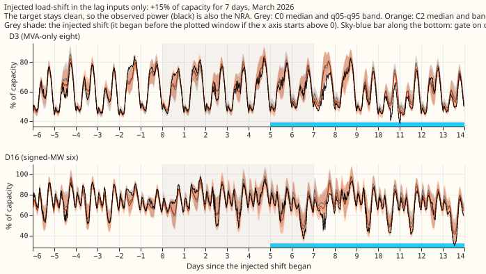

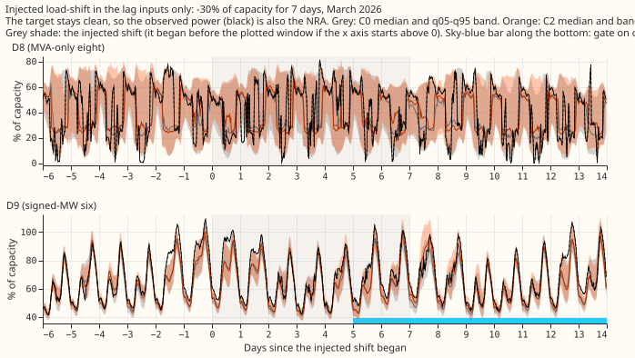

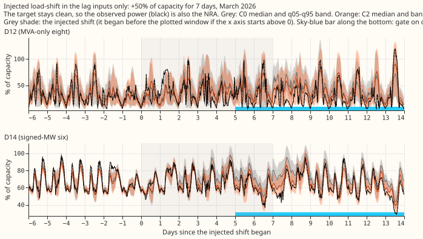

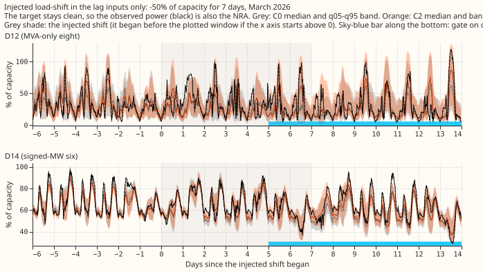

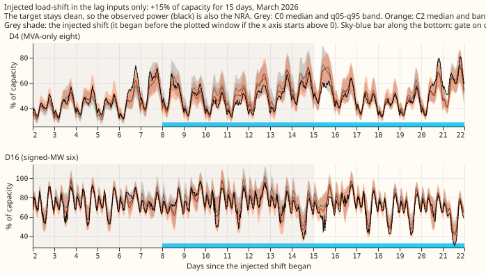

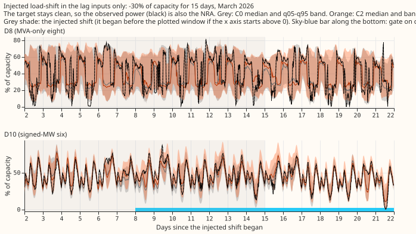

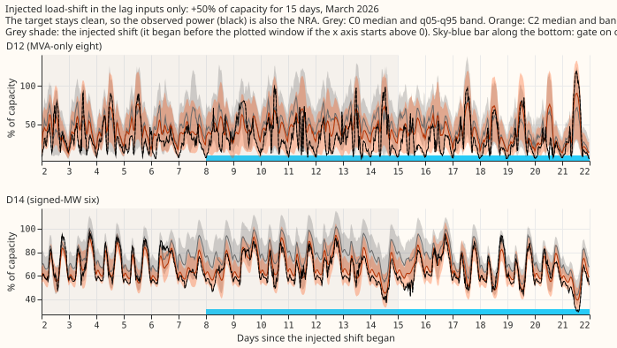

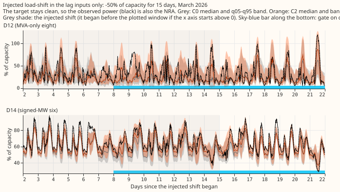

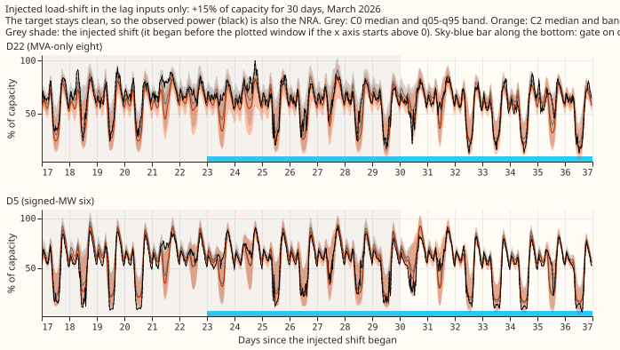

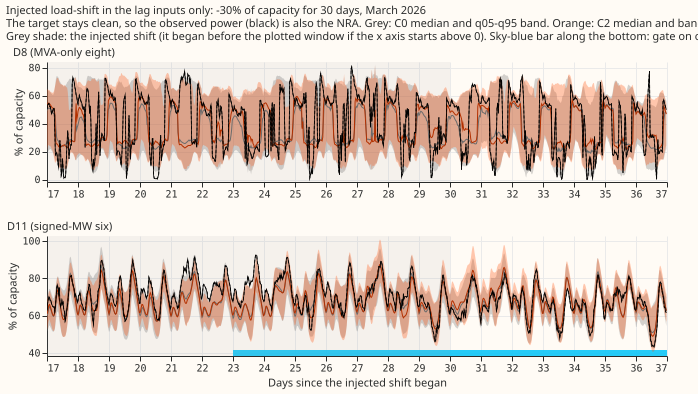

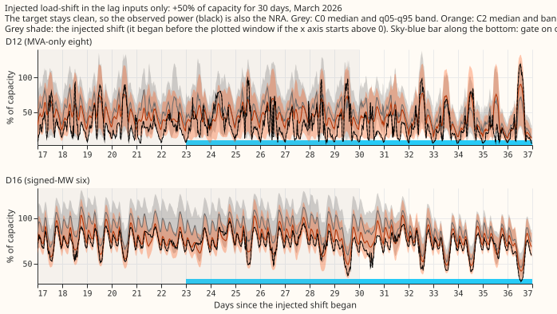

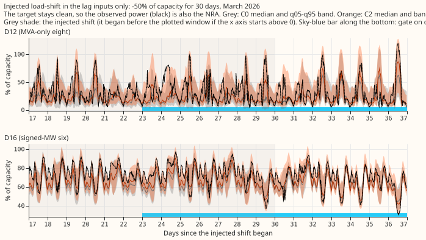

## Event-free control

Four 14-day windows with no labelled or verified load-shift within 7 days. Rule: the lowest-numbered
Primary of the stated group whose 14 days from day 8 of the month hold no event, for 2025-10 and
2026-06 (MVA-only) and 2026-03 and 2026-06 (MW). The gate was off on every origin day in all four
windows, and C2's 11 stored quantiles equal C1's on every one of the 672 rows in each window
(maximum difference 0.0). C1 is drawn grey under C2's orange, so only the orange shows.

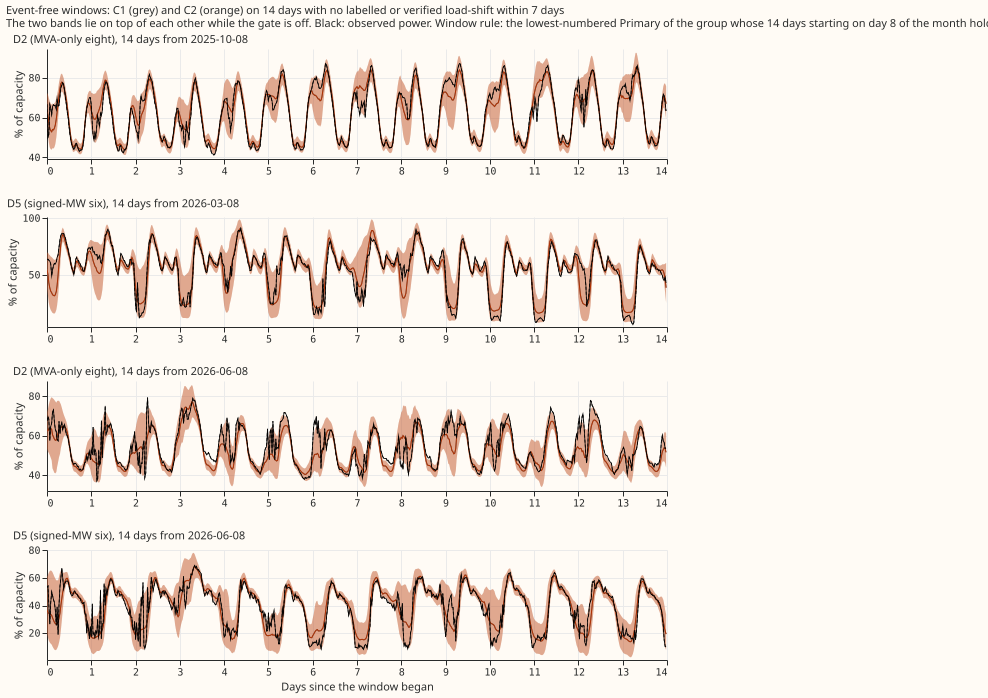

## Summary figures

Injected events of 15 and 30 days, both groups, 24 to 120 h, from the tables of [experiment
584](https://openclimatefix.github.io/nged-ml-research/ml-experiments/00584-nra-candidate-pack-x6/result/).
Look at the phases after the gate fires: C2 is highest there.

C2's band is wider than C1's in the phases where the gate is on, and equal before.

The orange line (C2) lies above the purple line (C1) on gate-on days.

Copied from [experiment
584](https://openclimatefix.github.io/nged-ml-research/ml-experiments/00584-nra-candidate-pack-x6/result/).
The follow ratio by phase is not redrawn, because [experiment
584](https://openclimatefix.github.io/nged-ml-research/ml-experiments/00584-nra-candidate-pack-x6/result/)
has no follow-ratio figure. [experiment
582](https://openclimatefix.github.io/nged-ml-research/ml-experiments/00582-nra-tails-on-verified-load-shift-events/result/)
has one for earlier arms on the same events.

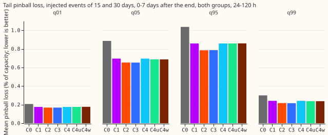

## What the plots show

- **Event-free days are unchanged.** C2's quantiles equal C1's on all 4 windows (event-free figure).
- **After the end, C2 beats C0 on both verified Primaries.** D16 0.85 against 0.33 and D5 0.57
  against 0.34 (verified table; descriptive, one transfer).
- **Before the event at D5, C2 is worse than C0.** 0.46 against 0.80, with the gate on for the whole
  window (D5 figure, gate timeline). [experiment
  584](https://openclimatefix.github.io/nged-ml-research/ml-experiments/00584-nra-candidate-pack-x6/result/)
  reports the same.
- **On injected events C2 covers more than C0 after the end in 17 of 24 panels.** The exceptions are
  negative-sign events at D8 and D12, and one at D11 (injected table).
- **Labelled events that the power readings did not confirm show no matching response.** The label
  line and the observed power disagree in those plots (labelled figures).

## Checks and caveats

- **Row set:** `experiment_470_intersection_v1`, five fold months (2025-10, 2025-12, 2026-01,
  2026-03, 2026-06), July 2026 unused, D15 and D18 cut before 2025-03-01, cleaned data, seeds 0 and
  1 averaged, coarse refits (days 0 and 14). Weather comes from the run issued at or before the
  forecast origin minus 9 h, and lags are at least 24 h old. Stored forecasts cover 0 to 120 h, so
  NGED's 1 to 10 day horizon is not shown.
- **Descriptive only:** one verified pair, 11 labelled events, and 12 injected designs at one
  Primary per group. No contrast is tested. Where [experiment
  584](https://openclimatefix.github.io/nged-ml-research/ml-experiments/00584-nra-candidate-pack-x6/result/)
  quotes a contrast, its minimum detectable effect is on that page.
- **Unlogged events:** NGED's logs may miss events, so the event-free windows may hold unlabelled
  events, and the real-event slices undercount.
- **Injected events** flatter any rule keyed on the lags, because the gate reads the injected lags
  and not a change in the power ([experiment
  583](https://openclimatefix.github.io/nged-ml-research/ml-experiments/00583-after-snap-back-event-band-on-x3-syn/result/)).
- **Not computed:** the avoidable-curtailment cost (it needs node forecasts with generators), tail
  tables beyond those of [experiment
  584](https://openclimatefix.github.io/nged-ml-research/ml-experiments/00584-nra-candidate-pack-x6/result/),
  and weekly refits.
- **Reviews:** a fresh Sonnet agent reviewed the script before the numbers were quoted. It found no
  leak and no generator data. Its findings were applied: the injected window now covers 7 days
  before the start, the span shade and the labelled-event selection were fixed, the label line uses
  the capacity of [experiment
  580](https://openclimatefix.github.io/nged-ml-research/ml-experiments/00580-verified-load-shift-event-set-and-label-audit/result/),
  and the event-free check compares all 11 quantiles exactly. Its note that the March origin mask
  cuts the injected "before" and late "after" rows stands, so injected coverage here is not
  comparable with the 24 to 120 h bank tables of [experiment
  584](https://openclimatefix.github.io/nged-ml-research/ml-experiments/00584-nra-candidate-pack-x6/result/).

Scripts: `ml-experiments/00588-nra-event-gallery-for-the-candidate-forecast/e00588_gallery.py`,
which wraps the code of experiments 582, 583, and 584 without editing it. Tables are in
`data/ml-experiments/00588-nra-event-gallery-for-the-candidate-forecast/` (private).
