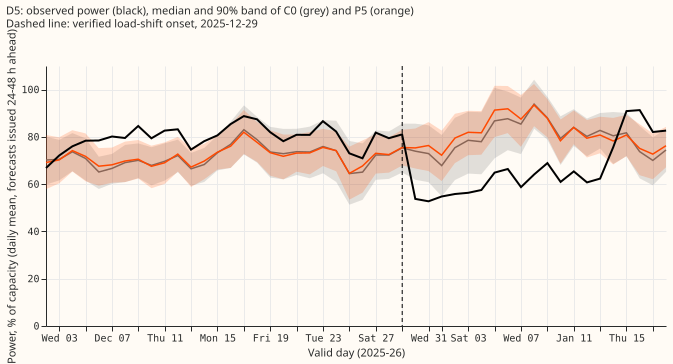
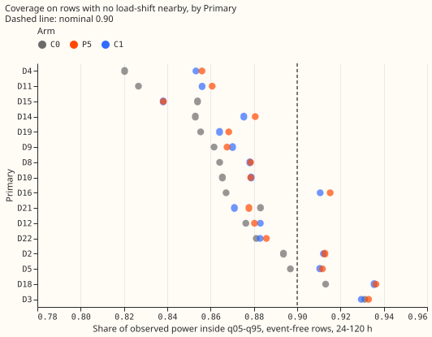
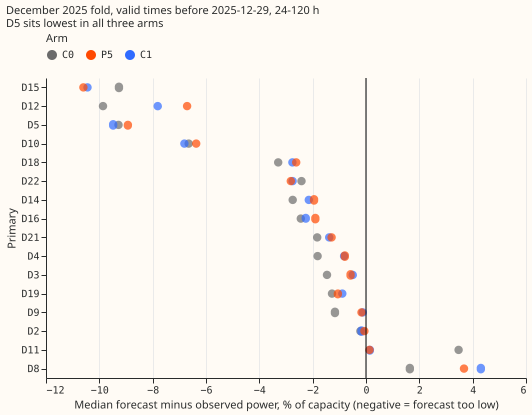

**The P5 forecast does not under-cover in general, and its poor coverage at Primary D5 before the
December 2025 load-shift is a level miss that all three forecasts share.** On rows with no
load-shift nearby, P5 puts the observed power inside its 90% band (the q05 to q95 range) on 0.884
of rows, against 0.869 for the earlier v3+D5 forecast (C0). At D5 in the week before the
load-shift, the median of every arm lies 8 to 9 points of capacity below the observed power, and
C0 covers more rows (0.83 against 0.51 for P5) only because its q95 is 3 to 4 points higher.

A row is one forecast half-hour for one Primary substation, issued 24 to 120 hours ahead. Experiment
[584](../00584-nra-candidate-pack-x6/result.md) found that P5 (the embargoed three-step recipe of
experiment [574](../00574-part-d-primaries-only-modular-recipe-lag-encoder-offset-and-add-one-arms/result.md))
covered D5's power before the December 2025 event on 0.43 to 0.51 of rows, against 0.83 for C0 (the
v3+D5 forecast of experiment
[572](../00572-two-offset-part-1-lags-versus-the-slow-output-offset/result.md)). We asked whether
that is a one-Primary effect, a property of P5, or noise. We tabulated the stored forecasts of C0,
P5, and C1 (P5 plus synthetic load-shifts, experiment 584) by Primary and month, and then looked at
D5 in the December fold. No fit was run.

Verdict: **supported**, as a statement that P5 is not under-covered in general and that D5's
December miss is shared by all arms. All numbers come from the five fold months with refits on days
0 and 14, and nothing here is adopted for production.

## Figures

Observed power at D5 (black) rose above both forecasts from early December. The shaded bands are
each arm's daily mean q05 to q95.

Each dot is one arm at one Primary. D5 (event-free rows only) is in the middle of the range.

In the December fold before 2025-12-29, D5 has the largest negative bias in all three arms.

## Results

- **Row set:** `experiment_470_intersection_v1`, five fold months (2025-10, 2025-12, 2026-01,
  2026-03, 2026-06), 24-120 h, July 2026 unused, D15 and D18 cut before 2025-03-01, cleaned data,
  seeds 0 and 1 averaged, coarse refits (days 0 and 14). Event-free rows: 367,725 at 24-120 h across
  16 Primaries (no labelled or verified event within 7 days of the valid time).
- **Stage 1, event-free coverage** (pooled; paired difference from C0 with a 95% month-block
  interval over 5 months; descriptive, no test):

| Group | C0 | P5 | C1 | P5 minus C0 |
|---|---|---|---|---|
| All 16 Primaries | 0.869 | 0.884 | 0.882 | +0.014 (+0.007 to +0.021) |
| Eight MVA Primaries | 0.875 | 0.886 | 0.883 | +0.011 (-0.001 to +0.022) |
| Six MW Primaries | 0.859 | 0.882 | 0.880 | +0.024 (+0.009 to +0.039) |
| D15 and D18 | 0.879 | 0.880 | 0.879 | +0.001 (-0.029 to +0.022) |

- **No Primary-month cell** (76 cells) has P5 more than 0.15 below C0. Per fold month, P5's
  coverage is 0.854 to 0.909 and C0's is 0.837 to 0.890. By lead band, P5 covers 0.888 (0-24 h) and
  0.884 (24-120 h), against 0.879 and 0.869 for C0.
- **Stage 2, D5 in the 2025-12 fold** (24-120 h, observed power, valid-time phases around the
  verified onset of 2025-12-29; share inside q05-q95 / share above q95 / median minus observed, in
  points of capacity):

| Phase | n rows | C0 | P5 | C1 |
|---|---|---|---|---|
| Earlier in December | 3,488 | 0.35 / 0.65 / -9.8 | 0.32 / 0.68 / -9.3 | 0.31 / 0.69 / -9.8 |
| 7 days before onset | 1,344 | 0.83 / 0.17 / -7.8 | 0.51 / 0.49 / -7.9 | 0.43 / 0.57 / -8.8 |
| During the event | 1,120 | 0.27 / 0.00 / +14.0 | 0.19 / 0.02 / +17.2 | 0.17 / 0.04 / +16.5 |

- **The median is below the observed power** on 0.93 to 0.95 of the rows in the week before onset, for
  every arm. The mean q05-q95 width in that week is 23.7 points for C0 and 18.5 for P5.

- **Not a D5-only bias in kind, but D5 in degree:** in the December fold before the onset, D5's
  median minus observed power is -8.9 (P5), D15's is -10.6, D12's is -6.7, and D10's is -6.4, so
  other Primaries show the same sign. D5 is the only Primary with P5 coverage below 0.70 in that
  window (0.37 for P5, 0.48 for C0, 0.34 for C1; the next lowest is D12 at 0.75 for P5).
- **D5's level rose before the event.** Its daily mean observed power rose from about 65% of
  capacity in early November to about 80% from the start of December, 19 days before the onset.
  That rise coincides with the days the gate was on in experiment 584. The data alone cannot say
  whether it was weather-driven demand or an earlier unflagged shift; all three forecasts, and the
  lags-masked twin of each, stayed near 70%.
- **Predictions:**
    - **P1 holds:** P5 and C1 are not below C0 on event-free rows at any group (paired differences
      +0.001 to +0.024), and D5's own event-free coverage is 0.912 (P5) against 0.897 (C0).
    - **P2 holds:** the median of P5 is below the observed power on 0.93 of the rows in the week
      before onset (at least 0.70 predicted), and 0.49 of the observed power lies above q95 (at
      least 0.40 predicted).
    - **P3 not run:** stage 3 (a 1 day embargo) was to run only if the cause pointed at the embargo
      or the schedule. It does not: the lags-masked twin and C0, which does not use the embargoed
      schedule, show the same bias.
- **Bonferroni count:** 0 tests were run (the planned count of 2 belonged to stage 3). Every number
  above is descriptive.
- **Not computed:** the avoidable-curtailment cost, tail pinball loss beyond the q05-q95 band, and a
  14-day horizon plot (stored forecasts cover 0 to 120 hours only, so every number is a short-lead
  result; NGED care about 1 to 10 days).

## Checks

- **Median forecast minus observed power, event-free rows, 24-120 h, % of capacity** (pooled by
  group, C0 / P5 / C1): eight MVA Primaries -1.42 / -0.98 / -1.03; six MW Primaries -0.86 / -0.82 /
  -0.92; D15 and D18 -5.72 / -8.47 / -8.25. Only quantiles are stored, so the mean forecast is not
  stored.
- **Mean-forecast error beside the contrasts:** not stored, so the contrasts are coverage shares
  only, and no quantile-score contrast was run.
- **Triggers fired:** none. Trigger 2 (a result that contradicts an earlier experiment) was
  considered: this page explains experiment 584's D5 finding and does not contradict it.
- **Reviews:** a fresh Sonnet review of the table script before the numbers were quoted found no
  error in the join, the quantile map, the masks, or the phase definitions. Its findings on the
  bootstrap (unpaired intervals, a shared random generator, no check on the five months) were
  accepted and fixed; its note that the event-free mask differs from experiment 583's (valid-time
  padding only, no origin-day hold) is stated here.

## Caveats

- **One verified event at one Primary:** the D5 analysis is a single case study, and the verdict on
  "one Primary or P5" rests on one fold month for the phase table.
- **Unlogged events:** NGED's logs may miss load-shift events, so the event-free rows may hold
  events no label covers, and the "before" window at D5 may too.
- **Cause of the level rise unknown:** the weather columns and the thermal-lag inputs were not
  inspected row by row. The rise of D5's level in December may be weather or an unflagged shift.
- **P5 against C0 widths:** the narrower P5 band at D5 (18.5 against 23.7 points) was not traced to
  its source (the embargo, the offset, or the fine-tune).

## What the next experiment should answer

Whether D5's December level rise came from the weather or from an earlier unflagged load-shift,
using the weather inputs and the neighbouring Primaries' power over the same weeks.
