**Putting the synthetic load-shift in the training targets as well raises coverage after a
load-shift ends from 0.86 to 0.90, but the neural network gets there by widening its band and by
following shifts in its lag inputs about twice as much while the event lasts (1.6 times as much
after it ends).** A placebo that adds random noise to the
lags, with no shift, covers 0.88 on its own. On the injected bank, all of the gain of fine-tuning on
perturbed lags over a neural network fine-tuned on clean lags (0.78) therefore comes from the
perturbation and not from the shifts. The effect on the verified December pair is too small to read.

A row is one forecast half-hour for one primary substation (a Primary), 24 to 120 hours ahead. The
eight MVA Primaries are metered in MVA only, and the six MW Primaries in signed MW. A load-shift
moves part of one Primary's demand onto another, so the recent power readings (the lag inputs) no
longer show the normal running arrangement (NRA), the power the Primary would have drawn without the
load-shift. The follow ratio is the change in the median forecast caused by a shift in the lags,
divided by the size of the shift; 0 means the median ignores the shift. CRPS is the continuous
ranked probability score. [Experiment
584](../00584-nra-candidate-pack-x6/result.md) fine-tunes a neural-network forecast on lag inputs
that carry synthetic load-shifts while the targets stay clean (arm T0 here). A real load-shift also
moves the target. We repeated the fine-tune with the same synthetic load-shifts also applied to the
targets (T1), to half of the shifted time (T2), and replaced by random noise (T3), and scored each
on
the 1,248 injected lag-only load-shifts (960 of 15 and 30 days, which are 672 Primary-events in the
table below) of [experiment
581](../00581-robust-multiweek-lag-encoder-x3/result.md). Verdict: **partly supported**. Nothing
here
is adopted for production.

## Figures

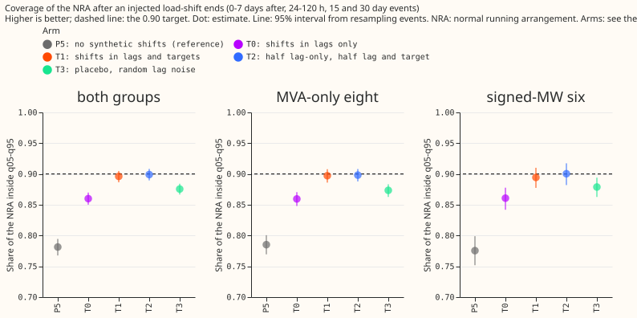

Coverage of the NRA after the end; T1, T2, and T3 sit above T0 and P5.

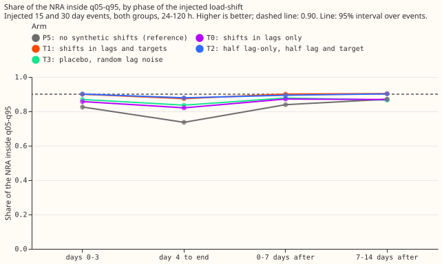

Coverage by phase; the arms differ most from day 4 of the event to its end.

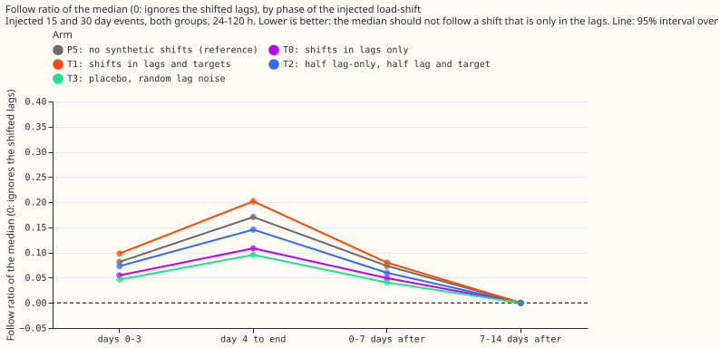

Follow ratio by phase; T1 follows the lags most and T3 least.

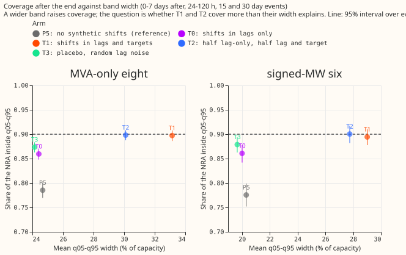

Coverage against band width; T1 and T2 sit to the right of T0 as well as above it.

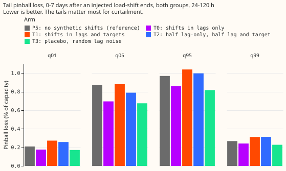

Tail pinball loss after the end; T1 and T2 have the highest tail loss.

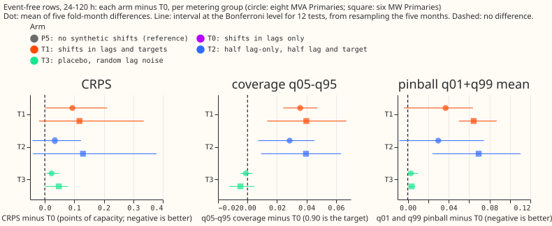

Event-free CRPS, coverage, and tail loss against T0; T1 and T2 over-cover and lose slightly on CRPS.

The next six figures are example forecasts. Day-ahead forecasts around four injected events (fixed
rule: month 2025-10, the lowest-numbered
Primary of each metering group, 15 days at 50% of capacity, up and down) and around the verified
December pair.

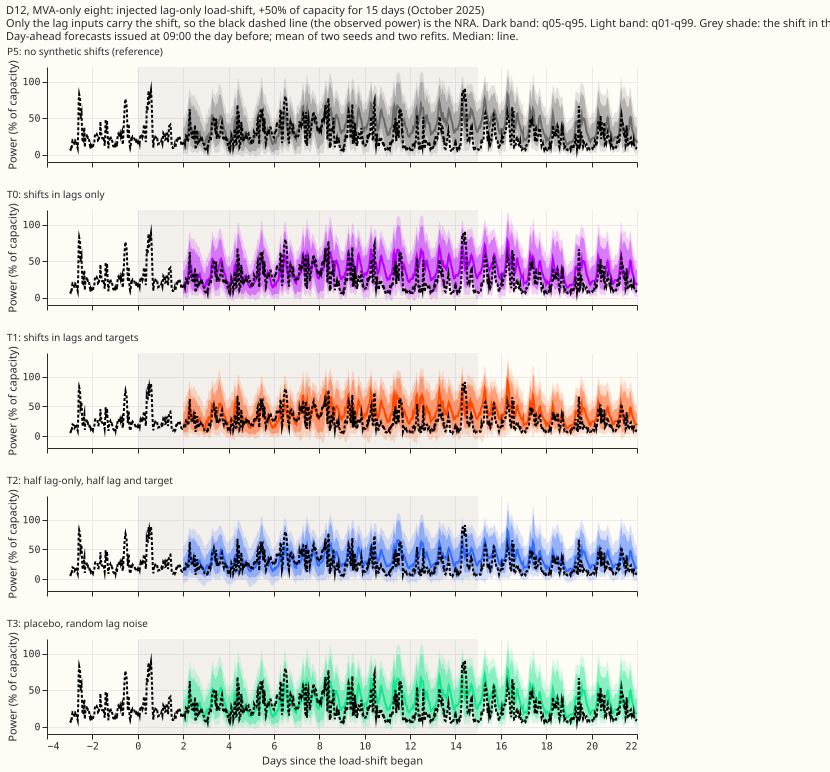

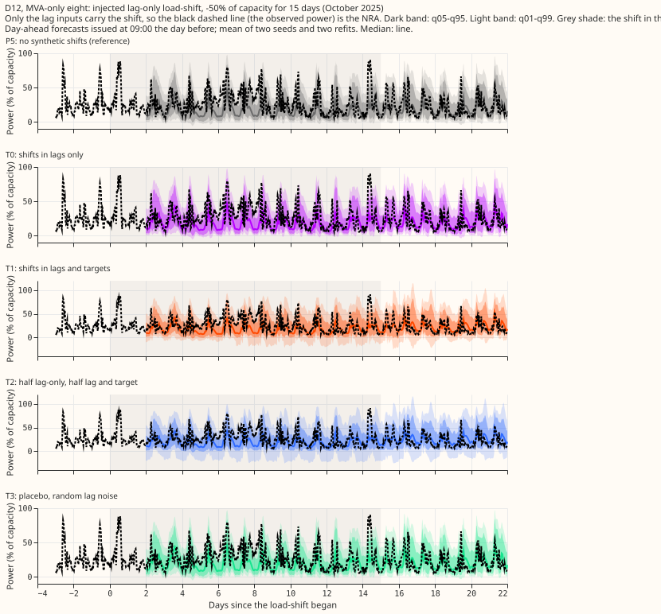

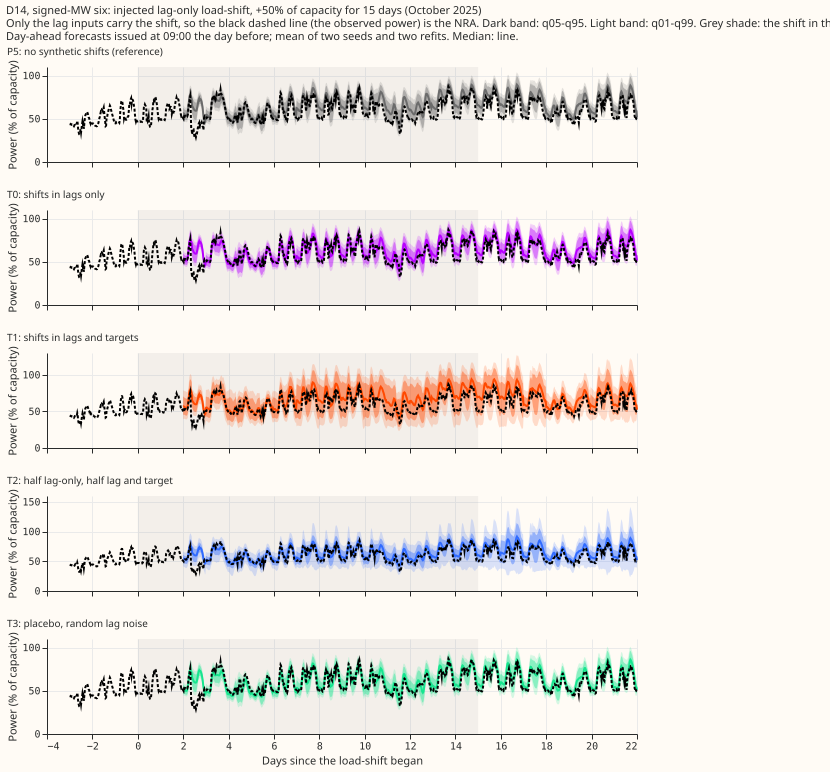

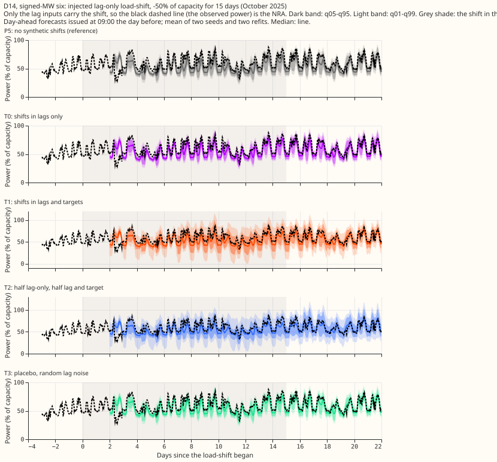

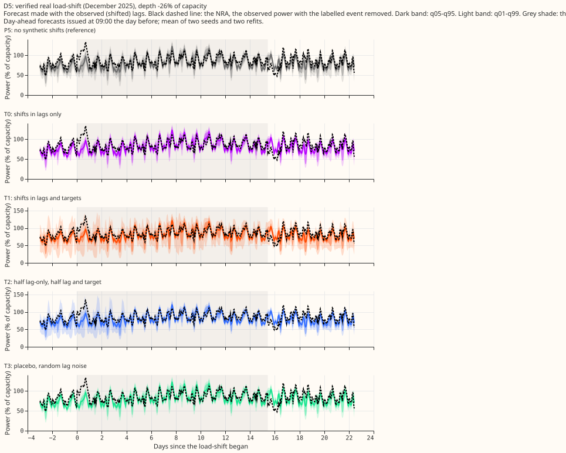

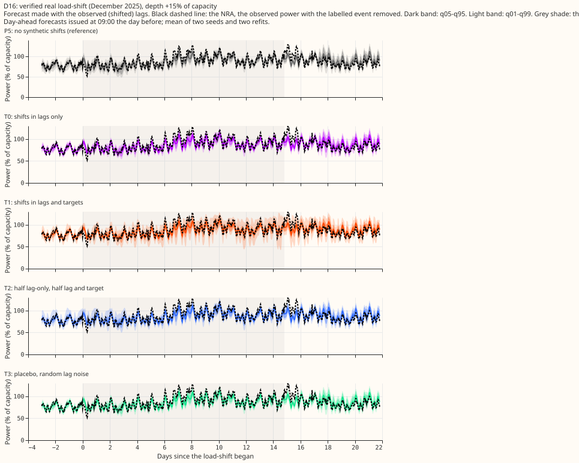

Stored forecasts cover 0 to 120 hours only, so no 14-day horizon plot exists. NGED care about 1 to
10
days, so every number here is a short-lead result.

## Arms

- **P5 (reference, not an arm of the question):** [experiment
574](../00574-part-d-primaries-only-modular-recipe-lag-encoder-offset-and-add-one-arms/result.md)'s
  P5 recipe fine-tuned on clean lags, forecasting the same injected bank.
- **T0 (control):** experiment 584's C1: the P5 recipe fine-tuned with lag-only synthetic
  load-shifts on 5% of each Primary's time (depths 15%, 30%, 50% of capacity; lengths 3, 7, 15, 30
  days; random sign). Stored forecasts and weights, not refitted.
- **T1:** the same schedule applied to the lags and to the targets of every row whose valid time
  lies
  inside an event.
- **T2:** lag-only shifts on 2.5% of the time and lag-and-target shifts on a further 2.5%. The
  lag-only set is a prefix of T0's event sequence.
- **T3 (placebo):** independent Gaussian noise on the lags, one draw per Primary and half-hour, with
  the standard deviation of the T0 shift schedule at that Primary. The targets stay clean. The noise
  has the variance of the shifts and not their persistence.
- All arms: 20 fine-tunes each (five fold months, refits on days 0 and 14, seeds 0 and 1); step-2
  weights (the second of the three fine-tuning steps) and the B1 standardisation statistics are
  experiment 574's. The target moments stay those of the clean power.

## Results

- **Row set:** `experiment_470_intersection_v1`, five fold months (2025-10, 2025-12, 2026-01,
  2026-03, 2026-06), 24 to 120 h, July 2026 unused, D15 and D18 cut before 2025-03-01, cleaned data.
  Coarse refits (days 0 and 14); the contrast could depend on the cadence. Counted contrasts: 12.
- **Coverage after the end** (injected 15 and 30 day events, 672 Primary-events, 0 to 7 days after,
  q05-q95, 95% event interval):

| Arm | Both groups | Eight MVA Primaries | Six MW Primaries | Mean width, % of capacity |
|---|---|---|---|---|
| P5 | 0.781 (0.768 to 0.795) | 0.785 | 0.775 | 22.96 |
| T0 | 0.860 (0.850 to 0.870) | 0.859 | 0.861 | 22.69 |
| T1 | 0.896 (0.887 to 0.905) | 0.897 | 0.894 | 31.52 |
| T2 | 0.899 (0.890 to 0.908) | 0.898 | 0.900 | 29.18 |
| T3 | 0.876 (0.867 to 0.884) | 0.877 | 0.873 | 22.38 |

- **Paired contrasts against T0, all 960 events of 15 and 30 days (a different weighting from the
  table above), 0 to 7 days after the end, Bonferroni level of 12** (difference, with the half-width
  of its interval as the minimum detectable effect): coverage T1 +0.029 (0.007), T2 +0.022 (0.006),
  T3 +0.006 (0.003); median follow ratio T1 +0.031 (0.004), T2 +0.011 (0.002), T3 -0.009 (0.001),
  where lower is better. T1 and T2 therefore beat T0 on coverage and lose on following. Plain P5
  covers 0.033 fewer rows than T0 and follows 0.024 more (descriptive).
- **Following by phase, both groups** (median follow ratio; 0 means the median ignores the lag
  shift): days 0-3 T0 0.055, T1 0.098, T2 0.073, T3 0.046; day 4 to the end T0 0.108, T1 0.202, T2
  0.146, T3 0.095; 0-7 days after T0 0.049, T1 0.080, T2 0.060, T3 0.041; 7-14 days after, 0.000 for
  every arm. The 7 days before the event and the first days of the month have no scored origins.
- **Coverage by phase, both groups** (follow table, 960 events): day 4 to the end T0 0.821, T1
  0.874,
  T2 0.879, T3 0.836; 7-14 days after T0 0.869, T1 0.903, T2 0.902, T3 0.866.
- **Tails, 0 to 7 days after the end, both groups** (mean pinball loss, % of capacity; lower is
  better):

| Arm | q01 | q05 | q95 | q99 |
|---|---|---|---|---|
| P5 | 0.209 | 0.869 | 0.969 | 0.268 |
| T0 | 0.175 | 0.695 | 0.858 | 0.241 |
| T1 | 0.272 | 0.880 | 1.039 | 0.311 |
| T2 | 0.258 | 0.789 | 0.997 | 0.313 |
| T3 | 0.172 | 0.675 | 0.817 | 0.228 |

- **Safe side of q05 or q95** (share of the NRA at or above q05 for an upward shift, or at or below
  q95 for a downward shift; nominal 0.95): P5 0.793, T0 0.876, T1 0.902, T2 0.907, T3 0.895.
- **Event-free rows, 24 to 120 h** (578,209 rows at 16 Primaries; each arm minus T0, month-block
  bootstrap at the Bonferroni level of 12, points of capacity; minimum detectable effect in
  brackets). CRPS (2 × the mean pinball loss over the 11 stored quantile levels): eight MVA
  Primaries T1 +0.094 (0.105), T2 +0.034 (0.080), T3 +0.023 (0.022); six MW Primaries T1 +0.118
  (0.195), T2 +0.129 (0.209), T3 +0.047 (0.037). Absolute CRPS (eight MVA, six MW): T0 3.081 and
  2.465, T1 3.178 and 2.572. Coverage of q05-q95: eight MVA T0 0.883, T1 0.919, T2 0.912, T3 0.882;
  six MW T0 0.880, T1 0.921, T2 0.921, T3 0.876. Mean q05-q95 width: eight MVA T0 21.6, T1 25.0, T2
  24.1; six MW T0 17.5, T1 20.6, T2 21.2.
- **Verified December pair, 0 to 7 days after the end, 24 to 120 h** (descriptive; one transfer,
  two Primaries): D16 P5 0.775, T0 0.824, T1 0.799, T2 0.816, T3 0.830; D5 P5 0.292, T0 0.369, T1
  0.441, T2 0.284, T3 0.382. D5 before the event: P5 0.505, T0 0.428, T1 0.798, T2 0.608, T3 0.322.
  The arms differ by less than the spread between the two Primaries (0.284 to 0.441 at D5 against
  0.799 to 0.830 at D16 for the four arms).
- **Predictions:** P1 fails on both halves: T1 follows 0.031 more than T0 (predicted at least 0.05)
  and covers 0.029 more rows (predicted at least 0.03 fewer). P2 holds on following (T2 follows
  0.060, between T0's 0.049 and T1's 0.080) and on the 0.82 floor, but not on coverage: T2 covers
  0.899, above T1's 0.896, in the 672-event table, and 0.894 against T1's 0.901 in the paired
  contrast, so the order of T1 and T2 depends on the weighting and the two are indistinguishable.
  P3 fails (T3 covers 0.016 more than T0 in the 672-event table and 0.006 more in the paired
  contrast, not 0.03 fewer). P4 holds for T1 and T2 (within the minimum detectable effects) and
  fails for T3: +0.023 against 0.022 at the eight MVA Primaries and +0.047 against 0.037 at the six
  MW Primaries, with intervals excluding zero. P5 is not tested. The verdict "partly supported"
  rests on P2 (following) and P4 holding for T1 and T2, and P1 and P3 failing.
- **Not computed:** experiment 587's absorption measure for T0 and T1 (it needs experiment 587's
  refit on shifted training power run on top of the synthetic fine-tune, which was judged more work
  than the main question needs); the avoidable-curtailment cost (needs node-level forecasts with
  generators); a
  width-matched control for T1 and T2; BG2, `manual_heuristic`, and climatology rows; weekly refits.

## Checks

- **Median minus mean forecast, and the error of the median:** not computed; only the 11 quantiles
  are stored, so the mean forecast is not stored.
- **Triggers fired:** the placebo T3 matching the treatment T0 (P3 failed) is a surprise, which
  fires
  the audit rule for an unexpected result. The explanation tested here is the plain-P5 reference
  (0.781): perturbing the lags in fine-tuning accounts for the gain, and a constant shift adds 0.006
  beyond noise in the paired contrast. No other trigger fired. Leaving one Primary out was not run.
- **Reviews:** a fresh Sonnet agent reviewed the fit wrapper before the first fit: no leakage, and
  it
  traced that patching the target after the rows are built reaches every fine-tune row, including
  the
  early-stopping rows. It suggested running the schedule check for every arm and storing each arm's
  schedule description; both were applied. A fresh Sonnet agent re-derived the headline numbers (see
  the PR body). A prose review of this page follows.

## Caveats

- **Only one verified transfer pair is in the fold months**, so every real-event number is
  descriptive.
- **Injected events** add a constant shift to the lag inputs only, so the injected bank rewards a
  network that ignores the lags. It penalises T1 and T2 for following lag shifts that, for a real
  load-shift, would be correct. The real December pair does not settle which view is right.
- **Width is not controlled:** T1 and T2 cover more partly because their bands are wider, on event
  rows and on event-free rows. No width-matched control was run.
- **T3's noise** is independent per half-hour. A persistent placebo (for example a random shift of
  zero mean) is not tested.
- **T1 uses the same event schedule as T0**, so the two arms differ in the targets; the T0 fits were
  not rerun.
- **Unlogged events:** NGED's logs may miss load-shift events, so clean rows may hold events no
  label
  covers, the event-free results are optimistic, and the real-event slices undercount.
- **Horizon:** stored forecasts cover 0 to 120 h; NGED care about 1 to 10 days.

## What the next experiment should answer

Whether the coverage gain of T0 over plain P5 survives a width-matched control for the placebo and
the shifts, and whether a placebo with persistent zero-mean shifts, which has the persistence of the
shifts but not their offset, performs as well as T0.

Scripts: `ml-experiments/00590-synthetic-load-shifts-in-the-training-targets/` (`e00590_arm.py`
wraps
experiment 574's fit as experiment 584 did; `e00590_score.py` wraps experiment 584's scoring;
`e00590_follow.py` computes follow ratios with experiment 581's code; `e00590_report.py` prints
every
table above; `e00590_figures.py` draws the figures). Code reused from experiments 572, 574, 578,
580, 581, 582, 583, and 584. Fitted weights (`.pt`) and tables are in
`data/ml-experiments/00590-synthetic-load-shifts-in-the-training-targets/` (private); the T1, T2,
and
T3 weights are under `t1`, `t2`, and `t3` in `work/models/P5`.
