**Asking a shared lag encoder to predict the depth of each injected load-shift did not help: the
forecast follows the shift as much as before and covers the normal running arrangement (NRA) on no
more rows after the shift ends.** Only the sharing helped. One encoder shared by the day-old and
week-old lags raised the share of rows whose NRA lies inside the q05-q95 band from 0.860 to 0.885 in
the week after an injected 15 or 30 day load-shift, at the same event-free forecast error.

A load-shift moves part of one primary substation's demand onto another, so recent power readings
no longer show the NRA, the power the substation would have drawn without the load-shift. A row is
one forecast half-hour for one primary substation (a Primary), 24 to 120 hours ahead. The forecast
is the neural network of [experiment
584](../00584-nra-candidate-pack-x6/result.md) (the P5 recipe, with the lag inputs carrying
synthetic load-shifts during training). We gave its lag encoder shared weights, so that one encoder
reads one lag at a time, and added a head that predicts, from the encoder's output, the signed depth
of the synthetic load-shift in that lag as a share of capacity. We scored five arms on the injected
bank of 1,248 Primary-events (a constant shift added to the lag inputs only) and on the verified
December pair of real load-shifts.

Verdict: **not supported**. Nothing here is adopted for production. All numbers come from the five
fold months, with refits on days 0 and 14, seeds 0 and 1 averaged.

## Figures

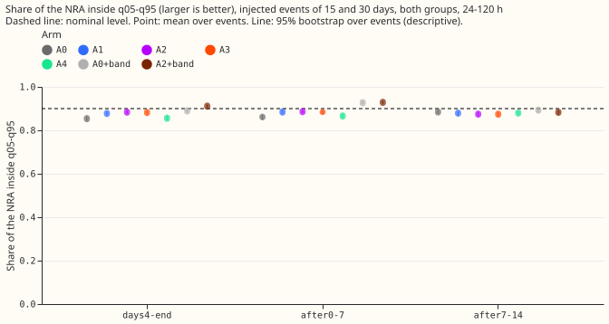

Coverage of the NRA by phase around an injected load-shift. Each point is one arm (A0 is experiment
584's C1; "+band" adds the gated wider band of experiment 583). The dashed line is the nominal 0.90.
Lines are 95% event-block bootstrap intervals.

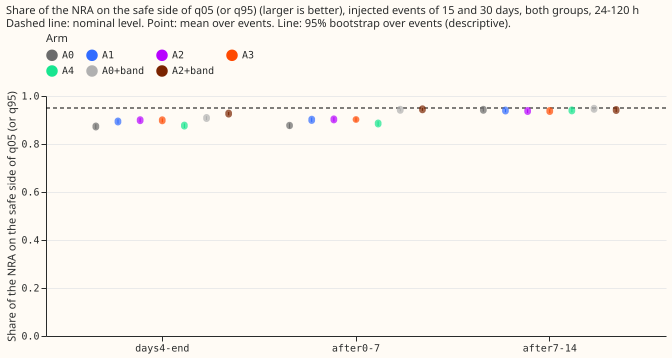

The one-sided share of the NRA that is on the safe side of the nearer tail quantile; nominal 0.95.

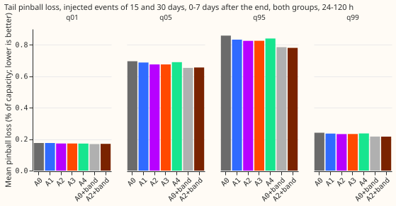

Mean pinball loss (the penalty for a quantile forecast; lower is better) in the 0 to 7 days after an
injected load-shift ends.

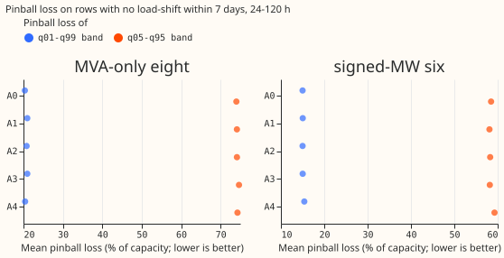

Pinball loss of the q05-q95 and q01-q99 bands on rows with no load-shift within 7 days.

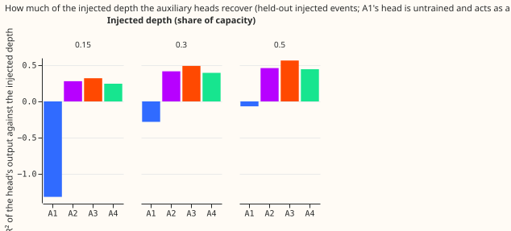

How much of the variance of the injected depth each head recovers on held-out injected events. A1's
head is never trained, so its bar is a floor and is not shown.

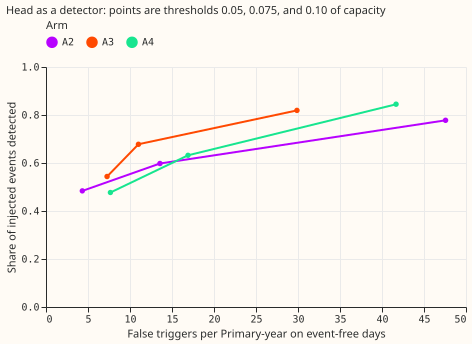

Share of injected events detected against false triggers per Primary-year on event-free days, for
three thresholds on the head's output (0.05, 0.075, and 0.10 of capacity).

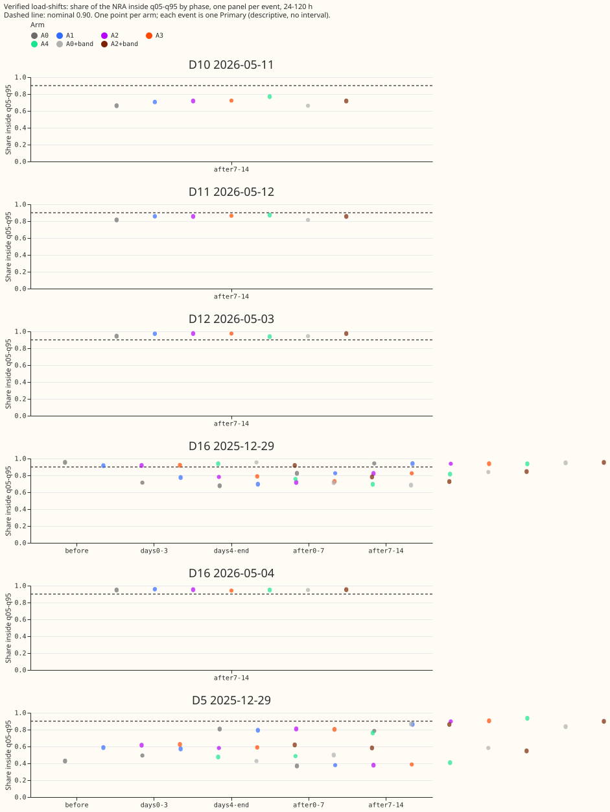

Coverage by phase for the two real December load-shifts (D5 and D16).

Day-ahead forecasts (issued 09:00 the day before the valid day) around the verified December pair.
Each of the five arms is one panel. The orange line is the observed power and the dashed line the
normal running arrangement. The gate strips are those of A2.

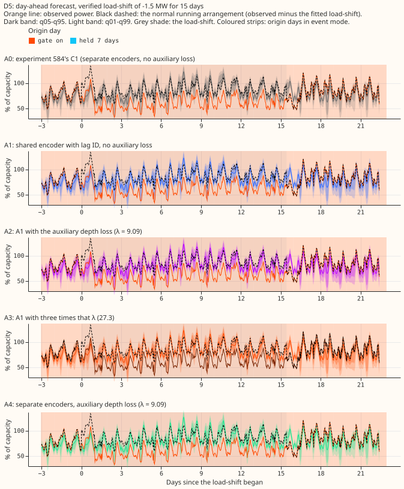

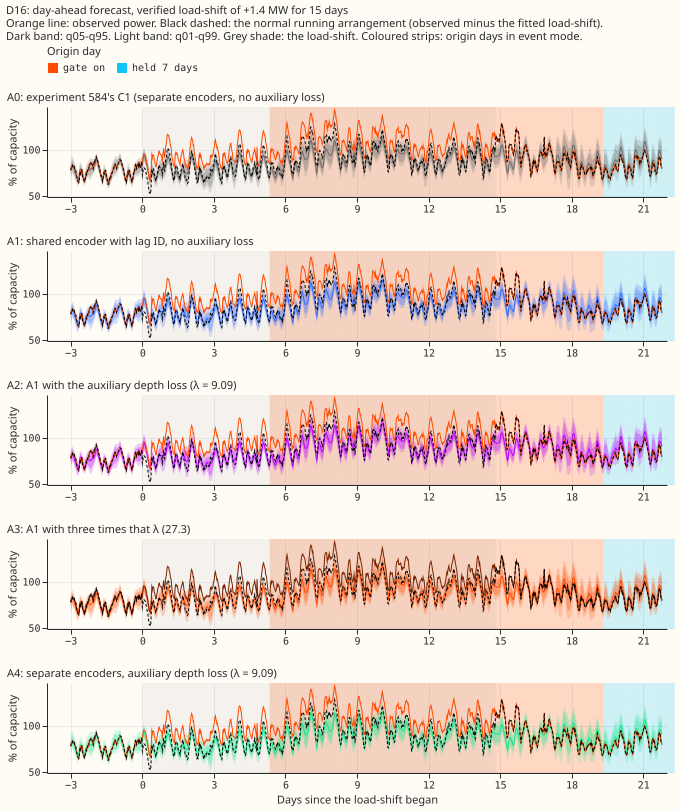

Day-ahead forecasts around six injected events (fixed rule: month 2025-10, the lowest-numbered
Primary of each metering group; 15 days at 50% of capacity up and down, and 7 days at 30% up).

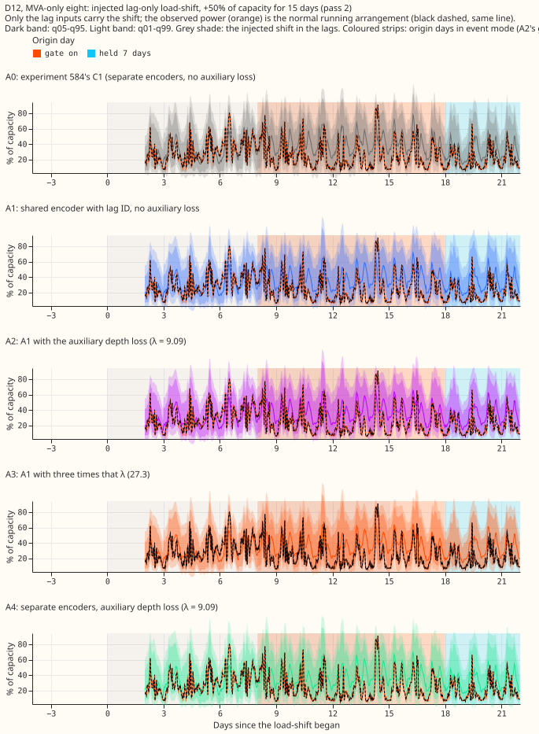

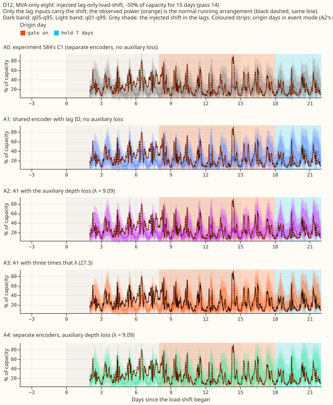

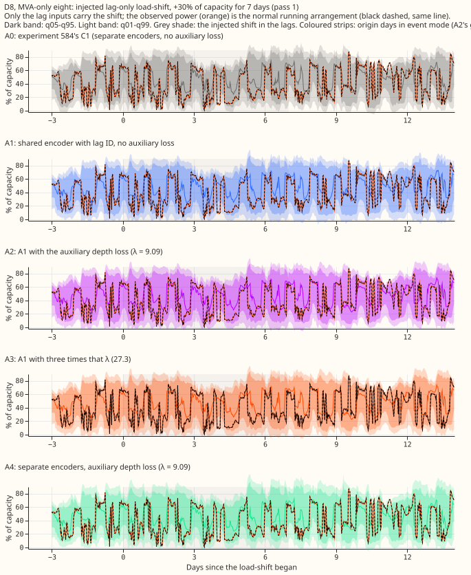

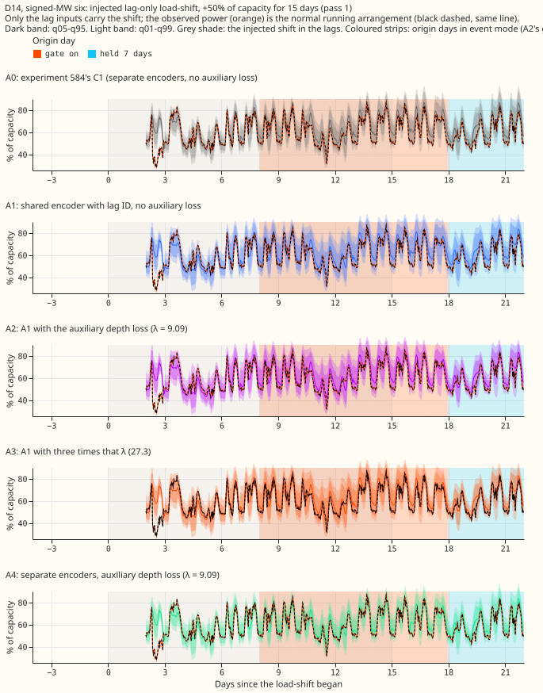

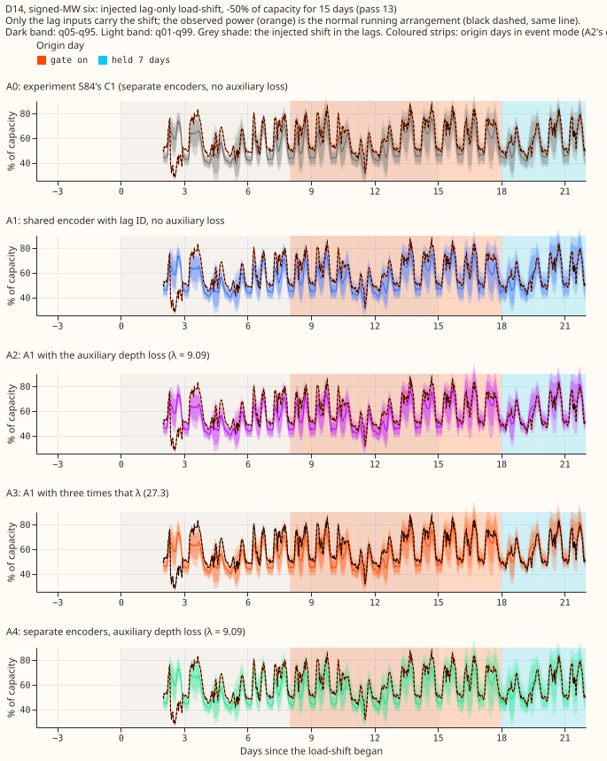

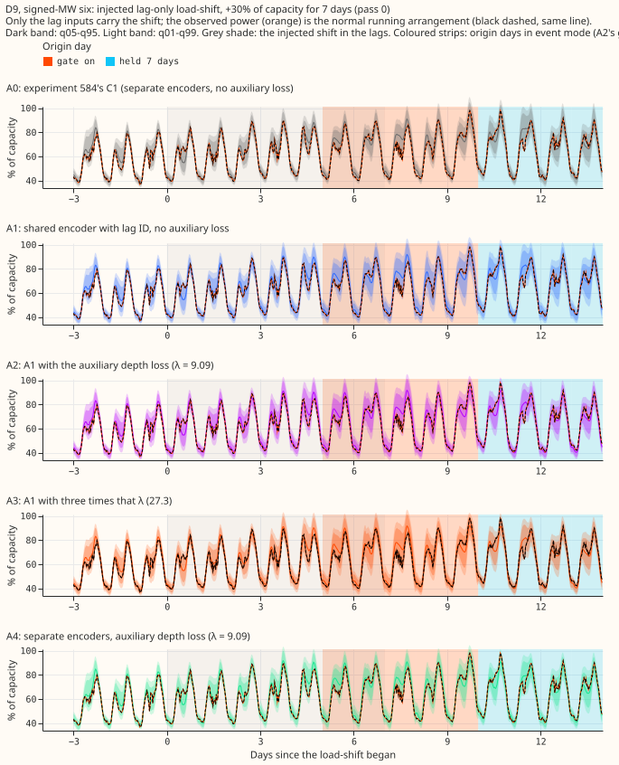

Other cuts (all lengths, one-sided shares, each group alone) sit beside this page as `coverage90_*`
and `nra_side95_*`. Stored forecasts cover 0 to 120 hours only, so no 14-day horizon plot exists;
NGED care about 1 to 10 days, so every number here is a short-lead result.

## Arms and what each one is

All arms use the P5 recipe of [experiment
574](../00574-part-d-primaries-only-modular-recipe-lag-encoder-offset-and-add-one-arms/result.md)
(pre-train on ERA5 and CAMS weather, fit a fresh mixer on the ensemble history with a 3-day embargo,
then a daily fine-tune with the embargo) and a daily fine-tune on lag-only synthetic load-shifts
(depths 15%, 30%, and 50% of capacity, lengths 3, 7, 15, and 30 days, random sign, on 5% of each
Primary's time) as in [experiment
581](../00581-robust-multiweek-lag-encoder-x3/result.md).

- **A0:** experiment 584's stored C1 forecasts. Separate encoders for the day-old and week-old lag,
  no auxiliary loss. 44,050 weights.
- **A1:** one shared lag encoder with a learnt lag-ID embedding, the wiring of [experiment
  586](../00586-lag-encoder-sharing-and-lag-id-embedding/result.md)'s S1. No auxiliary loss.
  45,475 weights, of which 1,089 sit in a head that is never trained and never used.
- **A2:** A1 plus the auxiliary loss, the mean squared error between the head's output and the
  injected depth, times lambda = 9.085. Lambda is the ratio of the mean gradient norm of the training
  loss to that of the auxiliary loss on the lag-encoder weights over 20 batches (2025-10, seed 0),
  so the two gradients are about the same size. The heads were untrained at that point, so the
  auxiliary gradient is larger once they have learnt, and lambda is therefore probably on the low
  side of equal. The auxiliary loss is off in validation and in early stopping.
- **A3:** A2 with 3 times lambda (27.26).
- **A4:** separate encoders plus the auxiliary loss at lambda = 9.085. 52,980 weights, 2,178 in the
  two heads.
- **A5 (A2 with the head's output fed to the mixer):** not run, because A2 and A3 did not help.
- At forecast time the head is dropped. The depth labels sit in two extra columns that exist only in
  the daily fine-tune's training tensor, and the model reads them in training mode only, so
  validation, test, and forecast rows carry no label.

## Results

- **Row set:** `experiment_470_intersection_v1`, five fold months (2025-10, 2025-12, 2026-01,
  2026-03, 2026-06), 24 to 120 h unless stated, July 2026 unused, D15 and D18 cut before 2025-03-01,
  cleaned data. Retraining: coarse refits (days 0 and 14); the contrasts could depend on the
  cadence.
- **Coverage after the end** (injected 15 and 30 day events, 672 Primary-events, 0 to 7 days after
  the end, q05-q95, 95% event bootstrap interval):

| Arm | Both groups | Eight MVA Primaries | Six MW Primaries | With the gated band | Mean width, % of capacity |
|---|---|---|---|---|---|
| A0 | 0.860 (0.849 to 0.870) | 0.859 | 0.861 | 0.927 | 22.69 |
| A1 | 0.885 (0.876 to 0.894) | 0.890 | 0.878 | 0.931 | 23.61 |
| A2 | 0.886 (0.877 to 0.894) | 0.890 | 0.880 | 0.929 | 23.44 |
| A3 | 0.884 (0.876 to 0.893) | 0.888 | 0.878 | 0.927 | 23.20 |
| A4 | 0.866 (0.856 to 0.875) | 0.868 | 0.862 | 0.921 | 22.45 |

- **From day 4 of the event to its end** (756 Primary-events), without and with the gated band: A0
  0.854 and 0.889, A1 0.878 and 0.907, A2 0.884 and 0.911, A3 0.882 and 0.910, A4 0.856 and 0.889.
  **Seven to 14 days after the end** (720 Primary-events): A0 0.885, A1 0.879, A2 0.875, A3 0.874, A4
  0.880.
- **Safe side of q05 or q95, 0 to 7 days after the end:** A0 0.876, A1 0.901, A2 0.903, A3 0.902, A4
  0.885; with the gated band 0.943, 0.946, 0.945, 0.944, and 0.940, against 0.95 nominal.
- **Following of the injected shift** (the change in the median forecast, as a share of the injected
  depth, [experiment 581](../00581-robust-multiweek-lag-encoder-x3/result.md)'s measure, 24 to 120 h):
  from day 4 to the end A0 0.108, A1 0.110, A2 0.110, A3 0.104, A4 0.105; days 0 to 3 0.042 to 0.047
  for all five; 0 to 7 days after the end 0.038 to 0.047. The median already follows the lags by only
  about a tenth of the depth in A0, so there was little to halve, and none of the arms halves it.
- **Tails, after the end, both groups** (mean pinball loss, % of capacity):

| Arm | q01 | q05 | q95 | q99 |
|---|---|---|---|---|
| A0 | 0.175 | 0.695 | 0.858 | 0.241 |
| A1 | 0.175 | 0.687 | 0.832 | 0.235 |
| A2 | 0.172 | 0.675 | 0.825 | 0.232 |
| A3 | 0.172 | 0.675 | 0.825 | 0.233 |
| A4 | 0.172 | 0.689 | 0.840 | 0.236 |

- **Event-free rows, 24 to 120 h** (578,209 rows at 16 Primaries): CRPS (estimated as 2 × the mean
  pinball loss over the 11 stored quantile levels), in points of capacity, at the eight MVA
  Primaries and the six MW Primaries: A0 3.081 and 2.465, A1 3.057 and 2.445, A2 3.059 and 2.455, A3
  3.074 and 2.451, A4 3.084 and 2.460. Contrasts, month-block bootstrap at the Bonferroni level of
  10 counted tests, difference (interval), minimum detectable effect (MDE):

| Contrast | Eight MVA Primaries | MDE | Six MW Primaries | MDE |
|---|---|---|---|---|
| A1 minus A0 | -0.026 (-0.092 to 0.023) | 0.058 | -0.023 (-0.076 to 0.041) | 0.059 |
| A2 minus A1 | +0.003 (-0.020 to 0.017) | 0.018 | +0.009 (-0.012 to 0.024) | 0.018 |
| A3 minus A1 | +0.018 (-0.014 to 0.065) | 0.039 | +0.006 (-0.016 to 0.037) | 0.026 |
| A3 minus A2 | +0.016 (-0.004 to 0.054) | 0.029 | -0.003 (-0.020 to 0.016) | 0.018 |
| A4 minus A2 | +0.026 (-0.052 to 0.081) | 0.066 | +0.008 (-0.056 to 0.103) | 0.079 |

  Every interval over all five folds contains zero. In the first fold pair alone (2025-10 and
  2025-12, two blocks, so the bootstrap is degenerate and not to be trusted), A2 minus A1 at the eight
  MVA Primaries is +0.012 (0.009 to 0.015) and A3 minus A1 +0.042 (0.010 to 0.074): the auxiliary
  loss is, if anything, slightly worse than A1 there. The stop rule (A1 worse than A0 by more than
  max(0.03, MDE) with the interval excluding zero in the first fold pair) did not fire.

- **Event-free calibration** (share of the NRA below each quantile; all arms alike): below q05 0.050
  to 0.054 at the eight MVA Primaries and 0.059 to 0.061 at the six MW Primaries; below q95 0.92 and
  0.88 to 0.89, against 0.95 nominal, so the upper tail is thin on event-free rows in every arm,
  A0 included.
- **Head recovery of the injected depth** (held-out injected events, both lags pooled; R squared of
  the head's output against the injected depth, positive when it recovers variance):

| Arm | All events | Depth 0.15 | Depth 0.30 | Depth 0.50 | Eight MVA | Six MW | Length 3 days | Length 30 days |
|---|---|---|---|---|---|---|---|---|
| A1 (never trained) | -0.20 | -1.32 | -0.28 | -0.07 | -0.16 | -0.25 | -0.74 | -0.11 |
| A2 | 0.44 | 0.28 | 0.42 | 0.46 | 0.46 | 0.49 | 0.40 | 0.44 |
| A3 | 0.53 | 0.32 | 0.49 | 0.56 | 0.55 | 0.60 | 0.49 | 0.53 |
| A4 | 0.42 | 0.25 | 0.39 | 0.44 | 0.43 | 0.47 | 0.32 | 0.43 |

- **The head as a detector** (an origin day fires when the head's score exceeds a threshold of 0.05,
  0.075, or 0.10 of capacity; 1,857 event-free Primary-days, about 5.1 Primary-years, so each false
  trigger rate rests on very few days): detection rate of injected events A2 0.78, 0.60, 0.48; A3
  0.82, 0.68, 0.54; A4 0.84, 0.63, 0.48. Detection of the deeper events (30% and 50%) with A3 is
  0.90, 0.81, 0.72. False triggers per Primary-year: A2 47.6, 13.6, 4.3; A3 29.9, 11.0, 7.3; A4
  41.7, 16.9, 7.7. At threshold 0.075 the mean median onset delay of 3 and 7 day events is 1.4 to 2.2
  days (shorter for deeper events). That is a slower, less selective detector than one reading the
  lags directly, and every number here is for injected shifts.
- **Verified December pair, 0 to 7 days after the end, 24 to 120 h** (descriptive; two Primaries),
  without and with the gated band:

| Event | A0 | A1 | A2 | A3 | A4 |
|---|---|---|---|---|---|
| D16, no band | 0.824 | 0.825 | 0.824 | 0.824 | 0.815 |
| D16, band | 0.840 | 0.844 | 0.845 | 0.844 | 0.839 |
| D5, no band | 0.369 | 0.379 | 0.379 | 0.387 | 0.408 |
| D5, band | 0.583 | 0.557 | 0.548 | 0.539 | 0.612 |

  Before the event D5 coverage is 0.428 for A0 and 0.587, 0.615, 0.624, and 0.475 for A1 to A4; D16
  from day 4 to the end is 0.677 for A0 and 0.696, 0.718, 0.728, and 0.694. The head's output on
  these real shifts is near zero: at D16 (verified depth +0.15 of capacity in the day-old lag) A2 reads
  0.034 and A3 0.043; at D5 (depth -0.26) A2 reads +0.028 and A3 +0.010. The heads did not recognise
  either real shift.

- **Predictions** (written before any fit):
    - **P1 fails:** following does not halve (0.104 to 0.110 from day 4 to the end, against 0.108 for
      A0), and after-end coverage without the band is 0.886 (A2) and 0.884 (A3), below 0.90.
    - **P2 holds:** A1's CRPS is within max(0.03, MDE) of A0's, and slightly lower.
    - **P3 fails:** R squared is 0.42 (A2) and 0.49 (A3) at depth 0.30, and 0.46 and 0.56 at depth
      0.50, against at least 0.7.
    - **P4 holds for CRPS and fails for coverage:** A4's CRPS is within max(0.03, MDE) of A2's, but
      its after-end coverage (0.866) is 0.020 below A2's (0.886).
- **Decision rule:** the auxiliary loss is not kept (following and after-end coverage unchanged from
  A1). The stop rule did not fire, so A2 and A3 were not run alone. Bonferroni count: 10 (12 with
  A5, which did not run).
- **Not computed:** the avoidable-curtailment cost (it needs node-level forecasts with generators);
  BG2, `manual_heuristic`, and climatology rows; weekly refits; A5; leaving one Primary out.

## Checks

- **Median forecast minus mean of the 11 stored quantiles, event-free rows, 24 to 120 h, % of
  capacity, per group** (eight MVA Primaries and six MW Primaries): A0 -0.51 and -0.22, A1 -0.45 and
  -0.19, A2 -0.47 and -0.18, A3 -0.46 and -0.17, A4 -0.51 and -0.18. Only quantiles are stored, so
  the mean forecast is not stored. The gap is small beside the 6.2 and 5.3 mean absolute error.
- **Error of the median beside the quantile contrasts** (mean absolute error of the median,
  event-free, % of capacity, eight MVA and six MW Primaries): A0 6.22 and 5.32, A1 6.14 and 5.24, A2
  6.16 and 5.27, A3 6.18 and 5.27, A4 6.21 and 5.25. It points the same way as the CRPS contrasts:
  A1 is lowest, and the auxiliary loss adds none of that gain.
- **Triggers fired:** trigger 2 (P1 fails). The explanation was tested above: the median follows the
  shifted lags only by about a tenth of the depth in A0 already, so the auxiliary loss had little to
  remove, and sharing alone moved the coverage. No other trigger fired; leaving one Primary out was
  not run.
- **Reviews:** a fresh Sonnet agent reviewed the fit wrapper before any fit. It found that the first
  pre-training run was overwriting experiment 574's stored B1 statistics files. They were
  bit-identical to the backup, so no harm was done; the run now writes to its own folder and a check
  asserts the stored files are unchanged. The review also reported lint and guard items, all fixed.

## Caveats

- **Only one verified transfer pair is in the fold months** (a load moved from D5 to D16 and back,
  December 2025), so every real-event number is descriptive.
- **Injected events** add a constant shift to the lag inputs only, so the head reads the injected
  lags and not a change in the power; the injected bank flatters any detector keyed on the lags.
- **Lambda was set with untrained heads.** Once the heads learn, the auxiliary gradient shrinks, so
  A2's effective weight may be below the intended equal-gradient setting; A3 (three times as large)
  bounds that and also found nothing.
- **The first-pair bootstrap has two blocks** and cannot be read as an interval.
- **Unlogged events:** NGED's logs may miss events, so the event-free rows may hold events no label
  covers. The false-trigger rates are then too high or too low in ways we cannot tell, and the
  real-event slices undercount.
- **Horizon:** stored forecasts cover 0 to 120 h; NGED care about 1 to 10 days.

## What the next experiment should answer

Whether a detector that reads the lags directly, instead of a head inside the forecast network, can
recognise the real December load-shifts and the longer-lead rows (days 5 to 10), where following may
matter more than at 24 to 120 h.

## Plain-language definitions

- **Coverage:** the share of half-hours at which the true NRA lies inside the stated band; a 90%
  band should contain it on 0.90 of rows.
- **One-sided share on the safe side:** the share of readings at or above q05 (or at or below q95);
  nominal 0.95.
- **Pinball loss at q05 (or q95, q01, q99):** the penalty for a quantile forecast, small when the
  quantile sits where the reading falls.
- **Auxiliary loss:** an extra training target that is not part of the forecast; its head is dropped
  when the forecast is made.
- **Following:** how much the median forecast moves with an injected shift, as a share of the depth
  of the shift.

Further definitions, with worked examples, are in [experiment 582's metrics
page](../00582-nra-tails-on-verified-load-shift-events/metrics-explained.md).
