**A gate that reads the freshest power turns the wider forecast band on about 5 days sooner. A rule
that a neighbouring Primary substation must show an opposite-sign gap keeps that gate's false
triggers low.** On injected 15 and 30 day load-shifts, the share of rows from day 4 of the
load-shift to its end that hold the normal running arrangement (NRA) inside the forecast's q05-q95
band rises from 0.889 to 0.913 with the best gate, G4. The same gate without the neighbour rule
reaches 0.915 but turns on falsely 2.6 times per Primary-year. The two verified December events do
not change under any gate. Verdict: partly supported. Predictions P1 to P3 and P5 held and P4 held
for G1 only (G2 lifted coverage by 0.014, more than the 0.01 predicted).

A load-shift is a period in which part of one Primary substation's demand is supplied through
another Primary, so recent power readings no longer show the NRA, the way the electricity network is
normally arranged to supply that Primary. The forecast widens its q05-q95 band (the range from the
5% to the 95% quantile) while a gate reports that a load-shift is in progress. A gate is a daily
rule that reads recent power. The gate in [experiment
584](../00584-nra-candidate-pack-x6/result.md), copied from [experiment
583](../00583-after-snap-back-event-band-on-x3-syn/result.md), reads day-old power and needs 3 days
of a gap, so it turns on a median 4 to 6 days after the load-shift begins. We asked whether a faster
gate, or a gate that reacts to the end of the load-shift, closes the gap to the 0.90 target. We
re-scored the stored experiment 584 forecasts under six gates, G0 to G5, defined below. We scored
them on injected load-shifts from [experiment
581](../00581-robust-multiweek-lag-encoder-x3/result.md) (synthetic load-shifts added to real power
readings, 1,680 Primary-events in the stored bank) and on the verified December pair of [experiment
580](../00580-verified-load-shift-event-set-and-label-audit/result.md) (events that experiment 580
confirmed from the operator's logs and the power data). Nothing is refitted and nothing is adopted
for production.

A false trigger is a forecast origin day on which a gate turns on although no load-shift is in
progress. A Primary-event is one load-shift at one Primary. A Primary-year is one Primary observed
for one year. A phase of a load-shift (before, days 0-3, day 4 to the end, 0-7 days after) is
assigned by the valid time of each forecast row. National Grid Electricity Distribution (NGED) is
the network operator that supplied the data.

## Gates

A lag is a past power value used as a forecast input. C1 is the forecast of experiment 584 that
reads lags at least a day old, and its lags-masked twin is the same forecast with every lag removed.
E2 is the forecast of [experiment 565](../00565-drift-embedding-variants-six-designs/result.md) that
never uses lags. All six gates share one threshold per Primary: the larger of 3 standard deviations
of the gap and 5% of capacity, taken on days with no load-shift.

- **G0** (control): experiment 583's gate. The gap is observed power minus the lags-masked forecast,
  averaged over a day, from data at least 24 h old. The gate turns on after 3 days above the
  threshold, and turns off when the gap falls below half the threshold.
- **G1, G2:** the same gate with a sustain of 2 days and of 1 day.
- **G3:** one reading per forecast origin: the mean of observed power minus the median of E2, over
  the 40 half-hours from the previous origin up to 4.0 h before this origin (forecasts are issued at
  09:00 coordinated universal time, with a first lead of 0.5 h). The gate turns on after one reading
  above the threshold, and turns off when a reading falls below half the threshold.
- **G4:** G3, turning on only if a metered electrical neighbour (from NGED's interconnection list)
  has a reading of the opposite sign above its own threshold on the same day.
- **G5:** G3, also turning off (a snap-back) when the reading changes sign or falls by more than 60%
  in one day.
- **The band under every gate** is experiment 584's C2: the wider of C1's band and its lags-masked
  twin's band while the gate is on and for 7 days after it turns off, and C1's own band elsewhere.

## Figures

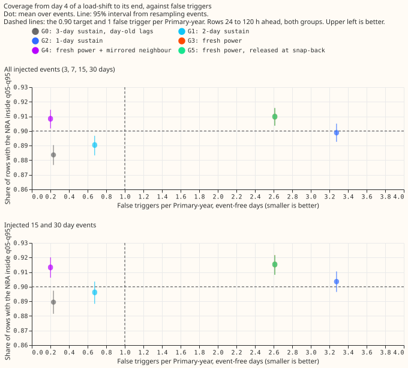

Each dot is one gate. Higher is better (more rows with the NRA inside the band) and further left is
better (fewer false triggers). G4 is the only gate above the 0.90 line and left of the 1 false
trigger line. G3 sits exactly under G5, which has identical coverage and false triggers, so only
G5's green dot shows.

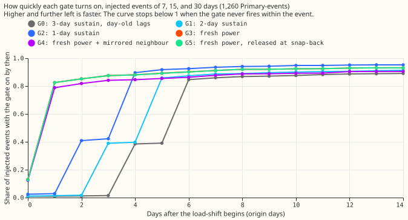

Each line is the share of injected events (7, 15, and 30 days) whose gate had turned on by that day
after the load-shift began. The fresh-power gates G3 to G5 turn on within 1 to 2 days, the day-old
gates G0 to G2 within 4 to 6 days.

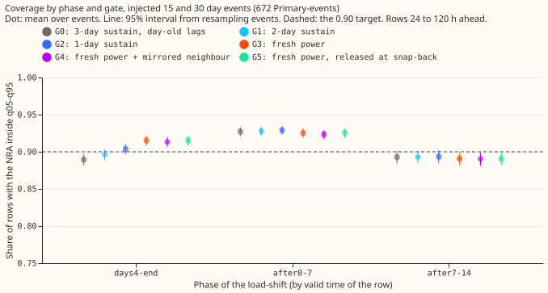

Each dot is the share of rows with the NRA inside the q05-q95 band in that phase. The dashed line is
the 0.90 target. The gates differ from day 4 to the end and are equal elsewhere.

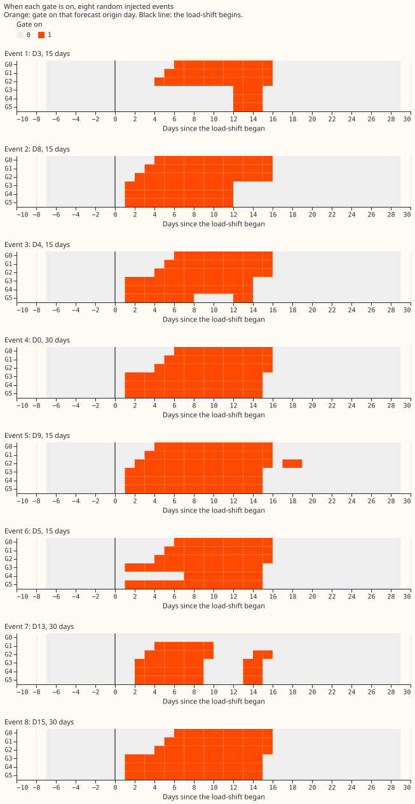

Orange marks the forecast origin days on which the gate is on, for eight injected events drawn at
random with a fixed seed. The black line is the day the load-shift begins. G3 and G5 sometimes turn
off before the event ends.

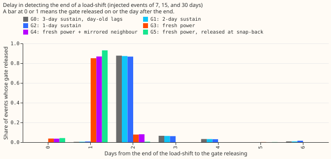

Each bar is the share of events whose gate turned off that many days after the load-shift ended.

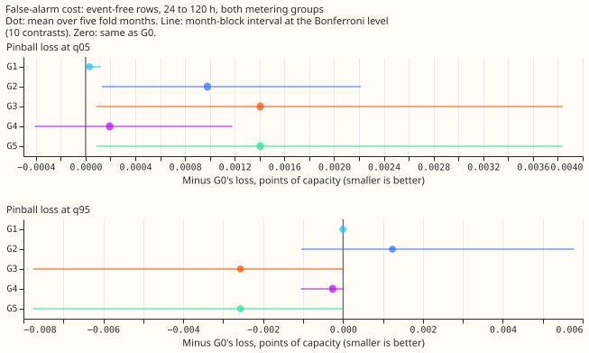

Extra pinball loss at q05 and q95 on days with no load-shift, each gate minus G0, with the
month-block interval. All intervals sit close to zero.

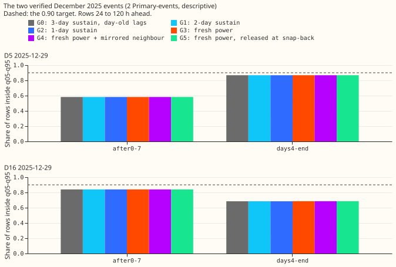

Share of rows inside the q05-q95 band for the two verified December 2025 events. The six gates give
the same bars, with one small exception for G4 on D5 in other phases (see the Results).

The next six charts show day-ahead forecasts (the forecast issued at 09:00 the day before, 24 to 48
h ahead) under C1 alone and under G0, G3, and G4. They stop at 120 h because the stored forecasts go
no further, so no 14-day horizon chart exists. NGED needs forecasts 1 to 10 days ahead.

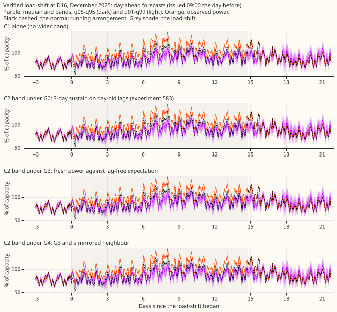

The verified load-shift at D16 in December 2025. The wider band under G3 and G4 starts earlier than
under G0.

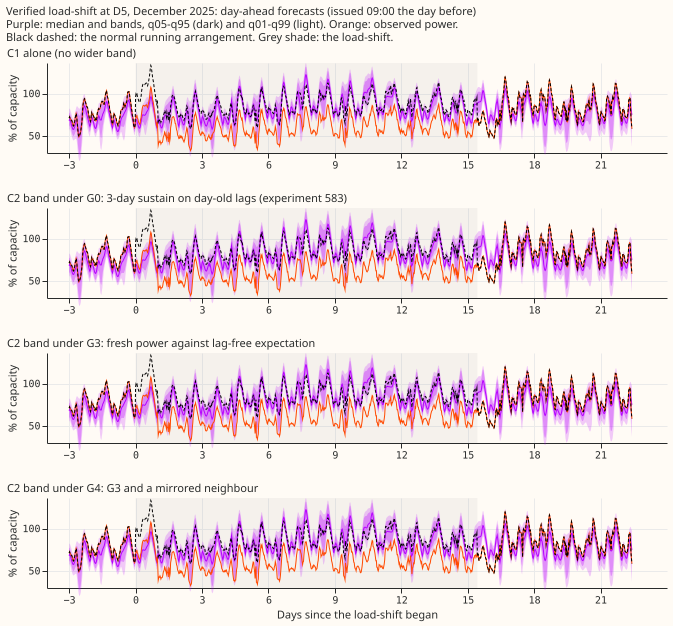

The verified load-shift at D5 in December 2025.

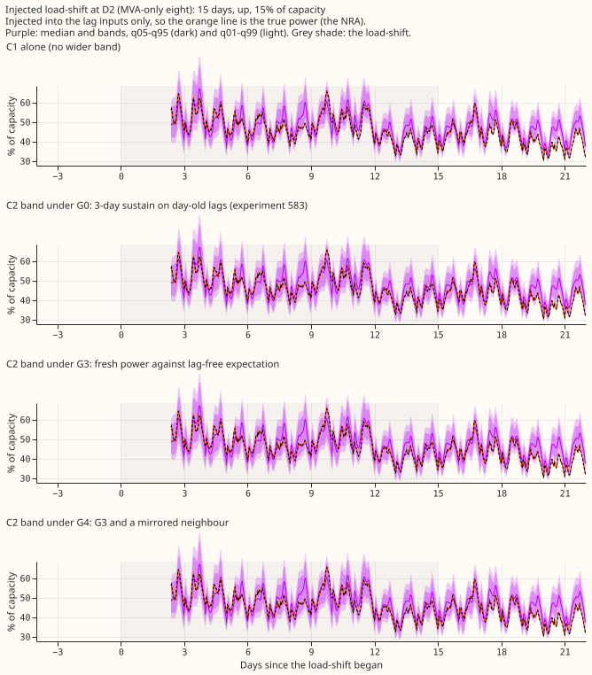

An injected load-shift. The orange line is the true power, and the title gives its Primary, length,
sign, and depth.

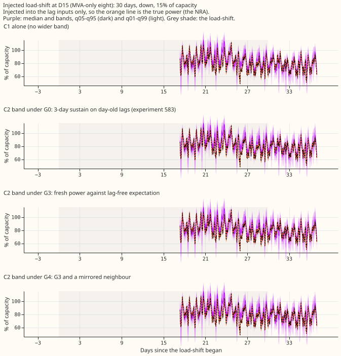

An injected load-shift; the title gives its length, sign, and depth.

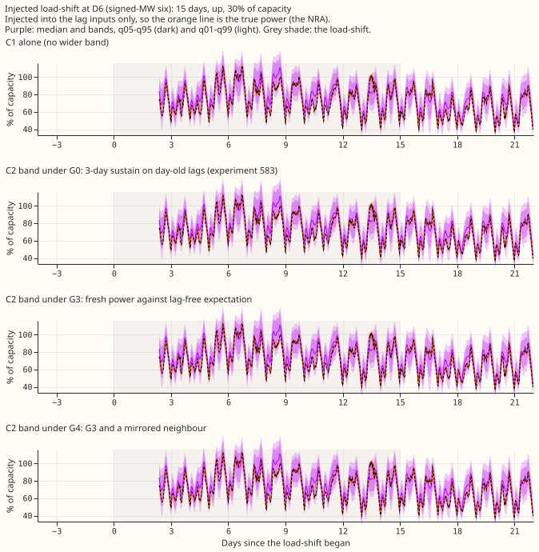

An injected load-shift; the title gives its Primary, length, sign, and depth.

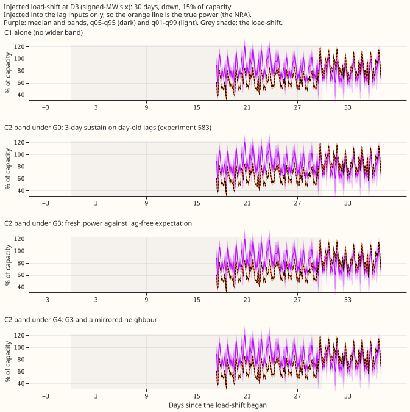

An injected load-shift; the title gives its Primary, length, sign, and depth.

## Results

- **Row set and recipe.** The rows are `experiment_470_intersection_v1`: five fold months (test
  months 2025-10, 2025-12, 2026-01, 2026-03, and 2026-06), forecasts 24 to 120 h ahead unless
  stated, July 2026 unused, cleaned data, and D15 and D18 (two Primaries with a short history) cut
  before 2025-03-01. Seeds 0 and 1 are averaged. The forecast weights were refitted on days 0 and 14
  of each month, so the contrast could change with a different refit cadence. No fit ran, so no
  model was saved. Reused forecasts: experiment 584's C1 (`c1/work`), its lags-masked twin, its
  injected bank, and E2 (every scored row has an E2 median).
- **Gates G2 to G5 reach a day-4-to-end coverage of 0.90 or more, and G0 and G1 do not.** Injected
  15 and 30 day events, 756 Primary-events with a day 4, q05-q95, 95% event-bootstrap interval: G0
  0.889 (0.882 to 0.897), G1 0.896 (0.888 to 0.903), G2 0.904 (0.896 to 0.910), G3 0.915 (0.908 to
  0.922), G4 0.913 (0.906 to 0.920), G5 0.915 (0.908 to 0.922). With the 3 and 7 day events added
  (1,092 Primary-events with a day 4): G0 0.884, G2 0.899, G3 0.910, G4 0.908 (0.902 to 0.915).
- **The gates are equal after the load-shift ends.** Coverage 0 to 7 days after the end (672
  Primary-events): G0 0.927, G3 0.925, G4 0.923, within the intervals of each other. The band was
  already near 0.92 after the end in experiments 583 and 584.
- **G3 to G5 turn on 3 to 5 days sooner.** Median days from onset to the first day the gate is on,
  and the share of events detected (injected events of 7, 15, and 30 days, 1,260 Primary-events): G0
  6 (0.892), G1 5 (0.915), G2 4 (0.956), G3 1 (0.931), G4 1 (0.905), G5 1 (0.931). The median days
  from the end of the load-shift to the gate turning off is 2 for G0, G1, and G2, and 1 for G3, G4,
  and G5.
- **G3 and G5 give too many false triggers, and G4 does not.** False triggers per Primary-year on
  event-free origin days at 16 Primaries (4.97 Primary-years for G3 to G5; the one-sided 95% upper
  bound is in brackets): G0 0.23 (1.1), G1 0.68 (1.7), G2 3.28 (5.0), G3 2.61 (4.2), G4 0.20 (0.95),
  G5 2.61 (4.2). The rates rest on 1 to 15 triggers each and are rough. Every Primary has at least
  one neighbour in the interconnection list.
- **The extra loss from false triggers is smaller than the minimum detectable effect, or close to
  it.** Pinball loss on event-free rows at 24 to 120 h, the eight MVA (megavolt-ampere) Primaries
  and the six MW (megawatt) Primaries together, minus G0's, in points of capacity, with the
  Bonferroni-level interval over 10 contrasts and the minimum detectable effect in brackets. At q05:
  G3 plus 0.0014 (0.0001 to 0.0038; 0.0019), G4 plus 0.0002 (-0.0004 to 0.0012; 0.0008). At q95: G3
  -0.0026 (-0.0078 to 0.0000; 0.0039), G4 -0.0003 (-0.0011 to 0.0000; 0.0005). The event-free width
  of the q05-q95 band is 19.97 (G0), 20.07 (G3), and 20.02 (G4) points of capacity, and its coverage
  is 0.883 to 0.884 for every gate. With five monthly blocks, each interval is close to the range of
  the five monthly differences.
- **The tails improve a little from day 4 to the end.** Injected 15 and 30 day events: q01-q99
  coverage is 0.978 (G0), 0.985 (G3), and 0.985 (G4). Pinball loss at q05, q95, q01, and q99 is
  0.707, 0.849, 0.178, and 0.226 points of capacity for G0, and 0.695, 0.808, 0.177, and 0.212 for
  G3. The curtailment-cost metric needs forecasts for a node and its generators, so it is not
  computed here.
- **The verified December pair does not change.** Two Primary-events, descriptive. From day 4 to the
  end, D16's coverage is 0.685 under every gate, although the share of origin days with the gate on
  or held rises from 0.64 (G0) to 0.89 (G3, G4, G5). D5's coverage is 0.868 under every gate and
  0.583 after the end. D5's gate was already on, or held, before the event under G0 to G3 and G5
  (share of origin days 1.0 for G0 to G2 and 0.86 for G3 and G5) and never on under G4 (0.0). G4
  differs a little from the other gates on D5 elsewhere (days 0-3 coverage 0.493 against 0.498).
- **G3 and G5 sometimes turn off inside an event.** The share of injected events (7, 15, and 30
  days) whose gate turned off at least once before the event's end is 0.007 (G0), 0.013 (G1), 0.042
  (G2), 0.131 (G3), 0.122 (G4), and 0.207 (G5).

## Checks

- **Median forecast minus mean forecast per site:** not applicable, because every gate selects one
  of two stored bands and keeps C1's median. The median and its error are identical across gates, so
  the contrasts are in band coverage and quantile loss only.
- **Reproduction:** G0 under this experiment's scorer reproduces experiment 584's C2 coverage
  exactly (largest difference 0.0 over 10,440 injected rows and 28 verified-event rows).
- **The seven triggers of the audit rule in the ml-experiment skill:** none fired. No control
  failed, no nested arm beat the arm that contains it, and G3 and G5 are equal. A
  leave-one-Primary-out check of the false-trigger counts was not run.
- **Code review:** a fresh Sonnet reviewer read the code before the first run that fed this page.
  The findings were triaged. The month-edge treatment of the fresh reading was made uniform, the
  false-trigger table gained a "with a neighbour" row, the G0 reproduction check was added, the
  uncounted intervals are labelled, and two docstrings were corrected.
- **Bias of the fresh reading:** on days when no gate is on, the mean fresh reading is at most 0.17
  of the threshold (median 0.06), so the raw reading and the threshold agree.
- **Write-up reviews:** a numbers review and a prose review ran on this page; the findings were
  applied (the D5 statement, the count of Primary-events, and the order of the sections).

## Caveats

- **The mirrored neighbour is idealised.** In the injected events, one metered neighbour (chosen by
  the pass number plus the Primary number, modulo the number of neighbours) receives exactly the
  opposite load, scaled by capacity. The capacity ratio mixes megawatt and megavolt-ampere ratings.
  Real load-shifts may be split over several Primaries, or go to a neighbour without a meter.
- **The false-trigger sample is 4.97 Primary-years.** One false trigger is 0.20 per Primary-year, so
  "at most 1" holds for G4 with a one-sided 95% upper bound of 0.95.
- **The two verified events are 2 Primary-events.** Their coverage did not move, so the
  injected-bank gain is not confirmed on real events. NGED may have load-shifts missing from its
  logs, so clean rows may hold unlogged events, the false-trigger counts may include real events,
  and the real-event slices undercount.
- **The injected load-shifts act on the day-old gate as whole days and on the fresh gate to the
  half-hour,** as in experiment 583 for the day-old gate. A partial first day slightly favours G0 to
  G2.
- **The bank count differs from the brief.** The brief quoted 1,248 injected Primary-events; the
  stored bank holds 1,680 (420 each of 3, 7, 15, and 30 days), and each phase scores fewer events
  because a phase needs at least 60 forecast rows.
- **The lead range is 0 to 120 h**, shorter than the 1 to 10 days NGED uses, so every number here is
  a short-lead result.
- **The threshold is set from the same data that scores the gates,** as in experiment 583, so the
  false-trigger rates are optimistic.

## What to try next

- Options include testing G4 on real load-shifts beyond the December pair, and on a neighbour whose
  real data mirror the shift.
- A rule that needs two quiet readings before the gate turns off would stop G3 and G5 turning off
  inside an event (13% and 21% of events).
- Counting false triggers over a longer event-free history would tighten the rates.
