**On the lag-only injected bank, noise on the same rows as the synthetic load-shifts, and shifts
whose sign flips every day, give the same coverage after an injected load-shift ends as the
synthetic load-shifts themselves (the NRA lies inside the q05-q95 band on 0.86 of rows for all
three, against 0.78 for a neural network fine-tuned on clean lags).** The coverage gain therefore
probably comes from teaching the neural network to distrust its lags on about 7% of rows, and not
from the shape of a load-shift. The gain is not specific to persistent shifts, so fine-tuning on
synthetic shifts is one recipe among several that give the same result on this injected bank.

**Terms.** A row is one forecast half-hour for one primary substation (a Primary), 24 to 120 hours
ahead. The eight MVA Primaries are metered in MVA only, and the six MW Primaries in signed MW. A
load-shift moves part of one Primary's demand onto another, so the recent power readings (the lag
inputs) no longer show the normal running arrangement (NRA), the power the Primary would have drawn
without the load-shift. Coverage is the share of rows with the NRA inside the q05-q95 band, the band
between the 5% and 95% quantiles of the forecast (target 0.90). The injected bank is a set of
artificial lag-only load-shifts, 3 to 30 days long, added to the lags of past data. The follow
ratio is the change in the forecast median caused by a shift in the lags, divided by the size of
the shift (0 means the median ignores the shift).

**The arms.**

- **P5:** [experiment 574](../00574-part-d-primaries-only-modular-recipe-lag-encoder-offset-and-add-one-arms/result.md)'s
  neural network fine-tuned on clean lags.
- **C1 (called T0 in the tables):** [experiment 584](../00584-nra-candidate-pack-x6/result.md)'s
  fine-tune on lags that carry synthetic load-shifts on 5% of each Primary's time, with clean
  targets.
- **T3:** [experiment 590](../00590-synthetic-load-shifts-in-the-training-targets/result.md)'s
  fine-tune on lags with non-persistent noise on 97% of rows. T3 matched C1's coverage but differs
  from C1 in the share of rows, the size of the perturbation, and persistence.
- **PS (P-share):** C1's event rows, with independent Gaussian noise on every half-hour whose
  standard deviation equals the event's depth (0.15, 0.30, or 0.50 of capacity).
- **PP (P-persist):** C1's event rows, with a shift of the event's depth whose sign is drawn
  independently for every day of the event.

Both placebos were scored on the injected load-shifts of
[experiment 581](../00581-robust-multiweek-lag-encoder-x3/result.md).

**Verdict: partly supported, and nothing here is adopted for production.** The pre-registered
predictions were P1: PS covers at least 0.03 fewer rows than C1 after the end (failed; the
difference is 0.002); P2: PP covers within 0.02 of C1 (held); P3: event-free CRPS of both placebos
is within the minimum detectable effect of C1 (held).

## Figures

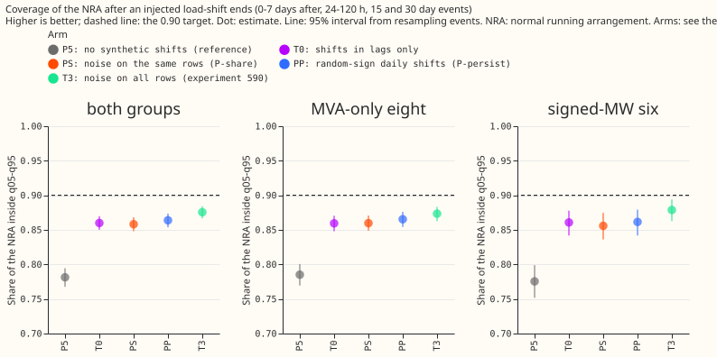

Coverage of the NRA 0 to 7 days after the end; T0, PS, and PP differ by under 0.003 and sit above
P5.

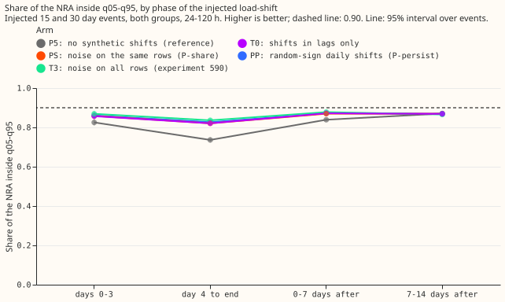

Coverage by phase; the placebos track T0 in every phase.

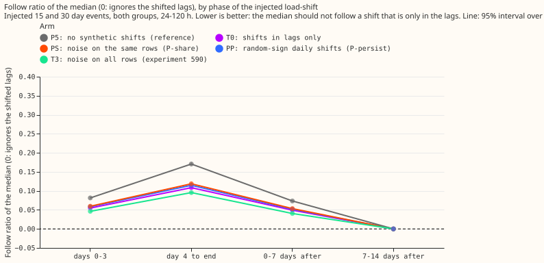

Follow ratio of the median by phase (0 means the median ignores the shift in the lags).

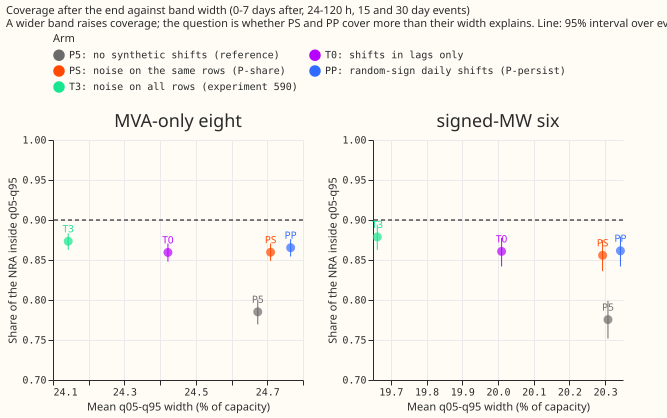

Coverage against band width after the end; PS and PP are 0.3 points of capacity wider than T0.

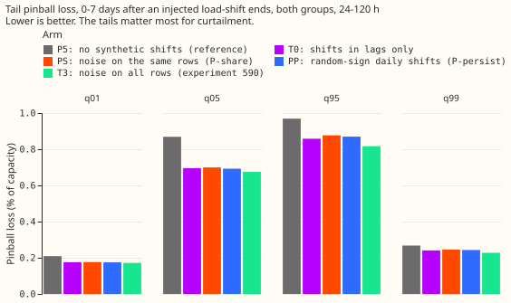

Tail pinball loss after the end.

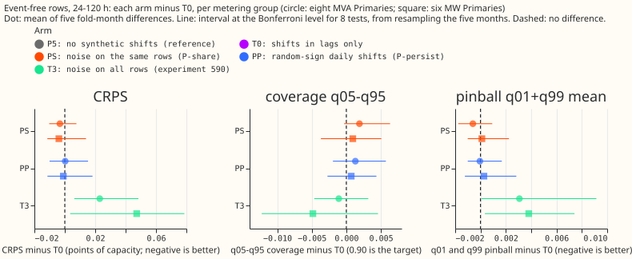

Event-free CRPS, coverage, and tail loss against T0; the placebos are within the intervals of zero.

The next six figures are example forecasts: day-ahead forecasts around four injected events (month
2025-10, the lowest-numbered Primary of each metering group, 15 days at 50% of capacity, up and
down) and around the verified December pair.

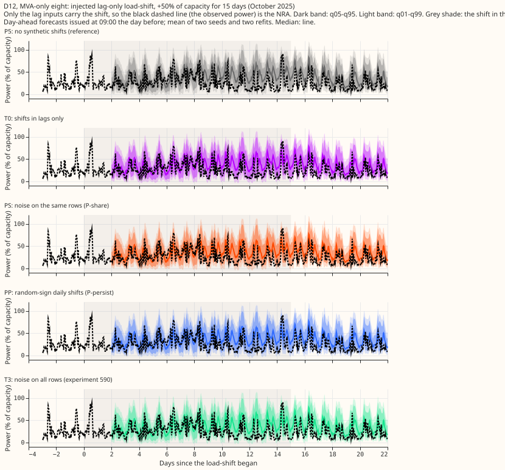

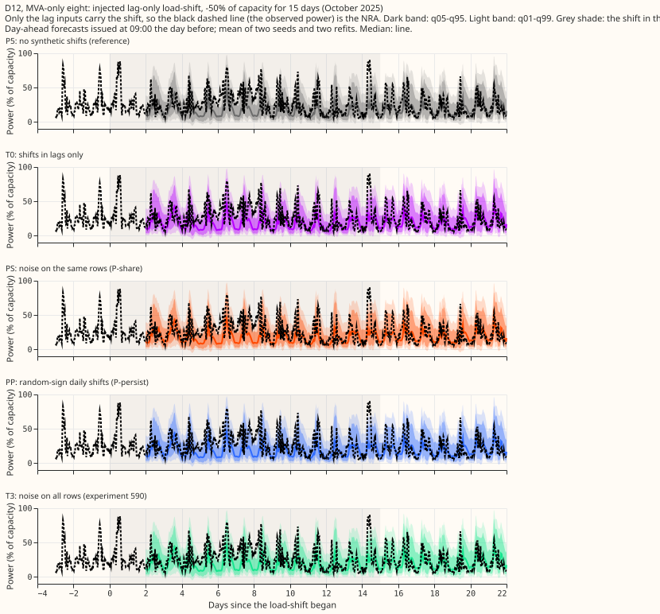

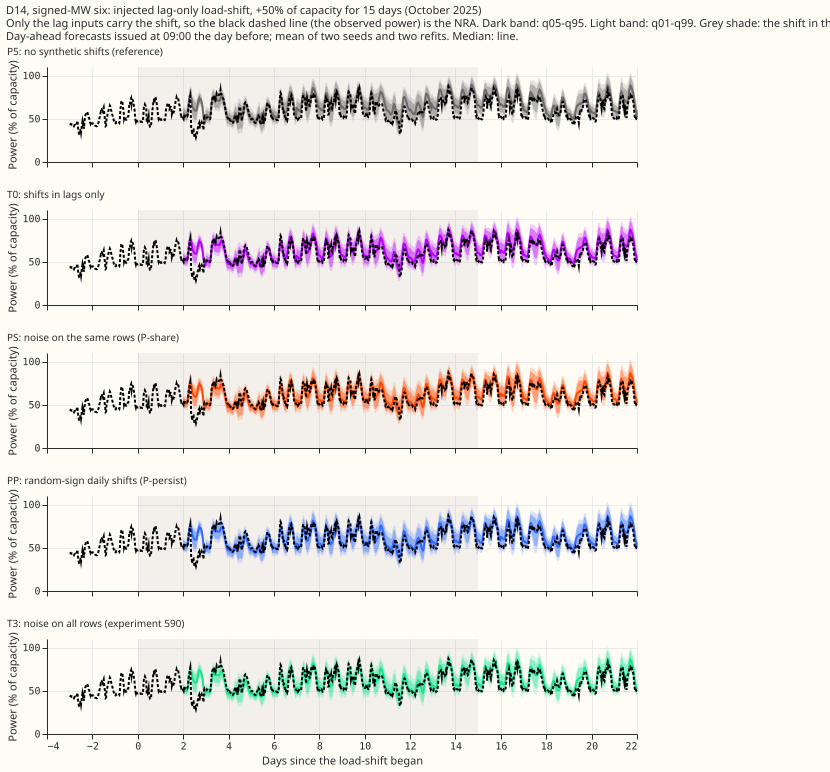

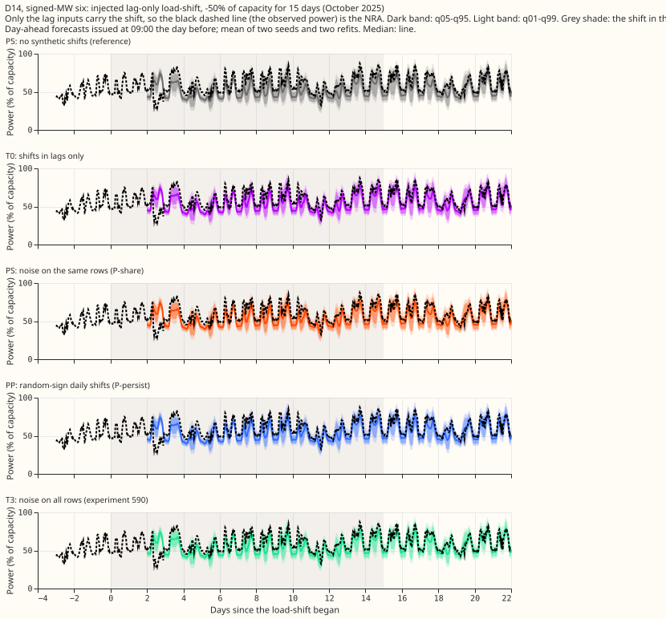

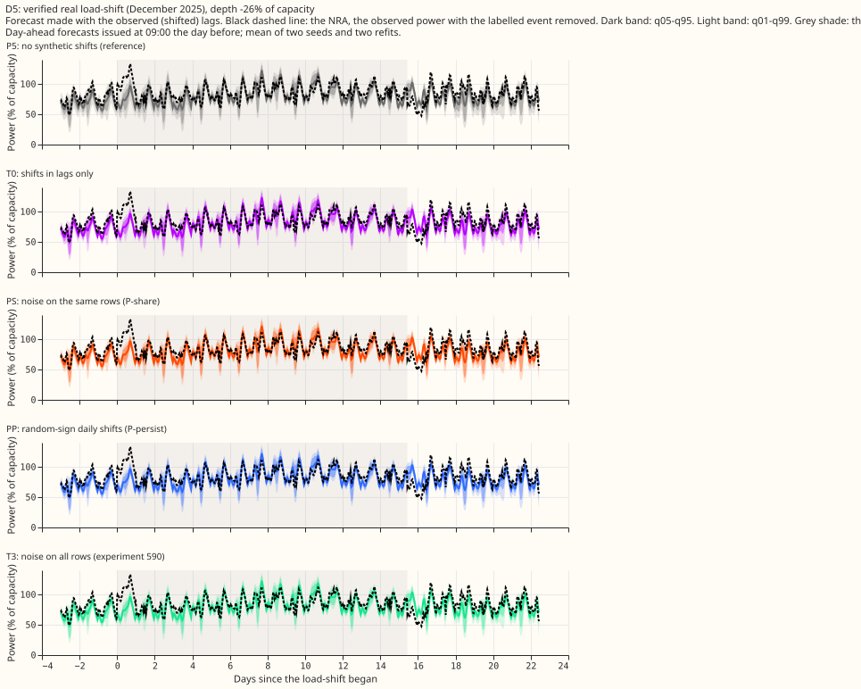

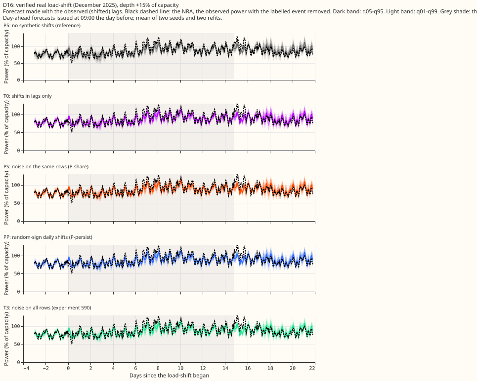

Stored forecasts cover 0 to 120 hours only, so no 14-day horizon plot exists. NGED care about 1 to
10 days, so every number here is a short-lead result.

## Headline numbers

Two definitions of "after the end" appear below, and both are in the printed report. The paired
contrasts and the follow table set the phase by the forecast origin and cover 960 events, which
include the report-only Primaries D15 and D18 (T0 0.872). The per-arm coverage table sets the phase
by the valid time and covers 672 events without them (T0 0.860). The two give the same ordering of
arms.

All numbers come from `report.txt` (script `e00594_report.py`). Counted contrasts: eight, intervals
at
the Bonferroni level for eight tests; the minimum detectable effect (MDE) is the interval half-
width.

- **Coverage 0 to 7 days after the end (unpaired, 672 Primary-events, 15 and 30 days):** P5 0.781,
  T0 0.860, PS 0.858, PP 0.864, T3 0.876. Band width 22.7 (T0), 23.0 (PS), 23.0 (PP), 22.4 (T3),
  23.0
  (P5) % of capacity.
- **Paired contrast against T0 (960 events, both groups):** PS -0.0021 (-0.0036 to -0.0005, MDE
  0.0015); PP +0.0001 (-0.0018 to 0.0019, MDE 0.0018). Pre-registered threshold: 0.01. T3 +0.0061
  and P5 -0.0328 (not counted).
- **Follow ratio of the median 0 to 7 days after the end:** T0 0.049, PS 0.053 (+0.0041, MDE
  0.0005), PP 0.052 (+0.0026, MDE 0.0007), T3 0.041, P5 0.073. Both placebos follow the lags
  slightly more than C1, by under 0.005 of the depth (17% of the gap between C1 and P5 for PS, 11%
  for PP), so shape has a small measurable effect on following, though not on coverage.
- **Safe-side share (NRA below q95 for an upward shift, above q05 for a downward one):** T0 0.911,
  PS 0.908, PP 0.911, T3 0.920, P5 0.875 (paired table, both groups; target 0.95).
- **Tails after the end (pinball x100, both groups, unpaired):** q01 / q05 / q95 / q99 for T0
  0.175 / 0.695 / 0.858 / 0.241, PS 0.176 / 0.699 / 0.877 / 0.245, PP 0.175 / 0.692 / 0.870 / 0.243.
- **By metering group (coverage after the end, paired diff against T0):** eight MVA Primaries PS
  -0.0033, PP -0.0014; six MW Primaries PS -0.0014, PP +0.0012. The sign of PS is negative in both
  groups; the sign of PP changes between groups, and PP's intervals include zero everywhere.
- **Event-free rows (24-120 h, 578,209 rows, five fold months):** CRPS (points of capacity x100) at
  the eight MVA Primaries T0 3.081, PS 3.078 (-0.003, MDE 0.009), PP 3.082 (+0.000, MDE 0.012); at
  the six MW Primaries T0 2.465, PS 2.460 (-0.004, MDE 0.012), PP 2.463 (-0.001, MDE 0.015).
  Coverage of q05-q95 on event-free rows: T0 0.883 (MVA), 0.880 (MW); PS and PP within 0.002.
  T3 raises CRPS by 0.023 (MVA) and 0.047 (MW), with the interval excluding zero.
- **Verified December pair (two Primary-events, too few to separate arms):** after-end coverage D16
  0.824 (T0), 0.825 (PS), 0.827 (PP); D5 0.369, 0.332, 0.345.
- **Events:** the schedule of each placebo equals C1's: 45 to 58 events per fold month, about 7% of
  rows with a changed day lag (0.064 to 0.072). The mean absolute net shift over an event, as a
  share
  of its depth, is 0.03 to 0.04 for PS and 0.25 to 0.28 for PP (short events have few daily blocks,
  so PP's net shift is small but not zero).
- **Choice of block length:** the experiment's brief asks for the sign to be "drawn per half-hour
  block". We used blocks of one day (48 half-hours), because a sign drawn for every single half-hour
  would make the shift average out to noise, as PS already does.
- **Refit schedule and settings:** coarse refits on day 0 and day 14 of each of five fold months
(2025-10,
  2025-12, 2026-01, 2026-03, 2026-06), seeds 0 and 1, experiment 574's P5 recipe, stored
  weights and rows reused. Fitted weights are in the private data folder
  (`00594-.../ps/work/` and `pp/work/`). The training rows, power cleaning, and row cuts are
  experiment 574's, unchanged.
- **Reuse:** C1 from experiment 584, T3 and P5 from experiment 590; code copied from experiment
590's
  folder.

## Checks

- **Median minus mean forecast:** not computed for this experiment.
- **Error of the median beside the quantile contrasts:** the follow ratio of the median is the
median
  contrast; the median forecast's follow ratio moves under 0.005 of the depth while coverage moves
  under 0.003,
  so both contrasts are small.
- **Triggers:** trigger 2 fired (a result contradicts its own prediction: P1 predicted PS 0.03 below
  C1, observed 0.002 below). The audit is triaged under Caveats.
- **Curtailment cost:** not computed; this experiment scores coverage after injected events, not
  curtailment.

## Caveats

- **Audit.** Trigger 2 fired, and a fresh Sonnet agent re-derived the coverage and CRPS numbers
  exactly (report `e594_audit.md` in the private briefs folder). It found no wiring bug: the 20
  weight files per arm differ, the placebo schedule equals C1's, and the noise has the stated
  spread. Triage: accepted the two-definitions note, the scoped headline, and the caveats below.
- **The bank rewards any lag distrust.** Coverage orders the arms the same way as the follow ratio
  (T3 has the lowest following and the highest coverage), so the likeliest reason the placebos match
  C1 is that any training that makes the lags look unreliable helps on this bank. The experiment
  cannot separate that from learning the shape of a shift.
- **PP is not a pure persistence test.** Its shift persists for one day at a time, not for 15 to 30
  days.
- **Small fine-tune.** Every arm moves 2% to 3% (relative L2 distance) from P5's weights and the
  placebos sit 0.9% from C1's, so a small lag encoder may have room for one global "trust the lags
  less" setting. A longer fine-tune or a larger encoder was not tested.
- **Intervals are too narrow.** The event bootstrap treats 960 events as independent, but they share
  20 fine-tuned models, so the PS interval that excludes zero (-0.0036 to -0.0005) should not be
  read as an effect. It is 15 times smaller than the predicted 0.03.

- The injected bank adds a constant lag-only shift, which rewards any lag distrust. It cannot tell a
  network that recognises a persistent shift from one that distrusts lags on some days. A real
  load-shift also moves the target and is mirrored at neighbouring Primaries; the verified December
  pair has two Primary-events only.
- NGED's logs may miss load-shifts, so clean-lag rows may hold events no label covers; the event-
free
  rows are therefore optimistic and the real-event slices undercount.
- Seeds 0 and 1 only, five fold months, coarse refits. The 14-day horizon is not stored.

## Options for later experiments

- Scoring the placebos on an event they cannot imitate, such as a persistent shift mirrored at
  neighbouring Primaries, or more verified real load-shifts, would test the shape of the shift.
- Varying the share of perturbed lag rows (for example 2%, 7%, and 15%) with noise alone would test
  whether that share is the active ingredient. The share is held fixed here, as are the event
  lengths and depths.
