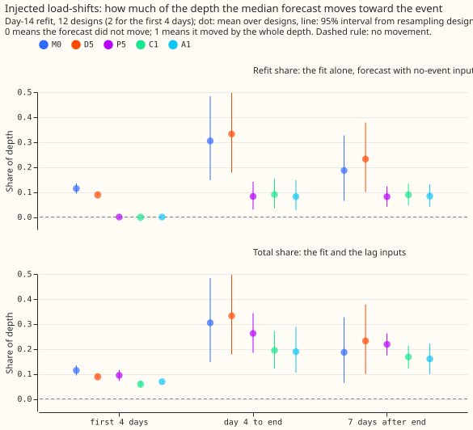
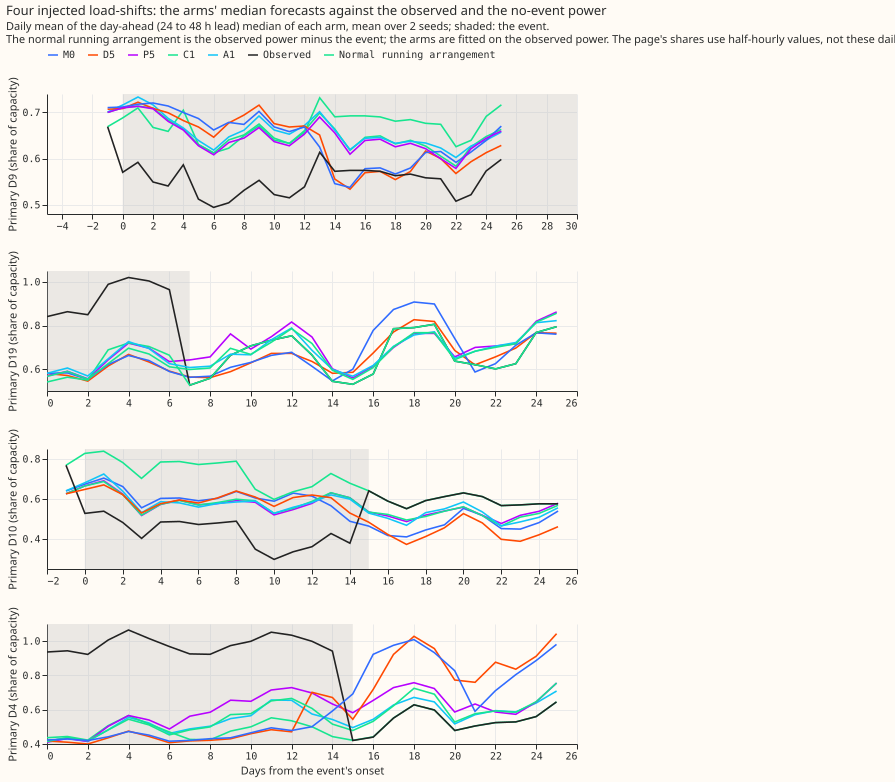
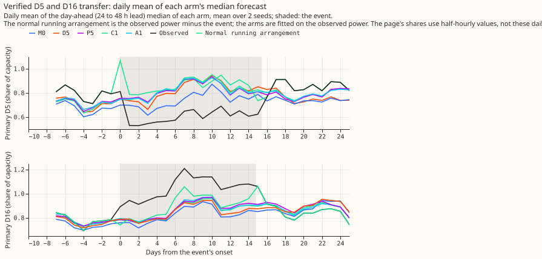

**The two release-candidate demand neural networks, C1 and A1, still learn a load-shift from the
power readings they are refitted on, but less than plain P5 does.** A load-shift moves load between
neighbouring primary substations (Primaries) for days or weeks. Its *depth* is its size as a share
of the Primary's capacity. As in [experiment
587](../00587-absorption-of-verified-and-injected-load-shifts-x5/result.md), we added 12 load-shifts
of known depth to the readings of two connected Primaries, refitted each network on the first day
and the fifteenth day of a month, and measured how far the median forecast moves toward the
load-shift compared with a refit on readings without it. A value of 0 means the forecast did not
move and 1 means it moved by the whole depth. C1 is P5 fine-tuned on synthetic shifts in its lag
inputs ([experiment 584](../00584-nra-candidate-pack-x6/result.md)). A1 shares one lag encoder
across the lags and adds a lag-identity embedding, with the same synthetic-shift fine-tuning
([experiment 591](../00591-shared-lag-encoder-auxiliary-shift-depth-loss/result.md)). P5 is the same
network without the synthetic shifts. M0 has no offset and no lags, and D5 adds the slow output
offset (both from experiment 587). Every share below is at the median forecast (q50) unless a tail
quantile is named.

**Take-home message: C1 and A1 lower the leak a little but do not reach 0.10.** Seven days after an
injected load-shift ends, at the day-14 refit, the median forecast still sits 0.168 (95% interval
0.121 to 0.213) of the depth toward the shift for C1 and 0.160 (0.099 to 0.221) for A1. Plain P5
gives 0.219 (0.174 to 0.262). Both pre-registered predictions (at least 0.15) held. The hypothesis,
that the two arms absorb no less than P5, failed for the total share and held for the refit share.
The drop from P5 is 0.051 for C1 (Bonferroni interval -0.070 to -0.032; minimum detectable effect
0.019) and 0.059 for A1 (-0.114 to -0.010; minimum detectable effect 0.052). The refit alone moves
the median by 0.089 (C1), 0.084 (A1), and 0.082 (P5) of the depth, a difference from P5 of at most
0.007 that we did not test. Total minus refit leaves a lag part of 0.137 (P5), 0.079 (C1), and 0.076
(A1), which matches the day-0 lag following. The proposed bar L4 (at most 0.10) is therefore a
concern for both candidates. The next experiment should test a training change, such as dropping or
down-weighting the newest training rows during a suspected load-shift.

*Figure 1. Share of the depth that the median forecast moves toward an injected load-shift, day-14
refit, 12 designs (2 designs in the first 4 days). Dot: mean over designs; line: 95% interval from
resampling designs. Top panel: the refit alone; bottom panel: the refit and the lag inputs.*

*Figure 2. Four injected load-shifts. Each arm's day-ahead median (daily mean) against the observed
power and the power without the shift (the normal running arrangement). Shaded: the shift.*

*Figure 3. The one verified real transfer (D5 and D16, December 2025). Descriptive only.*

- **Arms.** C1 and A1 fitted with the code of experiments 584 and 591 on the injected power; M0, D5,
  and P5 read from experiment 587's stored forecasts (same designs, folds, seeds, refit days). No
  arm other than C1 and A1 was refitted. Code folders reused: 574, 581, 584, 587, 591.
- **Total share at q50, day-14 refit, mean over designs (95% interval).** First 4 days (2 designs):
  M0 0.114, D5 0.090, P5 0.094, C1 0.060, A1 0.069. Day 4 to the end (9 designs): M0 0.305, D5
  0.332, P5 0.262, C1 0.195 (0.121 to 0.272), A1 0.189 (0.105 to 0.288). 7 days after the end (12
  designs): M0 0.186, D5 0.232, P5 0.219, C1 0.168, A1 0.160. Medians over designs after the end: P5
  0.224, C1 0.173, A1 0.141.
- **Refit share, 7 days after the end.** C1 0.089 (0.047 to 0.133), A1 0.084 (0.041 to 0.131), P5
  0.082 (0.042 to 0.122).
- **Day-0 refit (the shift is not in the training rows).** The total share is the lag following
  alone: 7 days after the end, P5 0.136, C1 0.075, A1 0.077 (6 designs). The synthetic shifts lower
  the lag following by about 45% (descriptive, outside the 6 counted tests).
- **Contrasts.** Counted tests: 6 (C1 minus P5 and A1 minus P5, in three phases, total share, day-14
  refit). C1 minus P5: -0.034 (2 designs), -0.067 (9 designs; minimum detectable effect 0.027),
  -0.051 (12; 0.019). A1 minus P5: -0.025, -0.073 (0.070), -0.059 (0.052). A1 minus C1
  (descriptive): -0.008 after the end (-0.040 to +0.020; 0.030), so the two candidates cannot be
  told apart.
- **Tails, total share 7 days after the end.** q01 / q05 / q95 / q99: P5 0.163 / 0.176 / 0.285 /
  0.291; C1 0.122 / 0.133 / 0.251 / 0.265; A1 0.120 / 0.134 / 0.223 / 0.243. The upper tails move
  further than the median for every arm.
- **Design cells (total share pooled over day 4 to the end and the 7 days after).** The 15-day
  designs that start on day 3 have the highest share (P5 0.357, C1 0.286, A1 0.296); the 15-day
  designs that start on day 12 give 0.122, 0.064, and 0.065.
- **Verified D5/D16 pair (descriptive, 2026-01 day-14 refit, 7 days after the end, total / refit).**
  Primary D5: P5 0.172 / 0.038, C1 0.138 / 0.041, A1 0.141 / 0.051. Primary D16: P5 0.293 / 0.113,
  C1 0.240 / 0.104, A1 0.189 / 0.111.
- **Checks.** The q50 forecast of each new arm's refit on the observed power matches the stored fit
  of experiments 584 and 591 to 2e-6 (mean 1e-8). Cells with fewer than 48 half-hours are dropped
  (6). The score is a share of q50 differences, not a quantile score, so there is no
  median-minus-mean or CRPS contrast to audit; the audit triggers for score contrasts do not apply.
- **Caveats.** Injected shifts are not real ones; the real evidence is one pair. Two seeds. Only 2
  designs fall in the first 4 days, so that phase has wide uncertainty. NGED says load-shift events
  may be missing from its logs, so the clean rows may hold unlabelled events and the shares here
  describe injected shifts only. Weather at lag times: none is used by the share measure; the
  forecasts use the ENS run issued at least 9 h before the forecast origin, as in 587. Nothing is
  adopted.
- **What to try next.** (1) Test a training-side change that targets the refit share (0.08 to 0.09):
  an embargo of the newest rows once a gate fires, or down-weighting rows near a detected shift. (2)
  Repeat the measurement for the gated candidate C1 plus G4 once it is assembled.
- **Reviews.** One fresh Sonnet code review before the first fit found no blocking issue and four
  minor ones (all fixed). A fresh Sonnet write-up review is recorded in the pull request.
- **Data and compute.** Forecasts and fitted weights are in the private folder
  `data/ml-experiments/00595-nra-target-side-absorption-for-p5-lag-encoder-with-synthetic-shifts/`
  (`work/<arm>/<world>/work/{fits,models}`; scores in `scores/`). Fits took about 0.4 GPU-h in
  total, one process at a time.
