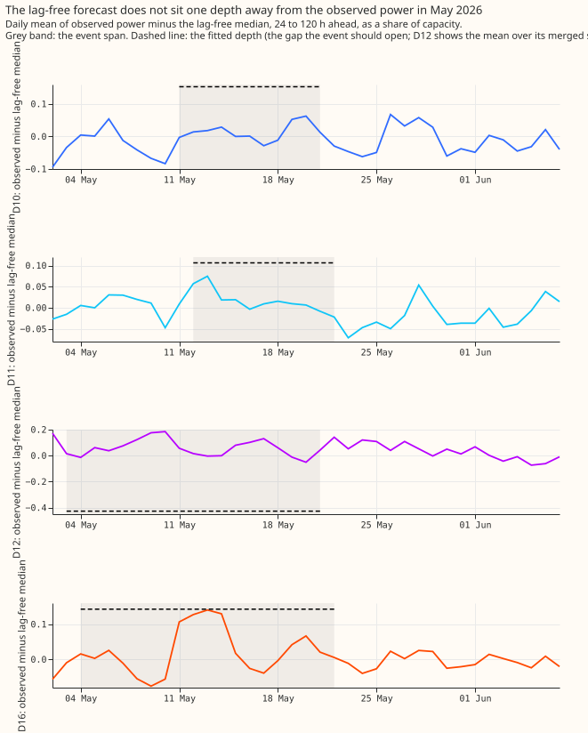
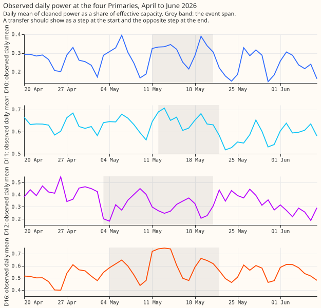
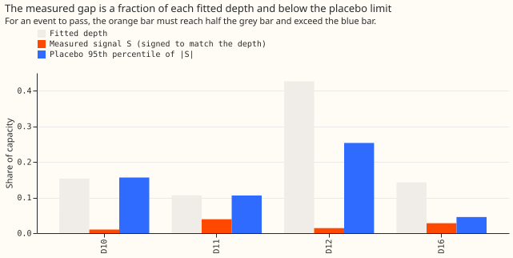

**Take-home message: the four May 2026 load-shifts do not show up in the readings, so they cannot
serve as a second real test.** We asked whether the transfers that NGED logged for May 2026
(Primaries D10, D11, D12, and D16) leave the signature a real transfer should leave. A forecast that
reads no recent power cannot know about a transfer, so inside the event it should sit about one
fitted depth away from the observed power. We measured that gap at 24 to 120 hours ahead, after
taking away the gap in the following week, and compared it with the gaps the same Primary shows on
days with no transfer. **No event passes** (the experiment's verdict is "not supported": the
hypothesis expected at least one pass, and the prediction written first expected none at D10, D11,
and D16). Because none passed, no fine-tune ran, no GPU was used, and the candidate forecast was not
scored on May 2026.

| Primary | Fitted depth (share of capacity) | Measured gap `S` | `S` as a share of depth (rule: 0.5 to 1.5) | Placebo 95th percentile of \|`S`\| (rule: `S` must exceed it) | Passes |
|---|---|---|---|---|---|
| D10 | +0.153 | +0.010 | 0.07 | 0.156 | No |
| D11 | +0.106 | +0.039 | 0.37 | 0.106 | No |
| D12 (three transfers merged) | -0.426 | -0.014 | 0.03 | 0.253 | No |
| D16 | +0.143 | +0.028 | 0.20 | 0.045 | No |

Each event fails the size test, and each also fails the placebo test. The placebo count is 108, 107,
79, and 34 windows for the four Primaries. The step-4 test (a passing Primary on each side of the
transfer) was never reached. No contrast was tested, so there is no Bonferroni count and no minimum
detectable effect to report.

*The dashed line is the gap the fitted depth predicts. The measured gap stays near zero, and at D16
reaches the depth on only 4 days (11 to 14 May).*

*D12's power steps down on about 3 May and back up on about 22 May. D16's power rises on 11 May, not
on 4 May, so the pair does not mirror on the labelled dates. D10 and D11 show no clear step.*

*An event passes only if the orange bar reaches half the grey bar and exceeds the blue bar.*

## What to ask NGED

- **Which Primaries exchanged load in May 2026, and on which days?** The labelled dates (D12 and D16
  from 3 to 21 May, D10 from 11 to 21 May, D11 from 12 to 22 May) do not match a mirrored pair in
  the readings.
- **How large was each transfer in megawatts?** The fitted depths come from steps in the telemetry,
  and the depth of D12 combines three overlapping transfers.
- **Did D12 change its running arrangement on about 3 May and about 22 May?** The observed power at
  D12 steps by roughly the depth of the first transfer on both dates (see the second figure), but no
  Primary mirrors it.

## Caveats and what was not done

- **The lag-free forecast carries a level bias** (experiment 589 found 5 to 9 points of capacity at
  D5 in December 2025), which is why the rule subtracts the following week's gap. A different
  reference window could change a ratio, so the rule's verdict is for this window only.
- **NGED's logs may miss events,** so the readings may hold transfers no label covers.
- **Not done:** the fine-tunes of C1 and A1 for 2026-05, the scoring of C1 plus G4, and any
  measurement of when G4 fires on a May event. Without a confirmed event, those scores would measure
  a forecast against a target that the readings do not show.
- **Reviews:** one Sonnet code review ran before the numbers (it found a mislabelled depth in
  megawatts, which was fixed, and minor notes that the signal averages valid times rather than
  forecast rows and that two ruff docstring rules need attention). A results review and a write-up
  review follow in the pull request.
- **Sources.** Pass rule, placebo, and check table: this folder and
  `ml-experiments/00596-nra-may-2026-transfers-recheck-and-second-real-event/e00596_check.py`.
  Forecasts and transfers: [experiment
  582](https://openclimatefix.github.io/nged-ml-research/ml-experiments/00582-nra-tails-on-verified-load-shift-events/result/)
  and [experiment
  580](https://openclimatefix.github.io/nged-ml-research/ml-experiments/00580-verified-load-shift-event-set-and-label-audit/result/),
  which reuse the code of experiments 400, 565, 572, and 578. The level bias comes from [experiment
  589](https://openclimatefix.github.io/nged-ml-research/ml-experiments/00589-p5-coverage-on-d5-before-the-december-load-shift/result/).

## Pass rule (fixed before any gap was computed, 2026-11-06)

**Rule.** For each Primary-event (D10, D11,
D12, and D16, from the `events_verified` table of experiment 580, with D12's three overlapping
transfers merged as in experiment 582), using the lag-free D5 median at 24 to 120 h lead:

1. **Signal.** `S` is the mean of (observed power minus lag-free median) over the rows whose valid
   time lies from 1 day after the onset to 1 day before the end, minus the same mean over the 7 days
   that start 1 day after the end. All values are shares of effective capacity.
2. **Sign and size.** The event passes only if `S` has the sign of the fitted depth and `S` lies
   between 0.5 and 1.5 times the depth.
3. **Placebo.** `|S|` must also exceed the 95th percentile of `|S|` for the same Primary and the
   same span length, computed over placebo windows slid by one day across the fold months that have
   lag-free forecasts and lie more than 7 days from every verified transfer.
4. **Transfer.** A transfer passes when the Primary on each side passes, the two signals have
   opposite signs, and the signed MW differ in sum by less than 30% of the larger. D12 enters with
   its merged depth, and the three May transfers are judged through D10, D11, and D16 against D12.
5. **Neighbours.** For each passing transfer, the daily mean of the partner Primary is plotted
   beside it, to look for the mirror by eye.

The lag-free forecast carries a level bias of 5 to 9 points of capacity in December 2025
(experiment 589), which is why the signal subtracts the same gap after the span.

**Reported whatever the outcome:** the table of `S`, depth, ratio, placebo p95, and verdict per
Primary-event; time series plots of observed power, lag-free median, and the fitted NRA at all four
Primaries, with the span marked; the daily means of the neighbouring Primaries. The caveat that
NGED's logs may miss events applies throughout. July 2026 is not used.
