**We asked whether a neural network that is given the signals of the hand-built gate can learn to
widen its own forecast band during a load-shift, so that the gate is not needed.** A load-shift moves
part of one Primary substation's demand onto a neighbour for days or weeks. We fine-tuned the A1
network ([experiment
591](https://openclimatefix.github.io/nged-ml-research/ml-experiments/00591-shared-lag-encoder-auxiliary-shift-depth-loss/result/))
on synthetic load-shifts with the gate's signals as extra inputs, and scored it on injected 15 and
30 day load-shifts in 2025-10 and 2025-12 against the A1 network with the G4 gate ([experiment
597](https://openclimatefix.github.io/nged-ml-research/ml-experiments/00597-nra-assemble-c1-and-a1-with-g4-gate-as-single-forecasts/result/)).
The network without the gate covered the normal running arrangement (NRA) inside q05-q95 on 0.888 of
rows from day 4 to the end, against 0.928 with the gate. The stop rule then called for S-g only, which
also failed, so the gate stays. We also ran the noise placebo S-p, which the stop rule would have
dropped, because it is the only way to tell "the signals carry little" from "the signals are in
sample". This is a first-fold-pair result with two seeds, not a five-month
result.

**Verdict: not supported.** P1 failed (gap 0.040), P2 failed, P3 failed, P5 failed at the eight MVA
Primaries, and P4 failed: S is only 0.004 above S-p (-0.008 to 0.014).

## Figures

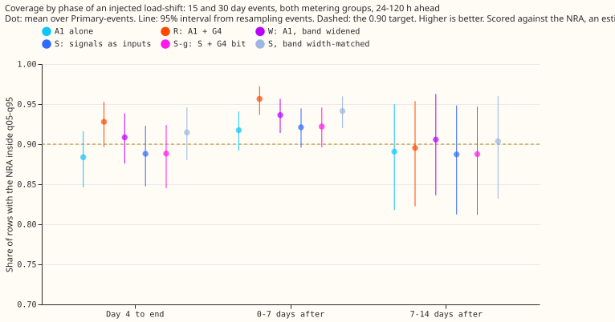

Share of rows with the NRA inside q05-q95, injected 15 and 30 day load-shifts, 24-120 h. Coverage is
scored against the estimated NRA. The gate (R) and the gate on the table T (G4T) lead from day 4 to the
end; S and S-g sit close to plain A1.

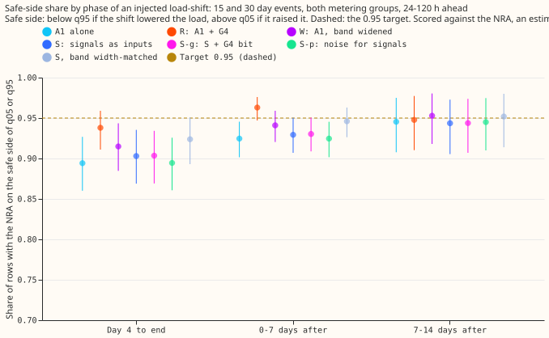

Share of rows with the NRA on the safe side of q05 or q95: look for bars below the dashed 0.95 line.

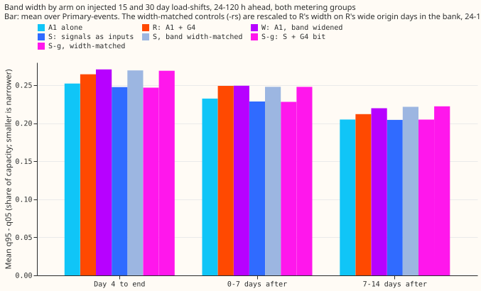

Mean q95 - q05 as a share of R's on the same rows. S is 0.936 of R's width from day 4 to the end;
the width-matched arms are 1.02.

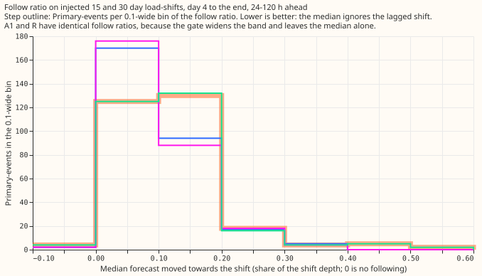

How far the median moved towards the injected shift, event by event (0: ignored the shift). S follows
0.101 of the depth, against R's 0.119.

The next five figures show the December 2025 example event, D5 and D16, from 14 days before to 14
days after, with dashed lines at the maintainer's switch times 2025-12-30 01:00 and 2026-01-14 11:30.
The maintainer's times match the observed steps (summed absolute step 0.90 of capacity, against 0.22
for [experiment
580](https://openclimatefix.github.io/nged-ml-research/ml-experiments/00580-verified-load-shift-event-set-and-label-audit/result/)'s
window about a day earlier). One arm per figure; coverage is scored against an estimated NRA, which
is not drawn. Look at where the observed power (black) leaves the shaded band after the onset, and
at whether the strip under the panel is on while it does. The strip is plotted at valid time (the
origin day plus one), and "on" includes the roughly 7 days the band is held after the gate turns
off. The gate strips of R and S-g were checked against the stored gate state (the 597 `mode_g4.npy`
and the saved S-g bits): both Primaries are on from 2025-12-31 to 2026-01-21. The W band is A1's
band widened by one constant factor, so it looks close to A1's.

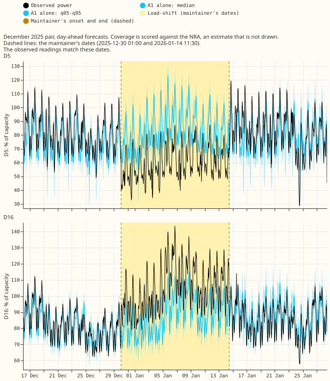

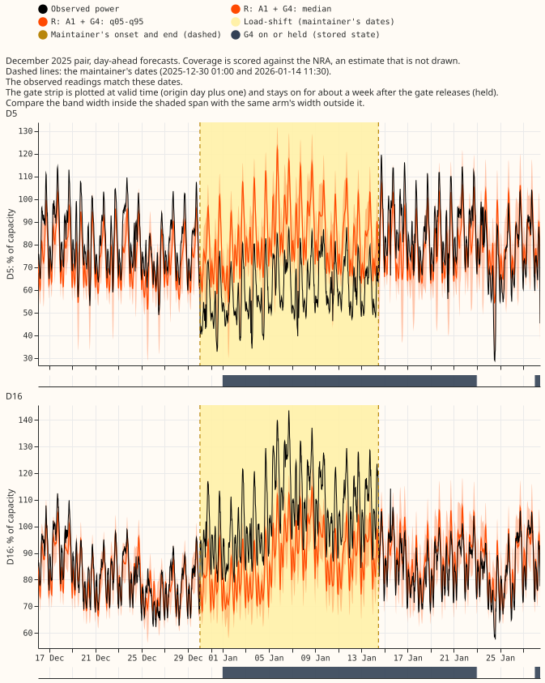

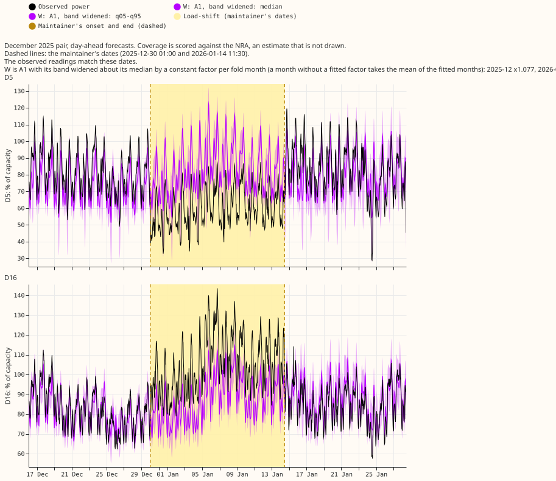

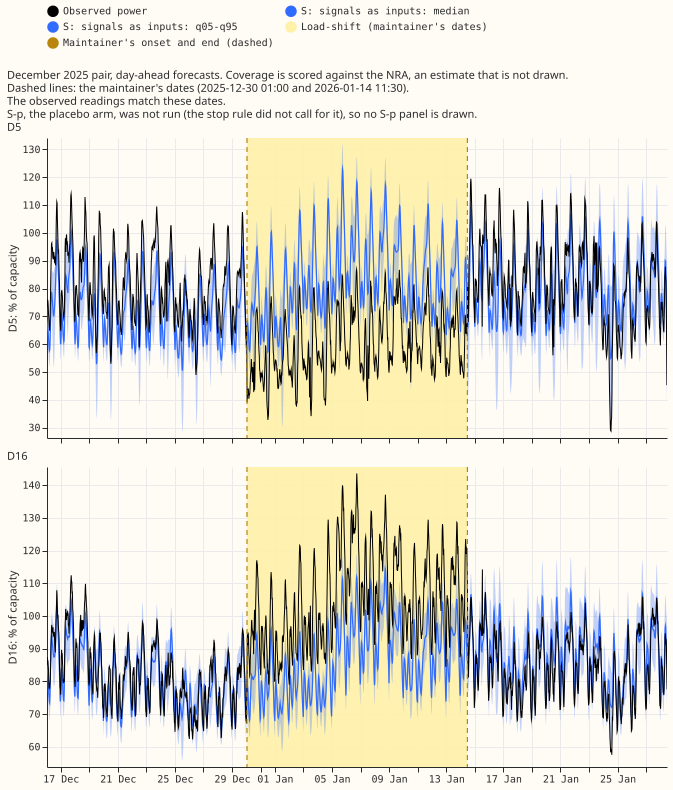

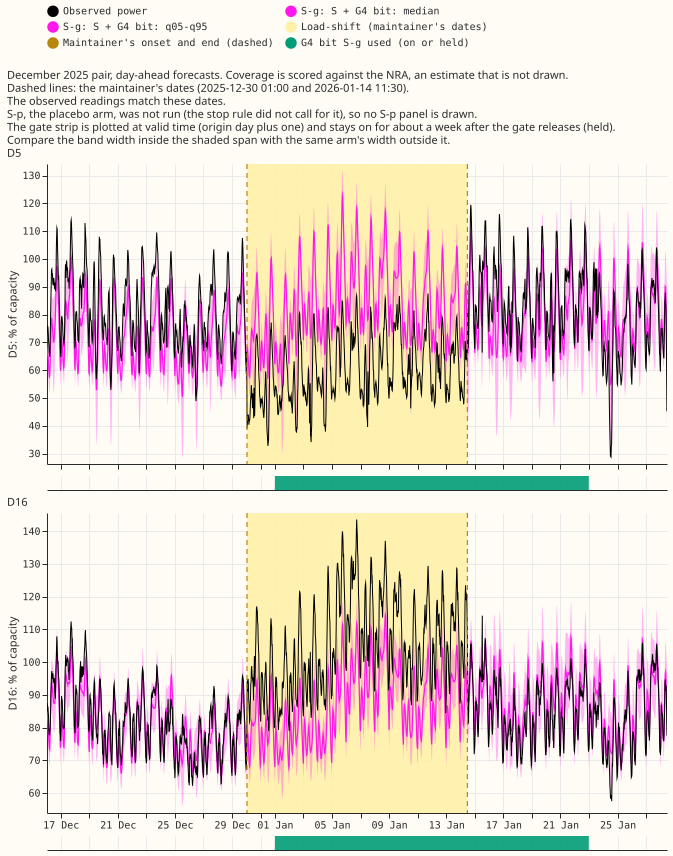

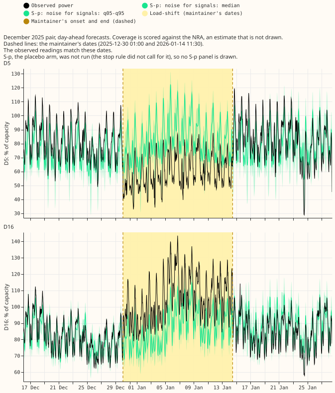

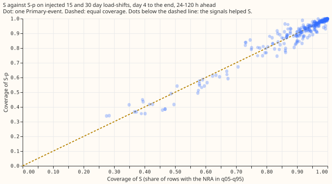

## Results (first fold pair, 2025-10 and 2025-12; 24-120 h; injected 15 and 30 day events)

- **Headline for "is placement worth anything beyond width".** Rescaled to R's width, S covers 0.915
  from day 4 to the end against R's 0.928: a gap of 0.013 (-0.003 to 0.032, MDE 0.017), inconclusive
  at this sample size. Without rescaling the gap is 0.040.
- **Arms.** R: A1 + G4 from experiment 597. W: A1 widened by one constant factor to R's width
  (1.069 and 1.077 by month). S: signals as inputs. S-g: S plus the G4 state bit. `-rs`: each S arm
  rescaled to R's width. G4T: G4 computed on the table T. S-p: the placebo, with noise in place of
  the signals.
- **Day 4 to the end, coverage.** A1 0.884, W 0.909, S 0.888, S-g 0.888, S-rs 0.915, S-g-rs 0.916,
  G4T 0.928, R 0.928. R minus S: 0.040 (0.022 to 0.060, MDE 0.019). R minus S-rs: 0.013 (-0.003 to
  0.032).
- **0 to 7 days after the end.** A1 0.917, W 0.936, S 0.921, S-rs 0.941, R 0.956. P2: S minus W is
  -0.015 (-0.023 to -0.009); S-rs minus W is +0.005 (0.0002 to 0.010), below the 0.03 margin.
- **Follow ratio (P3).** S 0.101 (0.079 to 0.129), R and A1 0.119 (0.092 to 0.163), S-g 0.100. The
  0.08 target was not met; the interval of S includes it.
- **Placebo S-p (P4).** Day 4 to the end 0.884, 0 to 7 days after 0.917, band 0.252 (A1 0.252),
  follow 0.118, event-free CRPS minus A1 -0.0002 (eight MVA) and +0.0017 (six MW). S minus S-p:
  +0.004 (-0.008 to 0.014, MDE 0.011), below the 0.02 margin.
- **Event-free CRPS (P5, S minus A1, points of capacity).** Eight MVA Primaries +0.031 (0.020 to
  0.042, MDE 0.011); six MW Primaries +0.029 (0.001 to 0.056, MDE 0.028). The fixed margin is 0.03.
  Two fold months are two blocks, so these intervals are rough.
- **Tails.** Pinball loss at q05 and q95 for S is within 0.001 of A1 on the injected bank; the
  event-free tail table is in the printed report.
- **Real December pair (descriptive).** Before the event, S covers 0.28 to 0.33 at D5 against 0.59 to
  0.62 for A1 and R, and about the same as A1 at D16 (0.92 against 0.91). From day 4 to the end, all
  arms stay below 0.80 at D5 and D16.
- **Counted tests: 7**, Bonferroni level 0.0071; minimum detectable effects are in the contrasts
  above. P1 is flagged untestable at its 0.01 margin because its MDE is 0.019.

## Checks

- **Gate and rebuilt state.** The rebuilt G4 state equals experiment 592's stored state, and R
  reproduces experiment 597 on its own row sets to within 1e-6.
- **Median minus mean forecast, and the error of the mean forecast beside the quantile contrasts: not
  computed.** The network outputs quantiles, and the median error `ae50` is in the printed report.
- **Triggers fired.** None of the seven fired in a form that changes the verdict: the contrasts agree
  between coverage and CRPS, no nested arm beats its parent, and no later experiment depends on this
  result yet. P4 was run after the stop rule fired and did not trigger one.
- **Reviews.** Sonnet plan review (12 findings, all applied), Sonnet code review (15 findings, 12
  applied or answered, 3 declined), Sonnet figure review (see the pull request).

## Caveats

- **Training signals are in-sample.** The lag-free table T comes from the fold's own A1 step-2
  network, which saw the training rows. In the pre-fit check on 2025-12 with seed 0, two
  Primaries fell below the 0.8 standard-deviation ratio and received added noise; the other folds'
  counts are in the fit logs. S-p (noise with the same per-column
  marginals) is indistinguishable from plain A1, so the network ignores noise inputs. S differs from
  S-p in follow ratio (0.101 against 0.118) and in event-free CRPS (+0.031 against 0 at the eight MVA
  Primaries) without gaining coverage. That fits signals that are used but mismatched between
  training and test, and it does not rule out signals that carry little.
- **Two months only.** The stop rule ended the experiment after the first fold pair, so the five-month
  bake-off was not run. Running S-p after the stop rule fired is a deviation from the stop rule, made
  at the manager's request.
- **Not done:** target-side absorption for R and S (experiment 595's method), the avoidable-curtailment
  cost, and the Bonferroni count above covers only the coverage and event-free CRPS tests.
- **Unlogged events.** NGED's logs may miss load-shifts, so clean rows may hold unlabelled events and
  the real-event slices undercount.
- **Thresholds.** The S-g gate threshold and the training-noise standard deviation use all of the
  fold month's real rows, as R's threshold does.
- **Weather source.** Weather at lag times comes from the run issued at or before the forecast origin
  minus 9 h, so it exists at forecast time.

## What to try next

- Rebuild T from a cross-fitted lag-free network (trained without the block it is applied to) and
  rerun S on the first fold pair, to separate the in-sample explanation.

## Plan (fixed before any score)

- **Arms (all P5 recipe with A1 wiring, fine-tuned on lag-only synthetic shifts mirrored at one
  neighbour).** R: A1 + G4 band (stored from [experiment
  597](https://openclimatefix.github.io/nged-ml-research/ml-experiments/00597-nra-assemble-c1-and-a1-with-g4-gate-as-single-forecasts/result/)).
  W: A1 with the band widened by a constant factor to R's mean width on event rows. S: signals as
  inputs, no gate. S-g: S plus the G4 state bit. S-p: S with noise of the same variance in place of
  the signals.
- **Reuse.** The A1 pre-training and step-2 weights of [experiment
  591](https://openclimatefix.github.io/nged-ml-research/ml-experiments/00591-shared-lag-encoder-auxiliary-shift-depth-loss/result/)
  start every S arm, with the new input columns zero-initialised, so each S arm begins as A1. Only
  the fine-tune is new, which is why the GPU estimate is below the brief's 3 GPU-h ceiling.
- **Cadence.** Coarse refits (day 0 and day 14), as in experiments 584 and 591; seeds 0 and 1; five
  development months 2025-10, 2025-12, 2026-01, 2026-03, 2026-06, first fold pair first. D15 and D18
  are cut before 2025-03-01 and reported only.
- **Where the signals come from (a departure from the brief's wording).** The brief takes the
  disagreement from the lags-masked twin's median. Stored lag-free forecasts exist only for the
  five test months, so training rows would have none. Instead, a frozen copy of the fold's A1
  step-2 network, run with its lags masked, gives a lag-free median and band for every grid time and
  Primary, in training and test months alike (the table `T`). Every signal is then a lookup on `T`
  plus the observed power, as the G4 gate does with E2: the disagreement of each lag with `T` at the
  lag's own time, its sustain count, the fresh residual (observed power minus `T` up to the origin
  minus 4.0 h, never as a lag), the lag ages, the neighbour's disagreement, and `T`'s q05 and q95.
  `T` is in-sample on training rows and out-of-sample on test rows; this is a caveat that S-p tests.
- **No lookahead.** The disagreements and the sustain count use lags at least 24 h old. The fresh
  residual uses power up to the origin minus 4.0 h. A training row's signals use only its own
  synthetic lags and earlier rows.
- **Counted tests.** Seven: P1 (two phases), P2, P3, P4, P5 (two groups). The Bonferroni level and
  the minimum detectable effect are printed beside each contrast.
- **Stop rule.** As in the decision rule. One GPU process at a time under 8 GB; ask the manager
  before crossing 3 GPU-h.
- **Maintainer's example event (2026-11-06).** Plots of forecast behaviour during and after
  load-shifts use the December 2025 pair (D5 and D16), which the maintainer dates "2025-12-30 01:00
  to 2026-01-14 11:30". One figure per Primary shows 14 days before to 14 days after, with dashed
  vertical lines at those two times, for R, W, S, S-g, and S-p. The verified window in [experiment
  580](https://openclimatefix.github.io/nged-ml-research/ml-experiments/00580-verified-load-shift-event-set-and-label-audit/result/)
  is 2025-12-29 to 2026-01-13, about a day earlier. The scoring script checks the readings to see
  which window matches the step, and the caption says which, and does not choose silently. The
  predictions are unchanged.
- **Time-series plot style (maintainer, 2026-11-06).** Every time-series figure has panels at least
  280 px high and at most two panels per figure. Each panel shows one arm's median and q05-q95 band
  with the observed power and the NRA, and a thin strip under the panel marks when the gate is on.
  A legend outside the data area names each line, band, shade, and bar. The five arms (R, W, S,
  S-g, S-p) therefore go in separate figures or small multiples of one arm each, never on one panel.
- **Further figure rules (maintainer, 2026-11-06).** The NRA line is not drawn on time-series plots,
  because it is an estimate, and each caption says coverage is scored against that estimate.
  Observed power is black, no other mark is black or grey, and the load-shift shade is a pale colour
  that no arm uses. A gate strip is checked against the stored gate state before it is published.
  Before the pull request is marked ready, a fresh Sonnet reviewer opens each figure rendered to PNG
  and answers the six-question figure checklist in writing; the pull request body records "figure
  review: passed" with the date.
- **Changes after the Sonnet plan review (all 12 findings accepted; the review is in the private
  briefs folder as `598_plan_review.md`).**
    - **Equal width.** Each S arm also gets a width-matched control: its band rescaled about the
      median so its mean q95 - q05 on R's G4-on-or-held origin days equals R's, one factor per fold
      and seed, printed with its row count. The factor is fitted on the injected bank's 24-120 h
      rows, which are the rows P1 and P2 read. P1 and P2 are read on the rescaled S as well as on
      S, and count as passed only if S's own event-row width is within 5% of R's or the rescaled S
      also passes. W uses the same factor rule applied to R.
    - **Training signals are in-sample.** Cross-fitting the frozen network is too expensive, so a
      pre-fit check prints, per Primary, the standard deviation of the fresh residual and of the lag
      disagreement on training rows against test rows. Where the training-to-test ratio is below
      0.8, Gaussian noise is added to the training-row signals to match the test standard
      deviation, and the write-up says so.
    - **The table.** `T` holds the lag-free median by Primary and grid time, taken from the freshest
      origin that covers it. The lags-masked q05 and q95 are per row (Primary, origin, valid time),
      computed by one masked inference pass over the rows used. The build asserts that no entry
      used for an origin comes from an NWP run issued after that origin.
    - **Signals in training.** The synthetic shift is added to the signal inputs (lag disagreement,
      fresh residual, neighbour disagreement) and not to the target, as `FreshGap.gap(shifts=...)`
      does in experiment 592. The sustain count and the neighbour disagreement are precomputed per
      row from earlier origins only and are zero where history is missing, with an assertion. A
      known-answer row checks the shift reaches each signal.
    - **Reference parity.** A fifth reference, G4 computed on `T` instead of E2, separates the gate
      from the change of expectation. Arm S-p (noise signals, same fine-tune and columns) is the
      second fine-tune of the A1 wiring with no usable signal, so it serves as the parity arm.
    - **Outcome bands.** Gap of S to R in day-4-to-end coverage: under 0.01 passes, 0.01 to 0.03 is
      inconclusive (S-g is not run), 0.03 or more fails (run S-g as the stop rule says).
    - **Detectability.** The minimum detectable effect of every prediction is printed before the
      fits are scored; a prediction whose margin is below its minimum detectable effect is reported
      as untestable. P5's margin is fixed at 0.03 points of capacity of event-free CRPS (S minus A1,
      both metering groups), set before any score; its interval resamples the fold months as
      blocks. R's and S-p's follow ratios are printed beside P3. Contrasts counted: seven, as
      above. S-g, the target-side absorption score (experiment 595's method, for R and S), and
      the real pair are descriptive and uncounted.
- **Standing practices followed.** Monthly-equivalent coarse refits, cleaned data, the D15 and D18
  cut, saved weights, reuse of stored forecasts, tails and avoidable-curtailment cost, load-shift
  event plots (at least 6, both metering groups), example forecasts, and the unlogged-event caveat.

Reviews: one Sonnet plan review, one Sonnet code review before the first fit, one Sonnet write-up
review (details in the pull request).
