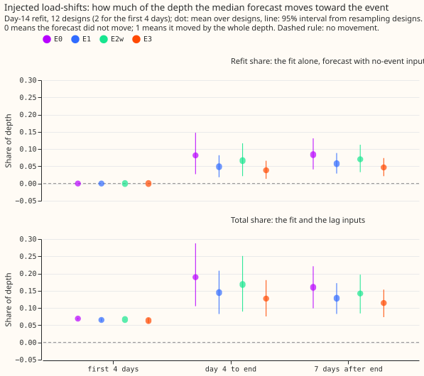
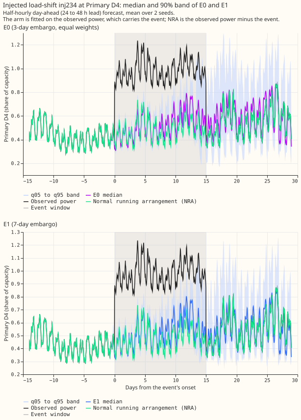
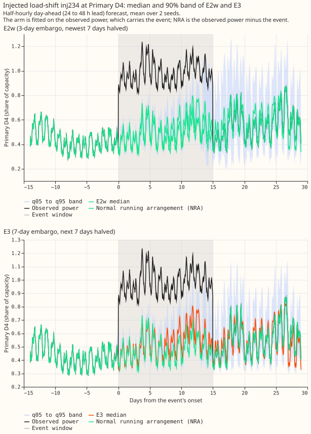
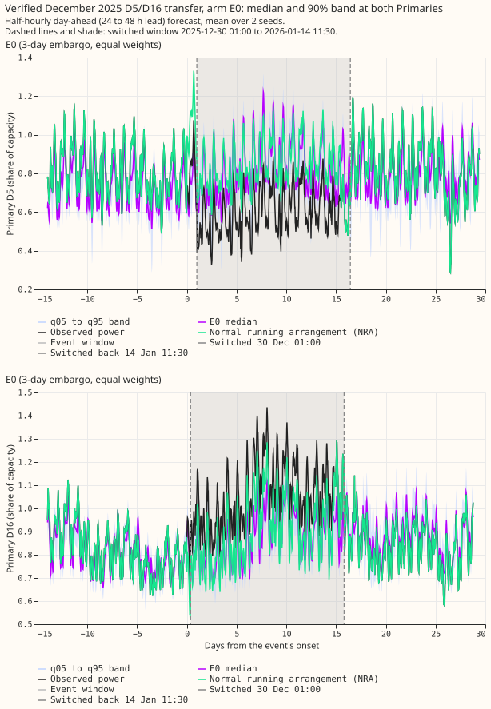
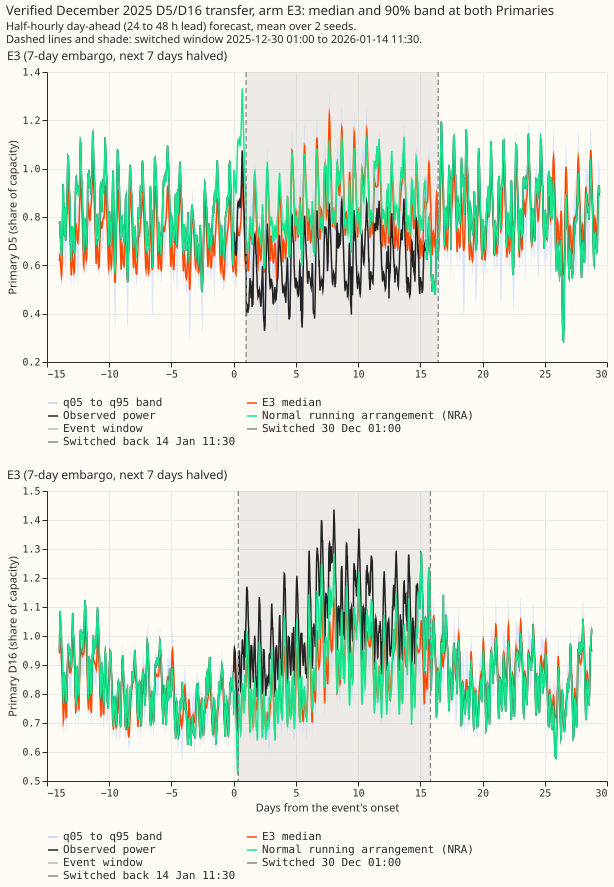

**A longer embargo and down-weighting of the newest rows do lower how much of a load-shift the
refit absorbs, but not enough on their own to reach the proposed bar.** A load-shift moves load
between neighbouring primary substations (Primaries) for days or weeks. Its *depth* is its size as a
share of the Primary's capacity. As in [experiment
595](../00595-nra-target-side-absorption-for-p5-lag-encoder-with-synthetic-shifts/result.md), we
added 12 load-shifts of known depth to the readings of two connected Primaries, refitted the A1
demand neural network on the first and the fifteenth day of a month, and measured how far the median
forecast moves toward the load-shift compared with a refit on readings without it. A value of 0
means the forecast did not move and 1 means it moved by the whole depth. E0 is A1 as stored by
experiment 595. E1 lengthens the embargo of the daily fine-tune from 3 to 7 days. E2w keeps the
3-day embargo and halves the weight of the rows aged 3 to 10 days. E3 does both: a 7-day embargo,
and the rows aged 7 to 14 days halved.

**Take-home message: E3 lowers the share from 0.160 to 0.114 of the depth, but 0.114 is above the
proposed bar of 0.10.** Seven days after an injected load-shift ends, at the day-14 refit, the median
forecast sits 0.114 (95% interval 0.073 to 0.154) of the depth toward the shift for E3, 0.128 (0.083
to 0.172) for E1, 0.142 (0.084 to 0.197) for E2w, and 0.160 (0.099 to 0.221) for E0. The
pre-registered prediction P1 (at least one arm lowers the share by 0.04) holds for E3 only: the drop
is 0.045 (Bonferroni interval -0.080 to -0.020; minimum detectable effect 0.030). E1 drops by 0.032
(-0.063 to -0.010), below the 0.04 target, and E2w by 0.018 (-0.037 to +0.000). Prediction P2 (no
event-free CRPS rise beyond the minimum detectable effect) holds for the eight MVA Primaries and the
six MW Primaries and fails for D15 and D18, which are report-only. Prediction P3 (the 7-day embargo
costs more at 0 to 24 h than later) holds weakly.

*Figure 1. Share of the depth that the median forecast moves toward an injected load-shift, day-14
refit, 12 designs (2 designs in the first 4 days). Dot: mean over designs; line: 95% interval from
resampling designs. Top panel: the refit alone; bottom panel: the refit and the lag inputs.*

*Figure 2. An injected load-shift (design 234, Primary D4, 15 days, 0.5 of the smaller capacity).
One arm per panel: the half-hourly day-ahead median and q05 to q95 band of E0 (top) and E1
(bottom), against the observed power (which carries the shift) and the normal running arrangement
(NRA), the observed power minus the shift. Shaded: the shift.*

*Figure 3. The same load-shift for E2w (top) and E3 (bottom).*

*Figure 4. The one verified real transfer (December 2025), arm E0 at both Primaries, 14 days before
to 14 days after. Dashed lines and shade: the switched window the maintainer gave, 2025-12-30 01:00
to 2026-01-14 11:30. The readings match that window better than experiment 580's window (2025-12-29
to 2026-01-13): the largest 2-hour change at D16 is at 2025-12-30 00:30 to 01:00, and the mean
level around the end changes by 1.6 to 1.7 MW across 2026-01-14 11:30 against 0.3 MW across
2026-01-13 (check in `scores/verified_window_check.txt`). The fits and shares still use 580's window.
Descriptive only.*

*Figure 5. The same transfer for E3.*

- **Arms.** E0 is experiment 595's A1, read from its stored forecasts. E1, E2w, and E3 are the same
  A1 code, with one training-side setting changed in the daily fine-tune: the embargo (E1, E3), and
  a step weight of 0.5 on the rows aged 3 to 10 days (E2w) or 7 to 14 days (E3), on top of the
  existing 90-day recency weight and applied to training and early-stopping rows alike. Step-2
  weights and pre-training are experiment 591's stored A1 chain, which never sees the injected
  shift, so the step-2 embargo stays at 3 days. Code folders reused: 574, 587, 591, 595. Schedule:
  coarse refits on days 0 and 14 of each fold month, seeds 0 and 1, five development months,
  July 2026 unused. A no-change smoke run of the wrapper reproduced experiment 595's A1 to 4e-7 at
  most.
- **Total share at q50, day-14 refit, mean over designs (95% interval).** First 4 days (2 designs):
  E0 0.069, E1 0.065, E2w 0.067, E3 0.063. Day 4 to the end (9 designs): E0 0.189 (0.105 to 0.288),
  E1 0.145 (0.083 to 0.208), E2w 0.168 (0.090 to 0.251), E3 0.127 (0.076 to 0.181). 7 days after the
  end (12 designs): E0 0.160, E1 0.128, E2w 0.142, E3 0.114. Medians over designs after the end: E0
  0.141, E1 0.106, E2w 0.123, E3 0.097.
- **Refit share, 7 days after the end.** E0 0.084 (0.041 to 0.131), E1 0.058 (0.029 to 0.088), E2w
  0.070 (0.033 to 0.113), E3 0.047 (0.021 to 0.074). Total minus refit leaves a lag part of 0.076
  (E0), 0.070 (E1), 0.072 (E2w), and 0.067 (E3). At the day-0 refit, where the shift is not in the
  training rows, every arm gives 0.077 or 0.078, so the arms differ only through the refit.
- **Contrasts.** Counted tests: 3 (E1, E2w, and E3 minus E0, total share, 7 days after the end,
  paired by design). E1 minus E0: -0.032 (Bonferroni interval -0.063 to -0.010; minimum detectable
  effect 0.026). E2w minus E0: -0.018 (-0.037 to +0.000; 0.019). E3 minus E0: -0.045 (-0.080 to
  -0.020; 0.030). Descriptive, day 4 to the end: E1 -0.045, E2w -0.021, E3 -0.062.
- **Tails, total share 7 days after the end.** q01 / q05 / q95 / q99: E0 0.120 / 0.134 / 0.223 /
  0.243; E1 0.089 / 0.104 / 0.181 / 0.203; E2w 0.101 / 0.115 / 0.205 / 0.229; E3 0.084 / 0.098 /
  0.157 / 0.179. The tails fall by the same amount as the median, and the upper tails stay further
  from zero than the median for every arm.
- **Event-free CRPS (arm fitted on the observed power, all five months, mean pinball-based CRPS in
  MW over the 0.01 to 0.99 levels, mean over Primary-by-month cells; minus E0, 95% interval).** The
  eight MVA Primaries (E0 0.3675 MW): E1 +0.0000 (-0.0023 to +0.0022), E2w +0.0005 (-0.0008 to
  +0.0019), E3 +0.0005 (-0.0021 to +0.0030; minimum detectable effect 0.0026). The six MW Primaries
  (E0 0.3102 MW): E1 +0.0024 (-0.0013 to +0.0061), E2w +0.0007 (-0.0010 to +0.0025), E3 +0.0031
  (-0.0013 to +0.0072; 0.0043). D15 and D18 (report-only, E0 0.3543 MW): E1 +0.0144 (+0.0033 to
  +0.0312), E2w +0.0065 (+0.0019 to +0.0120), E3 +0.0179 (+0.0053 to +0.0358).
- **Cost to forecast freshness (CRPS at 0 to 24 h lead against 24 h and later).** E3 minus E0: eight
  MVA Primaries +0.0025 at 0 to 24 h and +0.0002 later; six MW Primaries +0.0044 and +0.0029. E1
  minus E0: +0.0020 and -0.0002 (MVA), +0.0041 and +0.0022 (MW). The short leads cost most, as
  predicted, but by 1 to 2% and inside the minimum detectable effect.
- **Tail calibration on event-free rows (coverage of q05 to q95; share below q01; share above q99).**
  Eight MVA Primaries: E0 0.865 / 0.0121 / 0.0240, E3 0.867 / 0.0117 / 0.0224. Six MW Primaries: E0
  0.830 / 0.0214 / 0.0426, E3 0.817 / 0.0216 / 0.0477. D15 and D18: E0 0.845 / 0.0111 / 0.0387, E3
  0.831 / 0.0108 / 0.0444. The six MW Primaries lose 1.3 points of coverage with E3, and the
  upper tail (above q99) gets worse for them.
- **Verified D5/D16 pair (descriptive, 2026-01 day-14 refit, 7 days after the end, total / refit).**
  D5: E0 0.141 / 0.051, E1 0.126 / 0.029, E2w 0.129 / 0.037, E3 0.114 / 0.012. D16: E0 0.189 /
  0.111, E1 0.150 / 0.069, E2w 0.155 / 0.082, E3 0.119 / 0.041. The real pair moves the same way as
  the injected ones.
- **What a longer embargo costs a real tracking forecast.** A 7-day embargo means a genuine,
  permanent level change enters the fine-tune 4 days later than with a 3-day embargo. This
  experiment scored no such change, so the delay is unmeasured. The event-free CRPS, which includes
  ordinary drift, did not rise measurably at 14 of 16 Primaries and rose by 4 to 5% at D15 and D18.
- **Checks.** A fresh Sonnet agent re-derived the four shares independently (0.1599, 0.1283, 0.1421,
  and 0.1144) and found no audit trigger: the rows match across arms, no quantiles cross, and E3
  minus E0 is negative or about zero in all 12 designs (more than 0.02 below in 8; design 83 is the
  largest at -0.178, and without it the mean is still -0.034). Its CRPS level for the eight MVA
  Primaries was about 0.001 MW lower than the table's (cell weighting), with the same E3 minus E0
  sign and size (+0.0002 against +0.0004).
  Cells with fewer than 48 half-hours are dropped (12 of 580). The CRPS omits the two outer strips
  of the distribution for every arm alike. The intervals for CRPS resample Primary-by-month cells as
  independent, so they are approximate. There is no median-minus-mean check because the stored
  forecasts hold quantiles only.
- **Caveats.** Injected shifts are not real ones; the real evidence is one pair. Two seeds. Two
  designs fall in the first 4 days. The step-2 weights keep their 3-day embargo. NGED says
  load-shift events may be missing from its logs, so the clean rows may hold unlabelled events, and
  the event-free CRPS may include some of them. Weather: the ENS run issued at least 9 h before the
  forecast origin, as in 595. Nothing is adopted.
- **What to try next.** (1) Test an embargo and down-weighting that start only when a gate fires, so
  that ordinary periods keep the 3-day embargo. (2) Measure the delay cost on genuine permanent
  level changes (the real pair after the switch-back is one). (3) Repeat with C1 plus G4 once
  assembled. (4) Check D15 and D18 separately for a shorter embargo.
- **Reviews.** One fresh Sonnet code review before the fits found no blocking issue and six minor
  ones (four fixed, two noted in the checks above). One fresh Sonnet agent re-derived the headline
  numbers. A fresh Sonnet write-up review is recorded in the pull request.
- **Data and compute.** Forecasts and fitted weights are in the private folder
  `data/ml-experiments/00599-nra-refit-embargo-and-down-weighting-of-the-newest-rows-against-load-shift-absorption/`
  (`work/<arm>/<world>/work/{fits,models}`; scores in `scores/`). Fits took about 0.55 GPU-h in total,
  one process at a time.
